## Introduction

In late 2025, I ran across a paper by Lewis Glenn entitled "Long-Term Investing in Triple Leveraged Exchange Traded Funds." The paper explores the performance and risks associated with holding triple leveraged ETFs over extended periods, and proposes an investment strategy involving rebalancing two triple leveraged ETFs (abbreviated "TLETFs") on a bimonthly schedule. From the abstract:

> "The phrase long-term investing in triple leveraged ETFs is somewhat of an anathema for investment academicians. As a result of daily rebalancing and so-called beta slippage or “the constant leverage trap” it is highly likely over the long term to significantly deviate from the targeted leverage and, in so doing, generate wipeout losses. In fact, the data show that many 3X leveraged ETFs have performed poorly over the long term in the period of their existence. However, there are some significant exceptions. The 3X leveraged Nasdaq ETF, TQQQ, for example has delivered a total return exceeding 10,000% (CAGR of 54.4%) over the 10+ years of its existence, more than 13 times the total return of its underlying ETF (QQQ). Similar, but less impressive numbers have been achieved with triple leveraged ETFs that target the S&P 500 and the Dow Industrials."
>
> "These results, however, are accompanied by excessive volatility and very large maximum end-of-month (EOM) draw downs, in excess of 49% for TQQQ, and with maximum daily drawdown of almost 70%. Many retail investors would be unwilling to sustain such (paper) losses. Here we propose a strategy to mitigate these large draw downs while still retaining much of the upside performance of triple leveraging. We show that by simply establishing a portfolio consisting of an equal dollar amount of TQQQ and TMF (the triple leveraged ETF linked to the 20+ year treasury bond), and performing bimonthly rebalancing, a total return, after transaction costs, in excess of 5,800% (CAGR of 44.9%) would have been achieved over the 10+ years of TQQQ existence, with the maximum EOM draw down less than 25%."

The paper was published (or dated, at least) November 7, 2020. In this piece, we will attempt to reproduce the results of the investment strategy presented in the paper section by section, and examine whether the impressive performance in sample has continued.

A note on the numbering of figures and tables: figures that reproduce a figure from the paper use the same number as the paper (for example, Figure 1), with a letter added when we split one of the paper's figures into several plots (for example, Figures 9a, 9b, and 9c). Figure 10 from the paper is reproduced as a table. Figure 6 is omitted due to data limitations, and figure 11 (a pseudo-code diagram) is discussed but not reproduced. All figures and tables that do not appear in the paper are numbered with an "E" prefix (for example, Figure E1 and Table E1).

## Python Imports


```python
# Standard Library
import os
import sys
import warnings

from pathlib import Path

# Data Handling
import pandas as pd

# Suppress warnings
warnings.filterwarnings("ignore")
```


```python
# Add the source subdirectory to the system path to allow import config from settings.py
current_directory = Path(os.getcwd())
website_base_directory = current_directory.parent.parent.parent
src_directory = website_base_directory / "src"
sys.path.append(str(src_directory)) if str(src_directory) not in sys.path else None

# Import settings.py
from settings import config

# Add configured directories from config to path
SOURCE_DIR = config("SOURCE_DIR")
(
    sys.path.append(str(Path(SOURCE_DIR)))
    if str(Path(SOURCE_DIR)) not in sys.path
    else None
)

# Add other configured directories
BASE_DIR = config("BASE_DIR")
CONTENT_DIR = config("CONTENT_DIR")
POSTS_DIR = config("POSTS_DIR")
PAGES_DIR = config("PAGES_DIR")
PUBLIC_DIR = config("PUBLIC_DIR")
SOURCE_DIR = config("SOURCE_DIR")
DATA_DIR = config("DATA_DIR")
DATA_MANUAL_DIR = config("DATA_MANUAL_DIR")
```

## Python Functions

Here are the functions needed for this project:

* [load_data](/posts/reusable-extensible-python-functions-financial-data-analysis/#load_data): Load data from a CSV, Excel, or Pickle file into a pandas DataFrame.
* [pandas_set_decimal_places](/posts/reusable-extensible-python-functions-financial-data-analysis/#pandas_set_decimal_places): Set the number of decimal places displayed for floating-point numbers in pandas.
* [plot_time_series](/posts/reusable-extensible-python-functions-financial-data-analysis/#plot_time_series): Plot the timeseries data from a DataFrame for a specified date range and columns.
* [run_regression](/posts/reusable-extensible-python-functions-financial-data-analysis/#run_regression): Run a linear regression using statsmodels OLS and return the results.
* [summary_stats](/posts/reusable-extensible-python-functions-financial-data-analysis/#summary_stats): Generate summary statistics for a series of returns.
* [yf_pull_data](/posts/reusable-extensible-python-functions-financial-data-analysis/#yf_pull_data): Download daily price data from Yahoo Finance and export it.


```python
from load_data import load_data
from pandas_set_decimal_places import pandas_set_decimal_places
from plot_time_series import plot_time_series
from run_regression import run_regression
from summary_stats import summary_stats
from yf_pull_data import yf_pull_data
```

## Data Overview

For this exercise, we will use the following ETFs:

* TQQQ - ProShares UltraPro QQQ
* QQQ - Invesco QQQ Trust
* UPRO - ProShares UltraPro S&P 500
* SPY - SPDR S&P 500 ETF Trust
* UDOW - ProShares UltraPro Dow30
* DIA - SPDR Dow Jones Industrial Average ETF Trust
* TNA - Direxion Daily Small Cap Bull 3X Shares
* IWM - iShares Russell 2000 ETF
* TMF - Direxion Daily 20+ Year Treasury Bull 3X Shares
* TLT - iShares 20+ Year Treasury Bond ETF
* EDC - Direxion Daily MSCI Emerging Markets Bull 3X Shares
* EEM - iShares MSCI Emerging Markets ETF
* IEF - iShares 7-10 Year Treasury Bond ETF (used for the "black swan" filter in section 3.2)
* AGG - iShares Core U.S. Aggregate Bond ETF (used in extension 3)

We'll use the adjusted close prices for each of these ETFs.

The paper also used the following funds:

* DZK - Direxion Daily MSCI Developed Markets Bull 3X Shares
* EFA - iShares MSCI EAFE ETF

But we will omit these due to DZK being delisted.

## Acquire Data

First, let's get the data for these ETFs. If we already have the desired data, we can load it from a local pickle file. Otherwise, we can download it from Yahoo Finance using the `yf_pull_data` function.


```python
pandas_set_decimal_places(2)

# Create a list of the ETF tickers
fund_list = [
    "TQQQ",
    "QQQ",
    "UPRO",
    "SPY",
    "UDOW",
    "DIA",
    "TNA",
    "IWM",
    "TMF",
    "TLT",
    "EDC",
    "EEM",
]
```


```python
# Pull data for each ETF and cache it locally
for fund in fund_list:
    yf_pull_data(
        base_directory=DATA_DIR,
        ticker=fund,
        adjusted=False,
        source="Yahoo_Finance",
        asset_class="Exchange_Traded_Funds",
        excel_export=True,
        pickle_export=True,
        output_confirmation=False,
    )
```

## Create Data Dictionary

Then, create a dictionary to hold the data for each ETF.


```python
# Create an empty dictionary to hold the data for each ETF
fund_data = {}

# Load the data for each ETF, rename the columns to include the ticker, store it in the fund_data dictionary
for fund in fund_list:
    data = load_data(
        base_directory=DATA_DIR,
        ticker=fund,
        source="Yahoo_Finance",
        asset_class="Exchange_Traded_Funds",
        timeframe="Daily",
        file_format="pickle",
    )

    data = data.rename(
        columns={
            "Adj Close": f"{fund}_Adj_Close",
            "Close": f"{fund}_Close",
            "High": f"{fund}_High",
            "Low": f"{fund}_Low",
            "Open": f"{fund}_Open",
            "Volume": f"{fund}_Volume",
        }
    )

    fund_data[fund] = data
```

## Section 2.0: Long-term Empirical behavior of Triple Leveraged Exchange Traded Funds

Section 2.0 of the paper establishes some baseline definitions, specifically CAGR (referenced in the paper as cumulative annualized growth rate, but more commonly as compound annual growth rate), DDD (daily drawdown, daily and maximum), and MDD (monthly drawdown, monthly and maximum).

The following two helper functions will combine and normalize the fund prices, and calculate the summary statistics.


```python
def combine_normalize(
    fund_data: dict,
    lev_etf: str,
    etf: str,
    start_date=None,
    end_date=None,
) -> pd.DataFrame:
    """
    Combine and normalize the data for a leveraged ETF and its corresponding non-leveraged ETF.

    Parameters
    ----------
    fund_data : dict
        Dictionary containing DataFrames for each fund.
    lev_etf : str
        The ticker symbol for the leveraged ETF.
    etf : str
        The ticker symbol for the non-leveraged ETF.
    start_date : optional,
        Start date for the data. If None, uses the earliest available date (default is None).
    end_date : optional
        End date for the data. If None, uses the latest available date (default is None).

    Returns
    -------
    pd.DataFrame
        DataFrame with normalized values for both ETFs.
    """

    # Combine into a single DataFrame
    df = fund_data[lev_etf].merge(fund_data[etf], left_index=True, right_index=True)

    # Normalize values to start at 1
    df = df / df.iloc[0]

    # Set start and end dates
    if start_date is None:
        start_date = df.index.min()
    if end_date is None:
        end_date = df.index.max()

    df = df.loc[start_date:end_date]

    return df
```


```python
def calculate_returns_stats(
    df: pd.DataFrame,
    lev_etf: str,
    etf: str,
    max_per_ratio_date=None,
) -> pd.DataFrame:
    """
    Calculate and display summary statistics for the returns of a leveraged ETF and its corresponding non-leveraged ETF.

    Parameters
    ----------
    df : pd.DataFrame
        DataFrame containing the adjusted close prices of the ETFs.
    lev_etf : str
        Ticker symbol of the leveraged ETF.
    etf : str
        Ticker symbol of the non-leveraged ETF.
    max_per_ratio_date : optional
        Date of the maximum performance ratio. If provided, the CAGR is calculated through this date, while
        all other statistics use the full date range. If None, the CAGR uses the full date range (default is None).

    Returns
    -------
    pd.DataFrame
        DataFrame containing the summary statistics for both ETFs, including the maximum monthly drawdown
        calculated from end-of-month prices only.
    """

    df[f"{lev_etf}_Return"] = df[f"{lev_etf}_Adj_Close"].pct_change()
    df[f"{etf}_Return"] = df[f"{etf}_Adj_Close"].pct_change()

    # Create empty DataFrame for summary statistics
    sum_stats = pd.DataFrame()

    df_lev_stats = summary_stats(
        fund_list=[f"{lev_etf}"],
        df=df[[f"{lev_etf}_Return"]].dropna(),
        period="Daily",
        use_calendar_days=False,
        excel_export=False,
        pickle_export=False,
        output_confirmation=False,
    )

    sum_stats = pd.concat([sum_stats, df_lev_stats])

    df_etf_stats = summary_stats(
        fund_list=[f"{etf}"],
        df=df[[f"{etf}_Return"]].dropna(),
        period="Daily",
        use_calendar_days=False,
        excel_export=False,
        pickle_export=False,
        output_confirmation=False,
    )

    sum_stats = pd.concat([sum_stats, df_etf_stats])

    # Replace the CAGR with the CAGR through the maximum performance ratio date, if provided
    if max_per_ratio_date is not None:
        for fund in [lev_etf, etf]:
            df_cagr_stats = summary_stats(
                fund_list=[f"{fund}"],
                df=df.loc[:max_per_ratio_date, [f"{fund}_Return"]].dropna(),
                period="Daily",
                use_calendar_days=False,
                excel_export=False,
                pickle_export=False,
                output_confirmation=False,
            )

            sum_stats.loc[f"{fund}_Return", "CAGR (Geometric)"] = df_cagr_stats.loc[
                f"{fund}_Return", "CAGR (Geometric)"
            ]

    # Record the end date used for the CAGR
    sum_stats["CAGR End Date"] = (
        max_per_ratio_date
        if max_per_ratio_date is not None
        else df.index.max().strftime("%Y-%m-%d")
    )

    # Calculate the maximum monthly drawdown using end-of-month prices only
    for fund in [lev_etf, etf]:
        month_end_prices = df[f"{fund}_Adj_Close"].resample("ME").last()
        sum_stats.loc[f"{fund}_Return", "Max Monthly Drawdown"] = (
            month_end_prices / month_end_prices.cummax() - 1
        ).min()

    return sum_stats
```

### Figure 1: Comparing the normalized value of TQQQ with its underlying index

First, we will plot TQQQ and QQQ to match figure 1. Note that the data from the paper is normalized to begin at 1, so we will follow that approach as well.


```python
lev_etf = "TQQQ"
etf = "QQQ"
end_date = "2020-10-04"

df = combine_normalize(
    fund_data=fund_data,
    lev_etf=lev_etf,
    etf=etf,
    start_date=None,
    end_date=end_date,
)

print(f"Table E1: {lev_etf} & {etf} Normalized Data")
display(df)
```

    Table E1: TQQQ & QQQ Normalized Data


<div>
<style scoped>
    .dataframe tbody tr th:only-of-type {
        vertical-align: middle;
    }

    .dataframe tbody tr th {
        vertical-align: top;
    }

    .dataframe thead th {
        text-align: right;
    }
</style>
<table border="1" class="dataframe">
  <thead>
    <tr style="text-align: right;">
      <th></th>
      <th>TQQQ_Adj_Close</th>
      <th>TQQQ_Close</th>
      <th>TQQQ_High</th>
      <th>TQQQ_Low</th>
      <th>TQQQ_Open</th>
      <th>TQQQ_Volume</th>
      <th>QQQ_Adj_Close</th>
      <th>QQQ_Close</th>
      <th>QQQ_High</th>
      <th>QQQ_Low</th>
      <th>QQQ_Open</th>
      <th>QQQ_Volume</th>
    </tr>
    <tr>
      <th>Date</th>
      <th></th>
      <th></th>
      <th></th>
      <th></th>
      <th></th>
      <th></th>
      <th></th>
      <th></th>
      <th></th>
      <th></th>
      <th></th>
      <th></th>
    </tr>
  </thead>
  <tbody>
    <tr>
      <th>2010-02-11</th>
      <td>1.00</td>
      <td>1.00</td>
      <td>1.00</td>
      <td>1.00</td>
      <td>1.00</td>
      <td>1.00</td>
      <td>1.00</td>
      <td>1.00</td>
      <td>1.00</td>
      <td>1.00</td>
      <td>1.00</td>
      <td>1.00</td>
    </tr>
    <tr>
      <th>2010-02-12</th>
      <td>1.00</td>
      <td>1.00</td>
      <td>1.01</td>
      <td>1.03</td>
      <td>1.03</td>
      <td>2.49</td>
      <td>1.00</td>
      <td>1.00</td>
      <td>1.00</td>
      <td>1.01</td>
      <td>1.01</td>
      <td>1.01</td>
    </tr>
    <tr>
      <th>2010-02-16</th>
      <td>1.04</td>
      <td>1.04</td>
      <td>1.04</td>
      <td>1.08</td>
      <td>1.09</td>
      <td>2.78</td>
      <td>1.01</td>
      <td>1.01</td>
      <td>1.01</td>
      <td>1.03</td>
      <td>1.02</td>
      <td>0.90</td>
    </tr>
    <tr>
      <th>2010-02-17</th>
      <td>1.06</td>
      <td>1.06</td>
      <td>1.06</td>
      <td>1.11</td>
      <td>1.12</td>
      <td>5.55</td>
      <td>1.02</td>
      <td>1.02</td>
      <td>1.02</td>
      <td>1.04</td>
      <td>1.03</td>
      <td>0.89</td>
    </tr>
    <tr>
      <th>2010-02-18</th>
      <td>1.08</td>
      <td>1.08</td>
      <td>1.08</td>
      <td>1.12</td>
      <td>1.13</td>
      <td>11.24</td>
      <td>1.03</td>
      <td>1.03</td>
      <td>1.03</td>
      <td>1.04</td>
      <td>1.04</td>
      <td>0.71</td>
    </tr>
    <tr>
      <th>...</th>
      <td>...</td>
      <td>...</td>
      <td>...</td>
      <td>...</td>
      <td>...</td>
      <td>...</td>
      <td>...</td>
      <td>...</td>
      <td>...</td>
      <td>...</td>
      <td>...</td>
      <td>...</td>
    </tr>
    <tr>
      <th>2020-09-28</th>
      <td>75.16</td>
      <td>74.97</td>
      <td>74.73</td>
      <td>77.40</td>
      <td>79.44</td>
      <td>39.54</td>
      <td>7.08</td>
      <td>6.35</td>
      <td>6.33</td>
      <td>6.35</td>
      <td>6.43</td>
      <td>0.63</td>
    </tr>
    <tr>
      <th>2020-09-29</th>
      <td>74.37</td>
      <td>74.19</td>
      <td>75.21</td>
      <td>78.61</td>
      <td>79.56</td>
      <td>32.09</td>
      <td>7.04</td>
      <td>6.32</td>
      <td>6.34</td>
      <td>6.44</td>
      <td>6.43</td>
      <td>0.29</td>
    </tr>
    <tr>
      <th>2020-09-30</th>
      <td>75.85</td>
      <td>75.66</td>
      <td>77.90</td>
      <td>79.06</td>
      <td>79.01</td>
      <td>49.01</td>
      <td>7.09</td>
      <td>6.36</td>
      <td>6.42</td>
      <td>6.45</td>
      <td>6.42</td>
      <td>0.53</td>
    </tr>
    <tr>
      <th>2020-10-01</th>
      <td>79.40</td>
      <td>79.20</td>
      <td>79.37</td>
      <td>82.46</td>
      <td>83.91</td>
      <td>40.32</td>
      <td>7.20</td>
      <td>6.46</td>
      <td>6.46</td>
      <td>6.54</td>
      <td>6.55</td>
      <td>0.54</td>
    </tr>
    <tr>
      <th>2020-10-02</th>
      <td>72.85</td>
      <td>72.67</td>
      <td>76.82</td>
      <td>76.64</td>
      <td>78.72</td>
      <td>57.81</td>
      <td>7.00</td>
      <td>6.28</td>
      <td>6.45</td>
      <td>6.39</td>
      <td>6.41</td>
      <td>0.81</td>
    </tr>
  </tbody>
</table>
<p>2680 rows × 12 columns</p>
</div>


```python
# Create one empty dataframe for all summary statistics
all_sum_stats = pd.DataFrame()
```


```python
max_per_ratio_date = "2020-09-02"

sum_stats = calculate_returns_stats(
    df=df,
    lev_etf=lev_etf,
    etf=etf,
    max_per_ratio_date=max_per_ratio_date,
)

all_sum_stats = pd.concat([all_sum_stats, sum_stats])

print("Table E2: Leveraged and Non-Leveraged ETF Summary Statistics")
display(all_sum_stats)
```

    Table E2: Leveraged and Non-Leveraged ETF Summary Statistics


<div>
<style scoped>
    .dataframe tbody tr th:only-of-type {
        vertical-align: middle;
    }

    .dataframe tbody tr th {
        vertical-align: top;
    }

    .dataframe thead th {
        text-align: right;
    }
</style>
<table border="1" class="dataframe">
  <thead>
    <tr style="text-align: right;">
      <th></th>
      <th>Number of Observations</th>
      <th>Data Start Date</th>
      <th>Data End Date</th>
      <th>Annual Mean Return (Arithmetic)</th>
      <th>Annualized Volatility</th>
      <th>Annualized Sharpe Ratio</th>
      <th>CAGR (Geometric)</th>
      <th>Daily Max Return</th>
      <th>Daily Max Return (Date)</th>
      <th>Daily Min Return</th>
      <th>Daily Min Return (Date)</th>
      <th>Max Drawdown</th>
      <th>Peak</th>
      <th>Trough</th>
      <th>Recovery Date</th>
      <th>Calendar Days to Recovery</th>
      <th>MAR Ratio</th>
      <th>CAGR End Date</th>
      <th>Max Monthly Drawdown</th>
    </tr>
  </thead>
  <tbody>
    <tr>
      <th>TQQQ_Return</th>
      <td>2679</td>
      <td>2010-02-12</td>
      <td>2020-10-02</td>
      <td>0.57</td>
      <td>0.58</td>
      <td>0.99</td>
      <td>0.55</td>
      <td>0.27</td>
      <td>2020-03-13</td>
      <td>-0.34</td>
      <td>2020-03-16</td>
      <td>-0.70</td>
      <td>2020-02-19</td>
      <td>2020-03-20</td>
      <td>2020-07-10</td>
      <td>112</td>
      <td>0.71</td>
      <td>2020-09-02</td>
      <td>-0.49</td>
    </tr>
    <tr>
      <th>QQQ_Return</th>
      <td>2679</td>
      <td>2010-02-12</td>
      <td>2020-10-02</td>
      <td>0.20</td>
      <td>0.20</td>
      <td>1.03</td>
      <td>0.21</td>
      <td>0.08</td>
      <td>2020-03-13</td>
      <td>-0.12</td>
      <td>2020-03-16</td>
      <td>-0.29</td>
      <td>2020-02-19</td>
      <td>2020-03-16</td>
      <td>2020-06-03</td>
      <td>79</td>
      <td>0.70</td>
      <td>2020-09-02</td>
      <td>-0.17</td>
    </tr>
  </tbody>
</table>
</div>


The paper lists a CAGR of 54.4% for TQQQ and 21.2% for QQQ. We find nearly the same values in our calculations, as can be seen above at 55% and 21%.

For the DDD, the paper finds a maximum DDD of 69.2%, and we find 70%. For the MDD, the paper finds a maximum MDD of 49.1%, and we find 49%.

Note that the paper calculates the CAGR and the drawdowns over different date ranges. The CAGR is calculated through the date of the maximum performance ratio, which is the normalized value of the leveraged ETF divided by the normalized value of its underlying ETF. For TQQQ and QQQ, the paper finds a maximum performance ratio of 13.1 (101.12/7.73) on 9/2/2020. The DDD and MDD, on the other hand, are calculated over the full period shown in the plots, which ends on 10/4/2020. We follow the same approach, calculating the CAGR through the maximum performance ratio date and all other statistics through 10/4/2020.

Any slight differences can likely be attributed to our use of 252 trading days per year, vs the paper's use of 250 trading days per year.


```python
plot_time_series(
    df=df,
    plot_start_date=None,
    plot_end_date=None,
    plot_columns=[f"{lev_etf}_Adj_Close", f"{etf}_Adj_Close"],
    title=f"Figure 1: {lev_etf} & {etf} Adjusted Close Price (Normalized) as of {end_date}",
    x_label="Date",
    x_format="Year",
    x_tick_spacing=1,
    x_tick_start=None,
    x_tick_rotation=0,
    y_label="Price ($)",
    y_format="Decimal",
    y_format_decimal_places=0,
    y_tick_spacing="Auto",
    y_tick_rotation=0,
    caption="Data Source: Yahoo Finance, Analysis by the Author",
)
```


    
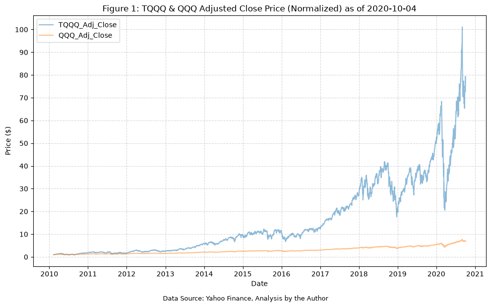
    


### Figure 2: Comparing the normalized value of UPRO with its underlying index

Next, UPRO and SPY.


```python
lev_etf = "UPRO"
etf = "SPY"
end_date = "2020-10-04"

df = combine_normalize(
    fund_data=fund_data,
    lev_etf=lev_etf,
    etf=etf,
    start_date=None,
    end_date=end_date,
)

print(f"Table E3: {lev_etf} & {etf} Normalized Data")
display(df)
```

    Table E3: UPRO & SPY Normalized Data


<div>
<style scoped>
    .dataframe tbody tr th:only-of-type {
        vertical-align: middle;
    }

    .dataframe tbody tr th {
        vertical-align: top;
    }

    .dataframe thead th {
        text-align: right;
    }
</style>
<table border="1" class="dataframe">
  <thead>
    <tr style="text-align: right;">
      <th></th>
      <th>UPRO_Adj_Close</th>
      <th>UPRO_Close</th>
      <th>UPRO_High</th>
      <th>UPRO_Low</th>
      <th>UPRO_Open</th>
      <th>UPRO_Volume</th>
      <th>SPY_Adj_Close</th>
      <th>SPY_Close</th>
      <th>SPY_High</th>
      <th>SPY_Low</th>
      <th>SPY_Open</th>
      <th>SPY_Volume</th>
    </tr>
    <tr>
      <th>Date</th>
      <th></th>
      <th></th>
      <th></th>
      <th></th>
      <th></th>
      <th></th>
      <th></th>
      <th></th>
      <th></th>
      <th></th>
      <th></th>
      <th></th>
    </tr>
  </thead>
  <tbody>
    <tr>
      <th>2009-06-25</th>
      <td>1.00</td>
      <td>1.00</td>
      <td>1.00</td>
      <td>1.00</td>
      <td>1.00</td>
      <td>1.00</td>
      <td>1.00</td>
      <td>1.00</td>
      <td>1.00</td>
      <td>1.00</td>
      <td>1.00</td>
      <td>1.00</td>
    </tr>
    <tr>
      <th>2009-06-26</th>
      <td>0.99</td>
      <td>0.99</td>
      <td>1.00</td>
      <td>1.05</td>
      <td>1.06</td>
      <td>5.08</td>
      <td>1.00</td>
      <td>1.00</td>
      <td>1.00</td>
      <td>1.02</td>
      <td>1.02</td>
      <td>0.60</td>
    </tr>
    <tr>
      <th>2009-06-29</th>
      <td>1.02</td>
      <td>1.02</td>
      <td>1.02</td>
      <td>1.06</td>
      <td>1.07</td>
      <td>3.37</td>
      <td>1.01</td>
      <td>1.01</td>
      <td>1.01</td>
      <td>1.02</td>
      <td>1.03</td>
      <td>0.60</td>
    </tr>
    <tr>
      <th>2009-06-30</th>
      <td>1.00</td>
      <td>1.00</td>
      <td>1.03</td>
      <td>1.04</td>
      <td>1.10</td>
      <td>6.65</td>
      <td>1.00</td>
      <td>1.00</td>
      <td>1.01</td>
      <td>1.02</td>
      <td>1.03</td>
      <td>0.82</td>
    </tr>
    <tr>
      <th>2009-07-01</th>
      <td>1.01</td>
      <td>1.01</td>
      <td>1.04</td>
      <td>1.08</td>
      <td>1.08</td>
      <td>4.67</td>
      <td>1.00</td>
      <td>1.00</td>
      <td>1.01</td>
      <td>1.03</td>
      <td>1.03</td>
      <td>0.62</td>
    </tr>
    <tr>
      <th>...</th>
      <td>...</td>
      <td>...</td>
      <td>...</td>
      <td>...</td>
      <td>...</td>
      <td>...</td>
      <td>...</td>
      <td>...</td>
      <td>...</td>
      <td>...</td>
      <td>...</td>
      <td>...</td>
    </tr>
    <tr>
      <th>2020-09-28</th>
      <td>23.67</td>
      <td>23.06</td>
      <td>23.10</td>
      <td>24.24</td>
      <td>24.46</td>
      <td>3.34</td>
      <td>4.54</td>
      <td>3.63</td>
      <td>3.63</td>
      <td>3.71</td>
      <td>3.72</td>
      <td>0.23</td>
    </tr>
    <tr>
      <th>2020-09-29</th>
      <td>23.28</td>
      <td>22.68</td>
      <td>23.07</td>
      <td>24.11</td>
      <td>24.63</td>
      <td>2.74</td>
      <td>4.52</td>
      <td>3.61</td>
      <td>3.63</td>
      <td>3.70</td>
      <td>3.72</td>
      <td>0.18</td>
    </tr>
    <tr>
      <th>2020-09-30</th>
      <td>23.80</td>
      <td>23.19</td>
      <td>23.79</td>
      <td>24.39</td>
      <td>24.44</td>
      <td>5.30</td>
      <td>4.55</td>
      <td>3.64</td>
      <td>3.67</td>
      <td>3.72</td>
      <td>3.71</td>
      <td>0.37</td>
    </tr>
    <tr>
      <th>2020-10-01</th>
      <td>24.24</td>
      <td>23.62</td>
      <td>23.88</td>
      <td>24.84</td>
      <td>25.44</td>
      <td>3.11</td>
      <td>4.58</td>
      <td>3.66</td>
      <td>3.68</td>
      <td>3.74</td>
      <td>3.77</td>
      <td>0.32</td>
    </tr>
    <tr>
      <th>2020-10-02</th>
      <td>23.57</td>
      <td>22.97</td>
      <td>23.30</td>
      <td>23.98</td>
      <td>24.10</td>
      <td>4.32</td>
      <td>4.54</td>
      <td>3.63</td>
      <td>3.66</td>
      <td>3.70</td>
      <td>3.70</td>
      <td>0.32</td>
    </tr>
  </tbody>
</table>
<p>2839 rows × 12 columns</p>
</div>


```python
max_per_ratio_date = "2020-02-19"

sum_stats = calculate_returns_stats(
    df=df,
    lev_etf=lev_etf,
    etf=etf,
    max_per_ratio_date=max_per_ratio_date,
)

all_sum_stats = pd.concat([all_sum_stats, sum_stats])

print("Table E4: Leveraged and Non-Leveraged ETF Summary Statistics")
display(all_sum_stats)
```

    Table E4: Leveraged and Non-Leveraged ETF Summary Statistics


<div>
<style scoped>
    .dataframe tbody tr th:only-of-type {
        vertical-align: middle;
    }

    .dataframe tbody tr th {
        vertical-align: top;
    }

    .dataframe thead th {
        text-align: right;
    }
</style>
<table border="1" class="dataframe">
  <thead>
    <tr style="text-align: right;">
      <th></th>
      <th>Number of Observations</th>
      <th>Data Start Date</th>
      <th>Data End Date</th>
      <th>Annual Mean Return (Arithmetic)</th>
      <th>Annualized Volatility</th>
      <th>Annualized Sharpe Ratio</th>
      <th>CAGR (Geometric)</th>
      <th>Daily Max Return</th>
      <th>Daily Max Return (Date)</th>
      <th>Daily Min Return</th>
      <th>Daily Min Return (Date)</th>
      <th>Max Drawdown</th>
      <th>Peak</th>
      <th>Trough</th>
      <th>Recovery Date</th>
      <th>Calendar Days to Recovery</th>
      <th>MAR Ratio</th>
      <th>CAGR End Date</th>
      <th>Max Monthly Drawdown</th>
    </tr>
  </thead>
  <tbody>
    <tr>
      <th>TQQQ_Return</th>
      <td>2679</td>
      <td>2010-02-12</td>
      <td>2020-10-02</td>
      <td>0.57</td>
      <td>0.58</td>
      <td>0.99</td>
      <td>0.55</td>
      <td>0.27</td>
      <td>2020-03-13</td>
      <td>-0.34</td>
      <td>2020-03-16</td>
      <td>-0.70</td>
      <td>2020-02-19</td>
      <td>2020-03-20</td>
      <td>2020-07-10</td>
      <td>112.00</td>
      <td>0.71</td>
      <td>2020-09-02</td>
      <td>-0.49</td>
    </tr>
    <tr>
      <th>QQQ_Return</th>
      <td>2679</td>
      <td>2010-02-12</td>
      <td>2020-10-02</td>
      <td>0.20</td>
      <td>0.20</td>
      <td>1.03</td>
      <td>0.21</td>
      <td>0.08</td>
      <td>2020-03-13</td>
      <td>-0.12</td>
      <td>2020-03-16</td>
      <td>-0.29</td>
      <td>2020-02-19</td>
      <td>2020-03-16</td>
      <td>2020-06-03</td>
      <td>79.00</td>
      <td>0.70</td>
      <td>2020-09-02</td>
      <td>-0.17</td>
    </tr>
    <tr>
      <th>UPRO_Return</th>
      <td>2838</td>
      <td>2009-06-26</td>
      <td>2020-10-02</td>
      <td>0.42</td>
      <td>0.52</td>
      <td>0.81</td>
      <td>0.39</td>
      <td>0.28</td>
      <td>2020-03-24</td>
      <td>-0.35</td>
      <td>2020-03-16</td>
      <td>-0.77</td>
      <td>2020-02-19</td>
      <td>2020-03-23</td>
      <td>NaT</td>
      <td>NaN</td>
      <td>0.42</td>
      <td>2020-02-19</td>
      <td>-0.60</td>
    </tr>
    <tr>
      <th>SPY_Return</th>
      <td>2838</td>
      <td>2009-06-26</td>
      <td>2020-10-02</td>
      <td>0.15</td>
      <td>0.17</td>
      <td>0.87</td>
      <td>0.15</td>
      <td>0.09</td>
      <td>2020-03-24</td>
      <td>-0.11</td>
      <td>2020-03-16</td>
      <td>-0.34</td>
      <td>2020-02-19</td>
      <td>2020-03-23</td>
      <td>2020-08-10</td>
      <td>140.00</td>
      <td>0.43</td>
      <td>2020-02-19</td>
      <td>-0.19</td>
    </tr>
  </tbody>
</table>
</div>


For UPRO and SPY, the paper finds a maximum performance ratio of 7.5 (34.13/4.53) on 2/19/2020, and lists a CAGR through that date of 39.0% for UPRO and 15.1% for SPY. We find 39% for UPRO and 15% for SPY. For the DDD, the paper finds a maximum DDD of 78.8% for UPRO, and we find 77%, so very close there. The paper's maximum MDD for UPRO is 60.4%, which matches our 60%.


```python
plot_time_series(
    df=df,
    plot_start_date=None,
    plot_end_date=None,
    plot_columns=[f"{lev_etf}_Adj_Close", f"{etf}_Adj_Close"],
    title=f"Figure 2: {lev_etf} & {etf} Adjusted Close Price (Normalized) as of {end_date}",
    x_label="Date",
    x_format="Year",
    x_tick_spacing=1,
    x_tick_start=None,
    x_tick_rotation=0,
    y_label="Price ($)",
    y_format="Decimal",
    y_format_decimal_places=0,
    y_tick_spacing="Auto",
    y_tick_rotation=0,
    caption="Data Source: Yahoo Finance, Analysis by the Author",
)
```


    
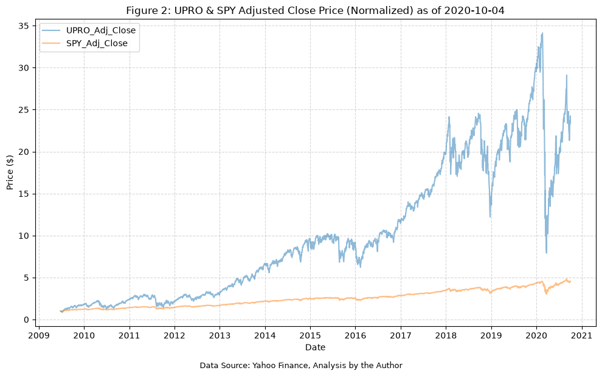
    


### Figure 3: Comparing the normalized value of UDOW with its underlying index

Next, figure #3 plots UDOW and DIA.


```python
lev_etf = "UDOW"
etf = "DIA"
end_date = "2020-10-04"

df = combine_normalize(
    fund_data=fund_data,
    lev_etf=lev_etf,
    etf=etf,
    start_date=None,
    end_date=end_date,
)

print(f"Table E5: {lev_etf} & {etf} Normalized Data")
display(df)
```

    Table E5: UDOW & DIA Normalized Data


<div>
<style scoped>
    .dataframe tbody tr th:only-of-type {
        vertical-align: middle;
    }

    .dataframe tbody tr th {
        vertical-align: top;
    }

    .dataframe thead th {
        text-align: right;
    }
</style>
<table border="1" class="dataframe">
  <thead>
    <tr style="text-align: right;">
      <th></th>
      <th>UDOW_Adj_Close</th>
      <th>UDOW_Close</th>
      <th>UDOW_High</th>
      <th>UDOW_Low</th>
      <th>UDOW_Open</th>
      <th>UDOW_Volume</th>
      <th>DIA_Adj_Close</th>
      <th>DIA_Close</th>
      <th>DIA_High</th>
      <th>DIA_Low</th>
      <th>DIA_Open</th>
      <th>DIA_Volume</th>
    </tr>
    <tr>
      <th>Date</th>
      <th></th>
      <th></th>
      <th></th>
      <th></th>
      <th></th>
      <th></th>
      <th></th>
      <th></th>
      <th></th>
      <th></th>
      <th></th>
      <th></th>
    </tr>
  </thead>
  <tbody>
    <tr>
      <th>2010-02-11</th>
      <td>1.00</td>
      <td>1.00</td>
      <td>1.00</td>
      <td>1.00</td>
      <td>1.00</td>
      <td>1.00</td>
      <td>1.00</td>
      <td>1.00</td>
      <td>1.00</td>
      <td>1.00</td>
      <td>1.00</td>
      <td>1.00</td>
    </tr>
    <tr>
      <th>2010-02-12</th>
      <td>1.00</td>
      <td>1.00</td>
      <td>1.00</td>
      <td>0.99</td>
      <td>1.00</td>
      <td>2.15</td>
      <td>1.00</td>
      <td>1.00</td>
      <td>1.00</td>
      <td>1.00</td>
      <td>1.00</td>
      <td>1.37</td>
    </tr>
    <tr>
      <th>2010-02-16</th>
      <td>1.06</td>
      <td>1.06</td>
      <td>1.06</td>
      <td>1.04</td>
      <td>1.05</td>
      <td>1.56</td>
      <td>1.01</td>
      <td>1.01</td>
      <td>1.01</td>
      <td>1.02</td>
      <td>1.02</td>
      <td>0.90</td>
    </tr>
    <tr>
      <th>2010-02-17</th>
      <td>1.09</td>
      <td>1.09</td>
      <td>1.09</td>
      <td>1.08</td>
      <td>1.08</td>
      <td>6.41</td>
      <td>1.02</td>
      <td>1.02</td>
      <td>1.02</td>
      <td>1.03</td>
      <td>1.03</td>
      <td>0.88</td>
    </tr>
    <tr>
      <th>2010-02-18</th>
      <td>1.11</td>
      <td>1.11</td>
      <td>1.12</td>
      <td>1.09</td>
      <td>1.09</td>
      <td>5.00</td>
      <td>1.03</td>
      <td>1.03</td>
      <td>1.03</td>
      <td>1.03</td>
      <td>1.03</td>
      <td>0.87</td>
    </tr>
    <tr>
      <th>...</th>
      <td>...</td>
      <td>...</td>
      <td>...</td>
      <td>...</td>
      <td>...</td>
      <td>...</td>
      <td>...</td>
      <td>...</td>
      <td>...</td>
      <td>...</td>
      <td>...</td>
      <td>...</td>
    </tr>
    <tr>
      <th>2020-09-28</th>
      <td>12.03</td>
      <td>11.55</td>
      <td>11.70</td>
      <td>11.41</td>
      <td>11.46</td>
      <td>49.80</td>
      <td>3.49</td>
      <td>2.72</td>
      <td>2.72</td>
      <td>2.75</td>
      <td>2.74</td>
      <td>0.28</td>
    </tr>
    <tr>
      <th>2020-09-29</th>
      <td>11.82</td>
      <td>11.35</td>
      <td>11.55</td>
      <td>11.22</td>
      <td>11.51</td>
      <td>69.70</td>
      <td>3.47</td>
      <td>2.70</td>
      <td>2.71</td>
      <td>2.74</td>
      <td>2.74</td>
      <td>0.20</td>
    </tr>
    <tr>
      <th>2020-09-30</th>
      <td>12.24</td>
      <td>11.76</td>
      <td>12.08</td>
      <td>11.43</td>
      <td>11.43</td>
      <td>86.74</td>
      <td>3.51</td>
      <td>2.73</td>
      <td>2.75</td>
      <td>2.75</td>
      <td>2.74</td>
      <td>0.41</td>
    </tr>
    <tr>
      <th>2020-10-01</th>
      <td>12.32</td>
      <td>11.83</td>
      <td>12.11</td>
      <td>11.63</td>
      <td>11.98</td>
      <td>69.12</td>
      <td>3.52</td>
      <td>2.74</td>
      <td>2.76</td>
      <td>2.77</td>
      <td>2.78</td>
      <td>0.30</td>
    </tr>
    <tr>
      <th>2020-10-02</th>
      <td>12.13</td>
      <td>11.66</td>
      <td>11.87</td>
      <td>11.25</td>
      <td>11.31</td>
      <td>71.53</td>
      <td>3.50</td>
      <td>2.72</td>
      <td>2.74</td>
      <td>2.74</td>
      <td>2.73</td>
      <td>0.48</td>
    </tr>
  </tbody>
</table>
<p>2680 rows × 12 columns</p>
</div>


```python
max_per_ratio_date = "2020-02-12"

sum_stats = calculate_returns_stats(
    df=df,
    lev_etf=lev_etf,
    etf=etf,
    max_per_ratio_date=max_per_ratio_date,
)

all_sum_stats = pd.concat([all_sum_stats, sum_stats])

print("Table E6: Leveraged and Non-Leveraged ETF Summary Statistics")
display(all_sum_stats)
```

    Table E6: Leveraged and Non-Leveraged ETF Summary Statistics


<div>
<style scoped>
    .dataframe tbody tr th:only-of-type {
        vertical-align: middle;
    }

    .dataframe tbody tr th {
        vertical-align: top;
    }

    .dataframe thead th {
        text-align: right;
    }
</style>
<table border="1" class="dataframe">
  <thead>
    <tr style="text-align: right;">
      <th></th>
      <th>Number of Observations</th>
      <th>Data Start Date</th>
      <th>Data End Date</th>
      <th>Annual Mean Return (Arithmetic)</th>
      <th>Annualized Volatility</th>
      <th>Annualized Sharpe Ratio</th>
      <th>CAGR (Geometric)</th>
      <th>Daily Max Return</th>
      <th>Daily Max Return (Date)</th>
      <th>Daily Min Return</th>
      <th>Daily Min Return (Date)</th>
      <th>Max Drawdown</th>
      <th>Peak</th>
      <th>Trough</th>
      <th>Recovery Date</th>
      <th>Calendar Days to Recovery</th>
      <th>MAR Ratio</th>
      <th>CAGR End Date</th>
      <th>Max Monthly Drawdown</th>
    </tr>
  </thead>
  <tbody>
    <tr>
      <th>TQQQ_Return</th>
      <td>2679</td>
      <td>2010-02-12</td>
      <td>2020-10-02</td>
      <td>0.57</td>
      <td>0.58</td>
      <td>0.99</td>
      <td>0.55</td>
      <td>0.27</td>
      <td>2020-03-13</td>
      <td>-0.34</td>
      <td>2020-03-16</td>
      <td>-0.70</td>
      <td>2020-02-19</td>
      <td>2020-03-20</td>
      <td>2020-07-10</td>
      <td>112.00</td>
      <td>0.71</td>
      <td>2020-09-02</td>
      <td>-0.49</td>
    </tr>
    <tr>
      <th>QQQ_Return</th>
      <td>2679</td>
      <td>2010-02-12</td>
      <td>2020-10-02</td>
      <td>0.20</td>
      <td>0.20</td>
      <td>1.03</td>
      <td>0.21</td>
      <td>0.08</td>
      <td>2020-03-13</td>
      <td>-0.12</td>
      <td>2020-03-16</td>
      <td>-0.29</td>
      <td>2020-02-19</td>
      <td>2020-03-16</td>
      <td>2020-06-03</td>
      <td>79.00</td>
      <td>0.70</td>
      <td>2020-09-02</td>
      <td>-0.17</td>
    </tr>
    <tr>
      <th>UPRO_Return</th>
      <td>2838</td>
      <td>2009-06-26</td>
      <td>2020-10-02</td>
      <td>0.42</td>
      <td>0.52</td>
      <td>0.81</td>
      <td>0.39</td>
      <td>0.28</td>
      <td>2020-03-24</td>
      <td>-0.35</td>
      <td>2020-03-16</td>
      <td>-0.77</td>
      <td>2020-02-19</td>
      <td>2020-03-23</td>
      <td>NaT</td>
      <td>NaN</td>
      <td>0.42</td>
      <td>2020-02-19</td>
      <td>-0.60</td>
    </tr>
    <tr>
      <th>SPY_Return</th>
      <td>2838</td>
      <td>2009-06-26</td>
      <td>2020-10-02</td>
      <td>0.15</td>
      <td>0.17</td>
      <td>0.87</td>
      <td>0.15</td>
      <td>0.09</td>
      <td>2020-03-24</td>
      <td>-0.11</td>
      <td>2020-03-16</td>
      <td>-0.34</td>
      <td>2020-02-19</td>
      <td>2020-03-23</td>
      <td>2020-08-10</td>
      <td>140.00</td>
      <td>0.43</td>
      <td>2020-02-19</td>
      <td>-0.19</td>
    </tr>
    <tr>
      <th>UDOW_Return</th>
      <td>2679</td>
      <td>2010-02-12</td>
      <td>2020-10-02</td>
      <td>0.37</td>
      <td>0.51</td>
      <td>0.72</td>
      <td>0.36</td>
      <td>0.33</td>
      <td>2020-03-24</td>
      <td>-0.35</td>
      <td>2020-03-16</td>
      <td>-0.80</td>
      <td>2020-02-12</td>
      <td>2020-03-23</td>
      <td>NaT</td>
      <td>NaN</td>
      <td>0.33</td>
      <td>2020-02-12</td>
      <td>-0.66</td>
    </tr>
    <tr>
      <th>DIA_Return</th>
      <td>2679</td>
      <td>2010-02-12</td>
      <td>2020-10-02</td>
      <td>0.13</td>
      <td>0.17</td>
      <td>0.77</td>
      <td>0.14</td>
      <td>0.11</td>
      <td>2020-03-24</td>
      <td>-0.13</td>
      <td>2020-03-16</td>
      <td>-0.37</td>
      <td>2020-02-12</td>
      <td>2020-03-23</td>
      <td>NaT</td>
      <td>NaN</td>
      <td>0.34</td>
      <td>2020-02-12</td>
      <td>-0.23</td>
    </tr>
  </tbody>
</table>
</div>


For UDOW and DIA, the paper finds a maximum performance ratio of 5.9 (21.62/3.68) on 2/12/2020, and lists a CAGR through that date of 35.7% for UDOW and 13.8% for DIA. Our values are 36% and 14% respectively. The DDD values from the paper at 80.3% and 33.7% are reasonably close to ours at 80% and 37%. For the MDD, the paper lists 66.3% for UDOW, which matches our 66%, and 19.4% for DIA, compared with our 23%. Interestingly, 19.4% is exactly the maximum MDD we find for SPY, so this may be a transcription error in the paper.


```python
plot_time_series(
    df=df,
    plot_start_date=None,
    plot_end_date=None,
    plot_columns=[f"{lev_etf}_Adj_Close", f"{etf}_Adj_Close"],
    title=f"Figure 3: {lev_etf} & {etf} Adjusted Close Price (Normalized) as of {end_date}",
    x_label="Date",
    x_format="Year",
    x_tick_spacing=1,
    x_tick_start=None,
    x_tick_rotation=0,
    y_label="Price ($)",
    y_format="Decimal",
    y_format_decimal_places=0,
    y_tick_spacing="Auto",
    y_tick_rotation=0,
    caption="Data Source: Yahoo Finance, Analysis by the Author",
)
```


    
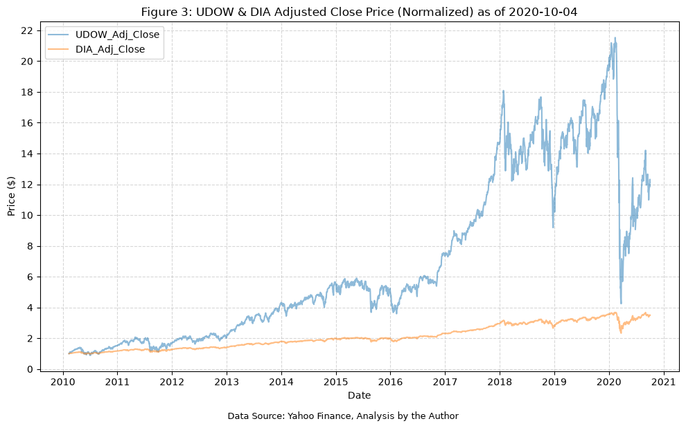
    


### Figure 4: Comparing the normalized value of TNA with its underlying index

Figure #4 plots TNA and IWM.


```python
lev_etf = "TNA"
etf = "IWM"
end_date = "2020-10-04"

df = combine_normalize(
    fund_data=fund_data,
    lev_etf=lev_etf,
    etf=etf,
    start_date=None,
    end_date=end_date,
)

print(f"Table E7: {lev_etf} & {etf} Normalized Data")
display(df)
```

    Table E7: TNA & IWM Normalized Data


<div>
<style scoped>
    .dataframe tbody tr th:only-of-type {
        vertical-align: middle;
    }

    .dataframe tbody tr th {
        vertical-align: top;
    }

    .dataframe thead th {
        text-align: right;
    }
</style>
<table border="1" class="dataframe">
  <thead>
    <tr style="text-align: right;">
      <th></th>
      <th>TNA_Adj_Close</th>
      <th>TNA_Close</th>
      <th>TNA_High</th>
      <th>TNA_Low</th>
      <th>TNA_Open</th>
      <th>TNA_Volume</th>
      <th>IWM_Adj_Close</th>
      <th>IWM_Close</th>
      <th>IWM_High</th>
      <th>IWM_Low</th>
      <th>IWM_Open</th>
      <th>IWM_Volume</th>
    </tr>
    <tr>
      <th>Date</th>
      <th></th>
      <th></th>
      <th></th>
      <th></th>
      <th></th>
      <th></th>
      <th></th>
      <th></th>
      <th></th>
      <th></th>
      <th></th>
      <th></th>
    </tr>
  </thead>
  <tbody>
    <tr>
      <th>2008-11-19</th>
      <td>1.00</td>
      <td>1.00</td>
      <td>1.00</td>
      <td>1.00</td>
      <td>1.00</td>
      <td>1.00</td>
      <td>1.00</td>
      <td>1.00</td>
      <td>1.00</td>
      <td>1.00</td>
      <td>1.00</td>
      <td>1.00</td>
    </tr>
    <tr>
      <th>2008-11-20</th>
      <td>0.79</td>
      <td>0.79</td>
      <td>0.78</td>
      <td>0.79</td>
      <td>0.75</td>
      <td>1.82</td>
      <td>0.93</td>
      <td>0.93</td>
      <td>0.93</td>
      <td>0.93</td>
      <td>0.92</td>
      <td>1.46</td>
    </tr>
    <tr>
      <th>2008-11-21</th>
      <td>0.91</td>
      <td>0.91</td>
      <td>0.70</td>
      <td>0.71</td>
      <td>0.71</td>
      <td>1.74</td>
      <td>0.98</td>
      <td>0.98</td>
      <td>0.90</td>
      <td>0.90</td>
      <td>0.88</td>
      <td>1.67</td>
    </tr>
    <tr>
      <th>2008-11-24</th>
      <td>1.10</td>
      <td>1.10</td>
      <td>0.87</td>
      <td>0.93</td>
      <td>0.76</td>
      <td>1.28</td>
      <td>1.05</td>
      <td>1.05</td>
      <td>0.98</td>
      <td>0.99</td>
      <td>0.92</td>
      <td>1.01</td>
    </tr>
    <tr>
      <th>2008-11-25</th>
      <td>1.16</td>
      <td>1.16</td>
      <td>0.89</td>
      <td>1.05</td>
      <td>0.90</td>
      <td>1.04</td>
      <td>1.07</td>
      <td>1.07</td>
      <td>0.98</td>
      <td>1.03</td>
      <td>0.99</td>
      <td>0.83</td>
    </tr>
    <tr>
      <th>...</th>
      <td>...</td>
      <td>...</td>
      <td>...</td>
      <td>...</td>
      <td>...</td>
      <td>...</td>
      <td>...</td>
      <td>...</td>
      <td>...</td>
      <td>...</td>
      <td>...</td>
      <td>...</td>
    </tr>
    <tr>
      <th>2020-09-28</th>
      <td>5.99</td>
      <td>5.08</td>
      <td>3.87</td>
      <td>4.94</td>
      <td>3.83</td>
      <td>1.13</td>
      <td>4.32</td>
      <td>3.63</td>
      <td>3.33</td>
      <td>3.55</td>
      <td>3.31</td>
      <td>0.18</td>
    </tr>
    <tr>
      <th>2020-09-29</th>
      <td>5.90</td>
      <td>5.00</td>
      <td>3.86</td>
      <td>4.91</td>
      <td>3.94</td>
      <td>1.34</td>
      <td>4.30</td>
      <td>3.61</td>
      <td>3.33</td>
      <td>3.59</td>
      <td>3.35</td>
      <td>0.19</td>
    </tr>
    <tr>
      <th>2020-09-30</th>
      <td>5.96</td>
      <td>5.05</td>
      <td>3.99</td>
      <td>4.96</td>
      <td>3.94</td>
      <td>1.39</td>
      <td>4.31</td>
      <td>3.62</td>
      <td>3.37</td>
      <td>3.60</td>
      <td>3.35</td>
      <td>0.30</td>
    </tr>
    <tr>
      <th>2020-10-01</th>
      <td>6.23</td>
      <td>5.28</td>
      <td>4.01</td>
      <td>5.06</td>
      <td>4.01</td>
      <td>1.15</td>
      <td>4.38</td>
      <td>3.68</td>
      <td>3.37</td>
      <td>3.62</td>
      <td>3.37</td>
      <td>0.27</td>
    </tr>
    <tr>
      <th>2020-10-02</th>
      <td>6.32</td>
      <td>5.36</td>
      <td>4.11</td>
      <td>5.00</td>
      <td>3.90</td>
      <td>1.52</td>
      <td>4.40</td>
      <td>3.70</td>
      <td>3.40</td>
      <td>3.61</td>
      <td>3.34</td>
      <td>0.31</td>
    </tr>
  </tbody>
</table>
<p>2988 rows × 12 columns</p>
</div>


```python
max_per_ratio_date = "2018-08-29"

sum_stats = calculate_returns_stats(
    df=df,
    lev_etf=lev_etf,
    etf=etf,
    max_per_ratio_date=max_per_ratio_date,
)

all_sum_stats = pd.concat([all_sum_stats, sum_stats])

print("Table E8: Leveraged and Non-Leveraged ETF Summary Statistics")
display(all_sum_stats)
```

    Table E8: Leveraged and Non-Leveraged ETF Summary Statistics


<div>
<style scoped>
    .dataframe tbody tr th:only-of-type {
        vertical-align: middle;
    }

    .dataframe tbody tr th {
        vertical-align: top;
    }

    .dataframe thead th {
        text-align: right;
    }
</style>
<table border="1" class="dataframe">
  <thead>
    <tr style="text-align: right;">
      <th></th>
      <th>Number of Observations</th>
      <th>Data Start Date</th>
      <th>Data End Date</th>
      <th>Annual Mean Return (Arithmetic)</th>
      <th>Annualized Volatility</th>
      <th>Annualized Sharpe Ratio</th>
      <th>CAGR (Geometric)</th>
      <th>Daily Max Return</th>
      <th>Daily Max Return (Date)</th>
      <th>Daily Min Return</th>
      <th>Daily Min Return (Date)</th>
      <th>Max Drawdown</th>
      <th>Peak</th>
      <th>Trough</th>
      <th>Recovery Date</th>
      <th>Calendar Days to Recovery</th>
      <th>MAR Ratio</th>
      <th>CAGR End Date</th>
      <th>Max Monthly Drawdown</th>
    </tr>
  </thead>
  <tbody>
    <tr>
      <th>TQQQ_Return</th>
      <td>2679</td>
      <td>2010-02-12</td>
      <td>2020-10-02</td>
      <td>0.57</td>
      <td>0.58</td>
      <td>0.99</td>
      <td>0.55</td>
      <td>0.27</td>
      <td>2020-03-13</td>
      <td>-0.34</td>
      <td>2020-03-16</td>
      <td>-0.70</td>
      <td>2020-02-19</td>
      <td>2020-03-20</td>
      <td>2020-07-10</td>
      <td>112.00</td>
      <td>0.71</td>
      <td>2020-09-02</td>
      <td>-0.49</td>
    </tr>
    <tr>
      <th>QQQ_Return</th>
      <td>2679</td>
      <td>2010-02-12</td>
      <td>2020-10-02</td>
      <td>0.20</td>
      <td>0.20</td>
      <td>1.03</td>
      <td>0.21</td>
      <td>0.08</td>
      <td>2020-03-13</td>
      <td>-0.12</td>
      <td>2020-03-16</td>
      <td>-0.29</td>
      <td>2020-02-19</td>
      <td>2020-03-16</td>
      <td>2020-06-03</td>
      <td>79.00</td>
      <td>0.70</td>
      <td>2020-09-02</td>
      <td>-0.17</td>
    </tr>
    <tr>
      <th>UPRO_Return</th>
      <td>2838</td>
      <td>2009-06-26</td>
      <td>2020-10-02</td>
      <td>0.42</td>
      <td>0.52</td>
      <td>0.81</td>
      <td>0.39</td>
      <td>0.28</td>
      <td>2020-03-24</td>
      <td>-0.35</td>
      <td>2020-03-16</td>
      <td>-0.77</td>
      <td>2020-02-19</td>
      <td>2020-03-23</td>
      <td>NaT</td>
      <td>NaN</td>
      <td>0.42</td>
      <td>2020-02-19</td>
      <td>-0.60</td>
    </tr>
    <tr>
      <th>SPY_Return</th>
      <td>2838</td>
      <td>2009-06-26</td>
      <td>2020-10-02</td>
      <td>0.15</td>
      <td>0.17</td>
      <td>0.87</td>
      <td>0.15</td>
      <td>0.09</td>
      <td>2020-03-24</td>
      <td>-0.11</td>
      <td>2020-03-16</td>
      <td>-0.34</td>
      <td>2020-02-19</td>
      <td>2020-03-23</td>
      <td>2020-08-10</td>
      <td>140.00</td>
      <td>0.43</td>
      <td>2020-02-19</td>
      <td>-0.19</td>
    </tr>
    <tr>
      <th>UDOW_Return</th>
      <td>2679</td>
      <td>2010-02-12</td>
      <td>2020-10-02</td>
      <td>0.37</td>
      <td>0.51</td>
      <td>0.72</td>
      <td>0.36</td>
      <td>0.33</td>
      <td>2020-03-24</td>
      <td>-0.35</td>
      <td>2020-03-16</td>
      <td>-0.80</td>
      <td>2020-02-12</td>
      <td>2020-03-23</td>
      <td>NaT</td>
      <td>NaN</td>
      <td>0.33</td>
      <td>2020-02-12</td>
      <td>-0.66</td>
    </tr>
    <tr>
      <th>DIA_Return</th>
      <td>2679</td>
      <td>2010-02-12</td>
      <td>2020-10-02</td>
      <td>0.13</td>
      <td>0.17</td>
      <td>0.77</td>
      <td>0.14</td>
      <td>0.11</td>
      <td>2020-03-24</td>
      <td>-0.13</td>
      <td>2020-03-16</td>
      <td>-0.37</td>
      <td>2020-02-12</td>
      <td>2020-03-23</td>
      <td>NaT</td>
      <td>NaN</td>
      <td>0.34</td>
      <td>2020-02-12</td>
      <td>-0.23</td>
    </tr>
    <tr>
      <th>TNA_Return</th>
      <td>2987</td>
      <td>2008-11-20</td>
      <td>2020-10-02</td>
      <td>0.42</td>
      <td>0.72</td>
      <td>0.58</td>
      <td>0.35</td>
      <td>0.27</td>
      <td>2020-03-24</td>
      <td>-0.37</td>
      <td>2020-03-16</td>
      <td>-0.88</td>
      <td>2018-08-31</td>
      <td>2020-03-23</td>
      <td>NaT</td>
      <td>NaN</td>
      <td>0.19</td>
      <td>2018-08-29</td>
      <td>-0.83</td>
    </tr>
    <tr>
      <th>IWM_Return</th>
      <td>2987</td>
      <td>2008-11-20</td>
      <td>2020-10-02</td>
      <td>0.15</td>
      <td>0.24</td>
      <td>0.64</td>
      <td>0.17</td>
      <td>0.09</td>
      <td>2020-03-24</td>
      <td>-0.13</td>
      <td>2020-03-16</td>
      <td>-0.41</td>
      <td>2018-08-31</td>
      <td>2020-03-23</td>
      <td>NaT</td>
      <td>NaN</td>
      <td>0.32</td>
      <td>2018-08-29</td>
      <td>-0.32</td>
    </tr>
  </tbody>
</table>
</div>


For TNA and IWM, the paper finds a maximum performance ratio of 3.8 (18.48/4.81) on 8/29/2018, well before the end of the period, and lists a CAGR through that date of 34.5% for TNA and 17.3% for IWM. Our values are 35% and 17% respectively. The DDD values from the paper at 88.1% and 41.1% are very close to ours at 88% and 41%. For the MDD, the paper lists 68.0% for TNA and 32.3% for IWM. Our IWM value of 32% matches, but our TNA value is 83%, measured from the end-of-month peak in August 2018 to the end-of-month trough in March 2020. We were not able to reproduce the paper's value for TNA.


```python
plot_time_series(
    df=df,
    plot_start_date=None,
    plot_end_date=None,
    plot_columns=[f"{lev_etf}_Adj_Close", f"{etf}_Adj_Close"],
    title=f"Figure 4: {lev_etf} & {etf} Adjusted Close Price (Normalized) as of {end_date}",
    x_label="Date",
    x_format="Year",
    x_tick_spacing=1,
    x_tick_start=None,
    x_tick_rotation=0,
    y_label="Price ($)",
    y_format="Decimal",
    y_format_decimal_places=0,
    y_tick_spacing="Auto",
    y_tick_rotation=0,
    caption="Data Source: Yahoo Finance, Analysis by the Author",
)
```


    
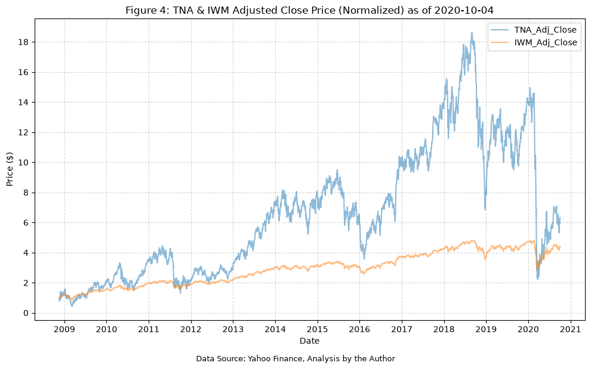
    


An interesting observation from the paper, from page 6:

> "Note that, in this case, the normalized value of TNA at the end of the period actually briefly diminishes below that of IWM as a result of the financial crisis triggered by the COVID-19 pandemic, another illustration of the extreme volatility of the TLETFs compared with their underlying."

### Figure 5: Comparing the normalized value of TMF with its underlying index

Next, figure #5 plots TMF and TLT.


```python
lev_etf = "TMF"
etf = "TLT"
end_date = "2020-10-04"

df = combine_normalize(
    fund_data=fund_data,
    lev_etf=lev_etf,
    etf=etf,
    start_date=None,
    end_date=end_date,
)

print(f"Table E9: {lev_etf} & {etf} Normalized Data")
display(df)
```

    Table E9: TMF & TLT Normalized Data


<div>
<style scoped>
    .dataframe tbody tr th:only-of-type {
        vertical-align: middle;
    }

    .dataframe tbody tr th {
        vertical-align: top;
    }

    .dataframe thead th {
        text-align: right;
    }
</style>
<table border="1" class="dataframe">
  <thead>
    <tr style="text-align: right;">
      <th></th>
      <th>TMF_Adj_Close</th>
      <th>TMF_Close</th>
      <th>TMF_High</th>
      <th>TMF_Low</th>
      <th>TMF_Open</th>
      <th>TMF_Volume</th>
      <th>TLT_Adj_Close</th>
      <th>TLT_Close</th>
      <th>TLT_High</th>
      <th>TLT_Low</th>
      <th>TLT_Open</th>
      <th>TLT_Volume</th>
    </tr>
    <tr>
      <th>Date</th>
      <th></th>
      <th></th>
      <th></th>
      <th></th>
      <th></th>
      <th></th>
      <th></th>
      <th></th>
      <th></th>
      <th></th>
      <th></th>
      <th></th>
    </tr>
  </thead>
  <tbody>
    <tr>
      <th>2009-04-16</th>
      <td>1.00</td>
      <td>1.00</td>
      <td>1.00</td>
      <td>1.00</td>
      <td>1.00</td>
      <td>1.00</td>
      <td>1.00</td>
      <td>1.00</td>
      <td>1.00</td>
      <td>1.00</td>
      <td>1.00</td>
      <td>1.00</td>
    </tr>
    <tr>
      <th>2009-04-17</th>
      <td>0.96</td>
      <td>0.96</td>
      <td>0.97</td>
      <td>0.95</td>
      <td>0.98</td>
      <td>2.64</td>
      <td>0.99</td>
      <td>0.99</td>
      <td>0.99</td>
      <td>0.99</td>
      <td>1.00</td>
      <td>2.45</td>
    </tr>
    <tr>
      <th>2009-04-20</th>
      <td>1.01</td>
      <td>1.01</td>
      <td>1.00</td>
      <td>0.99</td>
      <td>0.98</td>
      <td>0.60</td>
      <td>1.00</td>
      <td>1.00</td>
      <td>1.00</td>
      <td>1.00</td>
      <td>1.00</td>
      <td>1.62</td>
    </tr>
    <tr>
      <th>2009-04-21</th>
      <td>0.98</td>
      <td>0.98</td>
      <td>1.03</td>
      <td>0.99</td>
      <td>1.03</td>
      <td>1.37</td>
      <td>0.99</td>
      <td>0.99</td>
      <td>1.01</td>
      <td>0.99</td>
      <td>1.01</td>
      <td>0.86</td>
    </tr>
    <tr>
      <th>2009-04-22</th>
      <td>0.95</td>
      <td>0.95</td>
      <td>0.97</td>
      <td>0.94</td>
      <td>0.98</td>
      <td>2.22</td>
      <td>0.99</td>
      <td>0.99</td>
      <td>0.99</td>
      <td>0.98</td>
      <td>1.00</td>
      <td>2.16</td>
    </tr>
    <tr>
      <th>...</th>
      <td>...</td>
      <td>...</td>
      <td>...</td>
      <td>...</td>
      <td>...</td>
      <td>...</td>
      <td>...</td>
      <td>...</td>
      <td>...</td>
      <td>...</td>
      <td>...</td>
      <td>...</td>
    </tr>
    <tr>
      <th>2020-09-28</th>
      <td>3.51</td>
      <td>2.82</td>
      <td>2.78</td>
      <td>2.82</td>
      <td>2.82</td>
      <td>9.83</td>
      <td>2.22</td>
      <td>1.60</td>
      <td>1.59</td>
      <td>1.60</td>
      <td>1.60</td>
      <td>4.23</td>
    </tr>
    <tr>
      <th>2020-09-29</th>
      <td>3.52</td>
      <td>2.83</td>
      <td>2.80</td>
      <td>2.82</td>
      <td>2.81</td>
      <td>15.62</td>
      <td>2.22</td>
      <td>1.60</td>
      <td>1.60</td>
      <td>1.60</td>
      <td>1.60</td>
      <td>9.76</td>
    </tr>
    <tr>
      <th>2020-09-30</th>
      <td>3.43</td>
      <td>2.75</td>
      <td>2.74</td>
      <td>2.72</td>
      <td>2.77</td>
      <td>22.09</td>
      <td>2.20</td>
      <td>1.59</td>
      <td>1.59</td>
      <td>1.58</td>
      <td>1.59</td>
      <td>12.29</td>
    </tr>
    <tr>
      <th>2020-10-01</th>
      <td>3.45</td>
      <td>2.77</td>
      <td>2.73</td>
      <td>2.71</td>
      <td>2.70</td>
      <td>22.16</td>
      <td>2.21</td>
      <td>1.59</td>
      <td>1.58</td>
      <td>1.58</td>
      <td>1.58</td>
      <td>10.92</td>
    </tr>
    <tr>
      <th>2020-10-02</th>
      <td>3.41</td>
      <td>2.73</td>
      <td>2.73</td>
      <td>2.71</td>
      <td>2.76</td>
      <td>18.32</td>
      <td>2.20</td>
      <td>1.58</td>
      <td>1.58</td>
      <td>1.58</td>
      <td>1.59</td>
      <td>8.36</td>
    </tr>
  </tbody>
</table>
<p>2888 rows × 12 columns</p>
</div>


```python
max_per_ratio_date = "2020-03-09"

sum_stats = calculate_returns_stats(
    df=df,
    lev_etf=lev_etf,
    etf=etf,
    max_per_ratio_date=max_per_ratio_date,
)

all_sum_stats = pd.concat([all_sum_stats, sum_stats])

print("Table E10: Leveraged and Non-Leveraged ETF Summary Statistics")
display(all_sum_stats)
```

    Table E10: Leveraged and Non-Leveraged ETF Summary Statistics


<div>
<style scoped>
    .dataframe tbody tr th:only-of-type {
        vertical-align: middle;
    }

    .dataframe tbody tr th {
        vertical-align: top;
    }

    .dataframe thead th {
        text-align: right;
    }
</style>
<table border="1" class="dataframe">
  <thead>
    <tr style="text-align: right;">
      <th></th>
      <th>Number of Observations</th>
      <th>Data Start Date</th>
      <th>Data End Date</th>
      <th>Annual Mean Return (Arithmetic)</th>
      <th>Annualized Volatility</th>
      <th>Annualized Sharpe Ratio</th>
      <th>CAGR (Geometric)</th>
      <th>Daily Max Return</th>
      <th>Daily Max Return (Date)</th>
      <th>Daily Min Return</th>
      <th>Daily Min Return (Date)</th>
      <th>Max Drawdown</th>
      <th>Peak</th>
      <th>Trough</th>
      <th>Recovery Date</th>
      <th>Calendar Days to Recovery</th>
      <th>MAR Ratio</th>
      <th>CAGR End Date</th>
      <th>Max Monthly Drawdown</th>
    </tr>
  </thead>
  <tbody>
    <tr>
      <th>TQQQ_Return</th>
      <td>2679</td>
      <td>2010-02-12</td>
      <td>2020-10-02</td>
      <td>0.57</td>
      <td>0.58</td>
      <td>0.99</td>
      <td>0.55</td>
      <td>0.27</td>
      <td>2020-03-13</td>
      <td>-0.34</td>
      <td>2020-03-16</td>
      <td>-0.70</td>
      <td>2020-02-19</td>
      <td>2020-03-20</td>
      <td>2020-07-10</td>
      <td>112.00</td>
      <td>0.71</td>
      <td>2020-09-02</td>
      <td>-0.49</td>
    </tr>
    <tr>
      <th>QQQ_Return</th>
      <td>2679</td>
      <td>2010-02-12</td>
      <td>2020-10-02</td>
      <td>0.20</td>
      <td>0.20</td>
      <td>1.03</td>
      <td>0.21</td>
      <td>0.08</td>
      <td>2020-03-13</td>
      <td>-0.12</td>
      <td>2020-03-16</td>
      <td>-0.29</td>
      <td>2020-02-19</td>
      <td>2020-03-16</td>
      <td>2020-06-03</td>
      <td>79.00</td>
      <td>0.70</td>
      <td>2020-09-02</td>
      <td>-0.17</td>
    </tr>
    <tr>
      <th>UPRO_Return</th>
      <td>2838</td>
      <td>2009-06-26</td>
      <td>2020-10-02</td>
      <td>0.42</td>
      <td>0.52</td>
      <td>0.81</td>
      <td>0.39</td>
      <td>0.28</td>
      <td>2020-03-24</td>
      <td>-0.35</td>
      <td>2020-03-16</td>
      <td>-0.77</td>
      <td>2020-02-19</td>
      <td>2020-03-23</td>
      <td>NaT</td>
      <td>NaN</td>
      <td>0.42</td>
      <td>2020-02-19</td>
      <td>-0.60</td>
    </tr>
    <tr>
      <th>SPY_Return</th>
      <td>2838</td>
      <td>2009-06-26</td>
      <td>2020-10-02</td>
      <td>0.15</td>
      <td>0.17</td>
      <td>0.87</td>
      <td>0.15</td>
      <td>0.09</td>
      <td>2020-03-24</td>
      <td>-0.11</td>
      <td>2020-03-16</td>
      <td>-0.34</td>
      <td>2020-02-19</td>
      <td>2020-03-23</td>
      <td>2020-08-10</td>
      <td>140.00</td>
      <td>0.43</td>
      <td>2020-02-19</td>
      <td>-0.19</td>
    </tr>
    <tr>
      <th>UDOW_Return</th>
      <td>2679</td>
      <td>2010-02-12</td>
      <td>2020-10-02</td>
      <td>0.37</td>
      <td>0.51</td>
      <td>0.72</td>
      <td>0.36</td>
      <td>0.33</td>
      <td>2020-03-24</td>
      <td>-0.35</td>
      <td>2020-03-16</td>
      <td>-0.80</td>
      <td>2020-02-12</td>
      <td>2020-03-23</td>
      <td>NaT</td>
      <td>NaN</td>
      <td>0.33</td>
      <td>2020-02-12</td>
      <td>-0.66</td>
    </tr>
    <tr>
      <th>DIA_Return</th>
      <td>2679</td>
      <td>2010-02-12</td>
      <td>2020-10-02</td>
      <td>0.13</td>
      <td>0.17</td>
      <td>0.77</td>
      <td>0.14</td>
      <td>0.11</td>
      <td>2020-03-24</td>
      <td>-0.13</td>
      <td>2020-03-16</td>
      <td>-0.37</td>
      <td>2020-02-12</td>
      <td>2020-03-23</td>
      <td>NaT</td>
      <td>NaN</td>
      <td>0.34</td>
      <td>2020-02-12</td>
      <td>-0.23</td>
    </tr>
    <tr>
      <th>TNA_Return</th>
      <td>2987</td>
      <td>2008-11-20</td>
      <td>2020-10-02</td>
      <td>0.42</td>
      <td>0.72</td>
      <td>0.58</td>
      <td>0.35</td>
      <td>0.27</td>
      <td>2020-03-24</td>
      <td>-0.37</td>
      <td>2020-03-16</td>
      <td>-0.88</td>
      <td>2018-08-31</td>
      <td>2020-03-23</td>
      <td>NaT</td>
      <td>NaN</td>
      <td>0.19</td>
      <td>2018-08-29</td>
      <td>-0.83</td>
    </tr>
    <tr>
      <th>IWM_Return</th>
      <td>2987</td>
      <td>2008-11-20</td>
      <td>2020-10-02</td>
      <td>0.15</td>
      <td>0.24</td>
      <td>0.64</td>
      <td>0.17</td>
      <td>0.09</td>
      <td>2020-03-24</td>
      <td>-0.13</td>
      <td>2020-03-16</td>
      <td>-0.41</td>
      <td>2018-08-31</td>
      <td>2020-03-23</td>
      <td>NaT</td>
      <td>NaN</td>
      <td>0.32</td>
      <td>2018-08-29</td>
      <td>-0.32</td>
    </tr>
    <tr>
      <th>TMF_Return</th>
      <td>2887</td>
      <td>2009-04-17</td>
      <td>2020-10-02</td>
      <td>0.21</td>
      <td>0.44</td>
      <td>0.46</td>
      <td>0.15</td>
      <td>0.20</td>
      <td>2020-03-20</td>
      <td>-0.18</td>
      <td>2020-03-18</td>
      <td>-0.53</td>
      <td>2012-07-25</td>
      <td>2013-08-21</td>
      <td>2015-01-05</td>
      <td>502.00</td>
      <td>0.21</td>
      <td>2020-03-09</td>
      <td>-0.50</td>
    </tr>
    <tr>
      <th>TLT_Return</th>
      <td>2887</td>
      <td>2009-04-17</td>
      <td>2020-10-02</td>
      <td>0.08</td>
      <td>0.15</td>
      <td>0.54</td>
      <td>0.08</td>
      <td>0.08</td>
      <td>2020-03-20</td>
      <td>-0.07</td>
      <td>2020-03-17</td>
      <td>-0.21</td>
      <td>2012-07-25</td>
      <td>2013-08-21</td>
      <td>2014-12-10</td>
      <td>476.00</td>
      <td>0.34</td>
      <td>2020-03-09</td>
      <td>-0.18</td>
    </tr>
  </tbody>
</table>
</div>


For TMF and TLT, the paper finds a maximum performance ratio of 1.9 (4.412/2.294) on 3/9/2020, and reports a CAGR through that date of 14.5% for TMF and 7.9% for TLT. Our values are 15% and 8% respectively. For the drawdowns, the paper reports 53.3% for TMF and 20.7% for TLT, whereas our values are 53% and 21%. For the MDD, the paper reports 49.7% for TMF and 18.2% for TLT, and we find 50% and 18%. So again, very close for both the CAGR and the drawdown metrics.


```python
plot_time_series(
    df=df,
    plot_start_date=None,
    plot_end_date=None,
    plot_columns=[f"{lev_etf}_Adj_Close", f"{etf}_Adj_Close"],
    title=f"Figure 5: {lev_etf} & {etf} Adjusted Close Price (Normalized) as of {end_date}",
    x_label="Date",
    x_format="Year",
    x_tick_spacing=1,
    x_tick_start=None,
    x_tick_rotation=0,
    y_label="Price ($)",
    y_format="Decimal",
    y_format_decimal_places=1,
    y_tick_spacing="Auto",
    y_tick_rotation=0,
    caption="Data Source: Yahoo Finance, Analysis by the Author",
)
```


    
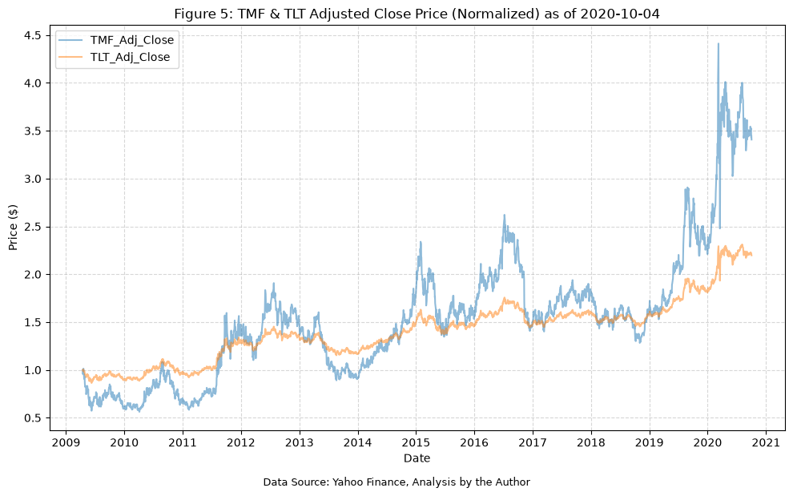
    


### Figure 7: Comparing the normalized value of EDC with its underlying index

As noted above, we will omit DZK and EFA, so we will jump to figure #7 which plots EDC and EEM.


```python
lev_etf = "EDC"
etf = "EEM"
end_date = "2020-10-04"

df = combine_normalize(
    fund_data=fund_data,
    lev_etf=lev_etf,
    etf=etf,
    start_date=None,
    end_date=end_date,
)

print(f"Table E11: {lev_etf} & {etf} Normalized Data")
display(df)
```

    Table E11: EDC & EEM Normalized Data


<div>
<style scoped>
    .dataframe tbody tr th:only-of-type {
        vertical-align: middle;
    }

    .dataframe tbody tr th {
        vertical-align: top;
    }

    .dataframe thead th {
        text-align: right;
    }
</style>
<table border="1" class="dataframe">
  <thead>
    <tr style="text-align: right;">
      <th></th>
      <th>EDC_Adj_Close</th>
      <th>EDC_Close</th>
      <th>EDC_High</th>
      <th>EDC_Low</th>
      <th>EDC_Open</th>
      <th>EDC_Volume</th>
      <th>EEM_Adj_Close</th>
      <th>EEM_Close</th>
      <th>EEM_High</th>
      <th>EEM_Low</th>
      <th>EEM_Open</th>
      <th>EEM_Volume</th>
    </tr>
    <tr>
      <th>Date</th>
      <th></th>
      <th></th>
      <th></th>
      <th></th>
      <th></th>
      <th></th>
      <th></th>
      <th></th>
      <th></th>
      <th></th>
      <th></th>
      <th></th>
    </tr>
  </thead>
  <tbody>
    <tr>
      <th>2008-12-30</th>
      <td>1.00</td>
      <td>1.00</td>
      <td>1.00</td>
      <td>1.00</td>
      <td>1.00</td>
      <td>1.00</td>
      <td>1.00</td>
      <td>1.00</td>
      <td>1.00</td>
      <td>1.00</td>
      <td>1.00</td>
      <td>1.00</td>
    </tr>
    <tr>
      <th>2008-12-31</th>
      <td>1.05</td>
      <td>1.05</td>
      <td>1.06</td>
      <td>1.01</td>
      <td>1.04</td>
      <td>0.56</td>
      <td>1.01</td>
      <td>1.01</td>
      <td>1.01</td>
      <td>1.01</td>
      <td>1.01</td>
      <td>0.89</td>
    </tr>
    <tr>
      <th>2009-01-02</th>
      <td>1.21</td>
      <td>1.21</td>
      <td>1.22</td>
      <td>1.13</td>
      <td>1.13</td>
      <td>0.76</td>
      <td>1.06</td>
      <td>1.06</td>
      <td>1.07</td>
      <td>1.04</td>
      <td>1.04</td>
      <td>1.39</td>
    </tr>
    <tr>
      <th>2009-01-05</th>
      <td>1.24</td>
      <td>1.24</td>
      <td>1.27</td>
      <td>1.23</td>
      <td>1.29</td>
      <td>1.19</td>
      <td>1.08</td>
      <td>1.08</td>
      <td>1.08</td>
      <td>1.07</td>
      <td>1.07</td>
      <td>1.29</td>
    </tr>
    <tr>
      <th>2009-01-06</th>
      <td>1.34</td>
      <td>1.34</td>
      <td>1.36</td>
      <td>1.35</td>
      <td>1.37</td>
      <td>2.62</td>
      <td>1.10</td>
      <td>1.10</td>
      <td>1.10</td>
      <td>1.11</td>
      <td>1.11</td>
      <td>1.36</td>
    </tr>
    <tr>
      <th>...</th>
      <td>...</td>
      <td>...</td>
      <td>...</td>
      <td>...</td>
      <td>...</td>
      <td>...</td>
      <td>...</td>
      <td>...</td>
      <td>...</td>
      <td>...</td>
      <td>...</td>
      <td>...</td>
    </tr>
    <tr>
      <th>2020-09-28</th>
      <td>0.86</td>
      <td>0.67</td>
      <td>0.68</td>
      <td>0.69</td>
      <td>0.71</td>
      <td>4.07</td>
      <td>2.22</td>
      <td>1.76</td>
      <td>1.76</td>
      <td>1.79</td>
      <td>1.80</td>
      <td>0.91</td>
    </tr>
    <tr>
      <th>2020-09-29</th>
      <td>0.86</td>
      <td>0.67</td>
      <td>0.67</td>
      <td>0.70</td>
      <td>0.70</td>
      <td>2.88</td>
      <td>2.22</td>
      <td>1.76</td>
      <td>1.76</td>
      <td>1.79</td>
      <td>1.79</td>
      <td>0.51</td>
    </tr>
    <tr>
      <th>2020-09-30</th>
      <td>0.89</td>
      <td>0.70</td>
      <td>0.71</td>
      <td>0.72</td>
      <td>0.72</td>
      <td>7.45</td>
      <td>2.25</td>
      <td>1.79</td>
      <td>1.79</td>
      <td>1.81</td>
      <td>1.81</td>
      <td>0.97</td>
    </tr>
    <tr>
      <th>2020-10-01</th>
      <td>0.92</td>
      <td>0.72</td>
      <td>0.72</td>
      <td>0.74</td>
      <td>0.75</td>
      <td>6.49</td>
      <td>2.28</td>
      <td>1.81</td>
      <td>1.80</td>
      <td>1.83</td>
      <td>1.83</td>
      <td>1.03</td>
    </tr>
    <tr>
      <th>2020-10-02</th>
      <td>0.89</td>
      <td>0.70</td>
      <td>0.71</td>
      <td>0.72</td>
      <td>0.72</td>
      <td>6.74</td>
      <td>2.25</td>
      <td>1.79</td>
      <td>1.80</td>
      <td>1.81</td>
      <td>1.81</td>
      <td>0.65</td>
    </tr>
  </tbody>
</table>
<p>2961 rows × 12 columns</p>
</div>


```python
max_per_ratio_date = None

sum_stats = calculate_returns_stats(
    df=df,
    lev_etf=lev_etf,
    etf=etf,
    max_per_ratio_date=max_per_ratio_date,
)

all_sum_stats = pd.concat([all_sum_stats, sum_stats])

print("Table E12: Leveraged and Non-Leveraged ETF Summary Statistics")
display(all_sum_stats)
```

    Table E12: Leveraged and Non-Leveraged ETF Summary Statistics


<div>
<style scoped>
    .dataframe tbody tr th:only-of-type {
        vertical-align: middle;
    }

    .dataframe tbody tr th {
        vertical-align: top;
    }

    .dataframe thead th {
        text-align: right;
    }
</style>
<table border="1" class="dataframe">
  <thead>
    <tr style="text-align: right;">
      <th></th>
      <th>Number of Observations</th>
      <th>Data Start Date</th>
      <th>Data End Date</th>
      <th>Annual Mean Return (Arithmetic)</th>
      <th>Annualized Volatility</th>
      <th>Annualized Sharpe Ratio</th>
      <th>CAGR (Geometric)</th>
      <th>Daily Max Return</th>
      <th>Daily Max Return (Date)</th>
      <th>Daily Min Return</th>
      <th>Daily Min Return (Date)</th>
      <th>Max Drawdown</th>
      <th>Peak</th>
      <th>Trough</th>
      <th>Recovery Date</th>
      <th>Calendar Days to Recovery</th>
      <th>MAR Ratio</th>
      <th>CAGR End Date</th>
      <th>Max Monthly Drawdown</th>
    </tr>
  </thead>
  <tbody>
    <tr>
      <th>TQQQ_Return</th>
      <td>2679</td>
      <td>2010-02-12</td>
      <td>2020-10-02</td>
      <td>0.57</td>
      <td>0.58</td>
      <td>0.99</td>
      <td>0.55</td>
      <td>0.27</td>
      <td>2020-03-13</td>
      <td>-0.34</td>
      <td>2020-03-16</td>
      <td>-0.70</td>
      <td>2020-02-19</td>
      <td>2020-03-20</td>
      <td>2020-07-10</td>
      <td>112.00</td>
      <td>0.71</td>
      <td>2020-09-02</td>
      <td>-0.49</td>
    </tr>
    <tr>
      <th>QQQ_Return</th>
      <td>2679</td>
      <td>2010-02-12</td>
      <td>2020-10-02</td>
      <td>0.20</td>
      <td>0.20</td>
      <td>1.03</td>
      <td>0.21</td>
      <td>0.08</td>
      <td>2020-03-13</td>
      <td>-0.12</td>
      <td>2020-03-16</td>
      <td>-0.29</td>
      <td>2020-02-19</td>
      <td>2020-03-16</td>
      <td>2020-06-03</td>
      <td>79.00</td>
      <td>0.70</td>
      <td>2020-09-02</td>
      <td>-0.17</td>
    </tr>
    <tr>
      <th>UPRO_Return</th>
      <td>2838</td>
      <td>2009-06-26</td>
      <td>2020-10-02</td>
      <td>0.42</td>
      <td>0.52</td>
      <td>0.81</td>
      <td>0.39</td>
      <td>0.28</td>
      <td>2020-03-24</td>
      <td>-0.35</td>
      <td>2020-03-16</td>
      <td>-0.77</td>
      <td>2020-02-19</td>
      <td>2020-03-23</td>
      <td>NaT</td>
      <td>NaN</td>
      <td>0.42</td>
      <td>2020-02-19</td>
      <td>-0.60</td>
    </tr>
    <tr>
      <th>SPY_Return</th>
      <td>2838</td>
      <td>2009-06-26</td>
      <td>2020-10-02</td>
      <td>0.15</td>
      <td>0.17</td>
      <td>0.87</td>
      <td>0.15</td>
      <td>0.09</td>
      <td>2020-03-24</td>
      <td>-0.11</td>
      <td>2020-03-16</td>
      <td>-0.34</td>
      <td>2020-02-19</td>
      <td>2020-03-23</td>
      <td>2020-08-10</td>
      <td>140.00</td>
      <td>0.43</td>
      <td>2020-02-19</td>
      <td>-0.19</td>
    </tr>
    <tr>
      <th>UDOW_Return</th>
      <td>2679</td>
      <td>2010-02-12</td>
      <td>2020-10-02</td>
      <td>0.37</td>
      <td>0.51</td>
      <td>0.72</td>
      <td>0.36</td>
      <td>0.33</td>
      <td>2020-03-24</td>
      <td>-0.35</td>
      <td>2020-03-16</td>
      <td>-0.80</td>
      <td>2020-02-12</td>
      <td>2020-03-23</td>
      <td>NaT</td>
      <td>NaN</td>
      <td>0.33</td>
      <td>2020-02-12</td>
      <td>-0.66</td>
    </tr>
    <tr>
      <th>DIA_Return</th>
      <td>2679</td>
      <td>2010-02-12</td>
      <td>2020-10-02</td>
      <td>0.13</td>
      <td>0.17</td>
      <td>0.77</td>
      <td>0.14</td>
      <td>0.11</td>
      <td>2020-03-24</td>
      <td>-0.13</td>
      <td>2020-03-16</td>
      <td>-0.37</td>
      <td>2020-02-12</td>
      <td>2020-03-23</td>
      <td>NaT</td>
      <td>NaN</td>
      <td>0.34</td>
      <td>2020-02-12</td>
      <td>-0.23</td>
    </tr>
    <tr>
      <th>TNA_Return</th>
      <td>2987</td>
      <td>2008-11-20</td>
      <td>2020-10-02</td>
      <td>0.42</td>
      <td>0.72</td>
      <td>0.58</td>
      <td>0.35</td>
      <td>0.27</td>
      <td>2020-03-24</td>
      <td>-0.37</td>
      <td>2020-03-16</td>
      <td>-0.88</td>
      <td>2018-08-31</td>
      <td>2020-03-23</td>
      <td>NaT</td>
      <td>NaN</td>
      <td>0.19</td>
      <td>2018-08-29</td>
      <td>-0.83</td>
    </tr>
    <tr>
      <th>IWM_Return</th>
      <td>2987</td>
      <td>2008-11-20</td>
      <td>2020-10-02</td>
      <td>0.15</td>
      <td>0.24</td>
      <td>0.64</td>
      <td>0.17</td>
      <td>0.09</td>
      <td>2020-03-24</td>
      <td>-0.13</td>
      <td>2020-03-16</td>
      <td>-0.41</td>
      <td>2018-08-31</td>
      <td>2020-03-23</td>
      <td>NaT</td>
      <td>NaN</td>
      <td>0.32</td>
      <td>2018-08-29</td>
      <td>-0.32</td>
    </tr>
    <tr>
      <th>TMF_Return</th>
      <td>2887</td>
      <td>2009-04-17</td>
      <td>2020-10-02</td>
      <td>0.21</td>
      <td>0.44</td>
      <td>0.46</td>
      <td>0.15</td>
      <td>0.20</td>
      <td>2020-03-20</td>
      <td>-0.18</td>
      <td>2020-03-18</td>
      <td>-0.53</td>
      <td>2012-07-25</td>
      <td>2013-08-21</td>
      <td>2015-01-05</td>
      <td>502.00</td>
      <td>0.21</td>
      <td>2020-03-09</td>
      <td>-0.50</td>
    </tr>
    <tr>
      <th>TLT_Return</th>
      <td>2887</td>
      <td>2009-04-17</td>
      <td>2020-10-02</td>
      <td>0.08</td>
      <td>0.15</td>
      <td>0.54</td>
      <td>0.08</td>
      <td>0.08</td>
      <td>2020-03-20</td>
      <td>-0.07</td>
      <td>2020-03-17</td>
      <td>-0.21</td>
      <td>2012-07-25</td>
      <td>2013-08-21</td>
      <td>2014-12-10</td>
      <td>476.00</td>
      <td>0.34</td>
      <td>2020-03-09</td>
      <td>-0.18</td>
    </tr>
    <tr>
      <th>EDC_Return</th>
      <td>2960</td>
      <td>2008-12-31</td>
      <td>2020-10-02</td>
      <td>0.25</td>
      <td>0.72</td>
      <td>0.35</td>
      <td>-0.01</td>
      <td>0.28</td>
      <td>2009-03-23</td>
      <td>-0.35</td>
      <td>2020-03-16</td>
      <td>-0.92</td>
      <td>2011-04-08</td>
      <td>2020-03-23</td>
      <td>NaT</td>
      <td>NaN</td>
      <td>-0.01</td>
      <td>2020-10-02</td>
      <td>-0.90</td>
    </tr>
    <tr>
      <th>EEM_Return</th>
      <td>2960</td>
      <td>2008-12-31</td>
      <td>2020-10-02</td>
      <td>0.10</td>
      <td>0.25</td>
      <td>0.40</td>
      <td>0.07</td>
      <td>0.09</td>
      <td>2009-03-23</td>
      <td>-0.12</td>
      <td>2020-03-16</td>
      <td>-0.38</td>
      <td>2018-01-26</td>
      <td>2020-03-23</td>
      <td>NaT</td>
      <td>NaN</td>
      <td>0.19</td>
      <td>2020-10-02</td>
      <td>-0.33</td>
    </tr>
  </tbody>
</table>
</div>


Finally, the paper does not provide a maximum performance ratio or any CAGR values for EDC or EEM, so we calculate the CAGR over the full period, and find -1% for EDC and 7% for EEM. For the drawdowns, we observed 92% for EDC and 38% for EEM, which is in line with the values of 92.3% and 38.2% that were provided in the paper. The MDD values from the paper of 89.6% and 32.7% also match ours at 90% and 33%.


```python
plot_time_series(
    df=df,
    plot_start_date=None,
    plot_end_date=None,
    plot_columns=[f"{lev_etf}_Adj_Close", f"{etf}_Adj_Close"],
    title=f"Figure 7: {lev_etf} & {etf} Adjusted Close Price (Normalized) as of {end_date}",
    x_label="Date",
    x_format="Year",
    x_tick_spacing=1,
    x_tick_start=None,
    x_tick_rotation=0,
    y_label="Price ($)",
    y_format="Decimal",
    y_format_decimal_places=1,
    y_tick_spacing="Auto",
    y_tick_rotation=0,
    caption="Data Source: Yahoo Finance, Analysis by the Author",
)
```


    
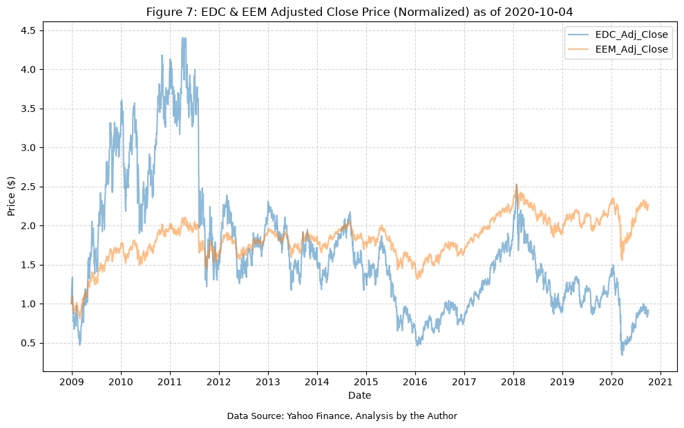
    


## Section 3.0: The Risk Mitigation Strategy

In section 3.0, the paper talks about using a portfolio composed of a combination of 2 TLETFs, rebalanced periodically to maintain a specific asset allocation. The section starts with the following claim:

> "As mentioned earlier, it is easy to show that QQQ, SPY, and DIA are generally negatively correlated with TLT and the same can be said about their corresponding TLETFs."

Before we move on to the portfolio and strategy, let's first look at the correlations between the above mentioned ETFs and the corresponding TLETFs.


```python
corr_data = pd.DataFrame()

for fund in ["QQQ", "SPY", "DIA", "TLT"]:
    df = fund_data[fund]
    df[f"{fund}_Return"] = df[f"{fund}_Adj_Close"].pct_change()
    corr_data = pd.concat([corr_data, df[[f"{fund}_Return"]]], axis=1)

corr_data = corr_data.dropna()
corr_data = corr_data[corr_data.index >= "2010-02-11"]
corr_data = corr_data[corr_data.index <= "2020-10-04"]

print("Table E13: QQQ, SPY, DIA, and TLT Daily Returns")
display(corr_data)

print("Table E14: Correlation Matrix of QQQ, SPY, DIA, and TLT Daily Returns")
display(corr_data.corr())
```

    Table E13: QQQ, SPY, DIA, and TLT Daily Returns


<div>
<style scoped>
    .dataframe tbody tr th:only-of-type {
        vertical-align: middle;
    }

    .dataframe tbody tr th {
        vertical-align: top;
    }

    .dataframe thead th {
        text-align: right;
    }
</style>
<table border="1" class="dataframe">
  <thead>
    <tr style="text-align: right;">
      <th></th>
      <th>QQQ_Return</th>
      <th>SPY_Return</th>
      <th>DIA_Return</th>
      <th>TLT_Return</th>
    </tr>
    <tr>
      <th>Date</th>
      <th></th>
      <th></th>
      <th></th>
      <th></th>
    </tr>
  </thead>
  <tbody>
    <tr>
      <th>2010-02-11</th>
      <td>0.02</td>
      <td>0.01</td>
      <td>0.01</td>
      <td>-0.01</td>
    </tr>
    <tr>
      <th>2010-02-12</th>
      <td>0.00</td>
      <td>-0.00</td>
      <td>-0.00</td>
      <td>0.00</td>
    </tr>
    <tr>
      <th>2010-02-16</th>
      <td>0.01</td>
      <td>0.02</td>
      <td>0.02</td>
      <td>0.00</td>
    </tr>
    <tr>
      <th>2010-02-17</th>
      <td>0.01</td>
      <td>0.00</td>
      <td>0.01</td>
      <td>-0.01</td>
    </tr>
    <tr>
      <th>2010-02-18</th>
      <td>0.01</td>
      <td>0.01</td>
      <td>0.01</td>
      <td>-0.00</td>
    </tr>
    <tr>
      <th>...</th>
      <td>...</td>
      <td>...</td>
      <td>...</td>
      <td>...</td>
    </tr>
    <tr>
      <th>2020-09-28</th>
      <td>0.02</td>
      <td>0.02</td>
      <td>0.02</td>
      <td>-0.00</td>
    </tr>
    <tr>
      <th>2020-09-29</th>
      <td>-0.00</td>
      <td>-0.01</td>
      <td>-0.01</td>
      <td>0.00</td>
    </tr>
    <tr>
      <th>2020-09-30</th>
      <td>0.01</td>
      <td>0.01</td>
      <td>0.01</td>
      <td>-0.01</td>
    </tr>
    <tr>
      <th>2020-10-01</th>
      <td>0.02</td>
      <td>0.01</td>
      <td>0.00</td>
      <td>0.00</td>
    </tr>
    <tr>
      <th>2020-10-02</th>
      <td>-0.03</td>
      <td>-0.01</td>
      <td>-0.00</td>
      <td>-0.00</td>
    </tr>
  </tbody>
</table>
<p>2680 rows × 4 columns</p>
</div>


    Table E14: Correlation Matrix of QQQ, SPY, DIA, and TLT Daily Returns


<div>
<style scoped>
    .dataframe tbody tr th:only-of-type {
        vertical-align: middle;
    }

    .dataframe tbody tr th {
        vertical-align: top;
    }

    .dataframe thead th {
        text-align: right;
    }
</style>
<table border="1" class="dataframe">
  <thead>
    <tr style="text-align: right;">
      <th></th>
      <th>QQQ_Return</th>
      <th>SPY_Return</th>
      <th>DIA_Return</th>
      <th>TLT_Return</th>
    </tr>
  </thead>
  <tbody>
    <tr>
      <th>QQQ_Return</th>
      <td>1.00</td>
      <td>0.93</td>
      <td>0.87</td>
      <td>-0.42</td>
    </tr>
    <tr>
      <th>SPY_Return</th>
      <td>0.93</td>
      <td>1.00</td>
      <td>0.97</td>
      <td>-0.48</td>
    </tr>
    <tr>
      <th>DIA_Return</th>
      <td>0.87</td>
      <td>0.97</td>
      <td>1.00</td>
      <td>-0.47</td>
    </tr>
    <tr>
      <th>TLT_Return</th>
      <td>-0.42</td>
      <td>-0.48</td>
      <td>-0.47</td>
      <td>1.00</td>
    </tr>
  </tbody>
</table>
</div>


The above table confirms the conjecture from the paper. The correlations amongst the equity and bond funds are in fact negative.

Next, we will confirm the correlations for the leveraged ETFs.


```python
lev_corr_data = pd.DataFrame()

for fund in ["TQQQ", "UPRO", "UDOW", "TMF"]:
    df = fund_data[fund]
    df[f"{fund}_Return"] = df[f"{fund}_Adj_Close"].pct_change()
    lev_corr_data = pd.concat([lev_corr_data, df[[f"{fund}_Return"]]], axis=1)

lev_corr_data = lev_corr_data.dropna()
lev_corr_data = lev_corr_data[lev_corr_data.index <= "2020-10-04"]

print("Table E15: TQQQ, UPRO, UDOW, and TMF Daily Returns")
display(lev_corr_data)

print("Table E16: Correlation Matrix of TQQQ, UPRO, UDOW, and TMF Daily Returns")
display(lev_corr_data.corr())
```

    Table E15: TQQQ, UPRO, UDOW, and TMF Daily Returns


<div>
<style scoped>
    .dataframe tbody tr th:only-of-type {
        vertical-align: middle;
    }

    .dataframe tbody tr th {
        vertical-align: top;
    }

    .dataframe thead th {
        text-align: right;
    }
</style>
<table border="1" class="dataframe">
  <thead>
    <tr style="text-align: right;">
      <th></th>
      <th>TQQQ_Return</th>
      <th>UPRO_Return</th>
      <th>UDOW_Return</th>
      <th>TMF_Return</th>
    </tr>
    <tr>
      <th>Date</th>
      <th></th>
      <th></th>
      <th></th>
      <th></th>
    </tr>
  </thead>
  <tbody>
    <tr>
      <th>2010-02-12</th>
      <td>0.00</td>
      <td>-0.00</td>
      <td>-0.00</td>
      <td>0.01</td>
    </tr>
    <tr>
      <th>2010-02-16</th>
      <td>0.04</td>
      <td>0.05</td>
      <td>0.07</td>
      <td>0.01</td>
    </tr>
    <tr>
      <th>2010-02-17</th>
      <td>0.02</td>
      <td>0.01</td>
      <td>0.02</td>
      <td>-0.03</td>
    </tr>
    <tr>
      <th>2010-02-18</th>
      <td>0.02</td>
      <td>0.02</td>
      <td>0.03</td>
      <td>-0.02</td>
    </tr>
    <tr>
      <th>2010-02-19</th>
      <td>0.00</td>
      <td>0.01</td>
      <td>0.00</td>
      <td>0.02</td>
    </tr>
    <tr>
      <th>...</th>
      <td>...</td>
      <td>...</td>
      <td>...</td>
      <td>...</td>
    </tr>
    <tr>
      <th>2020-09-28</th>
      <td>0.06</td>
      <td>0.05</td>
      <td>0.05</td>
      <td>-0.01</td>
    </tr>
    <tr>
      <th>2020-09-29</th>
      <td>-0.01</td>
      <td>-0.02</td>
      <td>-0.02</td>
      <td>0.00</td>
    </tr>
    <tr>
      <th>2020-09-30</th>
      <td>0.02</td>
      <td>0.02</td>
      <td>0.04</td>
      <td>-0.03</td>
    </tr>
    <tr>
      <th>2020-10-01</th>
      <td>0.05</td>
      <td>0.02</td>
      <td>0.01</td>
      <td>0.01</td>
    </tr>
    <tr>
      <th>2020-10-02</th>
      <td>-0.08</td>
      <td>-0.03</td>
      <td>-0.01</td>
      <td>-0.01</td>
    </tr>
  </tbody>
</table>
<p>2679 rows × 4 columns</p>
</div>


    Table E16: Correlation Matrix of TQQQ, UPRO, UDOW, and TMF Daily Returns


<div>
<style scoped>
    .dataframe tbody tr th:only-of-type {
        vertical-align: middle;
    }

    .dataframe tbody tr th {
        vertical-align: top;
    }

    .dataframe thead th {
        text-align: right;
    }
</style>
<table border="1" class="dataframe">
  <thead>
    <tr style="text-align: right;">
      <th></th>
      <th>TQQQ_Return</th>
      <th>UPRO_Return</th>
      <th>UDOW_Return</th>
      <th>TMF_Return</th>
    </tr>
  </thead>
  <tbody>
    <tr>
      <th>TQQQ_Return</th>
      <td>1.00</td>
      <td>0.93</td>
      <td>0.87</td>
      <td>-0.41</td>
    </tr>
    <tr>
      <th>UPRO_Return</th>
      <td>0.93</td>
      <td>1.00</td>
      <td>0.97</td>
      <td>-0.48</td>
    </tr>
    <tr>
      <th>UDOW_Return</th>
      <td>0.87</td>
      <td>0.97</td>
      <td>1.00</td>
      <td>-0.46</td>
    </tr>
    <tr>
      <th>TMF_Return</th>
      <td>-0.41</td>
      <td>-0.48</td>
      <td>-0.46</td>
      <td>1.00</td>
    </tr>
  </tbody>
</table>
</div>


Here we have the same finding. The correlations between the leveraged equity ETFs and the leveraged bond ETF are also negative. They are also nearly identical to the correlations for the underlying non-leveraged ETFs over the same period. This is expected, since the daily return of a leveraged ETF is approximately 3 times the daily return of its underlying index, and scaling a return series does not change its correlation.

Next, we'll look at the strategy. From the paper:

> Strategies that exploit this feature have been shown to exceed the performance of both that of both TLT and the equity ETFs and with reduced risk6,7. Here we focus on the triple leveraged versions of QQQ (TQQQ) and TLT (TMF) and propose simply to purchase a portfolio consisting of equal dollar amounts of both TLETFs and attempt to maintain this percentage by rebalancing on the last day of the k th month, where k=1,2,3,…

We'll use the following helper function to execute the strategy.


```python
def rebalance_strategy(
    fund_data: dict,
    fund_1: str,
    fund_2: str,
    fund_1_weight: float = 0.5,
    rebalance_months: int = 2,
    transaction_fee: float = 0.0025,
    start_date=None,
    end_date=None,
) -> pd.DataFrame:
    """
    Simulate a two-fund portfolio that is periodically rebalanced back to a target allocation.

    Parameters
    ----------
    fund_data : dict
        Dictionary containing DataFrames for each fund.
    fund_1 : str
        The ticker symbol for the first fund.
    fund_2 : str
        The ticker symbol for the second fund.
    fund_1_weight : float, optional
        Target allocation to the first fund; the second fund receives the remainder (default is 0.5).
    rebalance_months : int, optional
        Rebalance on the last trading day of every k-th month, counting the start month as month 1 (default is 2).
    transaction_fee : float, optional
        Fee charged on the dollar amount of each buy or sell order at a rebalance (default is 0.0025).
    start_date : optional
        Start date for the data. If None, uses the earliest date both funds have data (default is None).
    end_date : optional
        End date for the data. If None, uses the latest available date (default is None).

    Returns
    -------
    pd.DataFrame
        DataFrame with the normalized fund prices, the value of each holding, the normalized
        strategy value, the strategy daily return, and the rebalance flag and fee paid on each day.
    """

    # Combine the adjusted close prices over the common date range
    df = fund_data[fund_1][[f"{fund_1}_Adj_Close"]].merge(
        fund_data[fund_2][[f"{fund_2}_Adj_Close"]], left_index=True, right_index=True
    )

    # Filter by date range
    df = df.loc[start_date:end_date]

    # Normalize prices to start at 1
    df = df / df.iloc[0]

    # Calculate the return series for each fund
    df[f"{fund_1}_Return"] = df[f"{fund_1}_Adj_Close"].pct_change()
    df[f"{fund_2}_Return"] = df[f"{fund_2}_Adj_Close"].pct_change()

    # Calculate the drawdowns for each fund
    df[f"{fund_1}_Drawdown"] = (
        df[f"{fund_1}_Adj_Close"] / df[f"{fund_1}_Adj_Close"].cummax() - 1
    )
    df[f"{fund_2}_Drawdown"] = (
        df[f"{fund_2}_Adj_Close"] / df[f"{fund_2}_Adj_Close"].cummax() - 1
    )
    df[f"{fund_1}_Drawdown_Daily_Max"] = df[f"{fund_1}_Drawdown"].cummin()
    df[f"{fund_2}_Drawdown_Daily_Max"] = df[f"{fund_2}_Drawdown"].cummin()

    # Flag the last trading day of each month, excluding the final row since that month may be incomplete
    month = pd.Series(df.index.to_period("M"), index=df.index)
    month_end = month != month.shift(-1)
    month_end.iloc[-1] = False

    # Rebalance on the last trading day of every k-th month
    month_number = (
        (df.index.year - df.index[0].year) * 12
        + (df.index.month - df.index[0].month)
        + 1
    )
    rebalance = month_end & (month_number % rebalance_months == 0)

    fund_2_weight = 1 - fund_1_weight

    # Initial purchase at the target allocation with a starting portfolio value of 1
    fund_1_shares = fund_1_weight / df[f"{fund_1}_Adj_Close"].iloc[0]
    fund_2_shares = fund_2_weight / df[f"{fund_2}_Adj_Close"].iloc[0]

    fund_1_values, fund_2_values, fees = [], [], []

    for date, row in df.iterrows():
        fund_1_value = fund_1_shares * row[f"{fund_1}_Adj_Close"]
        fund_2_value = fund_2_shares * row[f"{fund_2}_Adj_Close"]
        fee = 0.0

        if rebalance.loc[date]:
            total_value = fund_1_value + fund_2_value

            # Fee on the dollar amount traded in each fund to get back to the target allocation
            fee = transaction_fee * (
                abs(fund_1_weight * total_value - fund_1_value)
                + abs(fund_2_weight * total_value - fund_2_value)
            )
            total_value -= fee

            fund_1_value = fund_1_weight * total_value
            fund_2_value = fund_2_weight * total_value
            fund_1_shares = fund_1_value / row[f"{fund_1}_Adj_Close"]
            fund_2_shares = fund_2_value / row[f"{fund_2}_Adj_Close"]

        fund_1_values.append(fund_1_value)
        fund_2_values.append(fund_2_value)
        fees.append(fee)

    df[f"{fund_1}_Value"] = fund_1_values
    df[f"{fund_2}_Value"] = fund_2_values
    df["Strategy_Adj_Close"] = df[f"{fund_1}_Value"] + df[f"{fund_2}_Value"]
    df["Strategy_Return"] = df["Strategy_Adj_Close"].pct_change()

    # Calculate the drawdown for the strategy
    df["Strategy_Drawdown"] = (
        df["Strategy_Adj_Close"] / df["Strategy_Adj_Close"].cummax() - 1
    )
    df["Strategy_Drawdown_Daily_Max"] = df["Strategy_Drawdown"].cummin()

    df["Rebalance"] = rebalance
    df["Transaction_Fee"] = fees

    return df
```

Now, we'll execute the strategy for TQQQ and TMF, as the paper does with a start date of 2/11/2010 and an end date of 10/4/2020.


```python
tqqq_tmf = rebalance_strategy(
    fund_data=fund_data,
    fund_1="TQQQ",
    fund_2="TMF",
    fund_1_weight=0.5,
    rebalance_months=2,
    transaction_fee=0.0025,  # 0.25% transaction fee
    start_date=None,
    end_date="2020-10-04",
)

print("Table E17: TQQQ/TMF Rebalance Strategy Data")
display(tqqq_tmf)
```

    Table E17: TQQQ/TMF Rebalance Strategy Data


<div>
<style scoped>
    .dataframe tbody tr th:only-of-type {
        vertical-align: middle;
    }

    .dataframe tbody tr th {
        vertical-align: top;
    }

    .dataframe thead th {
        text-align: right;
    }
</style>
<table border="1" class="dataframe">
  <thead>
    <tr style="text-align: right;">
      <th></th>
      <th>TQQQ_Adj_Close</th>
      <th>TMF_Adj_Close</th>
      <th>TQQQ_Return</th>
      <th>TMF_Return</th>
      <th>TQQQ_Drawdown</th>
      <th>TMF_Drawdown</th>
      <th>TQQQ_Drawdown_Daily_Max</th>
      <th>TMF_Drawdown_Daily_Max</th>
      <th>TQQQ_Value</th>
      <th>TMF_Value</th>
      <th>Strategy_Adj_Close</th>
      <th>Strategy_Return</th>
      <th>Strategy_Drawdown</th>
      <th>Strategy_Drawdown_Daily_Max</th>
      <th>Rebalance</th>
      <th>Transaction_Fee</th>
    </tr>
    <tr>
      <th>Date</th>
      <th></th>
      <th></th>
      <th></th>
      <th></th>
      <th></th>
      <th></th>
      <th></th>
      <th></th>
      <th></th>
      <th></th>
      <th></th>
      <th></th>
      <th></th>
      <th></th>
      <th></th>
      <th></th>
    </tr>
  </thead>
  <tbody>
    <tr>
      <th>2010-02-11</th>
      <td>1.00</td>
      <td>1.00</td>
      <td>NaN</td>
      <td>NaN</td>
      <td>0.00</td>
      <td>0.00</td>
      <td>0.00</td>
      <td>0.00</td>
      <td>0.50</td>
      <td>0.50</td>
      <td>1.00</td>
      <td>NaN</td>
      <td>0.00</td>
      <td>0.00</td>
      <td>False</td>
      <td>0.00</td>
    </tr>
    <tr>
      <th>2010-02-12</th>
      <td>1.00</td>
      <td>1.01</td>
      <td>0.00</td>
      <td>0.01</td>
      <td>0.00</td>
      <td>0.00</td>
      <td>0.00</td>
      <td>0.00</td>
      <td>0.50</td>
      <td>0.51</td>
      <td>1.01</td>
      <td>0.01</td>
      <td>0.00</td>
      <td>0.00</td>
      <td>False</td>
      <td>0.00</td>
    </tr>
    <tr>
      <th>2010-02-16</th>
      <td>1.04</td>
      <td>1.02</td>
      <td>0.04</td>
      <td>0.01</td>
      <td>0.00</td>
      <td>0.00</td>
      <td>0.00</td>
      <td>0.00</td>
      <td>0.52</td>
      <td>0.51</td>
      <td>1.03</td>
      <td>0.02</td>
      <td>0.00</td>
      <td>0.00</td>
      <td>False</td>
      <td>0.00</td>
    </tr>
    <tr>
      <th>2010-02-17</th>
      <td>1.06</td>
      <td>0.99</td>
      <td>0.02</td>
      <td>-0.03</td>
      <td>0.00</td>
      <td>-0.03</td>
      <td>0.00</td>
      <td>-0.03</td>
      <td>0.53</td>
      <td>0.49</td>
      <td>1.02</td>
      <td>-0.01</td>
      <td>-0.01</td>
      <td>-0.01</td>
      <td>False</td>
      <td>0.00</td>
    </tr>
    <tr>
      <th>2010-02-18</th>
      <td>1.08</td>
      <td>0.97</td>
      <td>0.02</td>
      <td>-0.02</td>
      <td>0.00</td>
      <td>-0.05</td>
      <td>0.00</td>
      <td>-0.05</td>
      <td>0.54</td>
      <td>0.49</td>
      <td>1.03</td>
      <td>0.00</td>
      <td>-0.01</td>
      <td>-0.01</td>
      <td>False</td>
      <td>0.00</td>
    </tr>
    <tr>
      <th>...</th>
      <td>...</td>
      <td>...</td>
      <td>...</td>
      <td>...</td>
      <td>...</td>
      <td>...</td>
      <td>...</td>
      <td>...</td>
      <td>...</td>
      <td>...</td>
      <td>...</td>
      <td>...</td>
      <td>...</td>
      <td>...</td>
      <td>...</td>
      <td>...</td>
    </tr>
    <tr>
      <th>2020-09-28</th>
      <td>75.16</td>
      <td>5.83</td>
      <td>0.06</td>
      <td>-0.01</td>
      <td>-0.26</td>
      <td>-0.20</td>
      <td>-0.70</td>
      <td>-0.53</td>
      <td>23.78</td>
      <td>19.49</td>
      <td>43.28</td>
      <td>0.03</td>
      <td>-0.17</td>
      <td>-0.42</td>
      <td>False</td>
      <td>0.00</td>
    </tr>
    <tr>
      <th>2020-09-29</th>
      <td>74.37</td>
      <td>5.85</td>
      <td>-0.01</td>
      <td>0.00</td>
      <td>-0.26</td>
      <td>-0.20</td>
      <td>-0.70</td>
      <td>-0.53</td>
      <td>23.53</td>
      <td>19.56</td>
      <td>43.09</td>
      <td>-0.00</td>
      <td>-0.17</td>
      <td>-0.42</td>
      <td>False</td>
      <td>0.00</td>
    </tr>
    <tr>
      <th>2020-09-30</th>
      <td>75.85</td>
      <td>5.69</td>
      <td>0.02</td>
      <td>-0.03</td>
      <td>-0.25</td>
      <td>-0.22</td>
      <td>-0.70</td>
      <td>-0.53</td>
      <td>21.51</td>
      <td>21.51</td>
      <td>43.02</td>
      <td>-0.00</td>
      <td>-0.17</td>
      <td>-0.42</td>
      <td>True</td>
      <td>0.01</td>
    </tr>
    <tr>
      <th>2020-10-01</th>
      <td>79.40</td>
      <td>5.73</td>
      <td>0.05</td>
      <td>0.01</td>
      <td>-0.21</td>
      <td>-0.22</td>
      <td>-0.70</td>
      <td>-0.53</td>
      <td>22.52</td>
      <td>21.63</td>
      <td>44.15</td>
      <td>0.03</td>
      <td>-0.15</td>
      <td>-0.42</td>
      <td>False</td>
      <td>0.00</td>
    </tr>
    <tr>
      <th>2020-10-02</th>
      <td>72.85</td>
      <td>5.66</td>
      <td>-0.08</td>
      <td>-0.01</td>
      <td>-0.28</td>
      <td>-0.23</td>
      <td>-0.70</td>
      <td>-0.53</td>
      <td>20.66</td>
      <td>21.37</td>
      <td>42.03</td>
      <td>-0.05</td>
      <td>-0.19</td>
      <td>-0.42</td>
      <td>False</td>
      <td>0.00</td>
    </tr>
  </tbody>
</table>
<p>2680 rows × 16 columns</p>
</div>


And then we can check the summary statistics to confirm that our implementation of the strategy matches the results reported in the paper.


```python
# Create one empty dataframe for all summary statistics
all_strat_sum_stats = pd.DataFrame()

tqqq_tmf_sum_stats = summary_stats(
    fund_list=["TQQQ", "TMF"],
    df=tqqq_tmf[["Strategy_Return"]].dropna(),
    period="Daily",
    use_calendar_days=False,
    excel_export=False,
    pickle_export=False,
    output_confirmation=False,
)

# Rename the index to indicate the strategy
tqqq_tmf_sum_stats.index = ["TQQQ/TMF Strategy"]

all_strat_sum_stats = pd.concat([all_strat_sum_stats, tqqq_tmf_sum_stats])

tqqq_sum_stats = summary_stats(
    fund_list=["TQQQ", "TMF"],
    df=tqqq_tmf[["TQQQ_Return"]].dropna(),
    period="Daily",
    use_calendar_days=False,
    excel_export=False,
    pickle_export=False,
    output_confirmation=False,
)

# Rename the index to indicate the strategy
tqqq_sum_stats.index = ["TQQQ"]

all_strat_sum_stats = pd.concat([all_strat_sum_stats, tqqq_sum_stats])

tmf_sum_stats = summary_stats(
    fund_list=["TQQQ", "TMF"],
    df=tqqq_tmf[["TMF_Return"]].dropna(),
    period="Daily",
    use_calendar_days=False,
    excel_export=False,
    pickle_export=False,
    output_confirmation=False,
)

# Rename the index to indicate the strategy
tmf_sum_stats.index = ["TMF"]

all_strat_sum_stats = pd.concat([all_strat_sum_stats, tmf_sum_stats])

print("Table E18: Strategy Summary Statistics")
display(all_strat_sum_stats)
```

    Table E18: Strategy Summary Statistics


<div>
<style scoped>
    .dataframe tbody tr th:only-of-type {
        vertical-align: middle;
    }

    .dataframe tbody tr th {
        vertical-align: top;
    }

    .dataframe thead th {
        text-align: right;
    }
</style>
<table border="1" class="dataframe">
  <thead>
    <tr style="text-align: right;">
      <th></th>
      <th>Number of Observations</th>
      <th>Data Start Date</th>
      <th>Data End Date</th>
      <th>Annual Mean Return (Arithmetic)</th>
      <th>Annualized Volatility</th>
      <th>Annualized Sharpe Ratio</th>
      <th>CAGR (Geometric)</th>
      <th>Daily Max Return</th>
      <th>Daily Max Return (Date)</th>
      <th>Daily Min Return</th>
      <th>Daily Min Return (Date)</th>
      <th>Max Drawdown</th>
      <th>Peak</th>
      <th>Trough</th>
      <th>Recovery Date</th>
      <th>Calendar Days to Recovery</th>
      <th>MAR Ratio</th>
    </tr>
  </thead>
  <tbody>
    <tr>
      <th>TQQQ/TMF Strategy</th>
      <td>2679</td>
      <td>2010-02-12</td>
      <td>2020-10-02</td>
      <td>0.39</td>
      <td>0.28</td>
      <td>1.40</td>
      <td>0.42</td>
      <td>0.11</td>
      <td>2020-03-20</td>
      <td>-0.16</td>
      <td>2020-03-18</td>
      <td>-0.42</td>
      <td>2020-03-06</td>
      <td>2020-03-18</td>
      <td>2020-05-07</td>
      <td>50</td>
      <td>1.00</td>
    </tr>
    <tr>
      <th>TQQQ</th>
      <td>2679</td>
      <td>2010-02-12</td>
      <td>2020-10-02</td>
      <td>0.57</td>
      <td>0.58</td>
      <td>0.99</td>
      <td>0.50</td>
      <td>0.27</td>
      <td>2020-03-13</td>
      <td>-0.34</td>
      <td>2020-03-16</td>
      <td>-0.70</td>
      <td>2020-02-19</td>
      <td>2020-03-20</td>
      <td>2020-07-10</td>
      <td>112</td>
      <td>0.71</td>
    </tr>
    <tr>
      <th>TMF</th>
      <td>2679</td>
      <td>2010-02-12</td>
      <td>2020-10-02</td>
      <td>0.26</td>
      <td>0.44</td>
      <td>0.59</td>
      <td>0.18</td>
      <td>0.20</td>
      <td>2020-03-20</td>
      <td>-0.18</td>
      <td>2020-03-18</td>
      <td>-0.53</td>
      <td>2012-07-25</td>
      <td>2013-08-21</td>
      <td>2015-01-05</td>
      <td>502</td>
      <td>0.33</td>
    </tr>
  </tbody>
</table>
</div>


The paper reports a CAGR of 44.9%, and our implementation finds 42%. The discrepancy here is likely the end date. The paper references 10/4/2020, but it seems the data points it uses are actually from 9/2/2020.

### Figure 8: Strategy Performance With Bimonthly Rebalancing

We can reproduce figure 8, which shows the performance of TQQQ, TMF, and the strategy over time.


```python
plot_time_series(
    df=tqqq_tmf,
    plot_start_date=None,
    plot_end_date=None,
    plot_columns=["TQQQ_Adj_Close", "TMF_Adj_Close", "Strategy_Adj_Close"],
    title="Figure 8: Rebalance Strategy, TQQQ, and TMF Adjusted Close Price (Normalized) as of 2020-10-04",
    x_label="Date",
    x_format="Year",
    x_tick_spacing=1,
    x_tick_start=None,
    x_tick_rotation=0,
    y_label="Price ($)",
    y_format="Decimal",
    y_format_decimal_places=1,
    y_tick_spacing="Auto",
    y_tick_rotation=0,
    caption="Data Source: Yahoo Finance, Analysis by the Author",
)
```


    
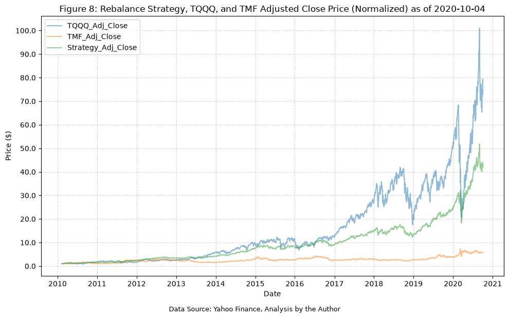
    


### Figure 9: Maximum end-of-month draw downs corresponding to fig. 8

Next, we can recreate figure 9, with the maximum DDD and MDD. First, the full daily drawdown plot.


```python
plot_time_series(
    df=tqqq_tmf,
    plot_start_date=None,
    plot_end_date=None,
    plot_columns=["TQQQ_Drawdown", "TMF_Drawdown", "Strategy_Drawdown"],
    title="Figure 9a: Rebalance Strategy, TQQQ, and TMF Daily Drawdowns as of 2020-10-04",
    x_label="Date",
    x_format="Year",
    x_tick_spacing=1,
    x_tick_start=None,
    x_tick_rotation=0,
    y_label="Drawdown",
    y_format="Percentage",
    y_format_decimal_places=0,
    y_tick_spacing="Auto",
    y_tick_rotation=0,
    caption="Data Source: Yahoo Finance, Analysis by the Author",
)
```


    
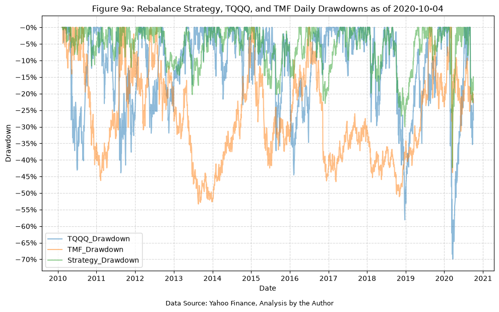
    


Next, the maximum DDD.


```python
plot_time_series(
    df=tqqq_tmf,
    plot_start_date=None,
    plot_end_date=None,
    plot_columns=[
        "TQQQ_Drawdown_Daily_Max",
        "TMF_Drawdown_Daily_Max",
        "Strategy_Drawdown_Daily_Max",
    ],
    title="Figure 9b: Rebalance Strategy, TQQQ, and TMF Maximum Daily Drawdowns as of 2020-10-04",
    x_label="Date",
    x_format="Year",
    x_tick_spacing=1,
    x_tick_start=None,
    x_tick_rotation=0,
    y_label="Drawdown",
    y_format="Percentage",
    y_format_decimal_places=0,
    y_tick_spacing="Auto",
    y_tick_rotation=0,
    caption="Data Source: Yahoo Finance, Analysis by the Author",
)
```


    
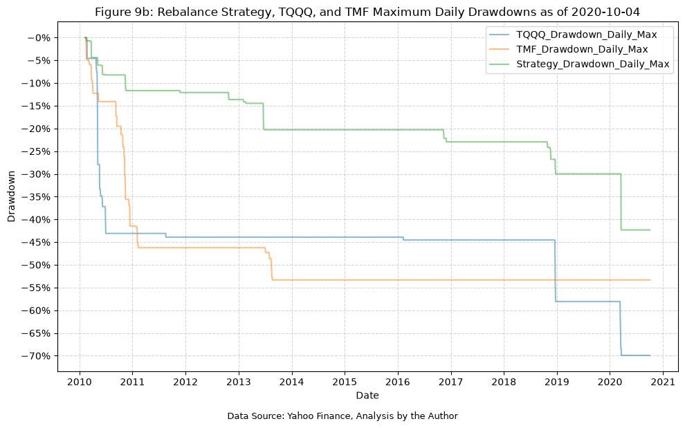
    


Finally, the maximum MDD.


```python
tqqq_tmf_monthly = tqqq_tmf.resample("ME").last()

# Calculate the monthly drawdowns using end-of-month prices only, then the running maximum monthly drawdown
for fund in ["TQQQ", "TMF", "Strategy"]:
    tqqq_tmf_monthly[f"{fund}_Drawdown_Monthly"] = (
        tqqq_tmf_monthly[f"{fund}_Adj_Close"]
        / tqqq_tmf_monthly[f"{fund}_Adj_Close"].cummax()
        - 1
    )
    tqqq_tmf_monthly[f"{fund}_Drawdown_Monthly_Max"] = tqqq_tmf_monthly[
        f"{fund}_Drawdown_Monthly"
    ].cummin()

plot_time_series(
    df=tqqq_tmf_monthly,
    plot_start_date=None,
    plot_end_date=None,
    plot_columns=[
        "TQQQ_Drawdown_Monthly_Max",
        "TMF_Drawdown_Monthly_Max",
        "Strategy_Drawdown_Monthly_Max",
    ],
    title="Figure 9c: Rebalance Strategy, TQQQ, and TMF Maximum Monthly Drawdowns as of 2020-10-04",
    x_label="Date",
    x_format="Year",
    x_tick_spacing=1,
    x_tick_start=None,
    x_tick_rotation=0,
    y_label="Drawdown",
    y_format="Percentage",
    y_format_decimal_places=0,
    y_tick_spacing="Auto",
    y_tick_rotation=0,
    caption="Data Source: Yahoo Finance, Analysis by the Author",
)
```


    
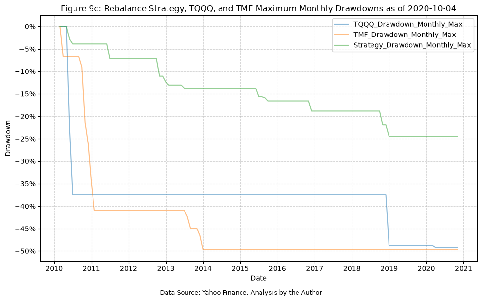
    


Our plot above matches figure 9 from the paper. We find a maximum MDD of 49% for TQQQ, 50% for TMF, and 24% for the strategy, compared with 49.1% for TQQQ and 49.7% for TMF from section 2.0 of the paper, and 24.4% for the strategy from section 3.2.

Note that the MDD uses end-of-month prices for both the drawdown and the prior peak, so a peak or trough within a month (such as TQQQ's peak on 2/19/2020) is not captured. This is why the MDD values are lower than the DDD values shown in the previous plot.

## Section 3.1: Optimum Balance Interval for Risk Mitigation Strategy

### Figure 10: Strategy performance on 9/2/20 as a function of rebalancing interval

Section 3.1 of the paper examines how the performance of the strategy on 9/2/2020 (the date of the peak normalized value) changes as the rebalancing interval is varied from one to six months, both with and without the 0.25% transaction fee. We can reproduce this by running the strategy for each rebalancing interval.


```python
# Calculate the normalized value of the strategy on 9/2/2020 for rebalancing intervals of 1 to 6 months, with and without the transaction fee
rebalance_interval_results = pd.DataFrame(
    index=pd.Index(range(1, 7), name="Rebalance Interval (Months)")
)

for k in rebalance_interval_results.index:
    for fee, col in [(0.0, "No Transaction Fee"), (0.0025, "Transaction Fee = 0.25%")]:
        df_k = rebalance_strategy(
            fund_data=fund_data,
            fund_1="TQQQ",
            fund_2="TMF",
            fund_1_weight=0.5,
            rebalance_months=k,
            transaction_fee=fee,
            start_date=None,
            end_date="2020-09-02",
        )
        rebalance_interval_results.loc[k, col] = df_k["Strategy_Adj_Close"].iloc[-1]

print("Figure 10: Strategy performance on 9/2/20 as a function of rebalancing interval")
display(rebalance_interval_results)
```

    Figure 10: Strategy performance on 9/2/20 as a function of rebalancing interval


<div>
<style scoped>
    .dataframe tbody tr th:only-of-type {
        vertical-align: middle;
    }

    .dataframe tbody tr th {
        vertical-align: top;
    }

    .dataframe thead th {
        text-align: right;
    }
</style>
<table border="1" class="dataframe">
  <thead>
    <tr style="text-align: right;">
      <th></th>
      <th>No Transaction Fee</th>
      <th>Transaction Fee = 0.25%</th>
    </tr>
    <tr>
      <th>Rebalance Interval (Months)</th>
      <th></th>
      <th></th>
    </tr>
  </thead>
  <tbody>
    <tr>
      <th>1</th>
      <td>50.65</td>
      <td>49.33</td>
    </tr>
    <tr>
      <th>2</th>
      <td>52.82</td>
      <td>51.86</td>
    </tr>
    <tr>
      <th>3</th>
      <td>41.31</td>
      <td>40.78</td>
    </tr>
    <tr>
      <th>4</th>
      <td>44.83</td>
      <td>44.34</td>
    </tr>
    <tr>
      <th>5</th>
      <td>49.15</td>
      <td>48.57</td>
    </tr>
    <tr>
      <th>6</th>
      <td>39.33</td>
      <td>38.99</td>
    </tr>
  </tbody>
</table>
</div>


## Section 3.2: Risk Mitigation Strategy Modified to Account for “Black Swan” Events

In section 3.2, the paper proposes the idea of switching the allocation from the rebalance strategy to cash or a cash substitute, after a severe drop in the price of TQQQ. Specifically:

> Such large one-day losses might cause even disciplined investors to panic sell. Here we propose a simple filter to overlay the risk mitigation strategy described above. The basic idea is to switch the simple strategy to cash, or a near-cash substitute (here we use the 7-10 year Treasury ETF, IEF) whenever an automated alert indicates that the daily return of TQQQ has dropped below a preset minimum. A return to the standard strategy is then only made when a second alert indicates that the daily adjusted close of TQQQ has returned to and exceeded the value it had when the switch was made.

This is an interesting idea, and we will implement it next, but first we need to pull data for IEF.


```python
yf_pull_data(
    base_directory=DATA_DIR,
    ticker="IEF",
    adjusted=False,
    source="Yahoo_Finance",
    asset_class="Exchange_Traded_Funds",
    excel_export=True,
    pickle_export=True,
    output_confirmation=False,
)
```


<div>
<style scoped>
    .dataframe tbody tr th:only-of-type {
        vertical-align: middle;
    }

    .dataframe tbody tr th {
        vertical-align: top;
    }

    .dataframe thead th {
        text-align: right;
    }
</style>
<table border="1" class="dataframe">
  <thead>
    <tr style="text-align: right;">
      <th></th>
      <th>Adj Close</th>
      <th>Close</th>
      <th>High</th>
      <th>Low</th>
      <th>Open</th>
      <th>Volume</th>
    </tr>
    <tr>
      <th>Date</th>
      <th></th>
      <th></th>
      <th></th>
      <th></th>
      <th></th>
      <th></th>
    </tr>
  </thead>
  <tbody>
    <tr>
      <th>2002-07-30</th>
      <td>40.00</td>
      <td>81.77</td>
      <td>82.12</td>
      <td>81.70</td>
      <td>81.94</td>
      <td>41300</td>
    </tr>
    <tr>
      <th>2002-07-31</th>
      <td>40.37</td>
      <td>82.52</td>
      <td>82.58</td>
      <td>82.05</td>
      <td>82.05</td>
      <td>32600</td>
    </tr>
    <tr>
      <th>2002-08-01</th>
      <td>40.53</td>
      <td>82.86</td>
      <td>82.90</td>
      <td>82.52</td>
      <td>82.54</td>
      <td>71400</td>
    </tr>
    <tr>
      <th>2002-08-02</th>
      <td>40.85</td>
      <td>83.50</td>
      <td>83.70</td>
      <td>82.90</td>
      <td>83.02</td>
      <td>120300</td>
    </tr>
    <tr>
      <th>2002-08-05</th>
      <td>41.05</td>
      <td>83.92</td>
      <td>83.92</td>
      <td>83.53</td>
      <td>83.68</td>
      <td>159300</td>
    </tr>
    <tr>
      <th>...</th>
      <td>...</td>
      <td>...</td>
      <td>...</td>
      <td>...</td>
      <td>...</td>
      <td>...</td>
    </tr>
    <tr>
      <th>2026-10-16</th>
      <td>90.42</td>
      <td>90.42</td>
      <td>90.54</td>
      <td>90.12</td>
      <td>90.15</td>
      <td>10831400</td>
    </tr>
    <tr>
      <th>2026-10-19</th>
      <td>90.08</td>
      <td>90.08</td>
      <td>90.38</td>
      <td>90.02</td>
      <td>90.32</td>
      <td>10400200</td>
    </tr>
    <tr>
      <th>2026-10-20</th>
      <td>90.25</td>
      <td>90.25</td>
      <td>90.50</td>
      <td>90.12</td>
      <td>90.29</td>
      <td>8956100</td>
    </tr>
    <tr>
      <th>2026-10-21</th>
      <td>90.23</td>
      <td>90.23</td>
      <td>90.47</td>
      <td>90.00</td>
      <td>90.39</td>
      <td>8909200</td>
    </tr>
    <tr>
      <th>2026-10-22</th>
      <td>91.20</td>
      <td>91.20</td>
      <td>91.40</td>
      <td>90.65</td>
      <td>90.75</td>
      <td>16518600</td>
    </tr>
  </tbody>
</table>
<p>6098 rows × 6 columns</p>
</div>


Then append it to the existing dictionary.


```python
fund_list.append("IEF")

# Load the data for each ETF, rename the columns to include the ticker, store it in the fund_data dictionary
for fund in fund_list:
    data = load_data(
        base_directory=DATA_DIR,
        ticker=fund,
        source="Yahoo_Finance",
        asset_class="Exchange_Traded_Funds",
        timeframe="Daily",
        file_format="pickle",
    )

    data = data.rename(
        columns={
            "Adj Close": f"{fund}_Adj_Close",
            "Close": f"{fund}_Close",
            "High": f"{fund}_High",
            "Low": f"{fund}_Low",
            "Open": f"{fund}_Open",
            "Volume": f"{fund}_Volume",
        }
    )

    fund_data[fund] = data
```

And we will use the following helper function. It implements the paper's filter with a threshold of 20% for the one-day drop in TQQQ (the paper's $\partial^{\ast}$) and IEF as the cash substitute. There are a few implementation details worth noting:

* The paper's pseudo-code in figure 11 sets the switch-back price $v^{\ast}$ to the price of TQQQ on the day of the drop, $v(n)$. Implemented that way, TQQQ closes above $v^{\ast}$ the very next day (3/10/2020), and the filter switches in and out three times during March 2020. However, the paper states that the return to the standard strategy occurs on 5/18/2020, which is the first date that TQQQ closes above its price on the day *before* the drop, $v(n-1)$. This also matches the paper's description of TQQQ needing to return to "the value it had when the switch was made", so we use $v(n-1)$ for $v^{\ast}$.
* While the strategy is holding IEF, the scheduled bimonthly rebalances are skipped.
* Each switch into or out of IEF pays the 0.25% transaction fee on both the sell and the buy.


```python
def rebalance_strategy_bs(
    fund_data: dict,
    fund_1: str,
    fund_2: str,
    cash_fund: str = "IEF",
    drop_threshold: float = 0.20,
    fund_1_weight: float = 0.5,
    rebalance_months: int = 2,
    transaction_fee: float = 0.0025,
    start_date=None,
    end_date=None,
) -> pd.DataFrame:
    """
    Simulate a two-fund portfolio that is periodically rebalanced back to a target allocation, with a
    "black swan" filter that switches the portfolio to a cash substitute after a large one-day drop in
    the first fund.

    When the daily return of the first fund falls below -drop_threshold, the entire portfolio is sold and
    moved into the cash fund at that day's close, and the first fund's price from the prior day's close
    (its value before the drop) is recorded. The portfolio stays in the cash fund, skipping any scheduled
    rebalances, until the first fund's price closes above the recorded price, at which point the cash fund
    is sold and the two-fund portfolio is bought back at the target allocation.

    Parameters
    ----------
    fund_data : dict
        Dictionary containing DataFrames for each fund.
    fund_1 : str
        The ticker symbol for the first fund. Its daily return triggers the switch to the cash fund.
    fund_2 : str
        The ticker symbol for the second fund.
    cash_fund : str, optional
        The ticker symbol for the cash substitute held after the filter is triggered (default is "IEF").
    drop_threshold : float, optional
        One-day decline in the first fund that triggers the switch to the cash fund (default is 0.20).
    fund_1_weight : float, optional
        Target allocation to the first fund; the second fund receives the remainder (default is 0.5).
    rebalance_months : int, optional
        Rebalance on the last trading day of every k-th month, counting the start month as month 1 (default is 2).
    transaction_fee : float, optional
        Fee charged on the dollar amount of each buy or sell order at a rebalance or switch (default is 0.0025).
    start_date : optional
        Start date for the data. If None, uses the earliest date all three funds have data (default is None).
    end_date : optional
        End date for the data. If None, uses the latest available date (default is None).

    Returns
    -------
    pd.DataFrame
        DataFrame with the normalized fund prices, the value of each holding, the normalized
        strategy value, the strategy daily return, the rebalance and switch flags, whether the
        portfolio is held in the cash fund, and the fee paid on each day.
    """

    # Combine the adjusted close prices over the common date range
    df = (
        fund_data[fund_1][[f"{fund_1}_Adj_Close"]]
        .merge(
            fund_data[fund_2][[f"{fund_2}_Adj_Close"]],
            left_index=True,
            right_index=True,
        )
        .merge(
            fund_data[cash_fund][[f"{cash_fund}_Adj_Close"]],
            left_index=True,
            right_index=True,
        )
    )

    # Filter by date range
    df = df.loc[start_date:end_date]

    # Normalize prices to start at 1
    df = df / df.iloc[0]

    # Calculate the return series for each fund
    df[f"{fund_1}_Return"] = df[f"{fund_1}_Adj_Close"].pct_change()
    df[f"{fund_2}_Return"] = df[f"{fund_2}_Adj_Close"].pct_change()

    # Calculate the drawdowns for each fund
    df[f"{fund_1}_Drawdown"] = (
        df[f"{fund_1}_Adj_Close"] / df[f"{fund_1}_Adj_Close"].cummax() - 1
    )
    df[f"{fund_2}_Drawdown"] = (
        df[f"{fund_2}_Adj_Close"] / df[f"{fund_2}_Adj_Close"].cummax() - 1
    )
    df[f"{fund_1}_Drawdown_Daily_Max"] = df[f"{fund_1}_Drawdown"].cummin()
    df[f"{fund_2}_Drawdown_Daily_Max"] = df[f"{fund_2}_Drawdown"].cummin()

    # Flag the last trading day of each month, excluding the final row since that month may be incomplete
    month = pd.Series(df.index.to_period("M"), index=df.index)
    month_end = month != month.shift(-1)
    month_end.iloc[-1] = False

    # Rebalance on the last trading day of every k-th month
    month_number = (
        (df.index.year - df.index[0].year) * 12
        + (df.index.month - df.index[0].month)
        + 1
    )
    rebalance = month_end & (month_number % rebalance_months == 0)

    fund_2_weight = 1 - fund_1_weight

    # Initial purchase at the target allocation with a starting portfolio value of 1
    fund_1_shares = fund_1_weight / df[f"{fund_1}_Adj_Close"].iloc[0]
    fund_2_shares = fund_2_weight / df[f"{fund_2}_Adj_Close"].iloc[0]
    cash_fund_shares = 0.0

    # Price of the first fund before the drop that triggered the switch to the cash fund (v* in the paper); 0 when
    # not in the cash fund. The paper's flowchart sets v* = v(n), but its switch back on 5/18/20 matches v* = v(n-1)
    switch_price = 0.0
    prior_close = df[f"{fund_1}_Adj_Close"].shift(1)

    fund_1_values, fund_2_values, cash_fund_values = [], [], []
    rebalanced, switched, in_cash_fund, fees = [], [], [], []

    for date, row in df.iterrows():
        fund_1_value = fund_1_shares * row[f"{fund_1}_Adj_Close"]
        fund_2_value = fund_2_shares * row[f"{fund_2}_Adj_Close"]
        cash_fund_value = cash_fund_shares * row[f"{cash_fund}_Adj_Close"]
        fee = 0.0
        rebalance_today = False
        switch_today = False

        if switch_price > 0:
            # Currently in the cash fund; switch back once the first fund closes above the switch price
            if row[f"{fund_1}_Adj_Close"] > switch_price:
                total_value = cash_fund_value

                # Fee on selling the cash fund and buying the two funds
                fee = transaction_fee * 2 * total_value
                total_value -= fee

                fund_1_value = fund_1_weight * total_value
                fund_2_value = fund_2_weight * total_value
                cash_fund_value = 0.0
                fund_1_shares = fund_1_value / row[f"{fund_1}_Adj_Close"]
                fund_2_shares = fund_2_value / row[f"{fund_2}_Adj_Close"]
                cash_fund_shares = 0.0

                switch_price = 0.0
                switch_today = True

        elif row[f"{fund_1}_Return"] < -drop_threshold:
            # One-day drop in the first fund exceeds the threshold; sell both funds and buy the cash fund
            total_value = fund_1_value + fund_2_value

            # Fee on selling the two funds and buying the cash fund
            fee = transaction_fee * 2 * total_value
            total_value -= fee

            cash_fund_value = total_value
            fund_1_value = 0.0
            fund_2_value = 0.0
            cash_fund_shares = cash_fund_value / row[f"{cash_fund}_Adj_Close"]
            fund_1_shares = 0.0
            fund_2_shares = 0.0

            switch_price = prior_close.loc[date]
            switch_today = True

        elif rebalance.loc[date]:
            total_value = fund_1_value + fund_2_value

            # Fee on the dollar amount traded in each fund to get back to the target allocation
            fee = transaction_fee * (
                abs(fund_1_weight * total_value - fund_1_value)
                + abs(fund_2_weight * total_value - fund_2_value)
            )
            total_value -= fee

            fund_1_value = fund_1_weight * total_value
            fund_2_value = fund_2_weight * total_value
            fund_1_shares = fund_1_value / row[f"{fund_1}_Adj_Close"]
            fund_2_shares = fund_2_value / row[f"{fund_2}_Adj_Close"]
            rebalance_today = True

        fund_1_values.append(fund_1_value)
        fund_2_values.append(fund_2_value)
        cash_fund_values.append(cash_fund_value)
        rebalanced.append(rebalance_today)
        switched.append(switch_today)
        in_cash_fund.append(switch_price > 0)
        fees.append(fee)

    df[f"{fund_1}_Value"] = fund_1_values
    df[f"{fund_2}_Value"] = fund_2_values
    df[f"{cash_fund}_Value"] = cash_fund_values
    df["Strategy_Adj_Close"] = (
        df[f"{fund_1}_Value"] + df[f"{fund_2}_Value"] + df[f"{cash_fund}_Value"]
    )
    df["Strategy_Return"] = df["Strategy_Adj_Close"].pct_change()

    # Calculate the drawdown for the strategy
    df["Strategy_Drawdown"] = (
        df["Strategy_Adj_Close"] / df["Strategy_Adj_Close"].cummax() - 1
    )
    df["Strategy_Drawdown_Daily_Max"] = df["Strategy_Drawdown"].cummin()

    df["Rebalance"] = rebalanced
    df["Switch"] = switched
    df[f"In_{cash_fund}"] = in_cash_fund
    df["Transaction_Fee"] = fees

    return df
```

Now, we'll execute the "black swan" strategy for TQQQ and TMF, as the paper does with a start date of 2/11/2010 and an end date of 10/4/2020.


```python
tqqq_tmf_bs = rebalance_strategy_bs(
    fund_data=fund_data,
    fund_1="TQQQ",
    fund_2="TMF",
    cash_fund="IEF",
    drop_threshold=0.2,
    fund_1_weight=0.5,
    rebalance_months=2,
    transaction_fee=0.0025,  # 0.25% transaction fee
    start_date=None,
    end_date="2020-10-04",
)

print("Table E19: TQQQ/TMF Black Swan Strategy Data")
display(tqqq_tmf_bs)
```

    Table E19: TQQQ/TMF Black Swan Strategy Data


<div>
<style scoped>
    .dataframe tbody tr th:only-of-type {
        vertical-align: middle;
    }

    .dataframe tbody tr th {
        vertical-align: top;
    }

    .dataframe thead th {
        text-align: right;
    }
</style>
<table border="1" class="dataframe">
  <thead>
    <tr style="text-align: right;">
      <th></th>
      <th>TQQQ_Adj_Close</th>
      <th>TMF_Adj_Close</th>
      <th>IEF_Adj_Close</th>
      <th>TQQQ_Return</th>
      <th>TMF_Return</th>
      <th>TQQQ_Drawdown</th>
      <th>TMF_Drawdown</th>
      <th>TQQQ_Drawdown_Daily_Max</th>
      <th>TMF_Drawdown_Daily_Max</th>
      <th>TQQQ_Value</th>
      <th>TMF_Value</th>
      <th>IEF_Value</th>
      <th>Strategy_Adj_Close</th>
      <th>Strategy_Return</th>
      <th>Strategy_Drawdown</th>
      <th>Strategy_Drawdown_Daily_Max</th>
      <th>Rebalance</th>
      <th>Switch</th>
      <th>In_IEF</th>
      <th>Transaction_Fee</th>
    </tr>
    <tr>
      <th>Date</th>
      <th></th>
      <th></th>
      <th></th>
      <th></th>
      <th></th>
      <th></th>
      <th></th>
      <th></th>
      <th></th>
      <th></th>
      <th></th>
      <th></th>
      <th></th>
      <th></th>
      <th></th>
      <th></th>
      <th></th>
      <th></th>
      <th></th>
      <th></th>
    </tr>
  </thead>
  <tbody>
    <tr>
      <th>2010-02-11</th>
      <td>1.00</td>
      <td>1.00</td>
      <td>1.00</td>
      <td>NaN</td>
      <td>NaN</td>
      <td>0.00</td>
      <td>0.00</td>
      <td>0.00</td>
      <td>0.00</td>
      <td>0.50</td>
      <td>0.50</td>
      <td>0.00</td>
      <td>1.00</td>
      <td>NaN</td>
      <td>0.00</td>
      <td>0.00</td>
      <td>False</td>
      <td>False</td>
      <td>False</td>
      <td>0.00</td>
    </tr>
    <tr>
      <th>2010-02-12</th>
      <td>1.00</td>
      <td>1.01</td>
      <td>1.00</td>
      <td>0.00</td>
      <td>0.01</td>
      <td>0.00</td>
      <td>0.00</td>
      <td>0.00</td>
      <td>0.00</td>
      <td>0.50</td>
      <td>0.51</td>
      <td>0.00</td>
      <td>1.01</td>
      <td>0.01</td>
      <td>0.00</td>
      <td>0.00</td>
      <td>False</td>
      <td>False</td>
      <td>False</td>
      <td>0.00</td>
    </tr>
    <tr>
      <th>2010-02-16</th>
      <td>1.04</td>
      <td>1.02</td>
      <td>1.00</td>
      <td>0.04</td>
      <td>0.01</td>
      <td>0.00</td>
      <td>0.00</td>
      <td>0.00</td>
      <td>0.00</td>
      <td>0.52</td>
      <td>0.51</td>
      <td>0.00</td>
      <td>1.03</td>
      <td>0.02</td>
      <td>0.00</td>
      <td>0.00</td>
      <td>False</td>
      <td>False</td>
      <td>False</td>
      <td>0.00</td>
    </tr>
    <tr>
      <th>2010-02-17</th>
      <td>1.06</td>
      <td>0.99</td>
      <td>1.00</td>
      <td>0.02</td>
      <td>-0.03</td>
      <td>0.00</td>
      <td>-0.03</td>
      <td>0.00</td>
      <td>-0.03</td>
      <td>0.53</td>
      <td>0.49</td>
      <td>0.00</td>
      <td>1.02</td>
      <td>-0.01</td>
      <td>-0.01</td>
      <td>-0.01</td>
      <td>False</td>
      <td>False</td>
      <td>False</td>
      <td>0.00</td>
    </tr>
    <tr>
      <th>2010-02-18</th>
      <td>1.08</td>
      <td>0.97</td>
      <td>1.00</td>
      <td>0.02</td>
      <td>-0.02</td>
      <td>0.00</td>
      <td>-0.05</td>
      <td>0.00</td>
      <td>-0.05</td>
      <td>0.54</td>
      <td>0.49</td>
      <td>0.00</td>
      <td>1.03</td>
      <td>0.00</td>
      <td>-0.01</td>
      <td>-0.01</td>
      <td>False</td>
      <td>False</td>
      <td>False</td>
      <td>0.00</td>
    </tr>
    <tr>
      <th>...</th>
      <td>...</td>
      <td>...</td>
      <td>...</td>
      <td>...</td>
      <td>...</td>
      <td>...</td>
      <td>...</td>
      <td>...</td>
      <td>...</td>
      <td>...</td>
      <td>...</td>
      <td>...</td>
      <td>...</td>
      <td>...</td>
      <td>...</td>
      <td>...</td>
      <td>...</td>
      <td>...</td>
      <td>...</td>
      <td>...</td>
    </tr>
    <tr>
      <th>2020-09-28</th>
      <td>75.16</td>
      <td>5.83</td>
      <td>1.69</td>
      <td>0.06</td>
      <td>-0.01</td>
      <td>-0.26</td>
      <td>-0.20</td>
      <td>-0.70</td>
      <td>-0.53</td>
      <td>22.53</td>
      <td>18.47</td>
      <td>0.00</td>
      <td>40.99</td>
      <td>0.03</td>
      <td>-0.17</td>
      <td>-0.30</td>
      <td>False</td>
      <td>False</td>
      <td>False</td>
      <td>0.00</td>
    </tr>
    <tr>
      <th>2020-09-29</th>
      <td>74.37</td>
      <td>5.85</td>
      <td>1.69</td>
      <td>-0.01</td>
      <td>0.00</td>
      <td>-0.26</td>
      <td>-0.20</td>
      <td>-0.70</td>
      <td>-0.53</td>
      <td>22.29</td>
      <td>18.52</td>
      <td>0.00</td>
      <td>40.82</td>
      <td>-0.00</td>
      <td>-0.17</td>
      <td>-0.30</td>
      <td>False</td>
      <td>False</td>
      <td>False</td>
      <td>0.00</td>
    </tr>
    <tr>
      <th>2020-09-30</th>
      <td>75.85</td>
      <td>5.69</td>
      <td>1.69</td>
      <td>0.02</td>
      <td>-0.03</td>
      <td>-0.25</td>
      <td>-0.22</td>
      <td>-0.70</td>
      <td>-0.53</td>
      <td>20.37</td>
      <td>20.37</td>
      <td>0.00</td>
      <td>40.75</td>
      <td>-0.00</td>
      <td>-0.17</td>
      <td>-0.30</td>
      <td>True</td>
      <td>False</td>
      <td>False</td>
      <td>0.01</td>
    </tr>
    <tr>
      <th>2020-10-01</th>
      <td>79.40</td>
      <td>5.73</td>
      <td>1.69</td>
      <td>0.05</td>
      <td>0.01</td>
      <td>-0.21</td>
      <td>-0.22</td>
      <td>-0.70</td>
      <td>-0.53</td>
      <td>21.33</td>
      <td>20.49</td>
      <td>0.00</td>
      <td>41.82</td>
      <td>0.03</td>
      <td>-0.15</td>
      <td>-0.30</td>
      <td>False</td>
      <td>False</td>
      <td>False</td>
      <td>0.00</td>
    </tr>
    <tr>
      <th>2020-10-02</th>
      <td>72.85</td>
      <td>5.66</td>
      <td>1.69</td>
      <td>-0.08</td>
      <td>-0.01</td>
      <td>-0.28</td>
      <td>-0.23</td>
      <td>-0.70</td>
      <td>-0.53</td>
      <td>19.57</td>
      <td>20.25</td>
      <td>0.00</td>
      <td>39.81</td>
      <td>-0.05</td>
      <td>-0.19</td>
      <td>-0.30</td>
      <td>False</td>
      <td>False</td>
      <td>False</td>
      <td>0.00</td>
    </tr>
  </tbody>
</table>
<p>2680 rows × 20 columns</p>
</div>


And then we can check the summary statistics to confirm that our implementation of the strategy matches the results reported in the paper.


```python
tqqq_tmf_bs_sum_stats = summary_stats(
    fund_list=["TQQQ", "TMF"],
    df=tqqq_tmf_bs[["Strategy_Return"]].dropna(),
    period="Daily",
    use_calendar_days=False,
    excel_export=False,
    pickle_export=False,
    output_confirmation=False,
)

# Rename the index to indicate the strategy
tqqq_tmf_bs_sum_stats.index = ["TQQQ/TMF BS"]

all_strat_sum_stats = pd.concat([all_strat_sum_stats, tqqq_tmf_bs_sum_stats])

print("Table E20: Strategy Summary Statistics")
display(all_strat_sum_stats)
```

    Table E20: Strategy Summary Statistics


<div>
<style scoped>
    .dataframe tbody tr th:only-of-type {
        vertical-align: middle;
    }

    .dataframe tbody tr th {
        vertical-align: top;
    }

    .dataframe thead th {
        text-align: right;
    }
</style>
<table border="1" class="dataframe">
  <thead>
    <tr style="text-align: right;">
      <th></th>
      <th>Number of Observations</th>
      <th>Data Start Date</th>
      <th>Data End Date</th>
      <th>Annual Mean Return (Arithmetic)</th>
      <th>Annualized Volatility</th>
      <th>Annualized Sharpe Ratio</th>
      <th>CAGR (Geometric)</th>
      <th>Daily Max Return</th>
      <th>Daily Max Return (Date)</th>
      <th>Daily Min Return</th>
      <th>Daily Min Return (Date)</th>
      <th>Max Drawdown</th>
      <th>Peak</th>
      <th>Trough</th>
      <th>Recovery Date</th>
      <th>Calendar Days to Recovery</th>
      <th>MAR Ratio</th>
    </tr>
  </thead>
  <tbody>
    <tr>
      <th>TQQQ/TMF Strategy</th>
      <td>2679</td>
      <td>2010-02-12</td>
      <td>2020-10-02</td>
      <td>0.39</td>
      <td>0.28</td>
      <td>1.40</td>
      <td>0.42</td>
      <td>0.11</td>
      <td>2020-03-20</td>
      <td>-0.16</td>
      <td>2020-03-18</td>
      <td>-0.42</td>
      <td>2020-03-06</td>
      <td>2020-03-18</td>
      <td>2020-05-07</td>
      <td>50</td>
      <td>1.00</td>
    </tr>
    <tr>
      <th>TQQQ</th>
      <td>2679</td>
      <td>2010-02-12</td>
      <td>2020-10-02</td>
      <td>0.57</td>
      <td>0.58</td>
      <td>0.99</td>
      <td>0.50</td>
      <td>0.27</td>
      <td>2020-03-13</td>
      <td>-0.34</td>
      <td>2020-03-16</td>
      <td>-0.70</td>
      <td>2020-02-19</td>
      <td>2020-03-20</td>
      <td>2020-07-10</td>
      <td>112</td>
      <td>0.71</td>
    </tr>
    <tr>
      <th>TMF</th>
      <td>2679</td>
      <td>2010-02-12</td>
      <td>2020-10-02</td>
      <td>0.26</td>
      <td>0.44</td>
      <td>0.59</td>
      <td>0.18</td>
      <td>0.20</td>
      <td>2020-03-20</td>
      <td>-0.18</td>
      <td>2020-03-18</td>
      <td>-0.53</td>
      <td>2012-07-25</td>
      <td>2013-08-21</td>
      <td>2015-01-05</td>
      <td>502</td>
      <td>0.33</td>
    </tr>
    <tr>
      <th>TQQQ/TMF BS</th>
      <td>2679</td>
      <td>2010-02-12</td>
      <td>2020-10-02</td>
      <td>0.38</td>
      <td>0.26</td>
      <td>1.48</td>
      <td>0.41</td>
      <td>0.07</td>
      <td>2020-03-06</td>
      <td>-0.09</td>
      <td>2020-09-03</td>
      <td>-0.30</td>
      <td>2018-08-29</td>
      <td>2018-12-24</td>
      <td>2019-04-23</td>
      <td>120</td>
      <td>1.38</td>
    </tr>
  </tbody>
</table>
</div>


### Figure 12: Strategy performance with and without IEF filter

We can then plot figure 12, which compares the performance of the strategy with and without the black swan filter.


```python
tqqq_tmf_both = tqqq_tmf.merge(
    tqqq_tmf_bs, on="Date", how="outer", suffixes=("", "_BS")
)

plot_time_series(
    df=tqqq_tmf_both,
    plot_start_date=None,
    plot_end_date=None,
    plot_columns=[
        "TQQQ_Adj_Close",
        "TMF_Adj_Close",
        "Strategy_Adj_Close",
        "Strategy_Adj_Close_BS",
    ],
    title="Figure 12a: Rebalance Strategy, Black Swan Strategy, TQQQ, and TMF Adjusted Close Price (Normalized) as of 2020-10-04",
    x_label="Date",
    x_format="Year",
    x_tick_spacing=1,
    x_tick_start=None,
    x_tick_rotation=0,
    y_label="Price ($)",
    y_format="Decimal",
    y_format_decimal_places=1,
    y_tick_spacing="Auto",
    y_tick_rotation=0,
    caption="Data Source: Yahoo Finance, Analysis by the Author",
)
```


    
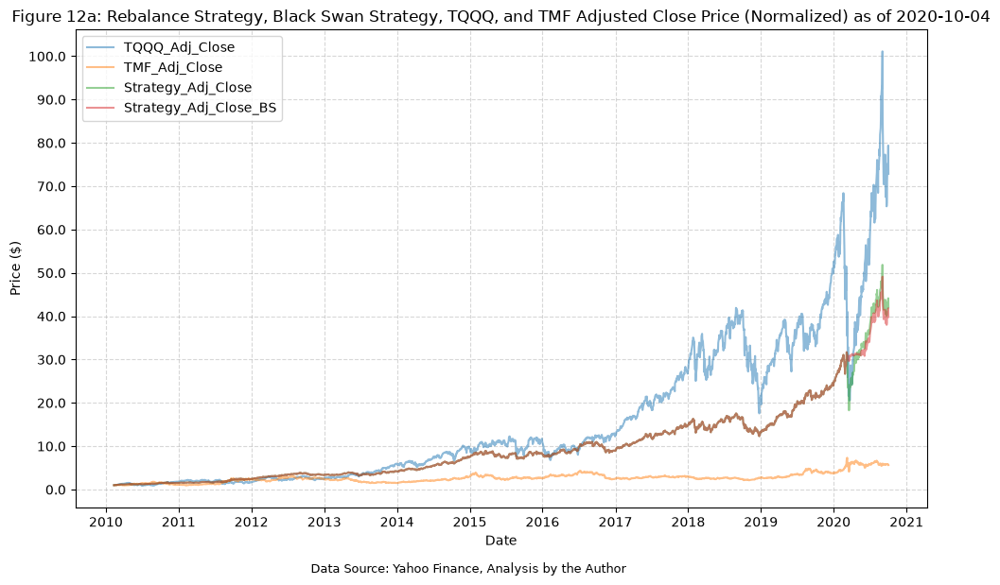
    


Zooming in on the data for 2020:


```python
plot_time_series(
    df=tqqq_tmf_both[tqqq_tmf_both.index >= "2020-01-01"],
    plot_start_date=None,
    plot_end_date=None,
    plot_columns=["Strategy_Adj_Close", "Strategy_Adj_Close_BS"],
    title="Figure 12b: Rebalance Strategy and Black Swan Strategy Adjusted Close Price (Normalized), 2020-01-01 to 2020-10-04",
    x_label="Date",
    x_format="Month",
    x_tick_spacing=1,
    x_tick_start=None,
    x_tick_rotation=0,
    y_label="Price ($)",
    y_format="Decimal",
    y_format_decimal_places=1,
    y_tick_spacing="Auto",
    y_tick_rotation=0,
    caption="Data Source: Yahoo Finance, Analysis by the Author",
)
```


    
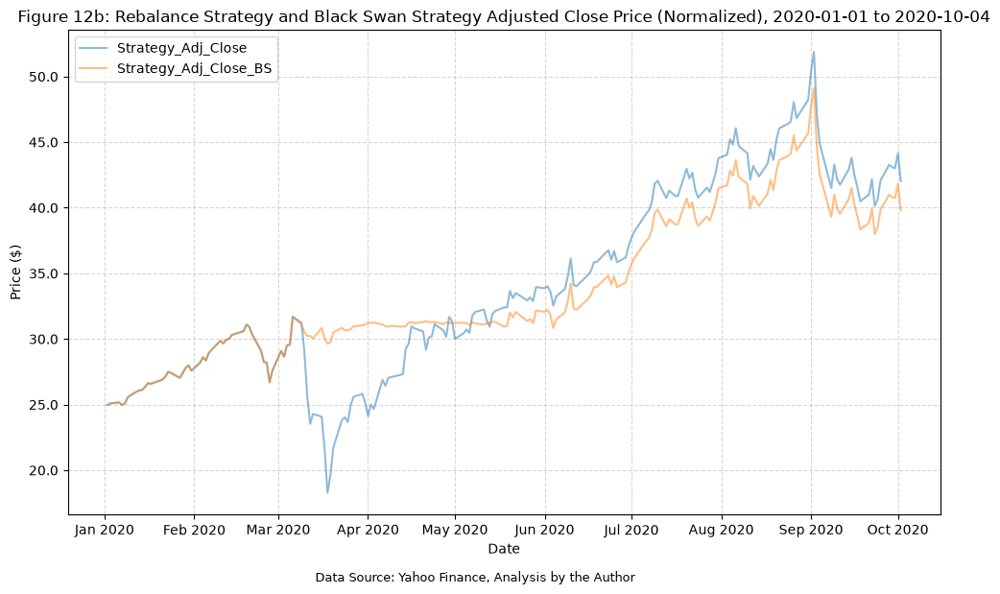
    


Interestingly, the BS strategy misses much of the COVID crash in March of 2020, while retaining nearly all of the performance throughout the rest of the date range.

### Figure 13: Maximum daily draw downs with IEF filter used for mitigation strategy

Finally, figure 13 shows the maximum DDD with the BS filter applied.


```python
plot_time_series(
    df=tqqq_tmf_bs,
    plot_start_date=None,
    plot_end_date=None,
    plot_columns=["TQQQ_Drawdown", "TMF_Drawdown", "Strategy_Drawdown"],
    title="Figure 13a: Black Swan Strategy, TQQQ, and TMF Daily Drawdowns as of 2020-10-04",
    x_label="Date",
    x_format="Year",
    x_tick_spacing=1,
    x_tick_start=None,
    x_tick_rotation=0,
    y_label="Drawdown",
    y_format="Percentage",
    y_format_decimal_places=0,
    y_tick_spacing="Auto",
    y_tick_rotation=0,
    caption="Data Source: Yahoo Finance, Analysis by the Author",
)
```


    

    


Next, the maximum DDD.


```python
plot_time_series(
    df=tqqq_tmf_bs,
    plot_start_date=None,
    plot_end_date=None,
    plot_columns=[
        "TQQQ_Drawdown_Daily_Max",
        "TMF_Drawdown_Daily_Max",
        "Strategy_Drawdown_Daily_Max",
    ],
    title="Figure 13b: Black Swan Strategy, TQQQ, and TMF Maximum Daily Drawdowns as of 2020-10-04",
    x_label="Date",
    x_format="Year",
    x_tick_spacing=1,
    x_tick_start=None,
    x_tick_rotation=0,
    y_label="Drawdown",
    y_format="Percentage",
    y_format_decimal_places=0,
    y_tick_spacing="Auto",
    y_tick_rotation=0,
    caption="Data Source: Yahoo Finance, Analysis by the Author",
)
```


    
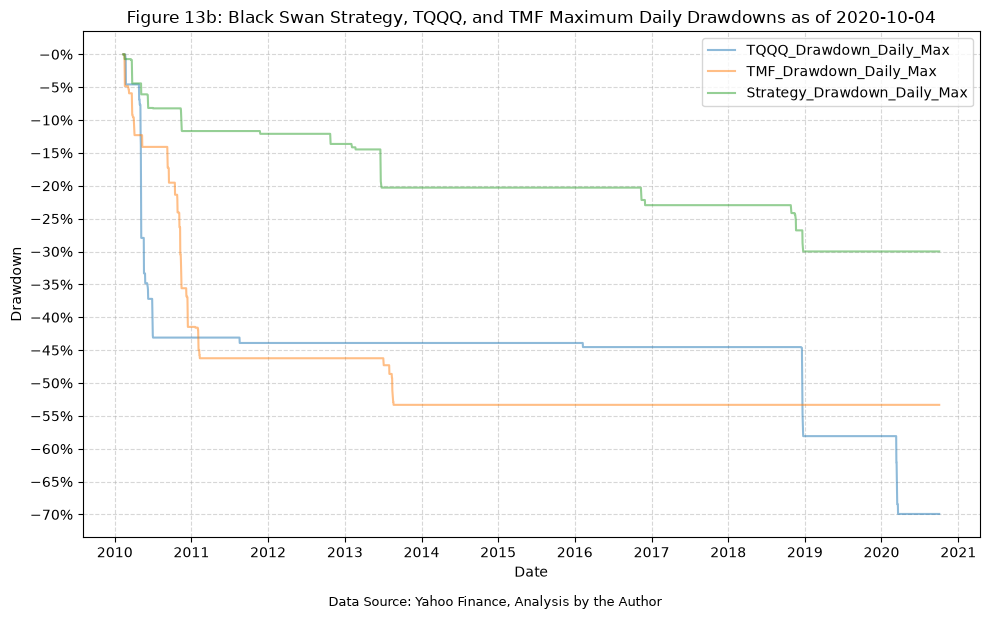
    


The above plot is the true replication of figure 13, and it does in fact appear to match. We see a maximum DDD of 30% for the BS strategy, and this does appear to match what is in the paper.

Finally, the maximum MDD.


```python
tqqq_tmf_bs_monthly = tqqq_tmf_bs.resample("ME").last()

# Calculate the monthly drawdowns using end-of-month prices only, then the running maximum monthly drawdown
for fund in ["TQQQ", "TMF", "Strategy"]:
    tqqq_tmf_bs_monthly[f"{fund}_Drawdown_Monthly"] = (
        tqqq_tmf_bs_monthly[f"{fund}_Adj_Close"]
        / tqqq_tmf_bs_monthly[f"{fund}_Adj_Close"].cummax()
        - 1
    )
    tqqq_tmf_bs_monthly[f"{fund}_Drawdown_Monthly_Max"] = tqqq_tmf_bs_monthly[
        f"{fund}_Drawdown_Monthly"
    ].cummin()

plot_time_series(
    df=tqqq_tmf_bs_monthly,
    plot_start_date=None,
    plot_end_date=None,
    plot_columns=[
        "TQQQ_Drawdown_Monthly_Max",
        "TMF_Drawdown_Monthly_Max",
        "Strategy_Drawdown_Monthly_Max",
    ],
    title="Figure 13c: Black Swan Strategy, TQQQ, and TMF Maximum Monthly Drawdowns as of 2020-10-04",
    x_label="Date",
    x_format="Year",
    x_tick_spacing=1,
    x_tick_start=None,
    x_tick_rotation=0,
    y_label="Drawdown",
    y_format="Percentage",
    y_format_decimal_places=0,
    y_tick_spacing="Auto",
    y_tick_rotation=0,
    caption="Data Source: Yahoo Finance, Analysis by the Author",
)
```


    
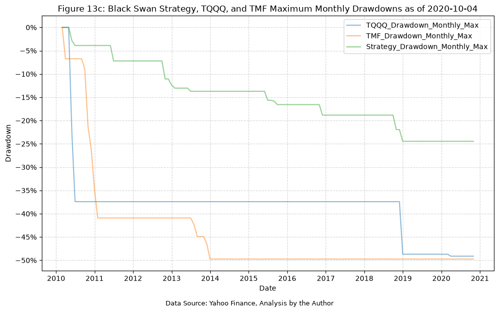
    


## Extension 1: Expanding the date range for analysis

Above we saw that the rebalance strategy performed well during a time when the correlations between equity and bond funds were negative, which is the entirety of the range between 2010 and 2020. Now, let's expand the date range to present, and see if the results of the rebalance strategy hold up.


```python
tqqq_tmf_full = rebalance_strategy(
    fund_data=fund_data,
    fund_1="TQQQ",
    fund_2="TMF",
    fund_1_weight=0.5,
    rebalance_months=2,
    transaction_fee=0.0025,  # 0.25% transaction fee
    start_date=None,
    end_date=None,
)

print("Table E21: TQQQ/TMF Rebalance Strategy Data (Full Period)")
display(tqqq_tmf_full)
```

    Table E21: TQQQ/TMF Rebalance Strategy Data (Full Period)


<div>
<style scoped>
    .dataframe tbody tr th:only-of-type {
        vertical-align: middle;
    }

    .dataframe tbody tr th {
        vertical-align: top;
    }

    .dataframe thead th {
        text-align: right;
    }
</style>
<table border="1" class="dataframe">
  <thead>
    <tr style="text-align: right;">
      <th></th>
      <th>TQQQ_Adj_Close</th>
      <th>TMF_Adj_Close</th>
      <th>TQQQ_Return</th>
      <th>TMF_Return</th>
      <th>TQQQ_Drawdown</th>
      <th>TMF_Drawdown</th>
      <th>TQQQ_Drawdown_Daily_Max</th>
      <th>TMF_Drawdown_Daily_Max</th>
      <th>TQQQ_Value</th>
      <th>TMF_Value</th>
      <th>Strategy_Adj_Close</th>
      <th>Strategy_Return</th>
      <th>Strategy_Drawdown</th>
      <th>Strategy_Drawdown_Daily_Max</th>
      <th>Rebalance</th>
      <th>Transaction_Fee</th>
    </tr>
    <tr>
      <th>Date</th>
      <th></th>
      <th></th>
      <th></th>
      <th></th>
      <th></th>
      <th></th>
      <th></th>
      <th></th>
      <th></th>
      <th></th>
      <th></th>
      <th></th>
      <th></th>
      <th></th>
      <th></th>
      <th></th>
    </tr>
  </thead>
  <tbody>
    <tr>
      <th>2010-02-11</th>
      <td>1.00</td>
      <td>1.00</td>
      <td>NaN</td>
      <td>NaN</td>
      <td>0.00</td>
      <td>0.00</td>
      <td>0.00</td>
      <td>0.00</td>
      <td>0.50</td>
      <td>0.50</td>
      <td>1.00</td>
      <td>NaN</td>
      <td>0.00</td>
      <td>0.00</td>
      <td>False</td>
      <td>0.00</td>
    </tr>
    <tr>
      <th>2010-02-12</th>
      <td>1.00</td>
      <td>1.01</td>
      <td>0.00</td>
      <td>0.01</td>
      <td>0.00</td>
      <td>0.00</td>
      <td>0.00</td>
      <td>0.00</td>
      <td>0.50</td>
      <td>0.51</td>
      <td>1.01</td>
      <td>0.01</td>
      <td>0.00</td>
      <td>0.00</td>
      <td>False</td>
      <td>0.00</td>
    </tr>
    <tr>
      <th>2010-02-16</th>
      <td>1.04</td>
      <td>1.02</td>
      <td>0.04</td>
      <td>0.01</td>
      <td>0.00</td>
      <td>0.00</td>
      <td>0.00</td>
      <td>0.00</td>
      <td>0.52</td>
      <td>0.51</td>
      <td>1.03</td>
      <td>0.02</td>
      <td>0.00</td>
      <td>0.00</td>
      <td>False</td>
      <td>0.00</td>
    </tr>
    <tr>
      <th>2010-02-17</th>
      <td>1.06</td>
      <td>0.99</td>
      <td>0.02</td>
      <td>-0.03</td>
      <td>0.00</td>
      <td>-0.03</td>
      <td>0.00</td>
      <td>-0.03</td>
      <td>0.53</td>
      <td>0.49</td>
      <td>1.02</td>
      <td>-0.01</td>
      <td>-0.01</td>
      <td>-0.01</td>
      <td>False</td>
      <td>0.00</td>
    </tr>
    <tr>
      <th>2010-02-18</th>
      <td>1.08</td>
      <td>0.97</td>
      <td>0.02</td>
      <td>-0.02</td>
      <td>0.00</td>
      <td>-0.05</td>
      <td>0.00</td>
      <td>-0.05</td>
      <td>0.54</td>
      <td>0.49</td>
      <td>1.03</td>
      <td>0.00</td>
      <td>-0.01</td>
      <td>-0.01</td>
      <td>False</td>
      <td>0.00</td>
    </tr>
    <tr>
      <th>...</th>
      <td>...</td>
      <td>...</td>
      <td>...</td>
      <td>...</td>
      <td>...</td>
      <td>...</td>
      <td>...</td>
      <td>...</td>
      <td>...</td>
      <td>...</td>
      <td>...</td>
      <td>...</td>
      <td>...</td>
      <td>...</td>
      <td>...</td>
      <td>...</td>
    </tr>
    <tr>
      <th>2026-10-16</th>
      <td>332.43</td>
      <td>0.48</td>
      <td>-0.08</td>
      <td>0.00</td>
      <td>-0.21</td>
      <td>-0.93</td>
      <td>-0.82</td>
      <td>-0.94</td>
      <td>15.13</td>
      <td>18.89</td>
      <td>34.02</td>
      <td>-0.03</td>
      <td>-0.46</td>
      <td>-0.78</td>
      <td>False</td>
      <td>0.00</td>
    </tr>
    <tr>
      <th>2026-10-19</th>
      <td>344.27</td>
      <td>0.47</td>
      <td>0.04</td>
      <td>-0.02</td>
      <td>-0.19</td>
      <td>-0.94</td>
      <td>-0.82</td>
      <td>-0.94</td>
      <td>15.67</td>
      <td>18.48</td>
      <td>34.15</td>
      <td>0.00</td>
      <td>-0.46</td>
      <td>-0.78</td>
      <td>False</td>
      <td>0.00</td>
    </tr>
    <tr>
      <th>2026-10-20</th>
      <td>343.15</td>
      <td>0.48</td>
      <td>-0.00</td>
      <td>0.02</td>
      <td>-0.19</td>
      <td>-0.93</td>
      <td>-0.82</td>
      <td>-0.94</td>
      <td>15.61</td>
      <td>18.93</td>
      <td>34.54</td>
      <td>0.01</td>
      <td>-0.46</td>
      <td>-0.78</td>
      <td>False</td>
      <td>0.00</td>
    </tr>
    <tr>
      <th>2026-10-21</th>
      <td>353.88</td>
      <td>0.48</td>
      <td>0.03</td>
      <td>0.00</td>
      <td>-0.16</td>
      <td>-0.93</td>
      <td>-0.82</td>
      <td>-0.94</td>
      <td>16.10</td>
      <td>19.02</td>
      <td>35.12</td>
      <td>0.02</td>
      <td>-0.45</td>
      <td>-0.78</td>
      <td>False</td>
      <td>0.00</td>
    </tr>
    <tr>
      <th>2026-10-22</th>
      <td>323.71</td>
      <td>0.51</td>
      <td>-0.09</td>
      <td>0.06</td>
      <td>-0.24</td>
      <td>-0.93</td>
      <td>-0.82</td>
      <td>-0.94</td>
      <td>14.73</td>
      <td>20.07</td>
      <td>34.80</td>
      <td>-0.01</td>
      <td>-0.45</td>
      <td>-0.78</td>
      <td>False</td>
      <td>0.00</td>
    </tr>
  </tbody>
</table>
<p>4200 rows × 16 columns</p>
</div>


```python
tqqq_tmf_full_sum_stats = summary_stats(
    fund_list=["TQQQ", "TMF"],
    df=tqqq_tmf_full[["Strategy_Return"]].dropna(),
    period="Daily",
    use_calendar_days=False,
    excel_export=False,
    pickle_export=False,
    output_confirmation=False,
)

# Rename the index to indicate the strategy
tqqq_tmf_full_sum_stats.index = ["TQQQ/TMF Full Strategy"]

all_strat_sum_stats = pd.concat([all_strat_sum_stats, tqqq_tmf_full_sum_stats])

print("Table E22: Strategy Summary Statistics")
display(all_strat_sum_stats)
```

    Table E22: Strategy Summary Statistics


<div>
<style scoped>
    .dataframe tbody tr th:only-of-type {
        vertical-align: middle;
    }

    .dataframe tbody tr th {
        vertical-align: top;
    }

    .dataframe thead th {
        text-align: right;
    }
</style>
<table border="1" class="dataframe">
  <thead>
    <tr style="text-align: right;">
      <th></th>
      <th>Number of Observations</th>
      <th>Data Start Date</th>
      <th>Data End Date</th>
      <th>Annual Mean Return (Arithmetic)</th>
      <th>Annualized Volatility</th>
      <th>Annualized Sharpe Ratio</th>
      <th>CAGR (Geometric)</th>
      <th>Daily Max Return</th>
      <th>Daily Max Return (Date)</th>
      <th>Daily Min Return</th>
      <th>Daily Min Return (Date)</th>
      <th>Max Drawdown</th>
      <th>Peak</th>
      <th>Trough</th>
      <th>Recovery Date</th>
      <th>Calendar Days to Recovery</th>
      <th>MAR Ratio</th>
    </tr>
  </thead>
  <tbody>
    <tr>
      <th>TQQQ/TMF Strategy</th>
      <td>2679</td>
      <td>2010-02-12</td>
      <td>2020-10-02</td>
      <td>0.39</td>
      <td>0.28</td>
      <td>1.40</td>
      <td>0.42</td>
      <td>0.11</td>
      <td>2020-03-20</td>
      <td>-0.16</td>
      <td>2020-03-18</td>
      <td>-0.42</td>
      <td>2020-03-06</td>
      <td>2020-03-18</td>
      <td>2020-05-07</td>
      <td>50.00</td>
      <td>1.00</td>
    </tr>
    <tr>
      <th>TQQQ</th>
      <td>2679</td>
      <td>2010-02-12</td>
      <td>2020-10-02</td>
      <td>0.57</td>
      <td>0.58</td>
      <td>0.99</td>
      <td>0.50</td>
      <td>0.27</td>
      <td>2020-03-13</td>
      <td>-0.34</td>
      <td>2020-03-16</td>
      <td>-0.70</td>
      <td>2020-02-19</td>
      <td>2020-03-20</td>
      <td>2020-07-10</td>
      <td>112.00</td>
      <td>0.71</td>
    </tr>
    <tr>
      <th>TMF</th>
      <td>2679</td>
      <td>2010-02-12</td>
      <td>2020-10-02</td>
      <td>0.26</td>
      <td>0.44</td>
      <td>0.59</td>
      <td>0.18</td>
      <td>0.20</td>
      <td>2020-03-20</td>
      <td>-0.18</td>
      <td>2020-03-18</td>
      <td>-0.53</td>
      <td>2012-07-25</td>
      <td>2013-08-21</td>
      <td>2015-01-05</td>
      <td>502.00</td>
      <td>0.33</td>
    </tr>
    <tr>
      <th>TQQQ/TMF BS</th>
      <td>2679</td>
      <td>2010-02-12</td>
      <td>2020-10-02</td>
      <td>0.38</td>
      <td>0.26</td>
      <td>1.48</td>
      <td>0.41</td>
      <td>0.07</td>
      <td>2020-03-06</td>
      <td>-0.09</td>
      <td>2020-09-03</td>
      <td>-0.30</td>
      <td>2018-08-29</td>
      <td>2018-12-24</td>
      <td>2019-04-23</td>
      <td>120.00</td>
      <td>1.38</td>
    </tr>
    <tr>
      <th>TQQQ/TMF Full Strategy</th>
      <td>4199</td>
      <td>2010-02-12</td>
      <td>2026-10-22</td>
      <td>0.27</td>
      <td>0.34</td>
      <td>0.80</td>
      <td>0.24</td>
      <td>0.17</td>
      <td>2022-11-10</td>
      <td>-0.16</td>
      <td>2020-03-18</td>
      <td>-0.78</td>
      <td>2021-11-19</td>
      <td>2022-11-09</td>
      <td>NaT</td>
      <td>NaN</td>
      <td>0.30</td>
    </tr>
  </tbody>
</table>
</div>


Here we can see that the performance has degraded over time, especially due to the significant drawdown in TMF. Next, we will look at the plots.


```python
plot_time_series(
    df=tqqq_tmf_full,
    plot_start_date=None,
    plot_end_date=None,
    plot_columns=["TQQQ_Adj_Close", "TMF_Adj_Close", "Strategy_Adj_Close"],
    title=f"Figure E1: Rebalance Strategy, TQQQ, and TMF Adjusted Close Price (Normalized) as of {tqqq_tmf_full.index[-1].date()}",
    x_label="Date",
    x_format="Year",
    x_tick_spacing=1,
    x_tick_start=None,
    x_tick_rotation=0,
    y_label="Price ($)",
    y_format="Decimal",
    y_format_decimal_places=1,
    y_tick_spacing="Auto",
    y_tick_rotation=0,
    caption="Data Source: Yahoo Finance, Analysis by the Author",
)
```


    
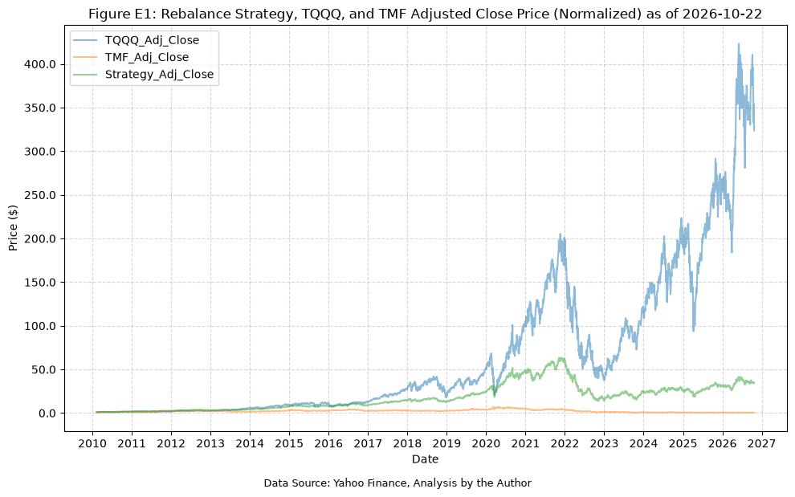
    


We can see that the strategy peaked in late 2021, and appears to have struggled since then. This could be due to the TQQQ performance, but since 2023 TQQQ has shown significant growth. Therefore, we suspect that TMF is actually the cause of the strategy underperformance, and we should look at its performance closely.


```python
lev_etf = "TMF"
etf = "TLT"
end_date = None

df = combine_normalize(
    fund_data=fund_data,
    lev_etf=lev_etf,
    etf=etf,
    start_date=None,
    end_date=end_date,
)

print(f"Table E23: {lev_etf} & {etf} Normalized Data (Full Period)")
display(df)
```

    Table E23: TMF & TLT Normalized Data (Full Period)


<div>
<style scoped>
    .dataframe tbody tr th:only-of-type {
        vertical-align: middle;
    }

    .dataframe tbody tr th {
        vertical-align: top;
    }

    .dataframe thead th {
        text-align: right;
    }
</style>
<table border="1" class="dataframe">
  <thead>
    <tr style="text-align: right;">
      <th></th>
      <th>TMF_Adj_Close</th>
      <th>TMF_Close</th>
      <th>TMF_High</th>
      <th>TMF_Low</th>
      <th>TMF_Open</th>
      <th>TMF_Volume</th>
      <th>TLT_Adj_Close</th>
      <th>TLT_Close</th>
      <th>TLT_High</th>
      <th>TLT_Low</th>
      <th>TLT_Open</th>
      <th>TLT_Volume</th>
    </tr>
    <tr>
      <th>Date</th>
      <th></th>
      <th></th>
      <th></th>
      <th></th>
      <th></th>
      <th></th>
      <th></th>
      <th></th>
      <th></th>
      <th></th>
      <th></th>
      <th></th>
    </tr>
  </thead>
  <tbody>
    <tr>
      <th>2009-04-16</th>
      <td>1.00</td>
      <td>1.00</td>
      <td>1.00</td>
      <td>1.00</td>
      <td>1.00</td>
      <td>1.00</td>
      <td>1.00</td>
      <td>1.00</td>
      <td>1.00</td>
      <td>1.00</td>
      <td>1.00</td>
      <td>1.00</td>
    </tr>
    <tr>
      <th>2009-04-17</th>
      <td>0.96</td>
      <td>0.96</td>
      <td>0.97</td>
      <td>0.95</td>
      <td>0.98</td>
      <td>2.64</td>
      <td>0.99</td>
      <td>0.99</td>
      <td>0.99</td>
      <td>0.99</td>
      <td>1.00</td>
      <td>2.45</td>
    </tr>
    <tr>
      <th>2009-04-20</th>
      <td>1.01</td>
      <td>1.01</td>
      <td>1.00</td>
      <td>0.99</td>
      <td>0.98</td>
      <td>0.60</td>
      <td>1.00</td>
      <td>1.00</td>
      <td>1.00</td>
      <td>1.00</td>
      <td>1.00</td>
      <td>1.62</td>
    </tr>
    <tr>
      <th>2009-04-21</th>
      <td>0.98</td>
      <td>0.98</td>
      <td>1.03</td>
      <td>0.99</td>
      <td>1.03</td>
      <td>1.37</td>
      <td>0.99</td>
      <td>0.99</td>
      <td>1.01</td>
      <td>0.99</td>
      <td>1.01</td>
      <td>0.86</td>
    </tr>
    <tr>
      <th>2009-04-22</th>
      <td>0.95</td>
      <td>0.95</td>
      <td>0.97</td>
      <td>0.94</td>
      <td>0.98</td>
      <td>2.22</td>
      <td>0.99</td>
      <td>0.99</td>
      <td>0.99</td>
      <td>0.98</td>
      <td>1.00</td>
      <td>2.16</td>
    </tr>
    <tr>
      <th>...</th>
      <td>...</td>
      <td>...</td>
      <td>...</td>
      <td>...</td>
      <td>...</td>
      <td>...</td>
      <td>...</td>
      <td>...</td>
      <td>...</td>
      <td>...</td>
      <td>...</td>
      <td>...</td>
    </tr>
    <tr>
      <th>2026-10-16</th>
      <td>0.29</td>
      <td>0.19</td>
      <td>0.19</td>
      <td>0.19</td>
      <td>0.19</td>
      <td>1451.62</td>
      <td>1.31</td>
      <td>0.78</td>
      <td>0.78</td>
      <td>0.78</td>
      <td>0.77</td>
      <td>40.17</td>
    </tr>
    <tr>
      <th>2026-10-19</th>
      <td>0.28</td>
      <td>0.19</td>
      <td>0.19</td>
      <td>0.19</td>
      <td>0.19</td>
      <td>1054.76</td>
      <td>1.30</td>
      <td>0.77</td>
      <td>0.77</td>
      <td>0.77</td>
      <td>0.78</td>
      <td>29.34</td>
    </tr>
    <tr>
      <th>2026-10-20</th>
      <td>0.29</td>
      <td>0.19</td>
      <td>0.19</td>
      <td>0.19</td>
      <td>0.19</td>
      <td>1008.60</td>
      <td>1.31</td>
      <td>0.78</td>
      <td>0.78</td>
      <td>0.78</td>
      <td>0.78</td>
      <td>26.97</td>
    </tr>
    <tr>
      <th>2026-10-21</th>
      <td>0.29</td>
      <td>0.19</td>
      <td>0.19</td>
      <td>0.19</td>
      <td>0.19</td>
      <td>910.70</td>
      <td>1.32</td>
      <td>0.78</td>
      <td>0.78</td>
      <td>0.78</td>
      <td>0.78</td>
      <td>34.37</td>
    </tr>
    <tr>
      <th>2026-10-22</th>
      <td>0.31</td>
      <td>0.20</td>
      <td>0.20</td>
      <td>0.20</td>
      <td>0.20</td>
      <td>2202.68</td>
      <td>1.34</td>
      <td>0.79</td>
      <td>0.79</td>
      <td>0.79</td>
      <td>0.79</td>
      <td>62.18</td>
    </tr>
  </tbody>
</table>
<p>4408 rows × 12 columns</p>
</div>


```python
plot_time_series(
    df=df,
    plot_start_date=None,
    plot_end_date=None,
    plot_columns=[f"{lev_etf}_Adj_Close", f"{etf}_Adj_Close"],
    title=f"Figure E2: {lev_etf} & {etf} Adjusted Close Price (Normalized) as of {df.index[-1].date()}",
    x_label="Date",
    x_format="Year",
    x_tick_spacing=1,
    x_tick_start=None,
    x_tick_rotation=0,
    y_label="Price ($)",
    y_format="Decimal",
    y_format_decimal_places=1,
    y_tick_spacing="Auto",
    y_tick_rotation=0,
    caption="Data Source: Yahoo Finance, Analysis by the Author",
)
```


    
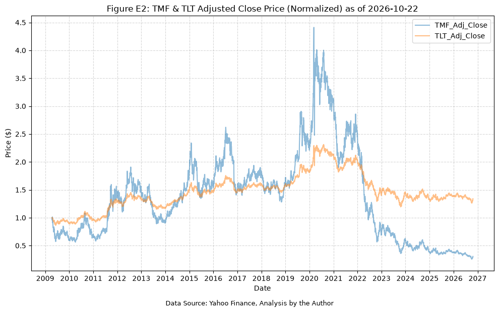
    


Here we have the answer. TMF has essentially collapsed since mid-2020, which explains the underperformance of the strategy despite the strong performance of TQQQ in recent years. Every time the strategy has been rebalancing, it has been selling TQQQ to buy TMF at depressed prices, which has hindered overall performance.

Let's look at the drawdown plots to see how the strategy has been affected by the TMF collapse.


```python
plot_time_series(
    df=tqqq_tmf_full,
    plot_start_date=None,
    plot_end_date=None,
    plot_columns=["TQQQ_Drawdown", "TMF_Drawdown", "Strategy_Drawdown"],
    title=f"Figure E3: Rebalance Strategy, TQQQ, and TMF Daily Drawdowns as of {tqqq_tmf_full.index[-1].date()}",
    x_label="Date",
    x_format="Year",
    x_tick_spacing=1,
    x_tick_start=None,
    x_tick_rotation=0,
    y_label="Drawdown",
    y_format="Percentage",
    y_format_decimal_places=0,
    y_tick_spacing="Auto",
    y_tick_rotation=0,
    caption="Data Source: Yahoo Finance, Analysis by the Author",
)
```


    
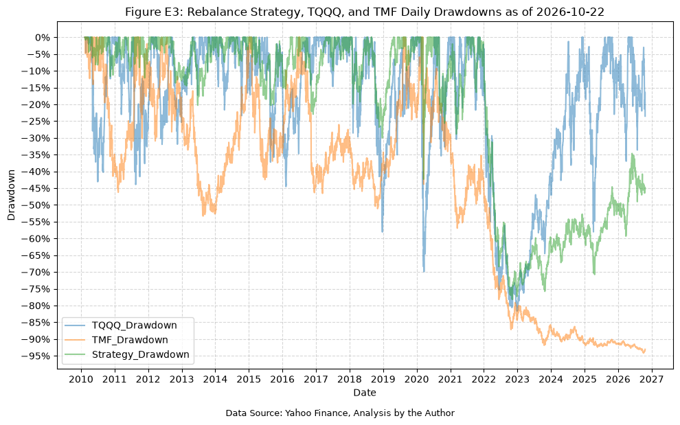
    


Next, the maximum DDD.


```python
plot_time_series(
    df=tqqq_tmf_full,
    plot_start_date=None,
    plot_end_date=None,
    plot_columns=[
        "TQQQ_Drawdown_Daily_Max",
        "TMF_Drawdown_Daily_Max",
        "Strategy_Drawdown_Daily_Max",
    ],
    title=f"Figure E4: Rebalance Strategy, TQQQ, and TMF Maximum Daily Drawdowns as of {tqqq_tmf_full.index[-1].date()}",
    x_label="Date",
    x_format="Year",
    x_tick_spacing=1,
    x_tick_start=None,
    x_tick_rotation=0,
    y_label="Drawdown",
    y_format="Percentage",
    y_format_decimal_places=0,
    y_tick_spacing="Auto",
    y_tick_rotation=0,
    caption="Data Source: Yahoo Finance, Analysis by the Author",
)
```


    
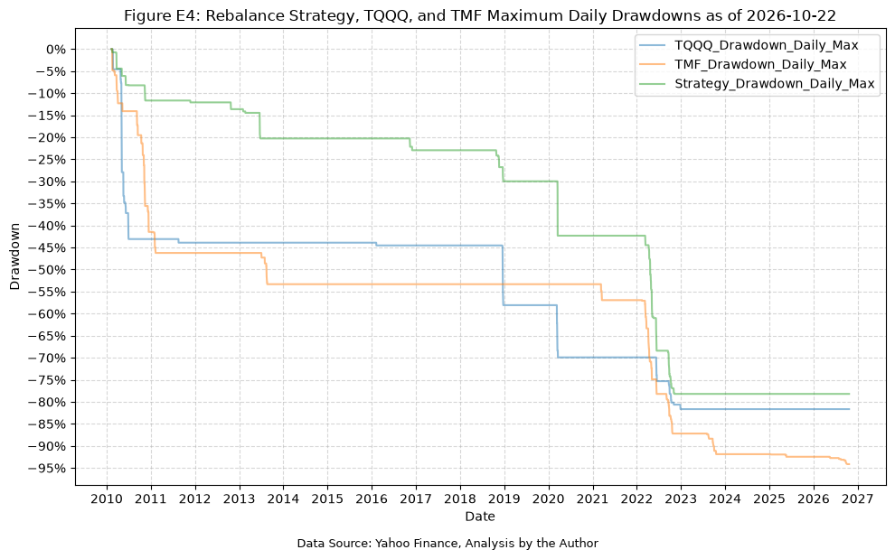
    


To confirm the change in regime, we can look at the correlation between the daily returns of TQQQ and TMF over time, first by calendar year, and then on a rolling 252 trading day (roughly one year) basis.


```python
# Calculate the correlation between TQQQ and TMF daily returns for each calendar year
annual_corr = (
    tqqq_tmf_full.groupby(tqqq_tmf_full.index.year)
    .apply(lambda x: x["TQQQ_Return"].corr(x["TMF_Return"]))
    .to_frame(name="TQQQ_TMF_Correlation")
)
annual_corr.index.name = "Year"

print("Table E24: Annual Correlation of TQQQ and TMF Daily Returns")
display(annual_corr)
```

    Table E24: Annual Correlation of TQQQ and TMF Daily Returns


<div>
<style scoped>
    .dataframe tbody tr th:only-of-type {
        vertical-align: middle;
    }

    .dataframe tbody tr th {
        vertical-align: top;
    }

    .dataframe thead th {
        text-align: right;
    }
</style>
<table border="1" class="dataframe">
  <thead>
    <tr style="text-align: right;">
      <th></th>
      <th>TQQQ_TMF_Correlation</th>
    </tr>
    <tr>
      <th>Year</th>
      <th></th>
    </tr>
  </thead>
  <tbody>
    <tr>
      <th>2010</th>
      <td>-0.55</td>
    </tr>
    <tr>
      <th>2011</th>
      <td>-0.62</td>
    </tr>
    <tr>
      <th>2012</th>
      <td>-0.56</td>
    </tr>
    <tr>
      <th>2013</th>
      <td>-0.20</td>
    </tr>
    <tr>
      <th>2014</th>
      <td>-0.41</td>
    </tr>
    <tr>
      <th>2015</th>
      <td>-0.33</td>
    </tr>
    <tr>
      <th>2016</th>
      <td>-0.29</td>
    </tr>
    <tr>
      <th>2017</th>
      <td>-0.16</td>
    </tr>
    <tr>
      <th>2018</th>
      <td>-0.23</td>
    </tr>
    <tr>
      <th>2019</th>
      <td>-0.41</td>
    </tr>
    <tr>
      <th>2020</th>
      <td>-0.39</td>
    </tr>
    <tr>
      <th>2021</th>
      <td>0.07</td>
    </tr>
    <tr>
      <th>2022</th>
      <td>0.08</td>
    </tr>
    <tr>
      <th>2023</th>
      <td>0.14</td>
    </tr>
    <tr>
      <th>2024</th>
      <td>0.00</td>
    </tr>
    <tr>
      <th>2025</th>
      <td>0.04</td>
    </tr>
    <tr>
      <th>2026</th>
      <td>0.20</td>
    </tr>
  </tbody>
</table>
</div>


```python
# Calculate the rolling 252 day correlation between TQQQ and TMF daily returns
tqqq_tmf_full["TQQQ_TMF_Rolling_Correlation"] = (
    tqqq_tmf_full["TQQQ_Return"].rolling(252).corr(tqqq_tmf_full["TMF_Return"])
)

plot_time_series(
    df=tqqq_tmf_full,
    plot_start_date=None,
    plot_end_date=None,
    plot_columns=["TQQQ_TMF_Rolling_Correlation"],
    title=f"Figure E5: TQQQ & TMF 252-Day Rolling Correlation of Daily Returns as of {tqqq_tmf_full.index[-1].date()}",
    x_label="Date",
    x_format="Year",
    x_tick_spacing=1,
    x_tick_start=None,
    x_tick_rotation=0,
    y_label="Correlation",
    y_format="Decimal",
    y_format_decimal_places=2,
    y_tick_spacing="Auto",
    y_tick_rotation=0,
    caption="Data Source: Yahoo Finance, Analysis by the Author",
)
```


    
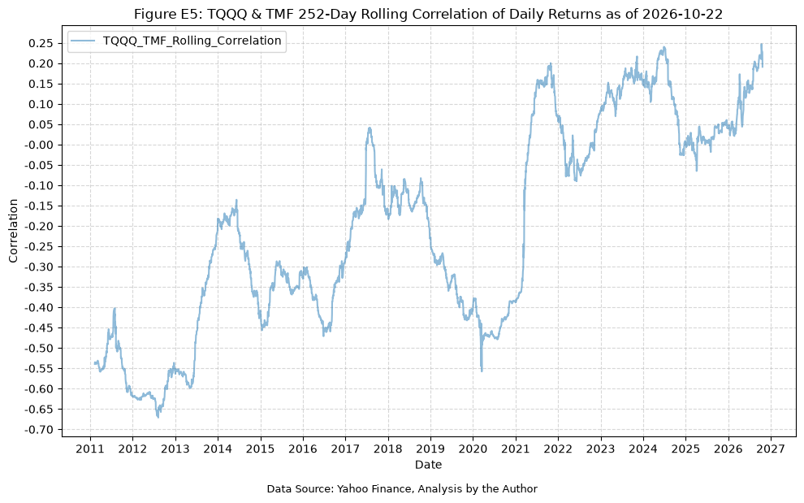
    


The correlation was negative in every year from 2010 through 2020, ranging from -0.16 to -0.62. Since 2021, it has been zero or positive in every year. The rolling correlation shows the same shift. Before 2021, it was positive for only a brief period in 2017, whereas since 2021 it has been positive for the vast majority of days.

What we find here is almost the worst case scenario for long-term investing in triple leveraged exchange traded funds. For years, we have a strategy that performs very well, with relatively low risk (Sharpe ratio of 1.4), but due to a regime change in markets, and a reversal of the historic equity/bond negative correlation, the strategy experiences significant drawdowns and underperformance, highlighting the challenges and risks associated with long-term investing in such leveraged instruments.

## Extension 2: Expanding the date range for analysis (including "Black Swan")

We can also extend the date range for the BS strategy, to see if that impacted the overall performance at all.


```python
tqqq_tmf_bs_full = rebalance_strategy_bs(
    fund_data=fund_data,
    fund_1="TQQQ",
    fund_2="TMF",
    cash_fund="IEF",
    drop_threshold=0.2,
    fund_1_weight=0.5,
    rebalance_months=2,
    transaction_fee=0.0025,  # 0.25% transaction fee
    start_date=None,
    end_date=None,
)

print("Table E25: TQQQ/TMF Black Swan Strategy Data (Full Period)")
display(tqqq_tmf_bs_full)
```

    Table E25: TQQQ/TMF Black Swan Strategy Data (Full Period)


<div>
<style scoped>
    .dataframe tbody tr th:only-of-type {
        vertical-align: middle;
    }

    .dataframe tbody tr th {
        vertical-align: top;
    }

    .dataframe thead th {
        text-align: right;
    }
</style>
<table border="1" class="dataframe">
  <thead>
    <tr style="text-align: right;">
      <th></th>
      <th>TQQQ_Adj_Close</th>
      <th>TMF_Adj_Close</th>
      <th>IEF_Adj_Close</th>
      <th>TQQQ_Return</th>
      <th>TMF_Return</th>
      <th>TQQQ_Drawdown</th>
      <th>TMF_Drawdown</th>
      <th>TQQQ_Drawdown_Daily_Max</th>
      <th>TMF_Drawdown_Daily_Max</th>
      <th>TQQQ_Value</th>
      <th>TMF_Value</th>
      <th>IEF_Value</th>
      <th>Strategy_Adj_Close</th>
      <th>Strategy_Return</th>
      <th>Strategy_Drawdown</th>
      <th>Strategy_Drawdown_Daily_Max</th>
      <th>Rebalance</th>
      <th>Switch</th>
      <th>In_IEF</th>
      <th>Transaction_Fee</th>
    </tr>
    <tr>
      <th>Date</th>
      <th></th>
      <th></th>
      <th></th>
      <th></th>
      <th></th>
      <th></th>
      <th></th>
      <th></th>
      <th></th>
      <th></th>
      <th></th>
      <th></th>
      <th></th>
      <th></th>
      <th></th>
      <th></th>
      <th></th>
      <th></th>
      <th></th>
      <th></th>
    </tr>
  </thead>
  <tbody>
    <tr>
      <th>2010-02-11</th>
      <td>1.00</td>
      <td>1.00</td>
      <td>1.00</td>
      <td>NaN</td>
      <td>NaN</td>
      <td>0.00</td>
      <td>0.00</td>
      <td>0.00</td>
      <td>0.00</td>
      <td>0.50</td>
      <td>0.50</td>
      <td>0.00</td>
      <td>1.00</td>
      <td>NaN</td>
      <td>0.00</td>
      <td>0.00</td>
      <td>False</td>
      <td>False</td>
      <td>False</td>
      <td>0.00</td>
    </tr>
    <tr>
      <th>2010-02-12</th>
      <td>1.00</td>
      <td>1.01</td>
      <td>1.00</td>
      <td>0.00</td>
      <td>0.01</td>
      <td>0.00</td>
      <td>0.00</td>
      <td>0.00</td>
      <td>0.00</td>
      <td>0.50</td>
      <td>0.51</td>
      <td>0.00</td>
      <td>1.01</td>
      <td>0.01</td>
      <td>0.00</td>
      <td>0.00</td>
      <td>False</td>
      <td>False</td>
      <td>False</td>
      <td>0.00</td>
    </tr>
    <tr>
      <th>2010-02-16</th>
      <td>1.04</td>
      <td>1.02</td>
      <td>1.00</td>
      <td>0.04</td>
      <td>0.01</td>
      <td>0.00</td>
      <td>0.00</td>
      <td>0.00</td>
      <td>0.00</td>
      <td>0.52</td>
      <td>0.51</td>
      <td>0.00</td>
      <td>1.03</td>
      <td>0.02</td>
      <td>0.00</td>
      <td>0.00</td>
      <td>False</td>
      <td>False</td>
      <td>False</td>
      <td>0.00</td>
    </tr>
    <tr>
      <th>2010-02-17</th>
      <td>1.06</td>
      <td>0.99</td>
      <td>1.00</td>
      <td>0.02</td>
      <td>-0.03</td>
      <td>0.00</td>
      <td>-0.03</td>
      <td>0.00</td>
      <td>-0.03</td>
      <td>0.53</td>
      <td>0.49</td>
      <td>0.00</td>
      <td>1.02</td>
      <td>-0.01</td>
      <td>-0.01</td>
      <td>-0.01</td>
      <td>False</td>
      <td>False</td>
      <td>False</td>
      <td>0.00</td>
    </tr>
    <tr>
      <th>2010-02-18</th>
      <td>1.08</td>
      <td>0.97</td>
      <td>1.00</td>
      <td>0.02</td>
      <td>-0.02</td>
      <td>0.00</td>
      <td>-0.05</td>
      <td>0.00</td>
      <td>-0.05</td>
      <td>0.54</td>
      <td>0.49</td>
      <td>0.00</td>
      <td>1.03</td>
      <td>0.00</td>
      <td>-0.01</td>
      <td>-0.01</td>
      <td>False</td>
      <td>False</td>
      <td>False</td>
      <td>0.00</td>
    </tr>
    <tr>
      <th>...</th>
      <td>...</td>
      <td>...</td>
      <td>...</td>
      <td>...</td>
      <td>...</td>
      <td>...</td>
      <td>...</td>
      <td>...</td>
      <td>...</td>
      <td>...</td>
      <td>...</td>
      <td>...</td>
      <td>...</td>
      <td>...</td>
      <td>...</td>
      <td>...</td>
      <td>...</td>
      <td>...</td>
      <td>...</td>
      <td>...</td>
    </tr>
    <tr>
      <th>2026-10-16</th>
      <td>332.43</td>
      <td>0.48</td>
      <td>1.47</td>
      <td>-0.08</td>
      <td>0.00</td>
      <td>-0.21</td>
      <td>-0.93</td>
      <td>-0.82</td>
      <td>-0.94</td>
      <td>14.33</td>
      <td>17.90</td>
      <td>0.00</td>
      <td>32.23</td>
      <td>-0.03</td>
      <td>-0.46</td>
      <td>-0.78</td>
      <td>False</td>
      <td>False</td>
      <td>False</td>
      <td>0.00</td>
    </tr>
    <tr>
      <th>2026-10-19</th>
      <td>344.27</td>
      <td>0.47</td>
      <td>1.47</td>
      <td>0.04</td>
      <td>-0.02</td>
      <td>-0.19</td>
      <td>-0.94</td>
      <td>-0.82</td>
      <td>-0.94</td>
      <td>14.84</td>
      <td>17.51</td>
      <td>0.00</td>
      <td>32.35</td>
      <td>0.00</td>
      <td>-0.46</td>
      <td>-0.78</td>
      <td>False</td>
      <td>False</td>
      <td>False</td>
      <td>0.00</td>
    </tr>
    <tr>
      <th>2026-10-20</th>
      <td>343.15</td>
      <td>0.48</td>
      <td>1.47</td>
      <td>-0.00</td>
      <td>0.02</td>
      <td>-0.19</td>
      <td>-0.93</td>
      <td>-0.82</td>
      <td>-0.94</td>
      <td>14.79</td>
      <td>17.93</td>
      <td>0.00</td>
      <td>32.72</td>
      <td>0.01</td>
      <td>-0.46</td>
      <td>-0.78</td>
      <td>False</td>
      <td>False</td>
      <td>False</td>
      <td>0.00</td>
    </tr>
    <tr>
      <th>2026-10-21</th>
      <td>353.88</td>
      <td>0.48</td>
      <td>1.47</td>
      <td>0.03</td>
      <td>0.00</td>
      <td>-0.16</td>
      <td>-0.93</td>
      <td>-0.82</td>
      <td>-0.94</td>
      <td>15.25</td>
      <td>18.01</td>
      <td>0.00</td>
      <td>33.26</td>
      <td>0.02</td>
      <td>-0.45</td>
      <td>-0.78</td>
      <td>False</td>
      <td>False</td>
      <td>False</td>
      <td>0.00</td>
    </tr>
    <tr>
      <th>2026-10-22</th>
      <td>323.71</td>
      <td>0.51</td>
      <td>1.48</td>
      <td>-0.09</td>
      <td>0.06</td>
      <td>-0.24</td>
      <td>-0.93</td>
      <td>-0.82</td>
      <td>-0.94</td>
      <td>13.95</td>
      <td>19.01</td>
      <td>0.00</td>
      <td>32.96</td>
      <td>-0.01</td>
      <td>-0.45</td>
      <td>-0.78</td>
      <td>False</td>
      <td>False</td>
      <td>False</td>
      <td>0.00</td>
    </tr>
  </tbody>
</table>
<p>4200 rows × 20 columns</p>
</div>


```python
tqqq_tmf_bs_full_sum_stats = summary_stats(
    fund_list=["TQQQ", "TMF"],
    df=tqqq_tmf_bs_full[["Strategy_Return"]].dropna(),
    period="Daily",
    use_calendar_days=False,
    excel_export=False,
    pickle_export=False,
    output_confirmation=False,
)

# Rename the index to indicate the strategy
tqqq_tmf_bs_full_sum_stats.index = ["TQQQ/TMF Full BS"]

all_strat_sum_stats = pd.concat([all_strat_sum_stats, tqqq_tmf_bs_full_sum_stats])

print("Table E26: Strategy Summary Statistics")
display(all_strat_sum_stats)
```

    Table E26: Strategy Summary Statistics


<div>
<style scoped>
    .dataframe tbody tr th:only-of-type {
        vertical-align: middle;
    }

    .dataframe tbody tr th {
        vertical-align: top;
    }

    .dataframe thead th {
        text-align: right;
    }
</style>
<table border="1" class="dataframe">
  <thead>
    <tr style="text-align: right;">
      <th></th>
      <th>Number of Observations</th>
      <th>Data Start Date</th>
      <th>Data End Date</th>
      <th>Annual Mean Return (Arithmetic)</th>
      <th>Annualized Volatility</th>
      <th>Annualized Sharpe Ratio</th>
      <th>CAGR (Geometric)</th>
      <th>Daily Max Return</th>
      <th>Daily Max Return (Date)</th>
      <th>Daily Min Return</th>
      <th>Daily Min Return (Date)</th>
      <th>Max Drawdown</th>
      <th>Peak</th>
      <th>Trough</th>
      <th>Recovery Date</th>
      <th>Calendar Days to Recovery</th>
      <th>MAR Ratio</th>
    </tr>
  </thead>
  <tbody>
    <tr>
      <th>TQQQ/TMF Strategy</th>
      <td>2679</td>
      <td>2010-02-12</td>
      <td>2020-10-02</td>
      <td>0.39</td>
      <td>0.28</td>
      <td>1.40</td>
      <td>0.42</td>
      <td>0.11</td>
      <td>2020-03-20</td>
      <td>-0.16</td>
      <td>2020-03-18</td>
      <td>-0.42</td>
      <td>2020-03-06</td>
      <td>2020-03-18</td>
      <td>2020-05-07</td>
      <td>50.00</td>
      <td>1.00</td>
    </tr>
    <tr>
      <th>TQQQ</th>
      <td>2679</td>
      <td>2010-02-12</td>
      <td>2020-10-02</td>
      <td>0.57</td>
      <td>0.58</td>
      <td>0.99</td>
      <td>0.50</td>
      <td>0.27</td>
      <td>2020-03-13</td>
      <td>-0.34</td>
      <td>2020-03-16</td>
      <td>-0.70</td>
      <td>2020-02-19</td>
      <td>2020-03-20</td>
      <td>2020-07-10</td>
      <td>112.00</td>
      <td>0.71</td>
    </tr>
    <tr>
      <th>TMF</th>
      <td>2679</td>
      <td>2010-02-12</td>
      <td>2020-10-02</td>
      <td>0.26</td>
      <td>0.44</td>
      <td>0.59</td>
      <td>0.18</td>
      <td>0.20</td>
      <td>2020-03-20</td>
      <td>-0.18</td>
      <td>2020-03-18</td>
      <td>-0.53</td>
      <td>2012-07-25</td>
      <td>2013-08-21</td>
      <td>2015-01-05</td>
      <td>502.00</td>
      <td>0.33</td>
    </tr>
    <tr>
      <th>TQQQ/TMF BS</th>
      <td>2679</td>
      <td>2010-02-12</td>
      <td>2020-10-02</td>
      <td>0.38</td>
      <td>0.26</td>
      <td>1.48</td>
      <td>0.41</td>
      <td>0.07</td>
      <td>2020-03-06</td>
      <td>-0.09</td>
      <td>2020-09-03</td>
      <td>-0.30</td>
      <td>2018-08-29</td>
      <td>2018-12-24</td>
      <td>2019-04-23</td>
      <td>120.00</td>
      <td>1.38</td>
    </tr>
    <tr>
      <th>TQQQ/TMF Full Strategy</th>
      <td>4199</td>
      <td>2010-02-12</td>
      <td>2026-10-22</td>
      <td>0.27</td>
      <td>0.34</td>
      <td>0.80</td>
      <td>0.24</td>
      <td>0.17</td>
      <td>2022-11-10</td>
      <td>-0.16</td>
      <td>2020-03-18</td>
      <td>-0.78</td>
      <td>2021-11-19</td>
      <td>2022-11-09</td>
      <td>NaT</td>
      <td>NaN</td>
      <td>0.30</td>
    </tr>
    <tr>
      <th>TQQQ/TMF Full BS</th>
      <td>4199</td>
      <td>2010-02-12</td>
      <td>2026-10-22</td>
      <td>0.26</td>
      <td>0.32</td>
      <td>0.81</td>
      <td>0.23</td>
      <td>0.17</td>
      <td>2022-11-10</td>
      <td>-0.12</td>
      <td>2022-05-05</td>
      <td>-0.78</td>
      <td>2021-11-19</td>
      <td>2022-11-09</td>
      <td>NaT</td>
      <td>NaN</td>
      <td>0.30</td>
    </tr>
  </tbody>
</table>
</div>


```python
tqqq_tmf_full_both = tqqq_tmf_full.merge(
    tqqq_tmf_bs_full, on="Date", how="outer", suffixes=("", "_BS")
)

plot_time_series(
    df=tqqq_tmf_full_both,
    plot_start_date=None,
    plot_end_date=None,
    plot_columns=[
        "TQQQ_Adj_Close",
        "TMF_Adj_Close",
        "Strategy_Adj_Close",
        "Strategy_Adj_Close_BS",
    ],
    title=f"Figure E6: Rebalance Strategy, Black Swan Strategy, TQQQ, and TMF Adjusted Close Price (Normalized) as of {tqqq_tmf_full_both.index[-1].date()}",
    x_label="Date",
    x_format="Year",
    x_tick_spacing=1,
    x_tick_start=None,
    x_tick_rotation=0,
    y_label="Price ($)",
    y_format="Decimal",
    y_format_decimal_places=1,
    y_tick_spacing="Auto",
    y_tick_rotation=0,
    caption="Data Source: Yahoo Finance, Analysis by the Author",
)
```


    
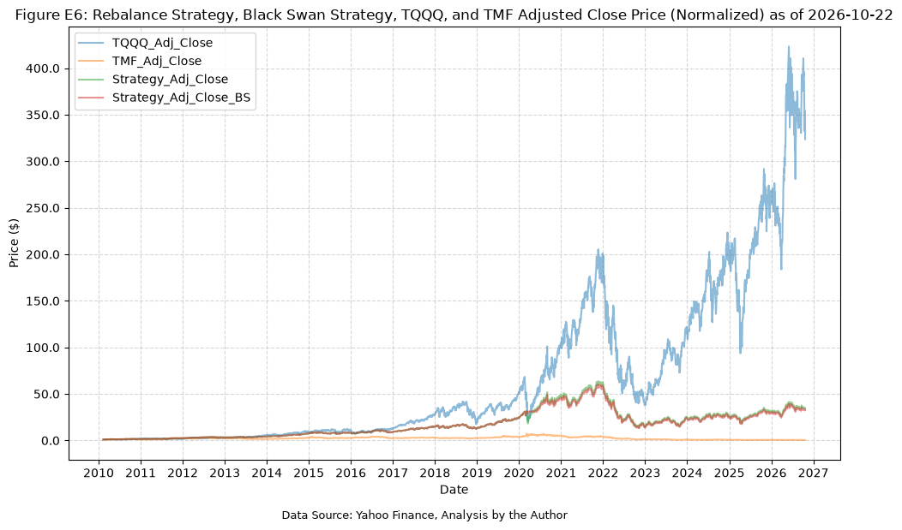
    


From the summary stats and the plot, we can see that the BS strategy did not materially change the performance. It might have had a risk-mitigation effect during COVID, but ultimately is not designed to handle nor is effective during long prolonged drawdowns.

## Extension 3: Using UPRO and AGG

For our third extention, we'll examine the performance of a portfolio consisting of UPRO and AGG, to see how it compares to the previous strategies.

One might say that UPRO is a more "well rounded" fund than TQQQ, in that it includes not only tech but other sectors of the market as well. This diversification could potentially reduce the overall volatility of the portfolio while still providing leveraged exposure to the broader market.

Similarly, AGG (the iShares Core U.S. Aggregate Bond ETF) provides exposure to the bond market, which tends to have a low correlation with equities. Using a non-leveraged fund will likely reduce the performance, but it might also help stabilize the volatility and provide a smoother overall return profile.

To compare with the TQQQ/TMF strategy over the same period, we'll use the same start date of 2/11/2010, even though UPRO has data back to June 2009.

First, we need to pull data for AGG.


```python
yf_pull_data(
    base_directory=DATA_DIR,
    ticker="AGG",
    adjusted=False,
    source="Yahoo_Finance",
    asset_class="Exchange_Traded_Funds",
    excel_export=True,
    pickle_export=True,
    output_confirmation=False,
)
```


<div>
<style scoped>
    .dataframe tbody tr th:only-of-type {
        vertical-align: middle;
    }

    .dataframe tbody tr th {
        vertical-align: top;
    }

    .dataframe thead th {
        text-align: right;
    }
</style>
<table border="1" class="dataframe">
  <thead>
    <tr style="text-align: right;">
      <th></th>
      <th>Adj Close</th>
      <th>Close</th>
      <th>High</th>
      <th>Low</th>
      <th>Open</th>
      <th>Volume</th>
    </tr>
    <tr>
      <th>Date</th>
      <th></th>
      <th></th>
      <th></th>
      <th></th>
      <th></th>
      <th></th>
    </tr>
  </thead>
  <tbody>
    <tr>
      <th>2003-09-29</th>
      <td>48.74</td>
      <td>102.17</td>
      <td>102.30</td>
      <td>102.10</td>
      <td>102.29</td>
      <td>13600</td>
    </tr>
    <tr>
      <th>2003-09-30</th>
      <td>49.00</td>
      <td>102.70</td>
      <td>102.74</td>
      <td>102.29</td>
      <td>102.30</td>
      <td>62600</td>
    </tr>
    <tr>
      <th>2003-10-01</th>
      <td>48.97</td>
      <td>102.65</td>
      <td>102.75</td>
      <td>102.60</td>
      <td>102.64</td>
      <td>66300</td>
    </tr>
    <tr>
      <th>2003-10-02</th>
      <td>48.90</td>
      <td>102.49</td>
      <td>102.65</td>
      <td>102.01</td>
      <td>102.20</td>
      <td>68900</td>
    </tr>
    <tr>
      <th>2003-10-03</th>
      <td>48.54</td>
      <td>101.75</td>
      <td>102.05</td>
      <td>101.70</td>
      <td>102.05</td>
      <td>64500</td>
    </tr>
    <tr>
      <th>...</th>
      <td>...</td>
      <td>...</td>
      <td>...</td>
      <td>...</td>
      <td>...</td>
      <td>...</td>
    </tr>
    <tr>
      <th>2026-10-16</th>
      <td>95.38</td>
      <td>95.38</td>
      <td>95.58</td>
      <td>95.22</td>
      <td>95.29</td>
      <td>11389000</td>
    </tr>
    <tr>
      <th>2026-10-19</th>
      <td>95.11</td>
      <td>95.11</td>
      <td>95.39</td>
      <td>95.04</td>
      <td>95.34</td>
      <td>10400500</td>
    </tr>
    <tr>
      <th>2026-10-20</th>
      <td>95.27</td>
      <td>95.27</td>
      <td>95.51</td>
      <td>95.16</td>
      <td>95.31</td>
      <td>9952700</td>
    </tr>
    <tr>
      <th>2026-10-21</th>
      <td>95.30</td>
      <td>95.30</td>
      <td>95.50</td>
      <td>95.11</td>
      <td>95.40</td>
      <td>9833700</td>
    </tr>
    <tr>
      <th>2026-10-22</th>
      <td>96.12</td>
      <td>96.12</td>
      <td>96.23</td>
      <td>95.62</td>
      <td>95.69</td>
      <td>10825400</td>
    </tr>
  </tbody>
</table>
<p>5804 rows × 6 columns</p>
</div>


Then append it to the existing dictionary.


```python
fund_list.append("AGG")

# Load the data for each ETF, rename the columns to include the ticker, store it in the fund_data dictionary
for fund in fund_list:
    data = load_data(
        base_directory=DATA_DIR,
        ticker=fund,
        source="Yahoo_Finance",
        asset_class="Exchange_Traded_Funds",
        timeframe="Daily",
        file_format="pickle",
    )

    data = data.rename(
        columns={
            "Adj Close": f"{fund}_Adj_Close",
            "Close": f"{fund}_Close",
            "High": f"{fund}_High",
            "Low": f"{fund}_Low",
            "Open": f"{fund}_Open",
            "Volume": f"{fund}_Volume",
        }
    )

    fund_data[fund] = data
```

Now we can run the strategy.


```python
upro_agg_full = rebalance_strategy(
    fund_data=fund_data,
    fund_1="UPRO",
    fund_2="AGG",
    fund_1_weight=0.5,
    rebalance_months=2,
    transaction_fee=0.0025,  # 0.25% transaction fee
    start_date="2010-02-11",
    end_date=None,
)

print("Table E27: UPRO/AGG Rebalance Strategy Data")
display(upro_agg_full)
```

    Table E27: UPRO/AGG Rebalance Strategy Data


<div>
<style scoped>
    .dataframe tbody tr th:only-of-type {
        vertical-align: middle;
    }

    .dataframe tbody tr th {
        vertical-align: top;
    }

    .dataframe thead th {
        text-align: right;
    }
</style>
<table border="1" class="dataframe">
  <thead>
    <tr style="text-align: right;">
      <th></th>
      <th>UPRO_Adj_Close</th>
      <th>AGG_Adj_Close</th>
      <th>UPRO_Return</th>
      <th>AGG_Return</th>
      <th>UPRO_Drawdown</th>
      <th>AGG_Drawdown</th>
      <th>UPRO_Drawdown_Daily_Max</th>
      <th>AGG_Drawdown_Daily_Max</th>
      <th>UPRO_Value</th>
      <th>AGG_Value</th>
      <th>Strategy_Adj_Close</th>
      <th>Strategy_Return</th>
      <th>Strategy_Drawdown</th>
      <th>Strategy_Drawdown_Daily_Max</th>
      <th>Rebalance</th>
      <th>Transaction_Fee</th>
    </tr>
    <tr>
      <th>Date</th>
      <th></th>
      <th></th>
      <th></th>
      <th></th>
      <th></th>
      <th></th>
      <th></th>
      <th></th>
      <th></th>
      <th></th>
      <th></th>
      <th></th>
      <th></th>
      <th></th>
      <th></th>
      <th></th>
    </tr>
  </thead>
  <tbody>
    <tr>
      <th>2010-02-11</th>
      <td>1.00</td>
      <td>1.00</td>
      <td>NaN</td>
      <td>NaN</td>
      <td>0.00</td>
      <td>0.00</td>
      <td>0.00</td>
      <td>0.00</td>
      <td>0.50</td>
      <td>0.50</td>
      <td>1.00</td>
      <td>NaN</td>
      <td>0.00</td>
      <td>0.00</td>
      <td>False</td>
      <td>0.00</td>
    </tr>
    <tr>
      <th>2010-02-12</th>
      <td>1.00</td>
      <td>1.00</td>
      <td>-0.00</td>
      <td>0.00</td>
      <td>-0.00</td>
      <td>0.00</td>
      <td>-0.00</td>
      <td>0.00</td>
      <td>0.50</td>
      <td>0.50</td>
      <td>1.00</td>
      <td>-0.00</td>
      <td>-0.00</td>
      <td>-0.00</td>
      <td>False</td>
      <td>0.00</td>
    </tr>
    <tr>
      <th>2010-02-16</th>
      <td>1.04</td>
      <td>1.00</td>
      <td>0.05</td>
      <td>0.00</td>
      <td>0.00</td>
      <td>0.00</td>
      <td>-0.00</td>
      <td>0.00</td>
      <td>0.52</td>
      <td>0.50</td>
      <td>1.02</td>
      <td>0.03</td>
      <td>0.00</td>
      <td>-0.00</td>
      <td>False</td>
      <td>0.00</td>
    </tr>
    <tr>
      <th>2010-02-17</th>
      <td>1.06</td>
      <td>1.00</td>
      <td>0.01</td>
      <td>-0.00</td>
      <td>0.00</td>
      <td>-0.00</td>
      <td>-0.00</td>
      <td>-0.00</td>
      <td>0.53</td>
      <td>0.50</td>
      <td>1.03</td>
      <td>0.01</td>
      <td>0.00</td>
      <td>-0.00</td>
      <td>False</td>
      <td>0.00</td>
    </tr>
    <tr>
      <th>2010-02-18</th>
      <td>1.08</td>
      <td>1.00</td>
      <td>0.02</td>
      <td>-0.00</td>
      <td>0.00</td>
      <td>-0.00</td>
      <td>-0.00</td>
      <td>-0.00</td>
      <td>0.54</td>
      <td>0.50</td>
      <td>1.04</td>
      <td>0.01</td>
      <td>0.00</td>
      <td>-0.00</td>
      <td>False</td>
      <td>0.00</td>
    </tr>
    <tr>
      <th>...</th>
      <td>...</td>
      <td>...</td>
      <td>...</td>
      <td>...</td>
      <td>...</td>
      <td>...</td>
      <td>...</td>
      <td>...</td>
      <td>...</td>
      <td>...</td>
      <td>...</td>
      <td>...</td>
      <td>...</td>
      <td>...</td>
      <td>...</td>
      <td>...</td>
    </tr>
    <tr>
      <th>2026-10-16</th>
      <td>82.92</td>
      <td>1.47</td>
      <td>-0.03</td>
      <td>-0.00</td>
      <td>-0.07</td>
      <td>-0.04</td>
      <td>-0.77</td>
      <td>-0.18</td>
      <td>8.44</td>
      <td>8.58</td>
      <td>17.03</td>
      <td>-0.02</td>
      <td>-0.04</td>
      <td>-0.43</td>
      <td>False</td>
      <td>0.00</td>
    </tr>
    <tr>
      <th>2026-10-19</th>
      <td>83.96</td>
      <td>1.46</td>
      <td>0.01</td>
      <td>-0.00</td>
      <td>-0.06</td>
      <td>-0.04</td>
      <td>-0.77</td>
      <td>-0.18</td>
      <td>8.55</td>
      <td>8.56</td>
      <td>17.11</td>
      <td>0.00</td>
      <td>-0.04</td>
      <td>-0.43</td>
      <td>False</td>
      <td>0.00</td>
    </tr>
    <tr>
      <th>2026-10-20</th>
      <td>84.70</td>
      <td>1.47</td>
      <td>0.01</td>
      <td>0.00</td>
      <td>-0.05</td>
      <td>-0.04</td>
      <td>-0.77</td>
      <td>-0.18</td>
      <td>8.63</td>
      <td>8.57</td>
      <td>17.20</td>
      <td>0.01</td>
      <td>-0.03</td>
      <td>-0.43</td>
      <td>False</td>
      <td>0.00</td>
    </tr>
    <tr>
      <th>2026-10-21</th>
      <td>86.08</td>
      <td>1.47</td>
      <td>0.02</td>
      <td>0.00</td>
      <td>-0.03</td>
      <td>-0.04</td>
      <td>-0.77</td>
      <td>-0.18</td>
      <td>8.77</td>
      <td>8.57</td>
      <td>17.34</td>
      <td>0.01</td>
      <td>-0.03</td>
      <td>-0.43</td>
      <td>False</td>
      <td>0.00</td>
    </tr>
    <tr>
      <th>2026-10-22</th>
      <td>82.98</td>
      <td>1.48</td>
      <td>-0.04</td>
      <td>0.01</td>
      <td>-0.07</td>
      <td>-0.03</td>
      <td>-0.77</td>
      <td>-0.18</td>
      <td>8.45</td>
      <td>8.65</td>
      <td>17.10</td>
      <td>-0.01</td>
      <td>-0.04</td>
      <td>-0.43</td>
      <td>False</td>
      <td>0.00</td>
    </tr>
  </tbody>
</table>
<p>4200 rows × 16 columns</p>
</div>


```python
upro_agg_full_sum_stats = summary_stats(
    fund_list=["UPRO", "AGG"],
    df=upro_agg_full[["Strategy_Return"]].dropna(),
    period="Daily",
    use_calendar_days=False,
    excel_export=False,
    pickle_export=False,
    output_confirmation=False,
)

# Rename the index to indicate the strategy
upro_agg_full_sum_stats.index = ["UPRO/AGG Full Strategy"]

all_strat_sum_stats = pd.concat([all_strat_sum_stats, upro_agg_full_sum_stats])

print("Table E28: Strategy Summary Statistics")
display(all_strat_sum_stats)
```

    Table E28: Strategy Summary Statistics


<div>
<style scoped>
    .dataframe tbody tr th:only-of-type {
        vertical-align: middle;
    }

    .dataframe tbody tr th {
        vertical-align: top;
    }

    .dataframe thead th {
        text-align: right;
    }
</style>
<table border="1" class="dataframe">
  <thead>
    <tr style="text-align: right;">
      <th></th>
      <th>Number of Observations</th>
      <th>Data Start Date</th>
      <th>Data End Date</th>
      <th>Annual Mean Return (Arithmetic)</th>
      <th>Annualized Volatility</th>
      <th>Annualized Sharpe Ratio</th>
      <th>CAGR (Geometric)</th>
      <th>Daily Max Return</th>
      <th>Daily Max Return (Date)</th>
      <th>Daily Min Return</th>
      <th>Daily Min Return (Date)</th>
      <th>Max Drawdown</th>
      <th>Peak</th>
      <th>Trough</th>
      <th>Recovery Date</th>
      <th>Calendar Days to Recovery</th>
      <th>MAR Ratio</th>
    </tr>
  </thead>
  <tbody>
    <tr>
      <th>TQQQ/TMF Strategy</th>
      <td>2679</td>
      <td>2010-02-12</td>
      <td>2020-10-02</td>
      <td>0.39</td>
      <td>0.28</td>
      <td>1.40</td>
      <td>0.42</td>
      <td>0.11</td>
      <td>2020-03-20</td>
      <td>-0.16</td>
      <td>2020-03-18</td>
      <td>-0.42</td>
      <td>2020-03-06</td>
      <td>2020-03-18</td>
      <td>2020-05-07</td>
      <td>50.00</td>
      <td>1.00</td>
    </tr>
    <tr>
      <th>TQQQ</th>
      <td>2679</td>
      <td>2010-02-12</td>
      <td>2020-10-02</td>
      <td>0.57</td>
      <td>0.58</td>
      <td>0.99</td>
      <td>0.50</td>
      <td>0.27</td>
      <td>2020-03-13</td>
      <td>-0.34</td>
      <td>2020-03-16</td>
      <td>-0.70</td>
      <td>2020-02-19</td>
      <td>2020-03-20</td>
      <td>2020-07-10</td>
      <td>112.00</td>
      <td>0.71</td>
    </tr>
    <tr>
      <th>TMF</th>
      <td>2679</td>
      <td>2010-02-12</td>
      <td>2020-10-02</td>
      <td>0.26</td>
      <td>0.44</td>
      <td>0.59</td>
      <td>0.18</td>
      <td>0.20</td>
      <td>2020-03-20</td>
      <td>-0.18</td>
      <td>2020-03-18</td>
      <td>-0.53</td>
      <td>2012-07-25</td>
      <td>2013-08-21</td>
      <td>2015-01-05</td>
      <td>502.00</td>
      <td>0.33</td>
    </tr>
    <tr>
      <th>TQQQ/TMF BS</th>
      <td>2679</td>
      <td>2010-02-12</td>
      <td>2020-10-02</td>
      <td>0.38</td>
      <td>0.26</td>
      <td>1.48</td>
      <td>0.41</td>
      <td>0.07</td>
      <td>2020-03-06</td>
      <td>-0.09</td>
      <td>2020-09-03</td>
      <td>-0.30</td>
      <td>2018-08-29</td>
      <td>2018-12-24</td>
      <td>2019-04-23</td>
      <td>120.00</td>
      <td>1.38</td>
    </tr>
    <tr>
      <th>TQQQ/TMF Full Strategy</th>
      <td>4199</td>
      <td>2010-02-12</td>
      <td>2026-10-22</td>
      <td>0.27</td>
      <td>0.34</td>
      <td>0.80</td>
      <td>0.24</td>
      <td>0.17</td>
      <td>2022-11-10</td>
      <td>-0.16</td>
      <td>2020-03-18</td>
      <td>-0.78</td>
      <td>2021-11-19</td>
      <td>2022-11-09</td>
      <td>NaT</td>
      <td>NaN</td>
      <td>0.30</td>
    </tr>
    <tr>
      <th>TQQQ/TMF Full BS</th>
      <td>4199</td>
      <td>2010-02-12</td>
      <td>2026-10-22</td>
      <td>0.26</td>
      <td>0.32</td>
      <td>0.81</td>
      <td>0.23</td>
      <td>0.17</td>
      <td>2022-11-10</td>
      <td>-0.12</td>
      <td>2022-05-05</td>
      <td>-0.78</td>
      <td>2021-11-19</td>
      <td>2022-11-09</td>
      <td>NaT</td>
      <td>NaN</td>
      <td>0.30</td>
    </tr>
    <tr>
      <th>UPRO/AGG Full Strategy</th>
      <td>4199</td>
      <td>2010-02-12</td>
      <td>2026-10-22</td>
      <td>0.20</td>
      <td>0.24</td>
      <td>0.83</td>
      <td>0.19</td>
      <td>0.12</td>
      <td>2025-04-09</td>
      <td>-0.13</td>
      <td>2020-03-12</td>
      <td>-0.43</td>
      <td>2021-12-27</td>
      <td>2022-10-14</td>
      <td>2024-06-12</td>
      <td>607.00</td>
      <td>0.43</td>
    </tr>
  </tbody>
</table>
</div>


Comparing the last 3 lines from above gives us an interesting result. Our CAGR for the UPRO/AGG strategy is lower than that of the TQQQ/TMF strategy, but the volatility and drawdowns are both significantly reduced, leading to a more stable overall performance, and an improved MAR ratio.

And now the plots for the UPRO/AGG strategy.


```python
plot_time_series(
    df=upro_agg_full,
    plot_start_date=None,
    plot_end_date=None,
    plot_columns=["UPRO_Adj_Close", "AGG_Adj_Close", "Strategy_Adj_Close"],
    title=f"Figure E7: Rebalance Strategy, UPRO, and AGG Adjusted Close Price (Normalized) as of {upro_agg_full.index[-1].date()}",
    x_label="Date",
    x_format="Year",
    x_tick_spacing=1,
    x_tick_start=None,
    x_tick_rotation=0,
    y_label="Price ($)",
    y_format="Decimal",
    y_format_decimal_places=1,
    y_tick_spacing="Auto",
    y_tick_rotation=0,
    caption="Data Source: Yahoo Finance, Analysis by the Author",
)
```


    
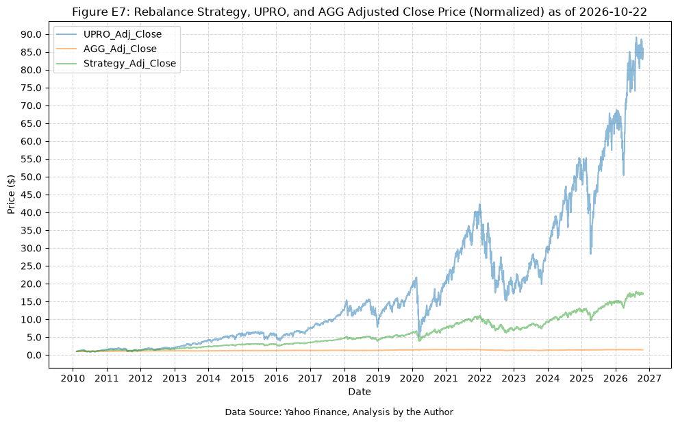
    


```python
plot_time_series(
    df=upro_agg_full,
    plot_start_date=None,
    plot_end_date=None,
    plot_columns=["UPRO_Drawdown", "AGG_Drawdown", "Strategy_Drawdown"],
    title=f"Figure E8: Rebalance Strategy, UPRO, and AGG Daily Drawdowns as of {upro_agg_full.index[-1].date()}",
    x_label="Date",
    x_format="Year",
    x_tick_spacing=1,
    x_tick_start=None,
    x_tick_rotation=0,
    y_label="Drawdown",
    y_format="Percentage",
    y_format_decimal_places=0,
    y_tick_spacing="Auto",
    y_tick_rotation=0,
    caption="Data Source: Yahoo Finance, Analysis by the Author",
)
```


    
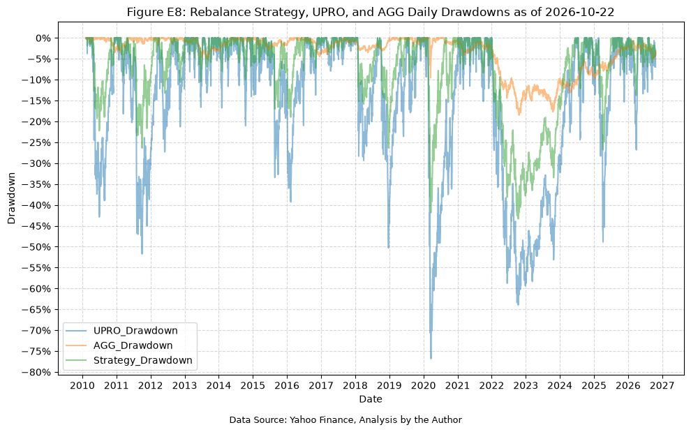
    


```python
plot_time_series(
    df=upro_agg_full,
    plot_start_date=None,
    plot_end_date=None,
    plot_columns=[
        "UPRO_Drawdown_Daily_Max",
        "AGG_Drawdown_Daily_Max",
        "Strategy_Drawdown_Daily_Max",
    ],
    title=f"Figure E9: Rebalance Strategy, UPRO, and AGG Maximum Daily Drawdowns as of {upro_agg_full.index[-1].date()}",
    x_label="Date",
    x_format="Year",
    x_tick_spacing=1,
    x_tick_start=None,
    x_tick_rotation=0,
    y_label="Drawdown",
    y_format="Percentage",
    y_format_decimal_places=0,
    y_tick_spacing="Auto",
    y_tick_rotation=0,
    caption="Data Source: Yahoo Finance, Analysis by the Author",
)
```


    
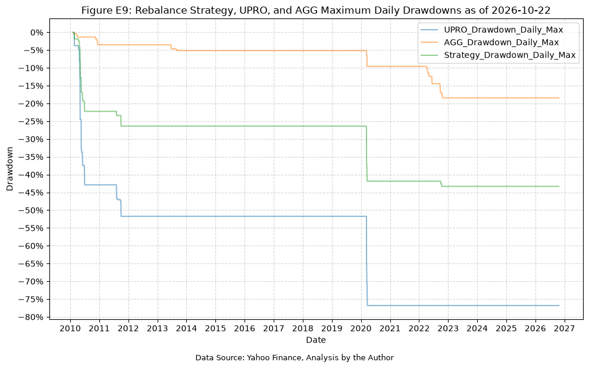
    


## Extension 4: Extrapolating UPRO Back To 1993

UPRO only has data back to its inception on 6/25/2009, which means that all of the results above come from a period that excludes both the dot-com crash and the 2008 financial crisis. To see how the strategy might have performed through those periods, we will extrapolate the returns for UPRO back to the start of SPY in January 1993, using a regression of the daily returns of UPRO on those of SPY over the period where both funds have data. Before the inception of UPRO we use the extrapolated data, and after its inception we use the actual data.

For the bond fund, we will use VBMFX (the Vanguard Total Bond Market Index Fund), which tracks the same index as AGG but has data back to 1986. We will then run the strategy on both UPRO/VBMFX and SPY/VBMFX from 1993 to present.

First, we need to pull data for VBMFX.


```python
yf_pull_data(
    base_directory=DATA_DIR,
    ticker="VBMFX",
    adjusted=False,
    source="Yahoo_Finance",
    asset_class="Mutual_Funds",
    excel_export=True,
    pickle_export=True,
    output_confirmation=False,
)
```


<div>
<style scoped>
    .dataframe tbody tr th:only-of-type {
        vertical-align: middle;
    }

    .dataframe tbody tr th {
        vertical-align: top;
    }

    .dataframe thead th {
        text-align: right;
    }
</style>
<table border="1" class="dataframe">
  <thead>
    <tr style="text-align: right;">
      <th></th>
      <th>Adj Close</th>
      <th>Close</th>
      <th>High</th>
      <th>Low</th>
      <th>Open</th>
      <th>Volume</th>
    </tr>
    <tr>
      <th>Date</th>
      <th></th>
      <th></th>
      <th></th>
      <th></th>
      <th></th>
      <th></th>
    </tr>
  </thead>
  <tbody>
    <tr>
      <th>1986-12-11</th>
      <td>1.38</td>
      <td>10.00</td>
      <td>10.00</td>
      <td>10.00</td>
      <td>10.00</td>
      <td>0</td>
    </tr>
    <tr>
      <th>1986-12-12</th>
      <td>1.38</td>
      <td>10.00</td>
      <td>10.00</td>
      <td>10.00</td>
      <td>10.00</td>
      <td>0</td>
    </tr>
    <tr>
      <th>1986-12-15</th>
      <td>1.37</td>
      <td>9.97</td>
      <td>9.97</td>
      <td>9.97</td>
      <td>9.97</td>
      <td>0</td>
    </tr>
    <tr>
      <th>1986-12-16</th>
      <td>1.38</td>
      <td>10.00</td>
      <td>10.00</td>
      <td>10.00</td>
      <td>10.00</td>
      <td>0</td>
    </tr>
    <tr>
      <th>1986-12-17</th>
      <td>1.38</td>
      <td>10.00</td>
      <td>10.00</td>
      <td>10.00</td>
      <td>10.00</td>
      <td>0</td>
    </tr>
    <tr>
      <th>...</th>
      <td>...</td>
      <td>...</td>
      <td>...</td>
      <td>...</td>
      <td>...</td>
      <td>...</td>
    </tr>
    <tr>
      <th>2026-10-16</th>
      <td>9.32</td>
      <td>9.32</td>
      <td>9.32</td>
      <td>9.32</td>
      <td>9.32</td>
      <td>0</td>
    </tr>
    <tr>
      <th>2026-10-19</th>
      <td>9.29</td>
      <td>9.29</td>
      <td>9.29</td>
      <td>9.29</td>
      <td>9.29</td>
      <td>0</td>
    </tr>
    <tr>
      <th>2026-10-20</th>
      <td>9.30</td>
      <td>9.30</td>
      <td>9.30</td>
      <td>9.30</td>
      <td>9.30</td>
      <td>0</td>
    </tr>
    <tr>
      <th>2026-10-21</th>
      <td>9.30</td>
      <td>9.30</td>
      <td>9.30</td>
      <td>9.30</td>
      <td>9.30</td>
      <td>0</td>
    </tr>
    <tr>
      <th>2026-10-22</th>
      <td>9.38</td>
      <td>9.38</td>
      <td>9.38</td>
      <td>9.38</td>
      <td>9.38</td>
      <td>0</td>
    </tr>
  </tbody>
</table>
<p>10042 rows × 6 columns</p>
</div>


Then add it to the existing dictionary. Since VBMFX is a mutual fund rather than an ETF, we load it separately.


```python
data = load_data(
    base_directory=DATA_DIR,
    ticker="VBMFX",
    source="Yahoo_Finance",
    asset_class="Mutual_Funds",
    timeframe="Daily",
    file_format="pickle",
)

data = data.rename(
    columns={
        "Adj Close": "VBMFX_Adj_Close",
        "Close": "VBMFX_Close",
        "High": "VBMFX_High",
        "Low": "VBMFX_Low",
        "Open": "VBMFX_Open",
        "Volume": "VBMFX_Volume",
    }
)

fund_data["VBMFX"] = data
```

Next, we run a regression of the daily returns of UPRO on the daily returns of SPY, over the period where both funds have data. The slope (beta) is the leverage that UPRO actually delivers, and the constant (alpha) captures the daily costs of the fund, including financing and fees.


```python
# Merge UPRO and SPY over the period where both funds have data
upro_spy = fund_data["UPRO"][["UPRO_Adj_Close"]].merge(
    fund_data["SPY"][["SPY_Adj_Close"]], left_index=True, right_index=True
)
upro_spy["UPRO_Return"] = upro_spy["UPRO_Adj_Close"].pct_change()
upro_spy["SPY_Return"] = upro_spy["SPY_Adj_Close"].pct_change()
upro_spy = upro_spy.dropna()

upro_spy_model = run_regression(
    df=upro_spy,
    x_plot_column="SPY_Return",
    y_plot_column="UPRO_Return",
    regression_model="OLS-statsmodels",
    regression_constant=True,
)

alpha = upro_spy_model.params.iloc[0]
beta = upro_spy_model.params.iloc[1]

print("Table E29: Regression of UPRO Daily Returns on SPY Daily Returns")
display(upro_spy_model.summary())
```

    Table E29: Regression of UPRO Daily Returns on SPY Daily Returns


<table class="simpletable">
<caption>OLS Regression Results</caption>
<tr>
  <th>Dep. Variable:</th>       <td>UPRO_Return</td>   <th>  R-squared:         </th>  <td>   0.997</td> 
</tr>
<tr>
  <th>Model:</th>                   <td>OLS</td>       <th>  Adj. R-squared:    </th>  <td>   0.997</td> 
</tr>
<tr>
  <th>Method:</th>             <td>Least Squares</td>  <th>  F-statistic:       </th>  <td>1.257e+06</td>
</tr>
<tr>
  <th>Date:</th>             <td>Sat, 24 Oct 2026</td> <th>  Prob (F-statistic):</th>   <td>  0.00</td>  
</tr>
<tr>
  <th>Time:</th>                 <td>18:28:23</td>     <th>  Log-Likelihood:    </th>  <td>  21156.</td> 
</tr>
<tr>
  <th>No. Observations:</th>      <td>  4358</td>      <th>  AIC:               </th> <td>-4.231e+04</td>
</tr>
<tr>
  <th>Df Residuals:</th>          <td>  4356</td>      <th>  BIC:               </th> <td>-4.230e+04</td>
</tr>
<tr>
  <th>Df Model:</th>              <td>     1</td>      <th>                     </th>      <td> </td>    
</tr>
<tr>
  <th>Covariance Type:</th>      <td>nonrobust</td>    <th>                     </th>      <td> </td>    
</tr>
</table>
<table class="simpletable">
<tr>
       <td></td>         <th>coef</th>     <th>std err</th>      <th>t</th>      <th>P>|t|</th>  <th>[0.025</th>    <th>0.975]</th>  
</tr>
<tr>
  <th>const</th>      <td>   -0.0002</td> <td> 2.86e-05</td> <td>   -6.754</td> <td> 0.000</td> <td>   -0.000</td> <td>   -0.000</td>
</tr>
<tr>
  <th>SPY_Return</th> <td>    2.9894</td> <td>    0.003</td> <td> 1121.375</td> <td> 0.000</td> <td>    2.984</td> <td>    2.995</td>
</tr>
</table>
<table class="simpletable">
<tr>
  <th>Omnibus:</th>       <td>2146.529</td> <th>  Durbin-Watson:     </th>  <td>   2.969</td>  
</tr>
<tr>
  <th>Prob(Omnibus):</th>  <td> 0.000</td>  <th>  Jarque-Bera (JB):  </th> <td>3412005.980</td>
</tr>
<tr>
  <th>Skew:</th>           <td>-0.729</td>  <th>  Prob(JB):          </th>  <td>    0.00</td>  
</tr>
<tr>
  <th>Kurtosis:</th>       <td>140.070</td> <th>  Cond. No.          </th>  <td>    93.3</td>  
</tr>
</table><br/><br/>Notes:<br/>[1] Standard Errors assume that the covariance matrix of the errors is correctly specified.


Before extrapolating, we can check how well the regression fits the actual UPRO data. Over the period where both funds have data, we compare the CAGR of the actual UPRO returns with the CAGR of the returns constructed from SPY, using only the beta, and using both the alpha and the beta.


```python
# Compare the actual UPRO returns with the returns constructed from SPY
fit_check = pd.DataFrame(
    {
        "Actual UPRO": upro_spy["UPRO_Return"],
        "Beta x SPY": beta * upro_spy["SPY_Return"],
        "Alpha + Beta x SPY": alpha + beta * upro_spy["SPY_Return"],
    }
)

years = len(fit_check) / 252
fit_check_cagr = ((1 + fit_check).prod() ** (1 / years) - 1).to_frame(name="CAGR")

print("Table E30: CAGR of Actual UPRO vs Returns Constructed From SPY")
display(fit_check_cagr)
```

    Table E30: CAGR of Actual UPRO vs Returns Constructed From SPY


<div>
<style scoped>
    .dataframe tbody tr th:only-of-type {
        vertical-align: middle;
    }

    .dataframe tbody tr th {
        vertical-align: top;
    }

    .dataframe thead th {
        text-align: right;
    }
</style>
<table border="1" class="dataframe">
  <thead>
    <tr style="text-align: right;">
      <th></th>
      <th>CAGR</th>
    </tr>
  </thead>
  <tbody>
    <tr>
      <th>Actual UPRO</th>
      <td>0.33</td>
    </tr>
    <tr>
      <th>Beta x SPY</th>
      <td>0.39</td>
    </tr>
    <tr>
      <th>Alpha + Beta x SPY</th>
      <td>0.33</td>
    </tr>
  </tbody>
</table>
</div>


The table above tells us that we have an adequate fit for the regression.

Next, we use the alpha and beta to extrapolate the UPRO returns back to the start of SPY, and then walk the price backwards from the first actual price of UPRO. Here is the data around the inception of UPRO after the extrapolation:


```python
# Merge SPY with UPRO over the full history of SPY
upro_extrap = fund_data["SPY"][["SPY_Adj_Close"]].merge(
    fund_data["UPRO"][["UPRO_Adj_Close"]], left_index=True, right_index=True, how="left"
)
upro_extrap["SPY_Return"] = upro_extrap["SPY_Adj_Close"].pct_change()
upro_extrap["UPRO_Return"] = upro_extrap["UPRO_Adj_Close"].pct_change()

# Before the inception of UPRO, fill the returns using the regression coefficients
upro_extrap["UPRO_Return"] = upro_extrap["UPRO_Return"].fillna(
    alpha + beta * upro_extrap["SPY_Return"]
)

# Walk backwards from the first actual price of UPRO: Price_{t} = Price_{t+1} / (1 + Return_{t+1})
first_valid_idx = upro_extrap["UPRO_Adj_Close"].first_valid_index()
splice_loc = upro_extrap.index.get_loc(first_valid_idx)
for i in range(splice_loc - 1, -1, -1):
    current_return = upro_extrap.iloc[i + 1]["UPRO_Return"]
    next_price = upro_extrap.iloc[i + 1]["UPRO_Adj_Close"]
    upro_extrap.loc[upro_extrap.index[i], "UPRO_Adj_Close"] = next_price / (
        1 + current_return
    )

# Store as a separate fund so the actual UPRO data is unchanged
fund_data["UPRO_Extrap"] = upro_extrap[["UPRO_Adj_Close"]].rename(
    columns={"UPRO_Adj_Close": "UPRO_Extrap_Adj_Close"}
)

print("Table E31: Extrapolated UPRO Data Around the Inception of UPRO")
display(upro_extrap.iloc[splice_loc - 3 : splice_loc + 3])
```

    Table E31: Extrapolated UPRO Data Around the Inception of UPRO


<div>
<style scoped>
    .dataframe tbody tr th:only-of-type {
        vertical-align: middle;
    }

    .dataframe tbody tr th {
        vertical-align: top;
    }

    .dataframe thead th {
        text-align: right;
    }
</style>
<table border="1" class="dataframe">
  <thead>
    <tr style="text-align: right;">
      <th></th>
      <th>SPY_Adj_Close</th>
      <th>UPRO_Adj_Close</th>
      <th>SPY_Return</th>
      <th>UPRO_Return</th>
    </tr>
    <tr>
      <th>Date</th>
      <th></th>
      <th></th>
      <th></th>
      <th></th>
    </tr>
  </thead>
  <tbody>
    <tr>
      <th>2009-06-22</th>
      <td>65.80</td>
      <td>1.03</td>
      <td>-0.03</td>
      <td>-0.09</td>
    </tr>
    <tr>
      <th>2009-06-23</th>
      <td>65.85</td>
      <td>1.03</td>
      <td>0.00</td>
      <td>0.00</td>
    </tr>
    <tr>
      <th>2009-06-24</th>
      <td>66.41</td>
      <td>1.06</td>
      <td>0.01</td>
      <td>0.03</td>
    </tr>
    <tr>
      <th>2009-06-25</th>
      <td>67.86</td>
      <td>1.13</td>
      <td>0.02</td>
      <td>0.06</td>
    </tr>
    <tr>
      <th>2009-06-26</th>
      <td>67.68</td>
      <td>1.12</td>
      <td>-0.00</td>
      <td>-0.01</td>
    </tr>
    <tr>
      <th>2009-06-29</th>
      <td>68.32</td>
      <td>1.15</td>
      <td>0.01</td>
      <td>0.03</td>
    </tr>
  </tbody>
</table>
</div>


And now we can run the strategy for both UPRO/VBMFX and SPY/VBMFX, from 1993 to present.


```python
upro_extrap_vbmfx_full = rebalance_strategy(
    fund_data=fund_data,
    fund_1="UPRO_Extrap",
    fund_2="VBMFX",
    fund_1_weight=0.5,
    rebalance_months=2,
    transaction_fee=0.0025,  # 0.25% transaction fee
    start_date=None,
    end_date=None,
)

print("Table E32: UPRO (Extrap)/VBMFX Rebalance Strategy Data")
display(upro_extrap_vbmfx_full)

spy_vbmfx_full = rebalance_strategy(
    fund_data=fund_data,
    fund_1="SPY",
    fund_2="VBMFX",
    fund_1_weight=0.5,
    rebalance_months=2,
    transaction_fee=0.0025,  # 0.25% transaction fee
    start_date=None,
    end_date=None,
)

print("Table E33: SPY/VBMFX Rebalance Strategy Data")
display(spy_vbmfx_full)
```

    Table E32: UPRO (Extrap)/VBMFX Rebalance Strategy Data


<div>
<style scoped>
    .dataframe tbody tr th:only-of-type {
        vertical-align: middle;
    }

    .dataframe tbody tr th {
        vertical-align: top;
    }

    .dataframe thead th {
        text-align: right;
    }
</style>
<table border="1" class="dataframe">
  <thead>
    <tr style="text-align: right;">
      <th></th>
      <th>UPRO_Extrap_Adj_Close</th>
      <th>VBMFX_Adj_Close</th>
      <th>UPRO_Extrap_Return</th>
      <th>VBMFX_Return</th>
      <th>UPRO_Extrap_Drawdown</th>
      <th>VBMFX_Drawdown</th>
      <th>UPRO_Extrap_Drawdown_Daily_Max</th>
      <th>VBMFX_Drawdown_Daily_Max</th>
      <th>UPRO_Extrap_Value</th>
      <th>VBMFX_Value</th>
      <th>Strategy_Adj_Close</th>
      <th>Strategy_Return</th>
      <th>Strategy_Drawdown</th>
      <th>Strategy_Drawdown_Daily_Max</th>
      <th>Rebalance</th>
      <th>Transaction_Fee</th>
    </tr>
    <tr>
      <th>Date</th>
      <th></th>
      <th></th>
      <th></th>
      <th></th>
      <th></th>
      <th></th>
      <th></th>
      <th></th>
      <th></th>
      <th></th>
      <th></th>
      <th></th>
      <th></th>
      <th></th>
      <th></th>
      <th></th>
    </tr>
  </thead>
  <tbody>
    <tr>
      <th>1993-01-29</th>
      <td>1.00</td>
      <td>1.00</td>
      <td>NaN</td>
      <td>NaN</td>
      <td>0.00</td>
      <td>0.00</td>
      <td>0.00</td>
      <td>0.00</td>
      <td>0.50</td>
      <td>0.50</td>
      <td>1.00</td>
      <td>NaN</td>
      <td>0.00</td>
      <td>0.00</td>
      <td>False</td>
      <td>0.00</td>
    </tr>
    <tr>
      <th>1993-02-01</th>
      <td>1.02</td>
      <td>1.00</td>
      <td>0.02</td>
      <td>0.00</td>
      <td>0.00</td>
      <td>0.00</td>
      <td>0.00</td>
      <td>0.00</td>
      <td>0.51</td>
      <td>0.50</td>
      <td>1.01</td>
      <td>0.01</td>
      <td>0.00</td>
      <td>0.00</td>
      <td>False</td>
      <td>0.00</td>
    </tr>
    <tr>
      <th>1993-02-02</th>
      <td>1.03</td>
      <td>1.00</td>
      <td>0.01</td>
      <td>-0.00</td>
      <td>0.00</td>
      <td>-0.00</td>
      <td>0.00</td>
      <td>-0.00</td>
      <td>0.51</td>
      <td>0.50</td>
      <td>1.01</td>
      <td>0.00</td>
      <td>0.00</td>
      <td>0.00</td>
      <td>False</td>
      <td>0.00</td>
    </tr>
    <tr>
      <th>1993-02-03</th>
      <td>1.06</td>
      <td>1.00</td>
      <td>0.03</td>
      <td>0.00</td>
      <td>0.00</td>
      <td>-0.00</td>
      <td>0.00</td>
      <td>-0.00</td>
      <td>0.53</td>
      <td>0.50</td>
      <td>1.03</td>
      <td>0.02</td>
      <td>0.00</td>
      <td>0.00</td>
      <td>False</td>
      <td>0.00</td>
    </tr>
    <tr>
      <th>1993-02-04</th>
      <td>1.07</td>
      <td>1.00</td>
      <td>0.01</td>
      <td>0.00</td>
      <td>0.00</td>
      <td>0.00</td>
      <td>0.00</td>
      <td>-0.00</td>
      <td>0.54</td>
      <td>0.50</td>
      <td>1.04</td>
      <td>0.01</td>
      <td>0.00</td>
      <td>0.00</td>
      <td>False</td>
      <td>0.00</td>
    </tr>
    <tr>
      <th>...</th>
      <td>...</td>
      <td>...</td>
      <td>...</td>
      <td>...</td>
      <td>...</td>
      <td>...</td>
      <td>...</td>
      <td>...</td>
      <td>...</td>
      <td>...</td>
      <td>...</td>
      <td>...</td>
      <td>...</td>
      <td>...</td>
      <td>...</td>
      <td>...</td>
    </tr>
    <tr>
      <th>2026-10-16</th>
      <td>183.52</td>
      <td>4.00</td>
      <td>-0.03</td>
      <td>0.00</td>
      <td>-0.07</td>
      <td>-0.05</td>
      <td>-0.98</td>
      <td>-0.19</td>
      <td>31.96</td>
      <td>32.27</td>
      <td>64.23</td>
      <td>-0.02</td>
      <td>-0.04</td>
      <td>-0.72</td>
      <td>False</td>
      <td>0.00</td>
    </tr>
    <tr>
      <th>2026-10-19</th>
      <td>185.82</td>
      <td>3.99</td>
      <td>0.01</td>
      <td>-0.00</td>
      <td>-0.06</td>
      <td>-0.05</td>
      <td>-0.98</td>
      <td>-0.19</td>
      <td>32.37</td>
      <td>32.17</td>
      <td>64.53</td>
      <td>0.00</td>
      <td>-0.04</td>
      <td>-0.72</td>
      <td>False</td>
      <td>0.00</td>
    </tr>
    <tr>
      <th>2026-10-20</th>
      <td>187.46</td>
      <td>4.00</td>
      <td>0.01</td>
      <td>0.00</td>
      <td>-0.05</td>
      <td>-0.05</td>
      <td>-0.98</td>
      <td>-0.19</td>
      <td>32.65</td>
      <td>32.20</td>
      <td>64.85</td>
      <td>0.00</td>
      <td>-0.04</td>
      <td>-0.72</td>
      <td>False</td>
      <td>0.00</td>
    </tr>
    <tr>
      <th>2026-10-21</th>
      <td>190.51</td>
      <td>4.00</td>
      <td>0.02</td>
      <td>0.00</td>
      <td>-0.03</td>
      <td>-0.05</td>
      <td>-0.98</td>
      <td>-0.19</td>
      <td>33.18</td>
      <td>32.20</td>
      <td>65.38</td>
      <td>0.01</td>
      <td>-0.03</td>
      <td>-0.72</td>
      <td>False</td>
      <td>0.00</td>
    </tr>
    <tr>
      <th>2026-10-22</th>
      <td>183.64</td>
      <td>4.03</td>
      <td>-0.04</td>
      <td>0.01</td>
      <td>-0.07</td>
      <td>-0.04</td>
      <td>-0.98</td>
      <td>-0.19</td>
      <td>31.99</td>
      <td>32.48</td>
      <td>64.46</td>
      <td>-0.01</td>
      <td>-0.04</td>
      <td>-0.72</td>
      <td>False</td>
      <td>0.00</td>
    </tr>
  </tbody>
</table>
<p>8491 rows × 16 columns</p>
</div>


    Table E33: SPY/VBMFX Rebalance Strategy Data


<div>
<style scoped>
    .dataframe tbody tr th:only-of-type {
        vertical-align: middle;
    }

    .dataframe tbody tr th {
        vertical-align: top;
    }

    .dataframe thead th {
        text-align: right;
    }
</style>
<table border="1" class="dataframe">
  <thead>
    <tr style="text-align: right;">
      <th></th>
      <th>SPY_Adj_Close</th>
      <th>VBMFX_Adj_Close</th>
      <th>SPY_Return</th>
      <th>VBMFX_Return</th>
      <th>SPY_Drawdown</th>
      <th>VBMFX_Drawdown</th>
      <th>SPY_Drawdown_Daily_Max</th>
      <th>VBMFX_Drawdown_Daily_Max</th>
      <th>SPY_Value</th>
      <th>VBMFX_Value</th>
      <th>Strategy_Adj_Close</th>
      <th>Strategy_Return</th>
      <th>Strategy_Drawdown</th>
      <th>Strategy_Drawdown_Daily_Max</th>
      <th>Rebalance</th>
      <th>Transaction_Fee</th>
    </tr>
    <tr>
      <th>Date</th>
      <th></th>
      <th></th>
      <th></th>
      <th></th>
      <th></th>
      <th></th>
      <th></th>
      <th></th>
      <th></th>
      <th></th>
      <th></th>
      <th></th>
      <th></th>
      <th></th>
      <th></th>
      <th></th>
    </tr>
  </thead>
  <tbody>
    <tr>
      <th>1993-01-29</th>
      <td>1.00</td>
      <td>1.00</td>
      <td>NaN</td>
      <td>NaN</td>
      <td>0.00</td>
      <td>0.00</td>
      <td>0.00</td>
      <td>0.00</td>
      <td>0.50</td>
      <td>0.50</td>
      <td>1.00</td>
      <td>NaN</td>
      <td>0.00</td>
      <td>0.00</td>
      <td>False</td>
      <td>0.00</td>
    </tr>
    <tr>
      <th>1993-02-01</th>
      <td>1.01</td>
      <td>1.00</td>
      <td>0.01</td>
      <td>0.00</td>
      <td>0.00</td>
      <td>0.00</td>
      <td>0.00</td>
      <td>0.00</td>
      <td>0.50</td>
      <td>0.50</td>
      <td>1.00</td>
      <td>0.00</td>
      <td>0.00</td>
      <td>0.00</td>
      <td>False</td>
      <td>0.00</td>
    </tr>
    <tr>
      <th>1993-02-02</th>
      <td>1.01</td>
      <td>1.00</td>
      <td>0.00</td>
      <td>-0.00</td>
      <td>0.00</td>
      <td>-0.00</td>
      <td>0.00</td>
      <td>-0.00</td>
      <td>0.50</td>
      <td>0.50</td>
      <td>1.00</td>
      <td>0.00</td>
      <td>0.00</td>
      <td>0.00</td>
      <td>False</td>
      <td>0.00</td>
    </tr>
    <tr>
      <th>1993-02-03</th>
      <td>1.02</td>
      <td>1.00</td>
      <td>0.01</td>
      <td>0.00</td>
      <td>0.00</td>
      <td>-0.00</td>
      <td>0.00</td>
      <td>-0.00</td>
      <td>0.51</td>
      <td>0.50</td>
      <td>1.01</td>
      <td>0.01</td>
      <td>0.00</td>
      <td>0.00</td>
      <td>False</td>
      <td>0.00</td>
    </tr>
    <tr>
      <th>1993-02-04</th>
      <td>1.02</td>
      <td>1.00</td>
      <td>0.00</td>
      <td>0.00</td>
      <td>0.00</td>
      <td>0.00</td>
      <td>0.00</td>
      <td>-0.00</td>
      <td>0.51</td>
      <td>0.50</td>
      <td>1.01</td>
      <td>0.00</td>
      <td>0.00</td>
      <td>0.00</td>
      <td>False</td>
      <td>0.00</td>
    </tr>
    <tr>
      <th>...</th>
      <td>...</td>
      <td>...</td>
      <td>...</td>
      <td>...</td>
      <td>...</td>
      <td>...</td>
      <td>...</td>
      <td>...</td>
      <td>...</td>
      <td>...</td>
      <td>...</td>
      <td>...</td>
      <td>...</td>
      <td>...</td>
      <td>...</td>
      <td>...</td>
    </tr>
    <tr>
      <th>2026-10-16</th>
      <td>31.73</td>
      <td>4.00</td>
      <td>-0.01</td>
      <td>0.00</td>
      <td>-0.02</td>
      <td>-0.05</td>
      <td>-0.55</td>
      <td>-0.19</td>
      <td>6.13</td>
      <td>6.06</td>
      <td>12.19</td>
      <td>-0.01</td>
      <td>-0.02</td>
      <td>-0.30</td>
      <td>False</td>
      <td>0.00</td>
    </tr>
    <tr>
      <th>2026-10-19</th>
      <td>31.87</td>
      <td>3.99</td>
      <td>0.00</td>
      <td>-0.00</td>
      <td>-0.02</td>
      <td>-0.05</td>
      <td>-0.55</td>
      <td>-0.19</td>
      <td>6.16</td>
      <td>6.04</td>
      <td>12.19</td>
      <td>0.00</td>
      <td>-0.02</td>
      <td>-0.30</td>
      <td>False</td>
      <td>0.00</td>
    </tr>
    <tr>
      <th>2026-10-20</th>
      <td>31.97</td>
      <td>4.00</td>
      <td>0.00</td>
      <td>0.00</td>
      <td>-0.01</td>
      <td>-0.05</td>
      <td>-0.55</td>
      <td>-0.19</td>
      <td>6.18</td>
      <td>6.04</td>
      <td>12.22</td>
      <td>0.00</td>
      <td>-0.01</td>
      <td>-0.30</td>
      <td>False</td>
      <td>0.00</td>
    </tr>
    <tr>
      <th>2026-10-21</th>
      <td>32.14</td>
      <td>4.00</td>
      <td>0.01</td>
      <td>0.00</td>
      <td>-0.01</td>
      <td>-0.05</td>
      <td>-0.55</td>
      <td>-0.19</td>
      <td>6.21</td>
      <td>6.04</td>
      <td>12.25</td>
      <td>0.00</td>
      <td>-0.01</td>
      <td>-0.30</td>
      <td>False</td>
      <td>0.00</td>
    </tr>
    <tr>
      <th>2026-10-22</th>
      <td>31.76</td>
      <td>4.03</td>
      <td>-0.01</td>
      <td>0.01</td>
      <td>-0.02</td>
      <td>-0.04</td>
      <td>-0.55</td>
      <td>-0.19</td>
      <td>6.14</td>
      <td>6.10</td>
      <td>12.23</td>
      <td>-0.00</td>
      <td>-0.01</td>
      <td>-0.30</td>
      <td>False</td>
      <td>0.00</td>
    </tr>
  </tbody>
</table>
<p>8491 rows × 16 columns</p>
</div>


```python
upro_extrap_vbmfx_full_sum_stats = summary_stats(
    fund_list=["UPRO (Extrap)/VBMFX"],
    df=upro_extrap_vbmfx_full[["Strategy_Return"]].dropna(),
    period="Daily",
    use_calendar_days=False,
    excel_export=False,
    pickle_export=False,
    output_confirmation=False,
)

# Rename the index to indicate the strategy
upro_extrap_vbmfx_full_sum_stats.index = ["UPRO (Extrap)/VBMFX Full Strategy"]

all_strat_sum_stats = pd.concat([all_strat_sum_stats, upro_extrap_vbmfx_full_sum_stats])

upro_extrap_sum_stats = summary_stats(
    fund_list=["UPRO (Extrap)/VBMFX"],
    df=upro_extrap_vbmfx_full[["UPRO_Extrap_Return"]].dropna(),
    period="Daily",
    use_calendar_days=False,
    excel_export=False,
    pickle_export=False,
    output_confirmation=False,
)

# Rename the index to indicate the strategy
upro_extrap_sum_stats.index = ["UPRO (Extrap)"]

all_strat_sum_stats = pd.concat([all_strat_sum_stats, upro_extrap_sum_stats])

spy_vbmfx_full_sum_stats = summary_stats(
    fund_list=["SPY/VBMFX"],
    df=spy_vbmfx_full[["Strategy_Return"]].dropna(),
    period="Daily",
    use_calendar_days=False,
    excel_export=False,
    pickle_export=False,
    output_confirmation=False,
)

# Rename the index to indicate the strategy
spy_vbmfx_full_sum_stats.index = ["SPY/VBMFX Full Strategy"]

all_strat_sum_stats = pd.concat([all_strat_sum_stats, spy_vbmfx_full_sum_stats])

spy_sum_stats = summary_stats(
    fund_list=["SPY"],
    df=spy_vbmfx_full[["SPY_Return"]].dropna(),
    period="Daily",
    use_calendar_days=False,
    excel_export=False,
    pickle_export=False,
    output_confirmation=False,
)

# Rename the index to indicate the strategy
spy_sum_stats.index = ["SPY"]

all_strat_sum_stats = pd.concat([all_strat_sum_stats, spy_sum_stats])

print("Table E34: Strategy Summary Statistics")
display(all_strat_sum_stats)
```

    Table E34: Strategy Summary Statistics


<div>
<style scoped>
    .dataframe tbody tr th:only-of-type {
        vertical-align: middle;
    }

    .dataframe tbody tr th {
        vertical-align: top;
    }

    .dataframe thead th {
        text-align: right;
    }
</style>
<table border="1" class="dataframe">
  <thead>
    <tr style="text-align: right;">
      <th></th>
      <th>Number of Observations</th>
      <th>Data Start Date</th>
      <th>Data End Date</th>
      <th>Annual Mean Return (Arithmetic)</th>
      <th>Annualized Volatility</th>
      <th>Annualized Sharpe Ratio</th>
      <th>CAGR (Geometric)</th>
      <th>Daily Max Return</th>
      <th>Daily Max Return (Date)</th>
      <th>Daily Min Return</th>
      <th>Daily Min Return (Date)</th>
      <th>Max Drawdown</th>
      <th>Peak</th>
      <th>Trough</th>
      <th>Recovery Date</th>
      <th>Calendar Days to Recovery</th>
      <th>MAR Ratio</th>
    </tr>
  </thead>
  <tbody>
    <tr>
      <th>TQQQ/TMF Strategy</th>
      <td>2679</td>
      <td>2010-02-12</td>
      <td>2020-10-02</td>
      <td>0.39</td>
      <td>0.28</td>
      <td>1.40</td>
      <td>0.42</td>
      <td>0.11</td>
      <td>2020-03-20</td>
      <td>-0.16</td>
      <td>2020-03-18</td>
      <td>-0.42</td>
      <td>2020-03-06</td>
      <td>2020-03-18</td>
      <td>2020-05-07</td>
      <td>50.00</td>
      <td>1.00</td>
    </tr>
    <tr>
      <th>TQQQ</th>
      <td>2679</td>
      <td>2010-02-12</td>
      <td>2020-10-02</td>
      <td>0.57</td>
      <td>0.58</td>
      <td>0.99</td>
      <td>0.50</td>
      <td>0.27</td>
      <td>2020-03-13</td>
      <td>-0.34</td>
      <td>2020-03-16</td>
      <td>-0.70</td>
      <td>2020-02-19</td>
      <td>2020-03-20</td>
      <td>2020-07-10</td>
      <td>112.00</td>
      <td>0.71</td>
    </tr>
    <tr>
      <th>TMF</th>
      <td>2679</td>
      <td>2010-02-12</td>
      <td>2020-10-02</td>
      <td>0.26</td>
      <td>0.44</td>
      <td>0.59</td>
      <td>0.18</td>
      <td>0.20</td>
      <td>2020-03-20</td>
      <td>-0.18</td>
      <td>2020-03-18</td>
      <td>-0.53</td>
      <td>2012-07-25</td>
      <td>2013-08-21</td>
      <td>2015-01-05</td>
      <td>502.00</td>
      <td>0.33</td>
    </tr>
    <tr>
      <th>TQQQ/TMF BS</th>
      <td>2679</td>
      <td>2010-02-12</td>
      <td>2020-10-02</td>
      <td>0.38</td>
      <td>0.26</td>
      <td>1.48</td>
      <td>0.41</td>
      <td>0.07</td>
      <td>2020-03-06</td>
      <td>-0.09</td>
      <td>2020-09-03</td>
      <td>-0.30</td>
      <td>2018-08-29</td>
      <td>2018-12-24</td>
      <td>2019-04-23</td>
      <td>120.00</td>
      <td>1.38</td>
    </tr>
    <tr>
      <th>TQQQ/TMF Full Strategy</th>
      <td>4199</td>
      <td>2010-02-12</td>
      <td>2026-10-22</td>
      <td>0.27</td>
      <td>0.34</td>
      <td>0.80</td>
      <td>0.24</td>
      <td>0.17</td>
      <td>2022-11-10</td>
      <td>-0.16</td>
      <td>2020-03-18</td>
      <td>-0.78</td>
      <td>2021-11-19</td>
      <td>2022-11-09</td>
      <td>NaT</td>
      <td>NaN</td>
      <td>0.30</td>
    </tr>
    <tr>
      <th>TQQQ/TMF Full BS</th>
      <td>4199</td>
      <td>2010-02-12</td>
      <td>2026-10-22</td>
      <td>0.26</td>
      <td>0.32</td>
      <td>0.81</td>
      <td>0.23</td>
      <td>0.17</td>
      <td>2022-11-10</td>
      <td>-0.12</td>
      <td>2022-05-05</td>
      <td>-0.78</td>
      <td>2021-11-19</td>
      <td>2022-11-09</td>
      <td>NaT</td>
      <td>NaN</td>
      <td>0.30</td>
    </tr>
    <tr>
      <th>UPRO/AGG Full Strategy</th>
      <td>4199</td>
      <td>2010-02-12</td>
      <td>2026-10-22</td>
      <td>0.20</td>
      <td>0.24</td>
      <td>0.83</td>
      <td>0.19</td>
      <td>0.12</td>
      <td>2025-04-09</td>
      <td>-0.13</td>
      <td>2020-03-12</td>
      <td>-0.43</td>
      <td>2021-12-27</td>
      <td>2022-10-14</td>
      <td>2024-06-12</td>
      <td>607.00</td>
      <td>0.43</td>
    </tr>
    <tr>
      <th>UPRO (Extrap)/VBMFX Full Strategy</th>
      <td>8490</td>
      <td>1993-02-01</td>
      <td>2026-10-22</td>
      <td>0.16</td>
      <td>0.26</td>
      <td>0.61</td>
      <td>0.13</td>
      <td>0.11</td>
      <td>2009-03-23</td>
      <td>-0.14</td>
      <td>2020-03-16</td>
      <td>-0.72</td>
      <td>2007-10-09</td>
      <td>2009-03-09</td>
      <td>2013-01-18</td>
      <td>1411.00</td>
      <td>0.18</td>
    </tr>
    <tr>
      <th>UPRO (Extrap)</th>
      <td>8490</td>
      <td>1993-02-01</td>
      <td>2026-10-22</td>
      <td>0.31</td>
      <td>0.55</td>
      <td>0.56</td>
      <td>0.17</td>
      <td>0.43</td>
      <td>2008-10-13</td>
      <td>-0.35</td>
      <td>2020-03-16</td>
      <td>-0.98</td>
      <td>2000-03-24</td>
      <td>2009-03-09</td>
      <td>2017-11-28</td>
      <td>3186.00</td>
      <td>0.17</td>
    </tr>
    <tr>
      <th>SPY/VBMFX Full Strategy</th>
      <td>8490</td>
      <td>1993-02-01</td>
      <td>2026-10-22</td>
      <td>0.08</td>
      <td>0.09</td>
      <td>0.86</td>
      <td>0.08</td>
      <td>0.06</td>
      <td>2008-10-13</td>
      <td>-0.05</td>
      <td>2020-03-12</td>
      <td>-0.30</td>
      <td>2007-10-09</td>
      <td>2009-03-09</td>
      <td>2010-04-15</td>
      <td>402.00</td>
      <td>0.26</td>
    </tr>
    <tr>
      <th>SPY</th>
      <td>8490</td>
      <td>1993-02-01</td>
      <td>2026-10-22</td>
      <td>0.12</td>
      <td>0.19</td>
      <td>0.65</td>
      <td>0.11</td>
      <td>0.15</td>
      <td>2008-10-13</td>
      <td>-0.11</td>
      <td>2020-03-16</td>
      <td>-0.55</td>
      <td>2007-10-09</td>
      <td>2009-03-09</td>
      <td>2012-08-16</td>
      <td>1256.00</td>
      <td>0.20</td>
    </tr>
  </tbody>
</table>
</div>


To make the comparison as easy as possible, we will plot both the UPRO (Extrap)/VBMFX strategy and the actual SPY/VBMFX strategy together, along with each of the individual components.


```python
plot_time_series(
    df=upro_extrap_vbmfx_full.merge(
        spy_vbmfx_full,
        on="Date",
        how="outer",
        suffixes=("_UPRO_Extrap_VBMFX", "_SPY_VBMFX"),
    ).rename(columns={"VBMFX_Adj_Close_UPRO_Extrap_VBMFX": "VBMFX_Adj_Close"}),
    plot_start_date=None,
    plot_end_date=None,
    plot_columns=[
        "UPRO_Extrap_Adj_Close",
        "SPY_Adj_Close",
        "VBMFX_Adj_Close",
        "Strategy_Adj_Close_UPRO_Extrap_VBMFX",
        "Strategy_Adj_Close_SPY_VBMFX",
    ],
    title=f"Figure E10: Rebalance Strategies, UPRO (Extrap), SPY, and VBMFX Adjusted Close Price (Normalized) as of {upro_extrap_vbmfx_full.index[-1].date()}",
    x_label="Date",
    x_format="Year",
    x_tick_spacing=2,
    x_tick_start=None,
    x_tick_rotation=0,
    y_label="Price ($)",
    y_format="Decimal",
    y_format_decimal_places=0,
    y_tick_spacing="Auto",
    y_tick_rotation=0,
    caption="Data Source: Yahoo Finance, Analysis by the Author",
)
```


    
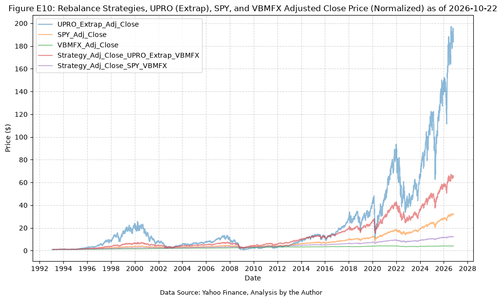
    


```python
plot_time_series(
    df=upro_extrap_vbmfx_full.merge(
        spy_vbmfx_full,
        on="Date",
        how="outer",
        suffixes=("_UPRO_Extrap_VBMFX", "_SPY_VBMFX"),
    ).rename(columns={"VBMFX_Drawdown_UPRO_Extrap_VBMFX": "VBMFX_Drawdown"}),
    plot_start_date=None,
    plot_end_date=None,
    plot_columns=[
        "UPRO_Extrap_Drawdown",
        "SPY_Drawdown",
        "VBMFX_Drawdown",
        "Strategy_Drawdown_UPRO_Extrap_VBMFX",
        "Strategy_Drawdown_SPY_VBMFX",
    ],
    title=f"Figure E11: Rebalance Strategies, UPRO (Extrap), SPY, and VBMFX Daily Drawdowns as of {upro_extrap_vbmfx_full.index[-1].date()}",
    x_label="Date",
    x_format="Year",
    x_tick_spacing=2,
    x_tick_start=None,
    x_tick_rotation=0,
    y_label="Drawdown",
    y_format="Percentage",
    y_format_decimal_places=0,
    y_tick_spacing="Auto",
    y_tick_rotation=0,
    caption="Data Source: Yahoo Finance, Analysis by the Author",
)
```


    
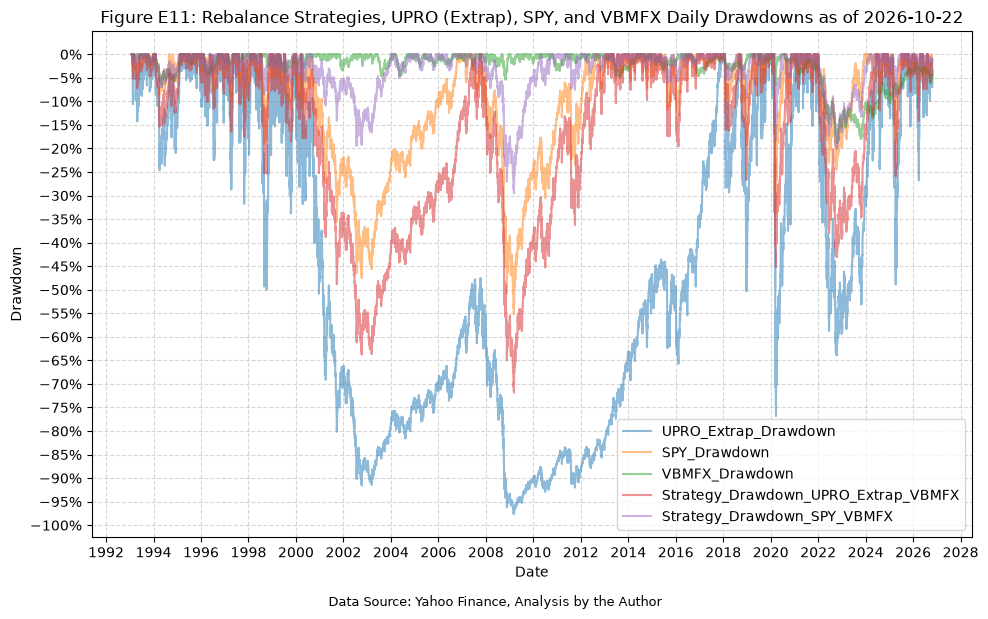
    


```python
plot_time_series(
    df=upro_extrap_vbmfx_full.merge(
        spy_vbmfx_full,
        on="Date",
        how="outer",
        suffixes=("_UPRO_Extrap_VBMFX", "_SPY_VBMFX"),
    ).rename(
        columns={
            "VBMFX_Drawdown_Daily_Max_UPRO_Extrap_VBMFX": "VBMFX_Drawdown_Daily_Max"
        }
    ),
    plot_start_date=None,
    plot_end_date=None,
    plot_columns=[
        "UPRO_Extrap_Drawdown_Daily_Max",
        "SPY_Drawdown_Daily_Max",
        "VBMFX_Drawdown_Daily_Max",
        "Strategy_Drawdown_Daily_Max_UPRO_Extrap_VBMFX",
        "Strategy_Drawdown_Daily_Max_SPY_VBMFX",
    ],
    title=f"Figure E12: Rebalance Strategies, UPRO (Extrap), SPY, and VBMFX Maximum Daily Drawdowns as of {upro_extrap_vbmfx_full.index[-1].date()}",
    x_label="Date",
    x_format="Year",
    x_tick_spacing=2,
    x_tick_start=None,
    x_tick_rotation=0,
    y_label="Drawdown",
    y_format="Percentage",
    y_format_decimal_places=0,
    y_tick_spacing="Auto",
    y_tick_rotation=0,
    caption="Data Source: Yahoo Finance, Analysis by the Author",
)
```


    
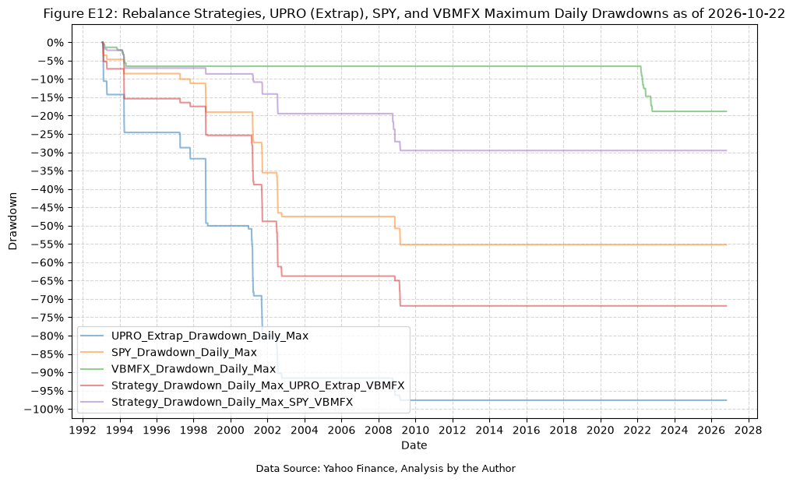
    


## Conclusion

First, the way the paper handles the different dates for the CAGR, DDD, and MDD is quite unusual and requires careful consideration when attempting to reproduce the results accurately. Typically, one would expect a specific data range to be consistently applied across all metrics to ensure comparability and validity of the results. The unusual way that the paper handled the dates actually required quite a bit of extra effort to align the data correctly and update the summary stats tables with additional fields to accurately portray what was being calculated in the paper.

Second, the pseudo-code for the "black swan" filter in figure 11 does not match the results reported in the paper. The pseudo-code sets the switch-back price $v^{\ast}$ to the price of TQQQ on the day of the drop, $v(n)$, but implemented that way, the filter switches back to the standard strategy the very next day and whipsaws in and out of IEF three times during March 2020. Using the price of TQQQ on the day before the drop, $v(n-1)$, instead reproduces both the 5/18/2020 switch-back date and the 30% maximum DDD reported in the paper. When the pseudo-code and the reported results disagree, the results (and the paper's written description of the method) are the better guide for a replication.

## Future Investigation

Nothing here yet.

## References

1. Glenn, Lewis A., Long-Term Investing in Triple Leveraged Exchange Traded Funds (October 30, 2020). Available at SSRN: https://ssrn.com/abstract=3722318 or http://dx.doi.org/10.2139/ssrn.3722318


