## Post Updates

Update 11/11/2026: Updated the methodology to ensure implementation lag is correctly applied based on FOMC announcements/rate changes and monthly returns The catch-all cycle label, previously "Modified Tightening", has been renamed `Extended Neutral` and is now documented that it covers 37% of the sample, including both zero-rate periods, and it is the single largest contributor to the strategy's return. The high yield regression chart was also plotting the Treasury series, and has been fixed. Commentary on the regressions has been revised to reflect that none of the four are statistically significant.

## Introduction

In this post, we will look into the Fed Funds cycles and evaluate asset class performance during tightening and easing of monetary policy. We'll pull data for stocks, intermediate Treasuries, high yield credit, and gold, and analyze their returns during different phases of the Fed Funds cycle. We'll also establish a simple strategy that allocates capital to a specific asset based on the current phase of the cycle, and evaluate the performance of this strategy over time.

## Python Imports


```python
import os
import sys
import warnings

from itertools import combinations, count
from pathlib import Path

# Data Handling
import numpy as np
import pandas as pd

from scipy.stats import norm

# Display
from IPython.display import Markdown, display

# Suppress warnings
warnings.filterwarnings("ignore")

# Add src/ to the path so settings.py and the helper modules can be imported
src_directory = str(Path.cwd().parents[2] / "src")
if src_directory not in sys.path:
    sys.path.append(src_directory)

from settings import config

DATA_DIR = config("DATA_DIR")  # keep only the directories this post uses
```

## Python Functions

Here are the functions needed for this project:

* [bb_clean_data](/posts/reusable-extensible-python-functions-financial-data-analysis/#bb_clean_data): Takes an Excel export from Bloomberg, removes the miscellaneous headings/rows, and returns a DataFrame.
* [calc_fed_cycle_asset_performance](/posts/reusable-extensible-python-functions-financial-data-analysis/#calc_fed_cycle_asset_performance): Calculates metrics for an asset based on a specified Fed tightening/easing cycle.
* [load_data](/posts/reusable-extensible-python-functions-financial-data-analysis/#load_data): Load data from a CSV, Excel, or Pickle file into a pandas DataFrame.
* [pandas_set_decimal_places](/posts/reusable-extensible-python-functions-financial-data-analysis/#pandas_set_decimal_places): Set the number of decimal places displayed for floating-point numbers in pandas.
* [plot_bar_returns_ffr_change](/posts/reusable-extensible-python-functions-financial-data-analysis/#plot_bar_returns_ffr_change): Plot the bar chart of the cumulative or annualized returns for the asset class along with the change in the Fed Funds Rate.
* [plot_scatter_regression_ffr_vs_returns](/posts/reusable-extensible-python-functions-financial-data-analysis/#plot_scatter_regression_ffr_vs_returns): Plot the scatter plot and regression of the annualized return for the asset class along with the annualized change in the Fed Funds Rate.
* [plot_time_series](/posts/reusable-extensible-python-functions-financial-data-analysis/#plot_time_series): Plot the time series data from a DataFrame for a specified date range and columns.
* [run_regression](/posts/reusable-extensible-python-functions-financial-data-analysis/#run_regression): Run a regression using a variety of different methods and return the results.
* [summary_stats](/posts/reusable-extensible-python-functions-financial-data-analysis/#summary_stats): Generate summary statistics for a series of returns.


```python
from bb_clean_data import bb_clean_data
from calc_fed_cycle_asset_performance import calc_fed_cycle_asset_performance
from load_data import load_data
from pandas_set_decimal_places import pandas_set_decimal_places
from plot_bar_returns_ffr_change import plot_bar_returns_ffr_change
from plot_scatter_regression_ffr_vs_returns import plot_scatter_regression_ffr_vs_returns
from plot_time_series import plot_time_series
from run_regression import run_regression
from summary_stats import summary_stats
```


```python
pandas_set_decimal_places(2)
figure_number = count(1)
table_number = count(1)
```

## Data Overview

### Acquire & Plot Fed Funds Data

First, let's get the data for the Fed Funds target rate (FFR). This data is found in 3 different datasets from FRED, which we pull directly from the FRED CSV endpoint.


```python
def pull_fred_series(series_id: str) -> pd.DataFrame:
    """Pull a single series from FRED as a date-indexed DataFrame."""
    url = f"https://fred.stlouisfed.org/graph/fredgraph.csv?id={series_id}"
    series = pd.read_csv(
        url,
        parse_dates=["observation_date"],
        index_col="observation_date",
    )
    # Normalize to nanosecond resolution so later merges against the
    # Bloomberg data line up on identical datetime dtypes
    series.index = series.index.astype("datetime64[ns]")
    series.index.name = "DATE"
    return pd.to_numeric(series[series_id], errors="coerce").to_frame()


# Pull Federal Funds Target Rate (DISCONTINUED) (DFEDTAR)
fedfunds_target_old = pull_fred_series("DFEDTAR")

# Pull Federal Funds Target Range - Upper Limit (DFEDTARU)
fedfunds_target_new_upper = pull_fred_series("DFEDTARU")

# Pull Federal Funds Target Range - Lower Limit (DFEDTARL)
fedfunds_target_new_lower = pull_fred_series("DFEDTARL")

# Merge the datasets together
fedfunds_combined = pd.concat([fedfunds_target_old, fedfunds_target_new_upper, fedfunds_target_new_lower], axis=1)

# Divide all values by 100 to get decimal rates
for col in fedfunds_combined.columns:
    fedfunds_combined[col] = fedfunds_combined[col] / 100

display(Markdown(f"Table {next(table_number)}: Fed Funds Target Rate Series, Daily"))
display(fedfunds_combined.iloc[45:60])
```


Table 1: Fed Funds Target Rate Series, Daily


<div>
<style scoped>
    .dataframe tbody tr th:only-of-type {
        vertical-align: middle;
    }

    .dataframe tbody tr th {
        vertical-align: top;
    }

    .dataframe thead th {
        text-align: right;
    }
</style>
<table border="1" class="dataframe">
  <thead>
    <tr style="text-align: right;">
      <th></th>
      <th>DFEDTAR</th>
      <th>DFEDTARU</th>
      <th>DFEDTARL</th>
    </tr>
    <tr>
      <th>DATE</th>
      <th></th>
      <th></th>
      <th></th>
    </tr>
  </thead>
  <tbody>
    <tr>
      <th>1982-11-11</th>
      <td>0.10</td>
      <td>NaN</td>
      <td>NaN</td>
    </tr>
    <tr>
      <th>1982-11-12</th>
      <td>0.10</td>
      <td>NaN</td>
      <td>NaN</td>
    </tr>
    <tr>
      <th>1982-11-13</th>
      <td>0.10</td>
      <td>NaN</td>
      <td>NaN</td>
    </tr>
    <tr>
      <th>1982-11-14</th>
      <td>0.10</td>
      <td>NaN</td>
      <td>NaN</td>
    </tr>
    <tr>
      <th>1982-11-15</th>
      <td>0.10</td>
      <td>NaN</td>
      <td>NaN</td>
    </tr>
    <tr>
      <th>1982-11-16</th>
      <td>0.10</td>
      <td>NaN</td>
      <td>NaN</td>
    </tr>
    <tr>
      <th>1982-11-17</th>
      <td>0.10</td>
      <td>NaN</td>
      <td>NaN</td>
    </tr>
    <tr>
      <th>1982-11-18</th>
      <td>0.10</td>
      <td>NaN</td>
      <td>NaN</td>
    </tr>
    <tr>
      <th>1982-11-19</th>
      <td>0.09</td>
      <td>NaN</td>
      <td>NaN</td>
    </tr>
    <tr>
      <th>1982-11-20</th>
      <td>0.09</td>
      <td>NaN</td>
      <td>NaN</td>
    </tr>
    <tr>
      <th>1982-11-21</th>
      <td>0.09</td>
      <td>NaN</td>
      <td>NaN</td>
    </tr>
    <tr>
      <th>1982-11-22</th>
      <td>0.09</td>
      <td>NaN</td>
      <td>NaN</td>
    </tr>
    <tr>
      <th>1982-11-23</th>
      <td>0.09</td>
      <td>NaN</td>
      <td>NaN</td>
    </tr>
    <tr>
      <th>1982-11-24</th>
      <td>0.09</td>
      <td>NaN</td>
      <td>NaN</td>
    </tr>
    <tr>
      <th>1982-11-25</th>
      <td>0.09</td>
      <td>NaN</td>
      <td>NaN</td>
    </tr>
  </tbody>
</table>
</div>


In the above plot we can see when the FFR adjustment actually took place, which was the middle of the month, post the FOMC meeting.


```python
# Resample to month-end (as if we know the rate at the end of the month)
fedfunds_monthly = fedfunds_combined.resample("ME").last()

display(Markdown(f"Table {next(table_number)}: Fed Funds Target Rate Series, Month End"))
display(fedfunds_monthly)
```


Table 2: Fed Funds Target Rate Series, Month End


<div>
<style scoped>
    .dataframe tbody tr th:only-of-type {
        vertical-align: middle;
    }

    .dataframe tbody tr th {
        vertical-align: top;
    }

    .dataframe thead th {
        text-align: right;
    }
</style>
<table border="1" class="dataframe">
  <thead>
    <tr style="text-align: right;">
      <th></th>
      <th>DFEDTAR</th>
      <th>DFEDTARU</th>
      <th>DFEDTARL</th>
    </tr>
    <tr>
      <th>DATE</th>
      <th></th>
      <th></th>
      <th></th>
    </tr>
  </thead>
  <tbody>
    <tr>
      <th>1982-09-30</th>
      <td>0.10</td>
      <td>NaN</td>
      <td>NaN</td>
    </tr>
    <tr>
      <th>1982-10-31</th>
      <td>0.10</td>
      <td>NaN</td>
      <td>NaN</td>
    </tr>
    <tr>
      <th>1982-11-30</th>
      <td>0.09</td>
      <td>NaN</td>
      <td>NaN</td>
    </tr>
    <tr>
      <th>1982-12-31</th>
      <td>0.09</td>
      <td>NaN</td>
      <td>NaN</td>
    </tr>
    <tr>
      <th>1983-01-31</th>
      <td>0.09</td>
      <td>NaN</td>
      <td>NaN</td>
    </tr>
    <tr>
      <th>...</th>
      <td>...</td>
      <td>...</td>
      <td>...</td>
    </tr>
    <tr>
      <th>2026-07-31</th>
      <td>NaN</td>
      <td>0.04</td>
      <td>0.04</td>
    </tr>
    <tr>
      <th>2026-08-31</th>
      <td>NaN</td>
      <td>0.04</td>
      <td>0.04</td>
    </tr>
    <tr>
      <th>2026-09-30</th>
      <td>NaN</td>
      <td>0.04</td>
      <td>0.04</td>
    </tr>
    <tr>
      <th>2026-10-31</th>
      <td>NaN</td>
      <td>0.04</td>
      <td>0.04</td>
    </tr>
    <tr>
      <th>2026-11-30</th>
      <td>NaN</td>
      <td>0.04</td>
      <td>0.04</td>
    </tr>
  </tbody>
</table>
<p>531 rows × 3 columns</p>
</div>


The month end resampling helps us align monthly returns to FFR, but it is not perfect, as there is a roughly ~2 week lag between the rate adjustment and the end of the month. We'll discuss this more later.

We can then generate several useful plots. First, the Fed Funds target rate:


```python
plot_time_series(
    df=fedfunds_monthly,
    plot_start_date=None,
    plot_end_date=None,
    plot_columns=["DFEDTAR", "DFEDTARU", "DFEDTARL"],
    title=f"Figure {next(figure_number)}: Fed Funds Target Rate",
    x_label="Date",
    x_format="Year",
    x_tick_spacing=2,
    x_tick_start=None,
    x_tick_rotation=30,
    y_label="Rate (%)",
    y_format="Percentage",
    y_format_decimal_places=0,
    y_tick_spacing=0.01,
    y_tick_rotation=0,
    grid=True,
    legend=True,
    export_plot=False,
    plot_file_name=None,
    caption="Data Source: FRED, Analysis by the Author",
)
```


    
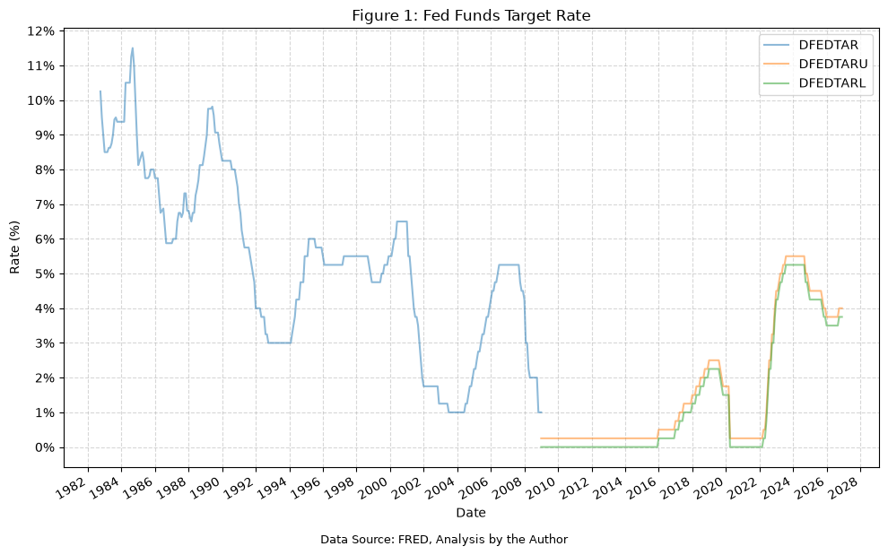
    


```python
pandas_set_decimal_places(4)

# First drop the lower column and merge
fedfunds_monthly["fed_funds"] = fedfunds_monthly["DFEDTAR"].combine_first(fedfunds_monthly["DFEDTARU"])
fedfunds_monthly = fedfunds_monthly.drop(columns=["DFEDTARL", "DFEDTARU", "DFEDTAR"])

# Compute change in rate from either column
fedfunds_monthly["fed_funds_change"] = fedfunds_monthly["fed_funds"].diff()

display(Markdown(f"Table {next(table_number)}: Fed Funds Target Rate And Monthly Change"))
display(fedfunds_monthly)
```


Table 3: Fed Funds Target Rate And Monthly Change


<div>
<style scoped>
    .dataframe tbody tr th:only-of-type {
        vertical-align: middle;
    }

    .dataframe tbody tr th {
        vertical-align: top;
    }

    .dataframe thead th {
        text-align: right;
    }
</style>
<table border="1" class="dataframe">
  <thead>
    <tr style="text-align: right;">
      <th></th>
      <th>fed_funds</th>
      <th>fed_funds_change</th>
    </tr>
    <tr>
      <th>DATE</th>
      <th></th>
      <th></th>
    </tr>
  </thead>
  <tbody>
    <tr>
      <th>1982-09-30</th>
      <td>0.1025</td>
      <td>NaN</td>
    </tr>
    <tr>
      <th>1982-10-31</th>
      <td>0.0950</td>
      <td>-0.0075</td>
    </tr>
    <tr>
      <th>1982-11-30</th>
      <td>0.0900</td>
      <td>-0.0050</td>
    </tr>
    <tr>
      <th>1982-12-31</th>
      <td>0.0850</td>
      <td>-0.0050</td>
    </tr>
    <tr>
      <th>1983-01-31</th>
      <td>0.0850</td>
      <td>0.0000</td>
    </tr>
    <tr>
      <th>...</th>
      <td>...</td>
      <td>...</td>
    </tr>
    <tr>
      <th>2026-07-31</th>
      <td>0.0375</td>
      <td>0.0000</td>
    </tr>
    <tr>
      <th>2026-08-31</th>
      <td>0.0375</td>
      <td>0.0000</td>
    </tr>
    <tr>
      <th>2026-09-30</th>
      <td>0.0400</td>
      <td>0.0025</td>
    </tr>
    <tr>
      <th>2026-10-31</th>
      <td>0.0400</td>
      <td>0.0000</td>
    </tr>
    <tr>
      <th>2026-11-30</th>
      <td>0.0400</td>
      <td>0.0000</td>
    </tr>
  </tbody>
</table>
<p>531 rows × 2 columns</p>
</div>


And then the change in FFR from month-to-month:


```python
plot_time_series(
    df=fedfunds_monthly,
    plot_start_date=None,
    plot_end_date=None,
    plot_columns=["fed_funds_change"],
    title=f"Figure {next(figure_number)}: Fed Funds Change In Rate",
    x_label="Date",
    x_format="Year",
    x_tick_spacing=2,
    x_tick_start=None,
    x_tick_rotation=30,
    y_label="Rate Change (%)",
    y_format="Percentage",
    y_format_decimal_places=2,
    y_tick_spacing=0.0025,
    y_tick_rotation=0,
    grid=True,
    legend=False,
    export_plot=False,
    plot_file_name=None,
    caption="Data Source: FRED, Analysis by the Author",
)
```


    
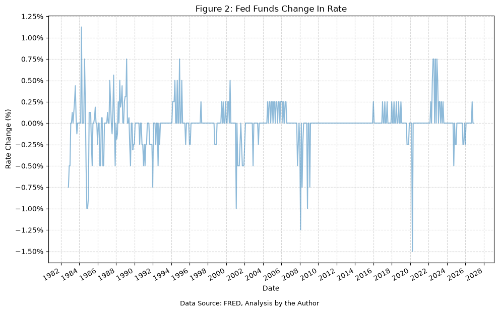
    


This plot, in particular, makes it easy to show the monthly increase and decrease in the FFR, as well as the magnitude of the change (i.e. slow, drawn-out increases or decreases or abrupt large increases or decreases).

### Define Fed Policy Cycles

Next, we will define the Fed policy tightening and easing cycles:


```python
# Set timeframe
START_DATE = "1989-12-15"
END_DATE = "2026-04-30"

# Copy DataFrame to avoid modifying original
fedfunds_cycles = fedfunds_monthly.copy()
fedfunds_cycles = fedfunds_cycles.loc[START_DATE:END_DATE]

# Reset index
fedfunds_cycles = fedfunds_cycles.reset_index()

# Drop the "fed_funds_change" column as we will use it to determine the cycle type later, but we don't need it in the final dataframe
fedfunds_cycles = fedfunds_cycles.drop(columns=["fed_funds_change"])

# Rename the date column to "Start Date", and the "fed_funds" column to "Fed Funds Start"
fedfunds_cycles = fedfunds_cycles.rename(columns={"DATE": "start_date", "fed_funds": "fed_funds_start"})

# Copy the "Start Date" column to a new column called "End Date" and shift it up by one row
fedfunds_cycles["end_date"] = fedfunds_cycles["start_date"].shift(-1)

# Copy the "Fed Funds Start" column to a new column called "Fed Funds End" and shift it up by one row
fedfunds_cycles["fed_funds_end"] = fedfunds_cycles["fed_funds_start"].shift(-1)

# Calculate the change in Fed Funds rate for each cycle
fedfunds_cycles["fed_funds_change"] = fedfunds_cycles["fed_funds_end"] - fedfunds_cycles["fed_funds_start"]

# Based on "Fed Funds Change" column, determine if the rate is increasing, decreasing, or unchanged
fedfunds_cycles["cycle"] = fedfunds_cycles["fed_funds_change"].apply(
    lambda x: "Tightening" if x > 0 else ("Easing" if x < 0 else "Neutral"))

display(Markdown(f"Table {next(table_number)}: Monthly Fed Funds Rate Changes And Cycle Labels"))
display(fedfunds_cycles)
```


Table 4: Monthly Fed Funds Rate Changes And Cycle Labels


<div>
<style scoped>
    .dataframe tbody tr th:only-of-type {
        vertical-align: middle;
    }

    .dataframe tbody tr th {
        vertical-align: top;
    }

    .dataframe thead th {
        text-align: right;
    }
</style>
<table border="1" class="dataframe">
  <thead>
    <tr style="text-align: right;">
      <th></th>
      <th>start_date</th>
      <th>fed_funds_start</th>
      <th>end_date</th>
      <th>fed_funds_end</th>
      <th>fed_funds_change</th>
      <th>cycle</th>
    </tr>
  </thead>
  <tbody>
    <tr>
      <th>0</th>
      <td>1989-12-31</td>
      <td>0.0825</td>
      <td>1990-01-31</td>
      <td>0.0825</td>
      <td>0.0000</td>
      <td>Neutral</td>
    </tr>
    <tr>
      <th>1</th>
      <td>1990-01-31</td>
      <td>0.0825</td>
      <td>1990-02-28</td>
      <td>0.0825</td>
      <td>0.0000</td>
      <td>Neutral</td>
    </tr>
    <tr>
      <th>2</th>
      <td>1990-02-28</td>
      <td>0.0825</td>
      <td>1990-03-31</td>
      <td>0.0825</td>
      <td>0.0000</td>
      <td>Neutral</td>
    </tr>
    <tr>
      <th>3</th>
      <td>1990-03-31</td>
      <td>0.0825</td>
      <td>1990-04-30</td>
      <td>0.0825</td>
      <td>0.0000</td>
      <td>Neutral</td>
    </tr>
    <tr>
      <th>4</th>
      <td>1990-04-30</td>
      <td>0.0825</td>
      <td>1990-05-31</td>
      <td>0.0825</td>
      <td>0.0000</td>
      <td>Neutral</td>
    </tr>
    <tr>
      <th>...</th>
      <td>...</td>
      <td>...</td>
      <td>...</td>
      <td>...</td>
      <td>...</td>
      <td>...</td>
    </tr>
    <tr>
      <th>432</th>
      <td>2025-12-31</td>
      <td>0.0375</td>
      <td>2026-01-31</td>
      <td>0.0375</td>
      <td>0.0000</td>
      <td>Neutral</td>
    </tr>
    <tr>
      <th>433</th>
      <td>2026-01-31</td>
      <td>0.0375</td>
      <td>2026-02-28</td>
      <td>0.0375</td>
      <td>0.0000</td>
      <td>Neutral</td>
    </tr>
    <tr>
      <th>434</th>
      <td>2026-02-28</td>
      <td>0.0375</td>
      <td>2026-03-31</td>
      <td>0.0375</td>
      <td>0.0000</td>
      <td>Neutral</td>
    </tr>
    <tr>
      <th>435</th>
      <td>2026-03-31</td>
      <td>0.0375</td>
      <td>2026-04-30</td>
      <td>0.0375</td>
      <td>0.0000</td>
      <td>Neutral</td>
    </tr>
    <tr>
      <th>436</th>
      <td>2026-04-30</td>
      <td>0.0375</td>
      <td>NaT</td>
      <td>NaN</td>
      <td>NaN</td>
      <td>Neutral</td>
    </tr>
  </tbody>
</table>
<p>437 rows × 6 columns</p>
</div>


Grouping the consecutive months of tightening and easing together, we can create a DataFrame that gives us the cumulative change in the FFR for each cycle, as well as the start and end dates for each cycle. This will be useful for evaluating asset class performance during these cycles.


```python
fedfunds_grouped_cycles = fedfunds_cycles.copy()

# Create a group key that increments whenever the Cycle value changes
fedfunds_grouped_cycles['group'] = (fedfunds_grouped_cycles['cycle'] != fedfunds_grouped_cycles['cycle'].shift(1)).cumsum()

# Group by both the group key and Cycle label
cycle_ranges = (
    fedfunds_grouped_cycles.groupby(['group', 'cycle'], sort=False)
    .agg(
        start_date=('start_date', 'first'),
        end_date=('end_date', 'last'),
        fed_funds_start=('fed_funds_start', 'first'),
        fed_funds_end=('fed_funds_end', 'last')
    )
    .reset_index(drop=False)
    .drop(columns='group')
)

display(Markdown(f"Table {next(table_number)}: Fed Policy Cycles, Before Forward Filling Neutral Months"))
display(cycle_ranges)
```


Table 5: Fed Policy Cycles, Before Forward Filling Neutral Months


<div>
<style scoped>
    .dataframe tbody tr th:only-of-type {
        vertical-align: middle;
    }

    .dataframe tbody tr th {
        vertical-align: top;
    }

    .dataframe thead th {
        text-align: right;
    }
</style>
<table border="1" class="dataframe">
  <thead>
    <tr style="text-align: right;">
      <th></th>
      <th>cycle</th>
      <th>start_date</th>
      <th>end_date</th>
      <th>fed_funds_start</th>
      <th>fed_funds_end</th>
    </tr>
  </thead>
  <tbody>
    <tr>
      <th>0</th>
      <td>Neutral</td>
      <td>1989-12-31</td>
      <td>1990-06-30</td>
      <td>0.0825</td>
      <td>0.0825</td>
    </tr>
    <tr>
      <th>1</th>
      <td>Easing</td>
      <td>1990-06-30</td>
      <td>1990-07-31</td>
      <td>0.0825</td>
      <td>0.0800</td>
    </tr>
    <tr>
      <th>2</th>
      <td>Neutral</td>
      <td>1990-07-31</td>
      <td>1990-09-30</td>
      <td>0.0800</td>
      <td>0.0800</td>
    </tr>
    <tr>
      <th>3</th>
      <td>Easing</td>
      <td>1990-09-30</td>
      <td>1991-04-30</td>
      <td>0.0800</td>
      <td>0.0575</td>
    </tr>
    <tr>
      <th>4</th>
      <td>Neutral</td>
      <td>1991-04-30</td>
      <td>1991-07-31</td>
      <td>0.0575</td>
      <td>0.0575</td>
    </tr>
    <tr>
      <th>...</th>
      <td>...</td>
      <td>...</td>
      <td>...</td>
      <td>...</td>
      <td>...</td>
    </tr>
    <tr>
      <th>116</th>
      <td>Neutral</td>
      <td>2024-12-31</td>
      <td>2025-08-31</td>
      <td>0.0450</td>
      <td>0.0450</td>
    </tr>
    <tr>
      <th>117</th>
      <td>Easing</td>
      <td>2025-08-31</td>
      <td>2025-10-31</td>
      <td>0.0450</td>
      <td>0.0400</td>
    </tr>
    <tr>
      <th>118</th>
      <td>Neutral</td>
      <td>2025-10-31</td>
      <td>2025-11-30</td>
      <td>0.0400</td>
      <td>0.0400</td>
    </tr>
    <tr>
      <th>119</th>
      <td>Easing</td>
      <td>2025-11-30</td>
      <td>2025-12-31</td>
      <td>0.0400</td>
      <td>0.0375</td>
    </tr>
    <tr>
      <th>120</th>
      <td>Neutral</td>
      <td>2025-12-31</td>
      <td>2026-04-30</td>
      <td>0.0375</td>
      <td>0.0375</td>
    </tr>
  </tbody>
</table>
<p>121 rows × 5 columns</p>
</div>


We will also make the assumption that any "Neutral" months (i.e. months where the FFR did not change) are part of the preceding cycle, to a point. For example, if we have a tightening month followed by a neutral month, we will consider the neutral month to be part of the tightening cycle. This is a simplifying assumption, but it allows us to attempt to categorize months into either tightening or easing cycles that are in fact a continuation of those cycles.
We will forward fill 6 months of neutral months as a starting point.

That leaves a third bucket of monthly periods. Any month that is still unlabeled after the forward fill - either because the Fed has held the rate flat for more than 6 months, or because we are at the very start of the sample with no preceding cycle to inherit from - gets its own label, referred to as `Extended Neutral`. This includes most of the ZIRP era, such as the 2009-2015 and 2020-2021 zero-rate periods.


```python
NEUTRAL_FILL_LIMIT = 6

fedfunds_grouped_cycles = fedfunds_cycles.copy()

# Forward fill cycle labels preceding "Neutral" cycles
fedfunds_grouped_cycles['cycle_filled'] = fedfunds_grouped_cycles['cycle'].replace('Neutral', pd.NA).ffill(limit=NEUTRAL_FILL_LIMIT)

# Label any remaining <NA> values as "Extended Neutral": either the Fed held the rate
# flat for longer than the 6 month fill limit, or we are at the start of the sample
# with no preceding cycle to inherit a label from
fedfunds_grouped_cycles['cycle_filled'] = fedfunds_grouped_cycles['cycle_filled'].fillna('Extended Neutral')

# Confirm how much of the sample lands in each bucket
display(Markdown(f"Table {next(table_number)}: Months By Cycle Label"))
display(fedfunds_grouped_cycles['cycle_filled'].value_counts())

# Create a group key that increments whenever the Cycle value changes
fedfunds_grouped_cycles['group'] = (fedfunds_grouped_cycles['cycle_filled'] != fedfunds_grouped_cycles['cycle_filled'].shift(1)).cumsum()

# Group by both the group key and Cycle label
cycle_ranges = (
    fedfunds_grouped_cycles.groupby(['group', 'cycle_filled'], sort=False)
    .agg(
        start_date=('start_date', 'first'),
        end_date=('end_date', 'last'),
        fed_funds_start=('fed_funds_start', 'first'),
        fed_funds_end=('fed_funds_end', 'last')
    )
    .reset_index(drop=False)
    .drop(columns='group')
)

# Calc change in Fed Funds rate for each cycle
cycle_ranges["fed_funds_change"] = cycle_ranges["fed_funds_end"] - cycle_ranges["fed_funds_start"]

# Add cycle labels
cycle_labels = [f"Cycle {i+1}" for i in range(len(cycle_ranges))]

# Combine labels with cycle_ranges
cycle_ranges['cycle_label'] = cycle_labels

display(Markdown(f"Table {next(table_number)}: Fed Policy Cycles"))
display(cycle_ranges)
```


Table 6: Months By Cycle Label


    cycle_filled
    Extended Neutral    160
    Easing              143
    Tightening          134
    Name: count, dtype: int64


Table 7: Fed Policy Cycles


<div>
<style scoped>
    .dataframe tbody tr th:only-of-type {
        vertical-align: middle;
    }

    .dataframe tbody tr th {
        vertical-align: top;
    }

    .dataframe thead th {
        text-align: right;
    }
</style>
<table border="1" class="dataframe">
  <thead>
    <tr style="text-align: right;">
      <th></th>
      <th>cycle_filled</th>
      <th>start_date</th>
      <th>end_date</th>
      <th>fed_funds_start</th>
      <th>fed_funds_end</th>
      <th>fed_funds_change</th>
      <th>cycle_label</th>
    </tr>
  </thead>
  <tbody>
    <tr>
      <th>0</th>
      <td>Extended Neutral</td>
      <td>1989-12-31</td>
      <td>1990-06-30</td>
      <td>0.0825</td>
      <td>0.0825</td>
      <td>0.0000</td>
      <td>Cycle 1</td>
    </tr>
    <tr>
      <th>1</th>
      <td>Easing</td>
      <td>1990-06-30</td>
      <td>1993-03-31</td>
      <td>0.0825</td>
      <td>0.0300</td>
      <td>-0.0525</td>
      <td>Cycle 2</td>
    </tr>
    <tr>
      <th>2</th>
      <td>Extended Neutral</td>
      <td>1993-03-31</td>
      <td>1994-01-31</td>
      <td>0.0300</td>
      <td>0.0300</td>
      <td>0.0000</td>
      <td>Cycle 3</td>
    </tr>
    <tr>
      <th>3</th>
      <td>Tightening</td>
      <td>1994-01-31</td>
      <td>1995-06-30</td>
      <td>0.0300</td>
      <td>0.0600</td>
      <td>0.0300</td>
      <td>Cycle 4</td>
    </tr>
    <tr>
      <th>4</th>
      <td>Easing</td>
      <td>1995-06-30</td>
      <td>1996-07-31</td>
      <td>0.0600</td>
      <td>0.0525</td>
      <td>-0.0075</td>
      <td>Cycle 5</td>
    </tr>
    <tr>
      <th>5</th>
      <td>Extended Neutral</td>
      <td>1996-07-31</td>
      <td>1997-02-28</td>
      <td>0.0525</td>
      <td>0.0525</td>
      <td>0.0000</td>
      <td>Cycle 6</td>
    </tr>
    <tr>
      <th>6</th>
      <td>Tightening</td>
      <td>1997-02-28</td>
      <td>1997-09-30</td>
      <td>0.0525</td>
      <td>0.0550</td>
      <td>0.0025</td>
      <td>Cycle 7</td>
    </tr>
    <tr>
      <th>7</th>
      <td>Extended Neutral</td>
      <td>1997-09-30</td>
      <td>1998-08-31</td>
      <td>0.0550</td>
      <td>0.0550</td>
      <td>0.0000</td>
      <td>Cycle 8</td>
    </tr>
    <tr>
      <th>8</th>
      <td>Easing</td>
      <td>1998-08-31</td>
      <td>1999-05-31</td>
      <td>0.0550</td>
      <td>0.0475</td>
      <td>-0.0075</td>
      <td>Cycle 9</td>
    </tr>
    <tr>
      <th>9</th>
      <td>Tightening</td>
      <td>1999-05-31</td>
      <td>2000-11-30</td>
      <td>0.0475</td>
      <td>0.0650</td>
      <td>0.0175</td>
      <td>Cycle 10</td>
    </tr>
    <tr>
      <th>10</th>
      <td>Extended Neutral</td>
      <td>2000-11-30</td>
      <td>2000-12-31</td>
      <td>0.0650</td>
      <td>0.0650</td>
      <td>0.0000</td>
      <td>Cycle 11</td>
    </tr>
    <tr>
      <th>11</th>
      <td>Easing</td>
      <td>2000-12-31</td>
      <td>2002-06-30</td>
      <td>0.0650</td>
      <td>0.0175</td>
      <td>-0.0475</td>
      <td>Cycle 12</td>
    </tr>
    <tr>
      <th>12</th>
      <td>Extended Neutral</td>
      <td>2002-06-30</td>
      <td>2002-10-31</td>
      <td>0.0175</td>
      <td>0.0175</td>
      <td>0.0000</td>
      <td>Cycle 13</td>
    </tr>
    <tr>
      <th>13</th>
      <td>Easing</td>
      <td>2002-10-31</td>
      <td>2003-12-31</td>
      <td>0.0175</td>
      <td>0.0100</td>
      <td>-0.0075</td>
      <td>Cycle 14</td>
    </tr>
    <tr>
      <th>14</th>
      <td>Extended Neutral</td>
      <td>2003-12-31</td>
      <td>2004-05-31</td>
      <td>0.0100</td>
      <td>0.0100</td>
      <td>0.0000</td>
      <td>Cycle 15</td>
    </tr>
    <tr>
      <th>15</th>
      <td>Tightening</td>
      <td>2004-05-31</td>
      <td>2006-12-31</td>
      <td>0.0100</td>
      <td>0.0525</td>
      <td>0.0425</td>
      <td>Cycle 16</td>
    </tr>
    <tr>
      <th>16</th>
      <td>Extended Neutral</td>
      <td>2006-12-31</td>
      <td>2007-08-31</td>
      <td>0.0525</td>
      <td>0.0525</td>
      <td>0.0000</td>
      <td>Cycle 17</td>
    </tr>
    <tr>
      <th>17</th>
      <td>Easing</td>
      <td>2007-08-31</td>
      <td>2009-07-31</td>
      <td>0.0525</td>
      <td>0.0025</td>
      <td>-0.0500</td>
      <td>Cycle 18</td>
    </tr>
    <tr>
      <th>18</th>
      <td>Extended Neutral</td>
      <td>2009-07-31</td>
      <td>2015-11-30</td>
      <td>0.0025</td>
      <td>0.0025</td>
      <td>0.0000</td>
      <td>Cycle 19</td>
    </tr>
    <tr>
      <th>19</th>
      <td>Tightening</td>
      <td>2015-11-30</td>
      <td>2016-06-30</td>
      <td>0.0025</td>
      <td>0.0050</td>
      <td>0.0025</td>
      <td>Cycle 20</td>
    </tr>
    <tr>
      <th>20</th>
      <td>Extended Neutral</td>
      <td>2016-06-30</td>
      <td>2016-11-30</td>
      <td>0.0050</td>
      <td>0.0050</td>
      <td>0.0000</td>
      <td>Cycle 21</td>
    </tr>
    <tr>
      <th>21</th>
      <td>Tightening</td>
      <td>2016-11-30</td>
      <td>2019-06-30</td>
      <td>0.0050</td>
      <td>0.0250</td>
      <td>0.0200</td>
      <td>Cycle 22</td>
    </tr>
    <tr>
      <th>22</th>
      <td>Extended Neutral</td>
      <td>2019-06-30</td>
      <td>2019-07-31</td>
      <td>0.0250</td>
      <td>0.0250</td>
      <td>0.0000</td>
      <td>Cycle 23</td>
    </tr>
    <tr>
      <th>23</th>
      <td>Easing</td>
      <td>2019-07-31</td>
      <td>2020-09-30</td>
      <td>0.0250</td>
      <td>0.0025</td>
      <td>-0.0225</td>
      <td>Cycle 24</td>
    </tr>
    <tr>
      <th>24</th>
      <td>Extended Neutral</td>
      <td>2020-09-30</td>
      <td>2022-02-28</td>
      <td>0.0025</td>
      <td>0.0025</td>
      <td>0.0000</td>
      <td>Cycle 25</td>
    </tr>
    <tr>
      <th>25</th>
      <td>Tightening</td>
      <td>2022-02-28</td>
      <td>2024-01-31</td>
      <td>0.0025</td>
      <td>0.0550</td>
      <td>0.0525</td>
      <td>Cycle 26</td>
    </tr>
    <tr>
      <th>26</th>
      <td>Extended Neutral</td>
      <td>2024-01-31</td>
      <td>2024-08-31</td>
      <td>0.0550</td>
      <td>0.0550</td>
      <td>0.0000</td>
      <td>Cycle 27</td>
    </tr>
    <tr>
      <th>27</th>
      <td>Easing</td>
      <td>2024-08-31</td>
      <td>2025-06-30</td>
      <td>0.0550</td>
      <td>0.0450</td>
      <td>-0.0100</td>
      <td>Cycle 28</td>
    </tr>
    <tr>
      <th>28</th>
      <td>Extended Neutral</td>
      <td>2025-06-30</td>
      <td>2025-08-31</td>
      <td>0.0450</td>
      <td>0.0450</td>
      <td>0.0000</td>
      <td>Cycle 29</td>
    </tr>
    <tr>
      <th>29</th>
      <td>Easing</td>
      <td>2025-08-31</td>
      <td>2026-04-30</td>
      <td>0.0450</td>
      <td>0.0375</td>
      <td>-0.0075</td>
      <td>Cycle 30</td>
    </tr>
  </tbody>
</table>
</div>


## Asset Class Performance By Fed Policy Cycle

Moving on, we will now look at the performance of four (4) different asset classes during each Fed cycle. We'll use the following Bloomberg indices:

* SPXT_S&P 500 Total Return Index (Stocks)
* SPBDU10T_S&P US Treasury Bond 7-10 Year Total Return Index (Bonds)
* LF98TRUU_Bloomberg US Corporate High Yield Total Return Index Value Unhedged USD (High Yield Bonds)
* XAU_Gold USD Spot (Gold)

### Stocks

First, we will clean and load the data for the S&P 500 Total Return Index (SPXT):


```python
pandas_set_decimal_places(2)

bb_clean_data(
    base_directory=DATA_DIR,
    fund_ticker_name="SPXT_S&P 500 Total Return Index",
    source="Bloomberg",
    asset_class="Indices",
    excel_export=True,
    pickle_export=True,
    output_confirmation=False,
)

spxt = load_data(
    base_directory=DATA_DIR,
    ticker="SPXT_S&P 500 Total Return Index_Clean",
    source="Bloomberg",
    asset_class="Indices",
    timeframe="Daily",
    file_format="pickle",
)

# The Bloomberg pickle stores the index as objects; convert to a nanosecond
# DatetimeIndex so it matches the FRED data in the merges further down
spxt.index = pd.to_datetime(spxt.index).astype("datetime64[ns]")

# Filter SPXT to date range
spxt = spxt[(spxt.index >= pd.to_datetime(START_DATE)) & (spxt.index <= pd.to_datetime(END_DATE))]

# Drop everything except the "close" column
spxt = spxt[["Close"]]

# Resample to monthly frequency
spxt_monthly = spxt.resample("ME").last()
spxt_monthly["Monthly_Return"] = spxt_monthly["Close"].pct_change()
spxt_monthly = spxt_monthly.dropna()

display(Markdown(f"Table {next(table_number)}: S&P 500 Total Return Index Monthly Close And Returns"))
display(spxt_monthly)
```


Table 8: S&P 500 Total Return Index Monthly Close And Returns


<div>
<style scoped>
    .dataframe tbody tr th:only-of-type {
        vertical-align: middle;
    }

    .dataframe tbody tr th {
        vertical-align: top;
    }

    .dataframe thead th {
        text-align: right;
    }
</style>
<table border="1" class="dataframe">
  <thead>
    <tr style="text-align: right;">
      <th></th>
      <th>Close</th>
      <th>Monthly_Return</th>
    </tr>
    <tr>
      <th>Date</th>
      <th></th>
      <th></th>
    </tr>
  </thead>
  <tbody>
    <tr>
      <th>1990-01-31</th>
      <td>353.94</td>
      <td>-0.07</td>
    </tr>
    <tr>
      <th>1990-02-28</th>
      <td>358.50</td>
      <td>0.01</td>
    </tr>
    <tr>
      <th>1990-03-31</th>
      <td>368</td>
      <td>0.03</td>
    </tr>
    <tr>
      <th>1990-04-30</th>
      <td>358.81</td>
      <td>-0.02</td>
    </tr>
    <tr>
      <th>1990-05-31</th>
      <td>393.80</td>
      <td>0.10</td>
    </tr>
    <tr>
      <th>...</th>
      <td>...</td>
      <td>...</td>
    </tr>
    <tr>
      <th>2025-12-31</th>
      <td>15220.45</td>
      <td>0.00</td>
    </tr>
    <tr>
      <th>2026-01-31</th>
      <td>15441.15</td>
      <td>0.01</td>
    </tr>
    <tr>
      <th>2026-02-28</th>
      <td>15323.80</td>
      <td>-0.01</td>
    </tr>
    <tr>
      <th>2026-03-31</th>
      <td>14560.75</td>
      <td>-0.05</td>
    </tr>
    <tr>
      <th>2026-04-30</th>
      <td>16088.56</td>
      <td>0.10</td>
    </tr>
  </tbody>
</table>
<p>436 rows × 2 columns</p>
</div>


Next, we can plot the price history before calculating the cycle performance:


```python
plot_time_series(
    df=spxt,
    plot_start_date=None,
    plot_end_date=None,
    plot_columns=["Close"],
    title=f"Figure {next(figure_number)}: S&P 500 Total Return Index Daily Close Price",
    x_label="Date",
    x_format="Year",
    x_tick_spacing=2,
    x_tick_start=None,
    x_tick_rotation=30,
    y_label="Price ($)",
    y_format="Decimal",
    y_format_decimal_places=0,
    y_tick_spacing=1000,
    y_tick_rotation=0,
    grid=True,
    legend=False,
    export_plot=False,
    plot_file_name=None,
    caption="Data Source: Bloomberg, Analysis by the Author",
)
```


    
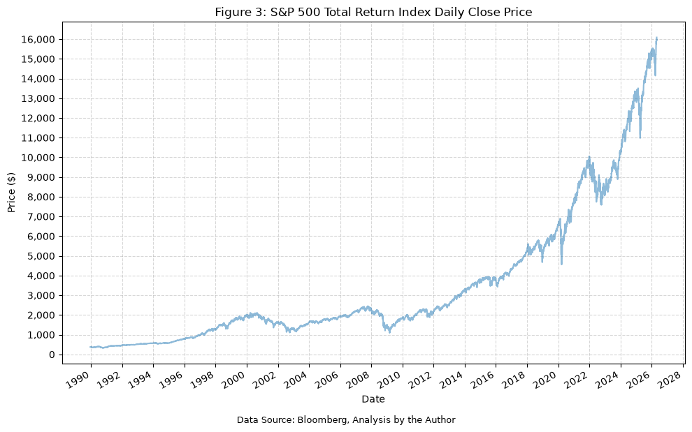
    


Next, we will calculate the performance for SPXT based on the pre-defined Fed cycles. To illustrate the methodology, we can take Cycle 1, which was 12/31/1989 to 6/30/1990, and which would also included rate decisions in the middle of December through the middle of June, and would therefore include monthly returns for January through June of 1990. So, hypothetically, from the rate decision in the middle of December, we could allocate a portfolio on January 1st, then after the rate decision in the middle of June, we could close any positions at the end of June (realizing June's return).


```python
display(cycle_ranges.iloc[0])
print(f"Cycle 1 Cumulative Return: {(1+spxt_monthly.loc['1990-01-31':'1990-06-30']['Monthly_Return']).cumprod()-1}")
```


    cycle_filled           Extended Neutral
    start_date          1989-12-31 00:00:00
    end_date            1990-06-30 00:00:00
    fed_funds_start                    0.08
    fed_funds_end                      0.08
    fed_funds_change                   0.00
    cycle_label                     Cycle 1
    Name: 0, dtype: object


    Cycle 1 Cumulative Return: Date
    1990-01-31   -0.07
    1990-02-28   -0.06
    1990-03-31   -0.03
    1990-04-30   -0.05
    1990-05-31    0.04
    1990-06-30    0.03
    Freq: ME, Name: Monthly_Return, dtype: object


And a second example, from Cycle 2, which was July of 1990 through March of 1993. This would have included rate decisions in the middle of June (portfolio allocations 7/1), through the middle of March (closing positions 3/31), and would therefore include monthly returns for July 1990 through March 1993.


```python
display(cycle_ranges.iloc[1])
print(f"Cycle 1 Cumulative Return: {(1+spxt_monthly.loc['1990-07-31':'1993-03-31']['Monthly_Return']).cumprod()-1}")
```


    cycle_filled                     Easing
    start_date          1990-06-30 00:00:00
    end_date            1993-03-31 00:00:00
    fed_funds_start                    0.08
    fed_funds_end                      0.03
    fed_funds_change                  -0.05
    cycle_label                     Cycle 2
    Name: 1, dtype: object


    Cycle 1 Cumulative Return: Date
    1990-07-31   -0.00
    1990-08-31   -0.09
    1990-09-30   -0.14
    1990-10-31   -0.14
    1990-11-30   -0.09
    1990-12-31   -0.06
    1991-01-31   -0.02
    1991-02-28    0.05
    1991-03-31    0.08
    1991-04-30    0.08
    1991-05-31    0.13
    1991-06-30    0.07
    1991-07-31    0.12
    1991-08-31    0.15
    1991-09-30    0.13
    1991-10-31    0.15
    1991-11-30    0.10
    1991-12-31    0.23
    1992-01-31    0.20
    1992-02-29    0.22
    1992-03-31    0.20
    1992-04-30    0.23
    1992-05-31    0.24
    1992-06-30    0.22
    1992-07-31    0.27
    1992-08-31    0.24
    1992-09-30    0.26
    1992-10-31    0.26
    1992-11-30    0.30
    1992-12-31    0.32
    1993-01-31    0.33
    1993-02-28    0.35
    1993-03-31    0.38
    Freq: ME, Name: Monthly_Return, dtype: object


Based on the above, we can see that the `end_date` is value, but we need to bump the `start_date` to the beginning of the next month to correctly capture the monthly returns for the cycle. We'll call this column `adjusted_start_date`.


```python
cycle_ranges['adjusted_start_date'] = cycle_ranges['start_date'] + pd.DateOffset(months=1)

display(Markdown(f"Table {next(table_number)}: Fed Policy Cycles, Adjusted Start Date"))
display(cycle_ranges)
```


Table 9: Fed Policy Cycles, Adjusted Start Date


<div>
<style scoped>
    .dataframe tbody tr th:only-of-type {
        vertical-align: middle;
    }

    .dataframe tbody tr th {
        vertical-align: top;
    }

    .dataframe thead th {
        text-align: right;
    }
</style>
<table border="1" class="dataframe">
  <thead>
    <tr style="text-align: right;">
      <th></th>
      <th>cycle_filled</th>
      <th>start_date</th>
      <th>end_date</th>
      <th>fed_funds_start</th>
      <th>fed_funds_end</th>
      <th>fed_funds_change</th>
      <th>cycle_label</th>
      <th>adjusted_start_date</th>
    </tr>
  </thead>
  <tbody>
    <tr>
      <th>0</th>
      <td>Extended Neutral</td>
      <td>1989-12-31</td>
      <td>1990-06-30</td>
      <td>0.08</td>
      <td>0.08</td>
      <td>0.00</td>
      <td>Cycle 1</td>
      <td>1990-01-31</td>
    </tr>
    <tr>
      <th>1</th>
      <td>Easing</td>
      <td>1990-06-30</td>
      <td>1993-03-31</td>
      <td>0.08</td>
      <td>0.03</td>
      <td>-0.05</td>
      <td>Cycle 2</td>
      <td>1990-07-30</td>
    </tr>
    <tr>
      <th>2</th>
      <td>Extended Neutral</td>
      <td>1993-03-31</td>
      <td>1994-01-31</td>
      <td>0.03</td>
      <td>0.03</td>
      <td>0.00</td>
      <td>Cycle 3</td>
      <td>1993-04-30</td>
    </tr>
    <tr>
      <th>3</th>
      <td>Tightening</td>
      <td>1994-01-31</td>
      <td>1995-06-30</td>
      <td>0.03</td>
      <td>0.06</td>
      <td>0.03</td>
      <td>Cycle 4</td>
      <td>1994-02-28</td>
    </tr>
    <tr>
      <th>4</th>
      <td>Easing</td>
      <td>1995-06-30</td>
      <td>1996-07-31</td>
      <td>0.06</td>
      <td>0.05</td>
      <td>-0.01</td>
      <td>Cycle 5</td>
      <td>1995-07-30</td>
    </tr>
    <tr>
      <th>5</th>
      <td>Extended Neutral</td>
      <td>1996-07-31</td>
      <td>1997-02-28</td>
      <td>0.05</td>
      <td>0.05</td>
      <td>0.00</td>
      <td>Cycle 6</td>
      <td>1996-08-31</td>
    </tr>
    <tr>
      <th>6</th>
      <td>Tightening</td>
      <td>1997-02-28</td>
      <td>1997-09-30</td>
      <td>0.05</td>
      <td>0.06</td>
      <td>0.00</td>
      <td>Cycle 7</td>
      <td>1997-03-28</td>
    </tr>
    <tr>
      <th>7</th>
      <td>Extended Neutral</td>
      <td>1997-09-30</td>
      <td>1998-08-31</td>
      <td>0.06</td>
      <td>0.06</td>
      <td>0.00</td>
      <td>Cycle 8</td>
      <td>1997-10-30</td>
    </tr>
    <tr>
      <th>8</th>
      <td>Easing</td>
      <td>1998-08-31</td>
      <td>1999-05-31</td>
      <td>0.06</td>
      <td>0.05</td>
      <td>-0.01</td>
      <td>Cycle 9</td>
      <td>1998-09-30</td>
    </tr>
    <tr>
      <th>9</th>
      <td>Tightening</td>
      <td>1999-05-31</td>
      <td>2000-11-30</td>
      <td>0.05</td>
      <td>0.07</td>
      <td>0.02</td>
      <td>Cycle 10</td>
      <td>1999-06-30</td>
    </tr>
    <tr>
      <th>10</th>
      <td>Extended Neutral</td>
      <td>2000-11-30</td>
      <td>2000-12-31</td>
      <td>0.07</td>
      <td>0.07</td>
      <td>0.00</td>
      <td>Cycle 11</td>
      <td>2000-12-30</td>
    </tr>
    <tr>
      <th>11</th>
      <td>Easing</td>
      <td>2000-12-31</td>
      <td>2002-06-30</td>
      <td>0.07</td>
      <td>0.02</td>
      <td>-0.05</td>
      <td>Cycle 12</td>
      <td>2001-01-31</td>
    </tr>
    <tr>
      <th>12</th>
      <td>Extended Neutral</td>
      <td>2002-06-30</td>
      <td>2002-10-31</td>
      <td>0.02</td>
      <td>0.02</td>
      <td>0.00</td>
      <td>Cycle 13</td>
      <td>2002-07-30</td>
    </tr>
    <tr>
      <th>13</th>
      <td>Easing</td>
      <td>2002-10-31</td>
      <td>2003-12-31</td>
      <td>0.02</td>
      <td>0.01</td>
      <td>-0.01</td>
      <td>Cycle 14</td>
      <td>2002-11-30</td>
    </tr>
    <tr>
      <th>14</th>
      <td>Extended Neutral</td>
      <td>2003-12-31</td>
      <td>2004-05-31</td>
      <td>0.01</td>
      <td>0.01</td>
      <td>0.00</td>
      <td>Cycle 15</td>
      <td>2004-01-31</td>
    </tr>
    <tr>
      <th>15</th>
      <td>Tightening</td>
      <td>2004-05-31</td>
      <td>2006-12-31</td>
      <td>0.01</td>
      <td>0.05</td>
      <td>0.04</td>
      <td>Cycle 16</td>
      <td>2004-06-30</td>
    </tr>
    <tr>
      <th>16</th>
      <td>Extended Neutral</td>
      <td>2006-12-31</td>
      <td>2007-08-31</td>
      <td>0.05</td>
      <td>0.05</td>
      <td>0.00</td>
      <td>Cycle 17</td>
      <td>2007-01-31</td>
    </tr>
    <tr>
      <th>17</th>
      <td>Easing</td>
      <td>2007-08-31</td>
      <td>2009-07-31</td>
      <td>0.05</td>
      <td>0.00</td>
      <td>-0.05</td>
      <td>Cycle 18</td>
      <td>2007-09-30</td>
    </tr>
    <tr>
      <th>18</th>
      <td>Extended Neutral</td>
      <td>2009-07-31</td>
      <td>2015-11-30</td>
      <td>0.00</td>
      <td>0.00</td>
      <td>0.00</td>
      <td>Cycle 19</td>
      <td>2009-08-31</td>
    </tr>
    <tr>
      <th>19</th>
      <td>Tightening</td>
      <td>2015-11-30</td>
      <td>2016-06-30</td>
      <td>0.00</td>
      <td>0.01</td>
      <td>0.00</td>
      <td>Cycle 20</td>
      <td>2015-12-30</td>
    </tr>
    <tr>
      <th>20</th>
      <td>Extended Neutral</td>
      <td>2016-06-30</td>
      <td>2016-11-30</td>
      <td>0.01</td>
      <td>0.01</td>
      <td>0.00</td>
      <td>Cycle 21</td>
      <td>2016-07-30</td>
    </tr>
    <tr>
      <th>21</th>
      <td>Tightening</td>
      <td>2016-11-30</td>
      <td>2019-06-30</td>
      <td>0.01</td>
      <td>0.03</td>
      <td>0.02</td>
      <td>Cycle 22</td>
      <td>2016-12-30</td>
    </tr>
    <tr>
      <th>22</th>
      <td>Extended Neutral</td>
      <td>2019-06-30</td>
      <td>2019-07-31</td>
      <td>0.03</td>
      <td>0.03</td>
      <td>0.00</td>
      <td>Cycle 23</td>
      <td>2019-07-30</td>
    </tr>
    <tr>
      <th>23</th>
      <td>Easing</td>
      <td>2019-07-31</td>
      <td>2020-09-30</td>
      <td>0.03</td>
      <td>0.00</td>
      <td>-0.02</td>
      <td>Cycle 24</td>
      <td>2019-08-31</td>
    </tr>
    <tr>
      <th>24</th>
      <td>Extended Neutral</td>
      <td>2020-09-30</td>
      <td>2022-02-28</td>
      <td>0.00</td>
      <td>0.00</td>
      <td>0.00</td>
      <td>Cycle 25</td>
      <td>2020-10-30</td>
    </tr>
    <tr>
      <th>25</th>
      <td>Tightening</td>
      <td>2022-02-28</td>
      <td>2024-01-31</td>
      <td>0.00</td>
      <td>0.06</td>
      <td>0.05</td>
      <td>Cycle 26</td>
      <td>2022-03-28</td>
    </tr>
    <tr>
      <th>26</th>
      <td>Extended Neutral</td>
      <td>2024-01-31</td>
      <td>2024-08-31</td>
      <td>0.06</td>
      <td>0.06</td>
      <td>0.00</td>
      <td>Cycle 27</td>
      <td>2024-02-29</td>
    </tr>
    <tr>
      <th>27</th>
      <td>Easing</td>
      <td>2024-08-31</td>
      <td>2025-06-30</td>
      <td>0.06</td>
      <td>0.04</td>
      <td>-0.01</td>
      <td>Cycle 28</td>
      <td>2024-09-30</td>
    </tr>
    <tr>
      <th>28</th>
      <td>Extended Neutral</td>
      <td>2025-06-30</td>
      <td>2025-08-31</td>
      <td>0.04</td>
      <td>0.04</td>
      <td>0.00</td>
      <td>Cycle 29</td>
      <td>2025-07-30</td>
    </tr>
    <tr>
      <th>29</th>
      <td>Easing</td>
      <td>2025-08-31</td>
      <td>2026-04-30</td>
      <td>0.04</td>
      <td>0.04</td>
      <td>-0.01</td>
      <td>Cycle 30</td>
      <td>2025-09-30</td>
    </tr>
  </tbody>
</table>
</div>


```python
spxt_cycles = calc_fed_cycle_asset_performance(
    start_date=cycle_ranges["adjusted_start_date"],
    end_date=cycle_ranges["end_date"],
    label=cycle_ranges["cycle_label"],
    fed_funds_change=cycle_ranges["fed_funds_change"],
    monthly_returns=spxt_monthly,
)

display(Markdown(f"Table {next(table_number)}: S&P 500 Total Return Index Performance By Fed Policy Cycle"))
display(spxt_cycles)
```


Table 10: S&P 500 Total Return Index Performance By Fed Policy Cycle


<div>
<style scoped>
    .dataframe tbody tr th:only-of-type {
        vertical-align: middle;
    }

    .dataframe tbody tr th {
        vertical-align: top;
    }

    .dataframe thead th {
        text-align: right;
    }
</style>
<table border="1" class="dataframe">
  <thead>
    <tr style="text-align: right;">
      <th></th>
      <th>Cycle</th>
      <th>Start</th>
      <th>End</th>
      <th>Months</th>
      <th>CumulativeReturn</th>
      <th>CumulativeReturnPct</th>
      <th>AverageMonthlyReturn</th>
      <th>AverageMonthlyReturnPct</th>
      <th>AnnualizedReturn</th>
      <th>AnnualizedReturnPct</th>
      <th>Volatility</th>
      <th>FedFundsChange</th>
      <th>FedFundsChange_bps</th>
      <th>FFR_AnnualizedChange</th>
      <th>FFR_AnnualizedChange_bps</th>
      <th>Label</th>
    </tr>
  </thead>
  <tbody>
    <tr>
      <th>0</th>
      <td>Cycle 1</td>
      <td>1990-01-31</td>
      <td>1990-06-30</td>
      <td>6</td>
      <td>0.03</td>
      <td>3.09</td>
      <td>0.01</td>
      <td>0.63</td>
      <td>0.06</td>
      <td>6.28</td>
      <td>0.19</td>
      <td>0.00</td>
      <td>0.00</td>
      <td>0.00</td>
      <td>0.00</td>
      <td>Cycle 1, 1990-01-31 to 1990-06-30</td>
    </tr>
    <tr>
      <th>1</th>
      <td>Cycle 2</td>
      <td>1990-07-30</td>
      <td>1993-03-31</td>
      <td>33</td>
      <td>0.38</td>
      <td>37.73</td>
      <td>0.01</td>
      <td>1.05</td>
      <td>0.12</td>
      <td>12.35</td>
      <td>0.13</td>
      <td>-0.05</td>
      <td>-525.00</td>
      <td>-0.02</td>
      <td>-190.91</td>
      <td>Cycle 2, 1990-07-30 to 1993-03-31</td>
    </tr>
    <tr>
      <th>2</th>
      <td>Cycle 3</td>
      <td>1993-04-30</td>
      <td>1994-01-31</td>
      <td>10</td>
      <td>0.09</td>
      <td>9.06</td>
      <td>0.01</td>
      <td>0.89</td>
      <td>0.11</td>
      <td>10.97</td>
      <td>0.07</td>
      <td>0.00</td>
      <td>0.00</td>
      <td>0.00</td>
      <td>0.00</td>
      <td>Cycle 3, 1993-04-30 to 1994-01-31</td>
    </tr>
    <tr>
      <th>3</th>
      <td>Cycle 4</td>
      <td>1994-02-28</td>
      <td>1995-06-30</td>
      <td>17</td>
      <td>0.18</td>
      <td>17.80</td>
      <td>0.01</td>
      <td>1.01</td>
      <td>0.12</td>
      <td>12.26</td>
      <td>0.10</td>
      <td>0.03</td>
      <td>300.00</td>
      <td>0.02</td>
      <td>211.76</td>
      <td>Cycle 4, 1994-02-28 to 1995-06-30</td>
    </tr>
    <tr>
      <th>4</th>
      <td>Cycle 5</td>
      <td>1995-07-30</td>
      <td>1996-07-31</td>
      <td>13</td>
      <td>0.20</td>
      <td>20.43</td>
      <td>0.01</td>
      <td>1.47</td>
      <td>0.19</td>
      <td>18.72</td>
      <td>0.08</td>
      <td>-0.01</td>
      <td>-75.00</td>
      <td>-0.01</td>
      <td>-69.23</td>
      <td>Cycle 5, 1995-07-30 to 1996-07-31</td>
    </tr>
    <tr>
      <th>5</th>
      <td>Cycle 6</td>
      <td>1996-08-31</td>
      <td>1997-02-28</td>
      <td>7</td>
      <td>0.25</td>
      <td>25.12</td>
      <td>0.03</td>
      <td>3.30</td>
      <td>0.47</td>
      <td>46.84</td>
      <td>0.12</td>
      <td>0.00</td>
      <td>0.00</td>
      <td>0.00</td>
      <td>0.00</td>
      <td>Cycle 6, 1996-08-31 to 1997-02-28</td>
    </tr>
    <tr>
      <th>6</th>
      <td>Cycle 7</td>
      <td>1997-03-28</td>
      <td>1997-09-30</td>
      <td>7</td>
      <td>0.21</td>
      <td>21.07</td>
      <td>0.03</td>
      <td>2.89</td>
      <td>0.39</td>
      <td>38.78</td>
      <td>0.19</td>
      <td>0.00</td>
      <td>25.00</td>
      <td>0.00</td>
      <td>42.86</td>
      <td>Cycle 7, 1997-03-28 to 1997-09-30</td>
    </tr>
    <tr>
      <th>7</th>
      <td>Cycle 8</td>
      <td>1997-10-30</td>
      <td>1998-08-31</td>
      <td>11</td>
      <td>0.02</td>
      <td>2.48</td>
      <td>0.00</td>
      <td>0.39</td>
      <td>0.03</td>
      <td>2.71</td>
      <td>0.20</td>
      <td>0.00</td>
      <td>0.00</td>
      <td>0.00</td>
      <td>0.00</td>
      <td>Cycle 8, 1997-10-30 to 1998-08-31</td>
    </tr>
    <tr>
      <th>8</th>
      <td>Cycle 9</td>
      <td>1998-09-30</td>
      <td>1999-05-31</td>
      <td>9</td>
      <td>0.37</td>
      <td>37.42</td>
      <td>0.04</td>
      <td>3.66</td>
      <td>0.53</td>
      <td>52.78</td>
      <td>0.13</td>
      <td>-0.01</td>
      <td>-75.00</td>
      <td>-0.01</td>
      <td>-100.00</td>
      <td>Cycle 9, 1998-09-30 to 1999-05-31</td>
    </tr>
    <tr>
      <th>9</th>
      <td>Cycle 10</td>
      <td>1999-06-30</td>
      <td>2000-11-30</td>
      <td>18</td>
      <td>0.03</td>
      <td>2.83</td>
      <td>0.00</td>
      <td>0.27</td>
      <td>0.02</td>
      <td>1.88</td>
      <td>0.17</td>
      <td>0.02</td>
      <td>175.00</td>
      <td>0.01</td>
      <td>116.67</td>
      <td>Cycle 10, 1999-06-30 to 2000-11-30</td>
    </tr>
    <tr>
      <th>10</th>
      <td>Cycle 11</td>
      <td>2000-12-30</td>
      <td>2000-12-31</td>
      <td>1</td>
      <td>0.00</td>
      <td>0.49</td>
      <td>0.00</td>
      <td>0.49</td>
      <td>0.06</td>
      <td>6.03</td>
      <td>NaN</td>
      <td>0.00</td>
      <td>0.00</td>
      <td>0.00</td>
      <td>0.00</td>
      <td>Cycle 11, 2000-12-30 to 2000-12-31</td>
    </tr>
    <tr>
      <th>11</th>
      <td>Cycle 12</td>
      <td>2001-01-31</td>
      <td>2002-06-30</td>
      <td>18</td>
      <td>-0.23</td>
      <td>-23.48</td>
      <td>-0.01</td>
      <td>-1.35</td>
      <td>-0.16</td>
      <td>-16.34</td>
      <td>0.18</td>
      <td>-0.05</td>
      <td>-475.00</td>
      <td>-0.03</td>
      <td>-316.67</td>
      <td>Cycle 12, 2001-01-31 to 2002-06-30</td>
    </tr>
    <tr>
      <th>12</th>
      <td>Cycle 13</td>
      <td>2002-07-30</td>
      <td>2002-10-31</td>
      <td>4</td>
      <td>-0.10</td>
      <td>-10.00</td>
      <td>-0.02</td>
      <td>-2.30</td>
      <td>-0.27</td>
      <td>-27.09</td>
      <td>0.31</td>
      <td>0.00</td>
      <td>0.00</td>
      <td>0.00</td>
      <td>0.00</td>
      <td>Cycle 13, 2002-07-30 to 2002-10-31</td>
    </tr>
    <tr>
      <th>13</th>
      <td>Cycle 14</td>
      <td>2002-11-30</td>
      <td>2003-12-31</td>
      <td>14</td>
      <td>0.28</td>
      <td>28.25</td>
      <td>0.02</td>
      <td>1.86</td>
      <td>0.24</td>
      <td>23.77</td>
      <td>0.13</td>
      <td>-0.01</td>
      <td>-75.00</td>
      <td>-0.01</td>
      <td>-64.29</td>
      <td>Cycle 14, 2002-11-30 to 2003-12-31</td>
    </tr>
    <tr>
      <th>14</th>
      <td>Cycle 15</td>
      <td>2004-01-31</td>
      <td>2004-05-31</td>
      <td>5</td>
      <td>0.01</td>
      <td>1.47</td>
      <td>0.00</td>
      <td>0.30</td>
      <td>0.04</td>
      <td>3.56</td>
      <td>0.06</td>
      <td>0.00</td>
      <td>0.00</td>
      <td>0.00</td>
      <td>0.00</td>
      <td>Cycle 15, 2004-01-31 to 2004-05-31</td>
    </tr>
    <tr>
      <th>15</th>
      <td>Cycle 16</td>
      <td>2004-06-30</td>
      <td>2006-12-31</td>
      <td>31</td>
      <td>0.33</td>
      <td>32.75</td>
      <td>0.01</td>
      <td>0.94</td>
      <td>0.12</td>
      <td>11.59</td>
      <td>0.07</td>
      <td>0.04</td>
      <td>425.00</td>
      <td>0.02</td>
      <td>164.52</td>
      <td>Cycle 16, 2004-06-30 to 2006-12-31</td>
    </tr>
    <tr>
      <th>16</th>
      <td>Cycle 17</td>
      <td>2007-01-31</td>
      <td>2007-08-31</td>
      <td>8</td>
      <td>0.05</td>
      <td>5.20</td>
      <td>0.01</td>
      <td>0.67</td>
      <td>0.08</td>
      <td>7.89</td>
      <td>0.09</td>
      <td>0.00</td>
      <td>0.00</td>
      <td>0.00</td>
      <td>0.00</td>
      <td>Cycle 17, 2007-01-31 to 2007-08-31</td>
    </tr>
    <tr>
      <th>17</th>
      <td>Cycle 18</td>
      <td>2007-09-30</td>
      <td>2009-07-31</td>
      <td>23</td>
      <td>-0.30</td>
      <td>-29.89</td>
      <td>-0.01</td>
      <td>-1.31</td>
      <td>-0.17</td>
      <td>-16.91</td>
      <td>0.23</td>
      <td>-0.05</td>
      <td>-500.00</td>
      <td>-0.03</td>
      <td>-260.87</td>
      <td>Cycle 18, 2007-09-30 to 2009-07-31</td>
    </tr>
    <tr>
      <th>18</th>
      <td>Cycle 19</td>
      <td>2009-08-31</td>
      <td>2015-11-30</td>
      <td>76</td>
      <td>1.41</td>
      <td>140.82</td>
      <td>0.01</td>
      <td>1.23</td>
      <td>0.15</td>
      <td>14.89</td>
      <td>0.13</td>
      <td>0.00</td>
      <td>0.00</td>
      <td>0.00</td>
      <td>0.00</td>
      <td>Cycle 19, 2009-08-31 to 2015-11-30</td>
    </tr>
    <tr>
      <th>19</th>
      <td>Cycle 20</td>
      <td>2015-12-30</td>
      <td>2016-06-30</td>
      <td>7</td>
      <td>0.02</td>
      <td>2.20</td>
      <td>0.00</td>
      <td>0.36</td>
      <td>0.04</td>
      <td>3.80</td>
      <td>0.12</td>
      <td>0.00</td>
      <td>25.00</td>
      <td>0.00</td>
      <td>42.86</td>
      <td>Cycle 20, 2015-12-30 to 2016-06-30</td>
    </tr>
    <tr>
      <th>20</th>
      <td>Cycle 21</td>
      <td>2016-07-30</td>
      <td>2016-11-30</td>
      <td>5</td>
      <td>0.06</td>
      <td>5.73</td>
      <td>0.01</td>
      <td>1.15</td>
      <td>0.14</td>
      <td>14.32</td>
      <td>0.09</td>
      <td>0.00</td>
      <td>0.00</td>
      <td>0.00</td>
      <td>0.00</td>
      <td>Cycle 21, 2016-07-30 to 2016-11-30</td>
    </tr>
    <tr>
      <th>21</th>
      <td>Cycle 22</td>
      <td>2016-12-30</td>
      <td>2019-06-30</td>
      <td>31</td>
      <td>0.41</td>
      <td>40.82</td>
      <td>0.01</td>
      <td>1.18</td>
      <td>0.14</td>
      <td>14.17</td>
      <td>0.13</td>
      <td>0.02</td>
      <td>200.00</td>
      <td>0.01</td>
      <td>77.42</td>
      <td>Cycle 22, 2016-12-30 to 2019-06-30</td>
    </tr>
    <tr>
      <th>22</th>
      <td>Cycle 23</td>
      <td>2019-07-30</td>
      <td>2019-07-31</td>
      <td>1</td>
      <td>0.01</td>
      <td>1.44</td>
      <td>0.01</td>
      <td>1.44</td>
      <td>0.19</td>
      <td>18.68</td>
      <td>NaN</td>
      <td>0.00</td>
      <td>0.00</td>
      <td>0.00</td>
      <td>0.00</td>
      <td>Cycle 23, 2019-07-30 to 2019-07-31</td>
    </tr>
    <tr>
      <th>23</th>
      <td>Cycle 24</td>
      <td>2019-08-31</td>
      <td>2020-09-30</td>
      <td>14</td>
      <td>0.15</td>
      <td>15.45</td>
      <td>0.01</td>
      <td>1.22</td>
      <td>0.13</td>
      <td>13.10</td>
      <td>0.22</td>
      <td>-0.02</td>
      <td>-225.00</td>
      <td>-0.02</td>
      <td>-192.86</td>
      <td>Cycle 24, 2019-08-31 to 2020-09-30</td>
    </tr>
    <tr>
      <th>24</th>
      <td>Cycle 25</td>
      <td>2020-10-30</td>
      <td>2022-02-28</td>
      <td>17</td>
      <td>0.33</td>
      <td>32.77</td>
      <td>0.02</td>
      <td>1.77</td>
      <td>0.22</td>
      <td>22.15</td>
      <td>0.15</td>
      <td>0.00</td>
      <td>0.00</td>
      <td>0.00</td>
      <td>0.00</td>
      <td>Cycle 25, 2020-10-30 to 2022-02-28</td>
    </tr>
    <tr>
      <th>25</th>
      <td>Cycle 26</td>
      <td>2022-03-28</td>
      <td>2024-01-31</td>
      <td>23</td>
      <td>0.14</td>
      <td>14.31</td>
      <td>0.01</td>
      <td>0.74</td>
      <td>0.07</td>
      <td>7.23</td>
      <td>0.20</td>
      <td>0.05</td>
      <td>525.00</td>
      <td>0.03</td>
      <td>273.91</td>
      <td>Cycle 26, 2022-03-28 to 2024-01-31</td>
    </tr>
    <tr>
      <th>26</th>
      <td>Cycle 27</td>
      <td>2024-02-29</td>
      <td>2024-08-31</td>
      <td>7</td>
      <td>0.18</td>
      <td>17.55</td>
      <td>0.02</td>
      <td>2.38</td>
      <td>0.32</td>
      <td>31.94</td>
      <td>0.11</td>
      <td>0.00</td>
      <td>0.00</td>
      <td>0.00</td>
      <td>0.00</td>
      <td>Cycle 27, 2024-02-29 to 2024-08-31</td>
    </tr>
    <tr>
      <th>27</th>
      <td>Cycle 28</td>
      <td>2024-09-30</td>
      <td>2025-06-30</td>
      <td>10</td>
      <td>0.11</td>
      <td>11.08</td>
      <td>0.01</td>
      <td>1.13</td>
      <td>0.13</td>
      <td>13.44</td>
      <td>0.14</td>
      <td>-0.01</td>
      <td>-100.00</td>
      <td>-0.01</td>
      <td>-120.00</td>
      <td>Cycle 28, 2024-09-30 to 2025-06-30</td>
    </tr>
    <tr>
      <th>28</th>
      <td>Cycle 29</td>
      <td>2025-07-30</td>
      <td>2025-08-31</td>
      <td>2</td>
      <td>0.04</td>
      <td>4.32</td>
      <td>0.02</td>
      <td>2.14</td>
      <td>0.29</td>
      <td>28.86</td>
      <td>0.01</td>
      <td>0.00</td>
      <td>0.00</td>
      <td>0.00</td>
      <td>0.00</td>
      <td>Cycle 29, 2025-07-30 to 2025-08-31</td>
    </tr>
    <tr>
      <th>29</th>
      <td>Cycle 30</td>
      <td>2025-09-30</td>
      <td>2026-04-30</td>
      <td>8</td>
      <td>0.12</td>
      <td>12.47</td>
      <td>0.02</td>
      <td>1.56</td>
      <td>0.19</td>
      <td>19.28</td>
      <td>0.15</td>
      <td>-0.01</td>
      <td>-75.00</td>
      <td>-0.01</td>
      <td>-112.50</td>
      <td>Cycle 30, 2025-09-30 to 2026-04-30</td>
    </tr>
  </tbody>
</table>
</div>


```python
spxt_cycles = calc_fed_cycle_asset_performance(
    start_date=cycle_ranges["start_date"],
    end_date=cycle_ranges["end_date"],
    label=cycle_ranges["cycle_label"],
    fed_funds_change=cycle_ranges["fed_funds_change"],
    monthly_returns=spxt_monthly,
)

display(Markdown(f"Table {next(table_number)}: S&P 500 Total Return Index Performance By Fed Policy Cycle"))
display(spxt_cycles)
```


Table 11: S&P 500 Total Return Index Performance By Fed Policy Cycle


<div>
<style scoped>
    .dataframe tbody tr th:only-of-type {
        vertical-align: middle;
    }

    .dataframe tbody tr th {
        vertical-align: top;
    }

    .dataframe thead th {
        text-align: right;
    }
</style>
<table border="1" class="dataframe">
  <thead>
    <tr style="text-align: right;">
      <th></th>
      <th>Cycle</th>
      <th>Start</th>
      <th>End</th>
      <th>Months</th>
      <th>CumulativeReturn</th>
      <th>CumulativeReturnPct</th>
      <th>AverageMonthlyReturn</th>
      <th>AverageMonthlyReturnPct</th>
      <th>AnnualizedReturn</th>
      <th>AnnualizedReturnPct</th>
      <th>Volatility</th>
      <th>FedFundsChange</th>
      <th>FedFundsChange_bps</th>
      <th>FFR_AnnualizedChange</th>
      <th>FFR_AnnualizedChange_bps</th>
      <th>Label</th>
    </tr>
  </thead>
  <tbody>
    <tr>
      <th>0</th>
      <td>Cycle 1</td>
      <td>1989-12-31</td>
      <td>1990-06-30</td>
      <td>6</td>
      <td>0.03</td>
      <td>3.09</td>
      <td>0.01</td>
      <td>0.63</td>
      <td>0.06</td>
      <td>6.28</td>
      <td>0.19</td>
      <td>0.00</td>
      <td>0.00</td>
      <td>0.00</td>
      <td>0.00</td>
      <td>Cycle 1, 1989-12-31 to 1990-06-30</td>
    </tr>
    <tr>
      <th>1</th>
      <td>Cycle 2</td>
      <td>1990-06-30</td>
      <td>1993-03-31</td>
      <td>34</td>
      <td>0.37</td>
      <td>36.80</td>
      <td>0.01</td>
      <td>1.00</td>
      <td>0.12</td>
      <td>11.69</td>
      <td>0.13</td>
      <td>-0.05</td>
      <td>-525.00</td>
      <td>-0.02</td>
      <td>-185.29</td>
      <td>Cycle 2, 1990-06-30 to 1993-03-31</td>
    </tr>
    <tr>
      <th>2</th>
      <td>Cycle 3</td>
      <td>1993-03-31</td>
      <td>1994-01-31</td>
      <td>11</td>
      <td>0.11</td>
      <td>11.36</td>
      <td>0.01</td>
      <td>1.00</td>
      <td>0.12</td>
      <td>12.45</td>
      <td>0.07</td>
      <td>0.00</td>
      <td>0.00</td>
      <td>0.00</td>
      <td>0.00</td>
      <td>Cycle 3, 1993-03-31 to 1994-01-31</td>
    </tr>
    <tr>
      <th>3</th>
      <td>Cycle 4</td>
      <td>1994-01-31</td>
      <td>1995-06-30</td>
      <td>18</td>
      <td>0.22</td>
      <td>21.80</td>
      <td>0.01</td>
      <td>1.14</td>
      <td>0.14</td>
      <td>14.05</td>
      <td>0.10</td>
      <td>0.03</td>
      <td>300.00</td>
      <td>0.02</td>
      <td>200.00</td>
      <td>Cycle 4, 1994-01-31 to 1995-06-30</td>
    </tr>
    <tr>
      <th>4</th>
      <td>Cycle 5</td>
      <td>1995-06-30</td>
      <td>1996-07-31</td>
      <td>14</td>
      <td>0.23</td>
      <td>23.23</td>
      <td>0.02</td>
      <td>1.53</td>
      <td>0.20</td>
      <td>19.61</td>
      <td>0.08</td>
      <td>-0.01</td>
      <td>-75.00</td>
      <td>-0.01</td>
      <td>-64.29</td>
      <td>Cycle 5, 1995-06-30 to 1996-07-31</td>
    </tr>
    <tr>
      <th>5</th>
      <td>Cycle 6</td>
      <td>1996-07-31</td>
      <td>1997-02-28</td>
      <td>8</td>
      <td>0.20</td>
      <td>19.59</td>
      <td>0.02</td>
      <td>2.34</td>
      <td>0.31</td>
      <td>30.78</td>
      <td>0.14</td>
      <td>0.00</td>
      <td>0.00</td>
      <td>0.00</td>
      <td>0.00</td>
      <td>Cycle 6, 1996-07-31 to 1997-02-28</td>
    </tr>
    <tr>
      <th>6</th>
      <td>Cycle 7</td>
      <td>1997-02-28</td>
      <td>1997-09-30</td>
      <td>8</td>
      <td>0.22</td>
      <td>22.02</td>
      <td>0.03</td>
      <td>2.63</td>
      <td>0.35</td>
      <td>34.78</td>
      <td>0.18</td>
      <td>0.00</td>
      <td>25.00</td>
      <td>0.00</td>
      <td>37.50</td>
      <td>Cycle 7, 1997-02-28 to 1997-09-30</td>
    </tr>
    <tr>
      <th>7</th>
      <td>Cycle 8</td>
      <td>1997-09-30</td>
      <td>1998-08-31</td>
      <td>12</td>
      <td>0.08</td>
      <td>8.09</td>
      <td>0.01</td>
      <td>0.81</td>
      <td>0.08</td>
      <td>8.09</td>
      <td>0.20</td>
      <td>0.00</td>
      <td>0.00</td>
      <td>0.00</td>
      <td>0.00</td>
      <td>Cycle 8, 1997-09-30 to 1998-08-31</td>
    </tr>
    <tr>
      <th>8</th>
      <td>Cycle 9</td>
      <td>1998-08-31</td>
      <td>1999-05-31</td>
      <td>10</td>
      <td>0.18</td>
      <td>17.55</td>
      <td>0.02</td>
      <td>1.85</td>
      <td>0.21</td>
      <td>21.42</td>
      <td>0.24</td>
      <td>-0.01</td>
      <td>-75.00</td>
      <td>-0.01</td>
      <td>-90.00</td>
      <td>Cycle 9, 1998-08-31 to 1999-05-31</td>
    </tr>
    <tr>
      <th>9</th>
      <td>Cycle 10</td>
      <td>1999-05-31</td>
      <td>2000-11-30</td>
      <td>19</td>
      <td>0.00</td>
      <td>0.40</td>
      <td>0.00</td>
      <td>0.13</td>
      <td>0.00</td>
      <td>0.25</td>
      <td>0.16</td>
      <td>0.02</td>
      <td>175.00</td>
      <td>0.01</td>
      <td>110.53</td>
      <td>Cycle 10, 1999-05-31 to 2000-11-30</td>
    </tr>
    <tr>
      <th>10</th>
      <td>Cycle 11</td>
      <td>2000-11-30</td>
      <td>2000-12-31</td>
      <td>2</td>
      <td>-0.07</td>
      <td>-7.43</td>
      <td>-0.04</td>
      <td>-3.70</td>
      <td>-0.37</td>
      <td>-37.09</td>
      <td>0.21</td>
      <td>0.00</td>
      <td>0.00</td>
      <td>0.00</td>
      <td>0.00</td>
      <td>Cycle 11, 2000-11-30 to 2000-12-31</td>
    </tr>
    <tr>
      <th>11</th>
      <td>Cycle 12</td>
      <td>2000-12-31</td>
      <td>2002-06-30</td>
      <td>19</td>
      <td>-0.23</td>
      <td>-23.11</td>
      <td>-0.01</td>
      <td>-1.25</td>
      <td>-0.15</td>
      <td>-15.29</td>
      <td>0.17</td>
      <td>-0.05</td>
      <td>-475.00</td>
      <td>-0.03</td>
      <td>-300.00</td>
      <td>Cycle 12, 2000-12-31 to 2002-06-30</td>
    </tr>
    <tr>
      <th>12</th>
      <td>Cycle 13</td>
      <td>2002-06-30</td>
      <td>2002-10-31</td>
      <td>5</td>
      <td>-0.16</td>
      <td>-16.41</td>
      <td>-0.03</td>
      <td>-3.27</td>
      <td>-0.35</td>
      <td>-34.96</td>
      <td>0.28</td>
      <td>0.00</td>
      <td>0.00</td>
      <td>0.00</td>
      <td>0.00</td>
      <td>Cycle 13, 2002-06-30 to 2002-10-31</td>
    </tr>
    <tr>
      <th>13</th>
      <td>Cycle 14</td>
      <td>2002-10-31</td>
      <td>2003-12-31</td>
      <td>15</td>
      <td>0.40</td>
      <td>39.54</td>
      <td>0.02</td>
      <td>2.33</td>
      <td>0.31</td>
      <td>30.55</td>
      <td>0.14</td>
      <td>-0.01</td>
      <td>-75.00</td>
      <td>-0.01</td>
      <td>-60.00</td>
      <td>Cycle 14, 2002-10-31 to 2003-12-31</td>
    </tr>
    <tr>
      <th>14</th>
      <td>Cycle 15</td>
      <td>2003-12-31</td>
      <td>2004-05-31</td>
      <td>6</td>
      <td>0.07</td>
      <td>6.79</td>
      <td>0.01</td>
      <td>1.13</td>
      <td>0.14</td>
      <td>14.04</td>
      <td>0.09</td>
      <td>0.00</td>
      <td>0.00</td>
      <td>0.00</td>
      <td>0.00</td>
      <td>Cycle 15, 2003-12-31 to 2004-05-31</td>
    </tr>
    <tr>
      <th>15</th>
      <td>Cycle 16</td>
      <td>2004-05-31</td>
      <td>2006-12-31</td>
      <td>32</td>
      <td>0.35</td>
      <td>34.57</td>
      <td>0.01</td>
      <td>0.95</td>
      <td>0.12</td>
      <td>11.78</td>
      <td>0.07</td>
      <td>0.04</td>
      <td>425.00</td>
      <td>0.02</td>
      <td>159.38</td>
      <td>Cycle 16, 2004-05-31 to 2006-12-31</td>
    </tr>
    <tr>
      <th>16</th>
      <td>Cycle 17</td>
      <td>2006-12-31</td>
      <td>2007-08-31</td>
      <td>9</td>
      <td>0.07</td>
      <td>6.67</td>
      <td>0.01</td>
      <td>0.75</td>
      <td>0.09</td>
      <td>8.99</td>
      <td>0.09</td>
      <td>0.00</td>
      <td>0.00</td>
      <td>0.00</td>
      <td>0.00</td>
      <td>Cycle 17, 2006-12-31 to 2007-08-31</td>
    </tr>
    <tr>
      <th>17</th>
      <td>Cycle 18</td>
      <td>2007-08-31</td>
      <td>2009-07-31</td>
      <td>24</td>
      <td>-0.29</td>
      <td>-28.84</td>
      <td>-0.01</td>
      <td>-1.19</td>
      <td>-0.16</td>
      <td>-15.64</td>
      <td>0.23</td>
      <td>-0.05</td>
      <td>-500.00</td>
      <td>-0.03</td>
      <td>-250.00</td>
      <td>Cycle 18, 2007-08-31 to 2009-07-31</td>
    </tr>
    <tr>
      <th>18</th>
      <td>Cycle 19</td>
      <td>2009-07-31</td>
      <td>2015-11-30</td>
      <td>77</td>
      <td>1.59</td>
      <td>159.04</td>
      <td>0.01</td>
      <td>1.31</td>
      <td>0.16</td>
      <td>15.99</td>
      <td>0.13</td>
      <td>0.00</td>
      <td>0.00</td>
      <td>0.00</td>
      <td>0.00</td>
      <td>Cycle 19, 2009-07-31 to 2015-11-30</td>
    </tr>
    <tr>
      <th>19</th>
      <td>Cycle 20</td>
      <td>2015-11-30</td>
      <td>2016-06-30</td>
      <td>8</td>
      <td>0.03</td>
      <td>2.50</td>
      <td>0.00</td>
      <td>0.36</td>
      <td>0.04</td>
      <td>3.78</td>
      <td>0.11</td>
      <td>0.00</td>
      <td>25.00</td>
      <td>0.00</td>
      <td>37.50</td>
      <td>Cycle 20, 2015-11-30 to 2016-06-30</td>
    </tr>
    <tr>
      <th>20</th>
      <td>Cycle 21</td>
      <td>2016-06-30</td>
      <td>2016-11-30</td>
      <td>6</td>
      <td>0.06</td>
      <td>6.01</td>
      <td>0.01</td>
      <td>1.00</td>
      <td>0.12</td>
      <td>12.38</td>
      <td>0.08</td>
      <td>0.00</td>
      <td>0.00</td>
      <td>0.00</td>
      <td>0.00</td>
      <td>Cycle 21, 2016-06-30 to 2016-11-30</td>
    </tr>
    <tr>
      <th>21</th>
      <td>Cycle 22</td>
      <td>2016-11-30</td>
      <td>2019-06-30</td>
      <td>32</td>
      <td>0.46</td>
      <td>46.03</td>
      <td>0.01</td>
      <td>1.26</td>
      <td>0.15</td>
      <td>15.26</td>
      <td>0.13</td>
      <td>0.02</td>
      <td>200.00</td>
      <td>0.01</td>
      <td>75.00</td>
      <td>Cycle 22, 2016-11-30 to 2019-06-30</td>
    </tr>
    <tr>
      <th>22</th>
      <td>Cycle 23</td>
      <td>2019-06-30</td>
      <td>2019-07-31</td>
      <td>2</td>
      <td>0.09</td>
      <td>8.59</td>
      <td>0.04</td>
      <td>4.24</td>
      <td>0.64</td>
      <td>63.93</td>
      <td>0.14</td>
      <td>0.00</td>
      <td>0.00</td>
      <td>0.00</td>
      <td>0.00</td>
      <td>Cycle 23, 2019-06-30 to 2019-07-31</td>
    </tr>
    <tr>
      <th>23</th>
      <td>Cycle 24</td>
      <td>2019-07-31</td>
      <td>2020-09-30</td>
      <td>15</td>
      <td>0.17</td>
      <td>17.10</td>
      <td>0.01</td>
      <td>1.23</td>
      <td>0.13</td>
      <td>13.46</td>
      <td>0.21</td>
      <td>-0.02</td>
      <td>-225.00</td>
      <td>-0.02</td>
      <td>-180.00</td>
      <td>Cycle 24, 2019-07-31 to 2020-09-30</td>
    </tr>
    <tr>
      <th>24</th>
      <td>Cycle 25</td>
      <td>2020-09-30</td>
      <td>2022-02-28</td>
      <td>18</td>
      <td>0.28</td>
      <td>27.73</td>
      <td>0.01</td>
      <td>1.46</td>
      <td>0.18</td>
      <td>17.72</td>
      <td>0.15</td>
      <td>0.00</td>
      <td>0.00</td>
      <td>0.00</td>
      <td>0.00</td>
      <td>Cycle 25, 2020-09-30 to 2022-02-28</td>
    </tr>
    <tr>
      <th>25</th>
      <td>Cycle 26</td>
      <td>2022-02-28</td>
      <td>2024-01-31</td>
      <td>24</td>
      <td>0.11</td>
      <td>10.89</td>
      <td>0.01</td>
      <td>0.58</td>
      <td>0.05</td>
      <td>5.31</td>
      <td>0.19</td>
      <td>0.05</td>
      <td>525.00</td>
      <td>0.03</td>
      <td>262.50</td>
      <td>Cycle 26, 2022-02-28 to 2024-01-31</td>
    </tr>
    <tr>
      <th>26</th>
      <td>Cycle 27</td>
      <td>2024-01-31</td>
      <td>2024-08-31</td>
      <td>8</td>
      <td>0.20</td>
      <td>19.53</td>
      <td>0.02</td>
      <td>2.29</td>
      <td>0.31</td>
      <td>30.68</td>
      <td>0.10</td>
      <td>0.00</td>
      <td>0.00</td>
      <td>0.00</td>
      <td>0.00</td>
      <td>Cycle 27, 2024-01-31 to 2024-08-31</td>
    </tr>
    <tr>
      <th>27</th>
      <td>Cycle 28</td>
      <td>2024-08-31</td>
      <td>2025-06-30</td>
      <td>11</td>
      <td>0.14</td>
      <td>13.78</td>
      <td>0.01</td>
      <td>1.24</td>
      <td>0.15</td>
      <td>15.12</td>
      <td>0.13</td>
      <td>-0.01</td>
      <td>-100.00</td>
      <td>-0.01</td>
      <td>-109.09</td>
      <td>Cycle 28, 2024-08-31 to 2025-06-30</td>
    </tr>
    <tr>
      <th>28</th>
      <td>Cycle 29</td>
      <td>2025-06-30</td>
      <td>2025-08-31</td>
      <td>3</td>
      <td>0.10</td>
      <td>9.62</td>
      <td>0.03</td>
      <td>3.12</td>
      <td>0.44</td>
      <td>44.41</td>
      <td>0.06</td>
      <td>0.00</td>
      <td>0.00</td>
      <td>0.00</td>
      <td>0.00</td>
      <td>Cycle 29, 2025-06-30 to 2025-08-31</td>
    </tr>
    <tr>
      <th>29</th>
      <td>Cycle 30</td>
      <td>2025-08-31</td>
      <td>2026-04-30</td>
      <td>9</td>
      <td>0.15</td>
      <td>14.75</td>
      <td>0.02</td>
      <td>1.61</td>
      <td>0.20</td>
      <td>20.14</td>
      <td>0.14</td>
      <td>-0.01</td>
      <td>-75.00</td>
      <td>-0.01</td>
      <td>-100.00</td>
      <td>Cycle 30, 2025-08-31 to 2026-04-30</td>
    </tr>
  </tbody>
</table>
</div>


This gives us the following data points:

* Cycle start date
* Cycle end date
* Number of months in the cycle
* Cumulative return during the cycle (decimal and percent)
* Average monthly return during the cycle (decimal and percent)
* Annualized return during the cycle (decimal and percent)
* Return volatility during the cycle
* Cumulative change in FFR during the cycle (decimal and basis points)
* Annualized change in FFR during the cycle (decimal and basis points)

From the above DataFrame, we can then plot the cumulative and annualized returns for each cycle in a bar chart. First, the cumulative returns along with the cumulative change in FFR:


```python
plot_bar_returns_ffr_change(
    cycle_df=spxt_cycles,
    asset_label="SPXT",
    annualized_or_cumulative="Cumulative",
    title=f"Figure {next(figure_number)}: S&P 500 Cumulative Return And Cumulative Change In FFR By Fed Policy Cycle",
    caption="Data Sources: Bloomberg & FRED, Analysis by the Author",
)
```


    
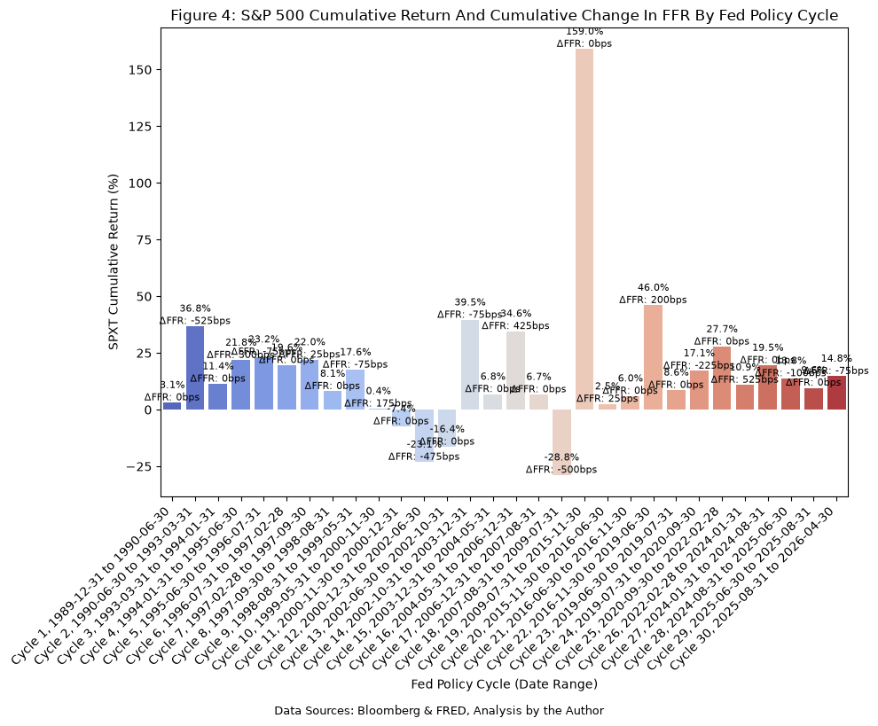
    


And then the annualized returns along with the annualized change in FFR:


```python
plot_bar_returns_ffr_change(
    cycle_df=spxt_cycles,
    asset_label="SPXT",
    annualized_or_cumulative="Annualized",
    title=f"Figure {next(figure_number)}: S&P 500 Annualized Return And Annualized Change In FFR By Fed Policy Cycle",
    caption="Data Sources: Bloomberg & FRED, Analysis by the Author",
)
```


    
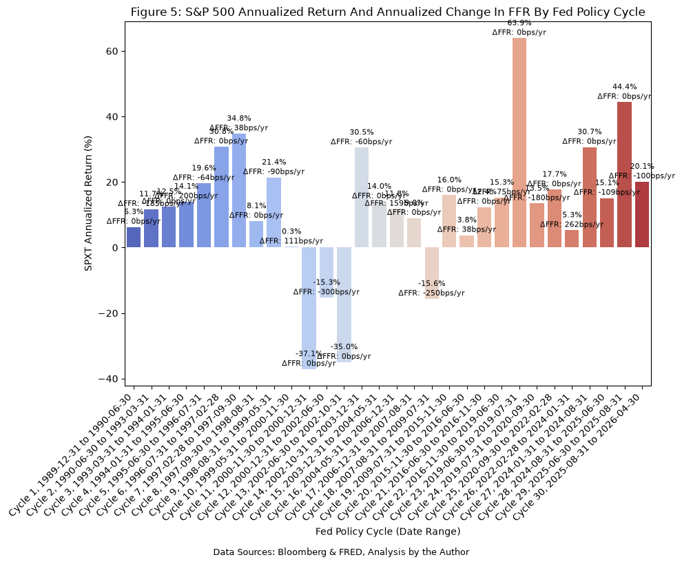
    


The cumulative returns plot is not particularly insightful, but there are some interesting observations from the annualized returns plot. During the past two (2) rate cutting cycles (cycles 11/12/13 and 18), stocks have exhibited negative returns during either a flat period or the rate cutting cycle. However, after the rate cutting cycle was complete, returns during the following cycle (when rates were usually flat) were quite strong and higher than the historical mean return for the S&P 500. The economic intuition for this behavior is valid; as the economy weakens, investors are concerned about the pricing of equities, the returns become negative, and the Fed responds with cutting rates. The exact timing of when the Fed begins cutting rates is one of the unknowns; the Fed could be ahead of the curve, cutting rates as economic data begins to prompt that action, or behind the curve, where the economy rolls over rapidly and even the Fed's actions are not enough to halt the economic contraction.

Finally, we can run an OLS regression to check fit:


```python
model = run_regression(
    df=spxt_cycles,
    x_plot_column="FFR_AnnualizedChange_bps",
    y_plot_column="AnnualizedReturnPct",
    regression_model="OLS-statsmodels",
    regression_constant=True,
)

print(model.summary())

# Pull the fitted coefficients by name
intercept = model.params["const"]
slope = model.params["FFR_AnnualizedChange_bps"]
print(f"Intercept: {intercept}, Slope: {slope}")

# Calc X and Y values for the regression line across the observed FFR range
X_vals = np.linspace(
    spxt_cycles["FFR_AnnualizedChange_bps"].min(),
    spxt_cycles["FFR_AnnualizedChange_bps"].max(),
    100,
)
Y_vals = intercept + slope * X_vals
```

                                 OLS Regression Results                            
    ===============================================================================
    Dep. Variable:     AnnualizedReturnPct   R-squared:                       0.019
    Model:                             OLS   Adj. R-squared:                 -0.016
    Method:                  Least Squares   F-statistic:                    0.5519
    Date:                 Wed, 11 Nov 2026   Prob (F-statistic):              0.464
    Time:                         14:16:57   Log-Likelihood:                -132.17
    No. Observations:                   30   AIC:                             268.3
    Df Residuals:                       28   BIC:                             271.2
    Df Model:                            1                                         
    Covariance Type:             nonrobust                                         
    ============================================================================================
                                   coef    std err          t      P>|t|      [0.025      0.975]
    --------------------------------------------------------------------------------------------
    const                       13.0295      3.778      3.449      0.002       5.290      20.769
    FFR_AnnualizedChange_bps     0.0240      0.032      0.743      0.464      -0.042       0.090
    ==============================================================================
    Omnibus:                        4.100   Durbin-Watson:                   1.544
    Prob(Omnibus):                  0.129   Jarque-Bera (JB):                2.954
    Skew:                          -0.312   Prob(JB):                        0.228
    Kurtosis:                       4.405   Cond. No.                         118.
    ==============================================================================
    
    Notes:
    [1] Standard Errors assume that the covariance matrix of the errors is correctly specified.
    Intercept: 13.029533274127317, Slope: 0.023952631706877066


And then plot the regression line along with the values:


```python
plot_scatter_regression_ffr_vs_returns(
    cycle_df=spxt_cycles,
    asset_label="SPXT",
    x_vals=X_vals,
    y_vals=Y_vals,
    intercept=intercept,
    slope=slope,
    title=f"Figure {next(figure_number)}: S&P 500 Annualized Return vs Annualized Change In FFR By Fed Policy Cycle",
    caption="Data Source: Bloomberg, FRED, Analysis by the Author",
)
```


    
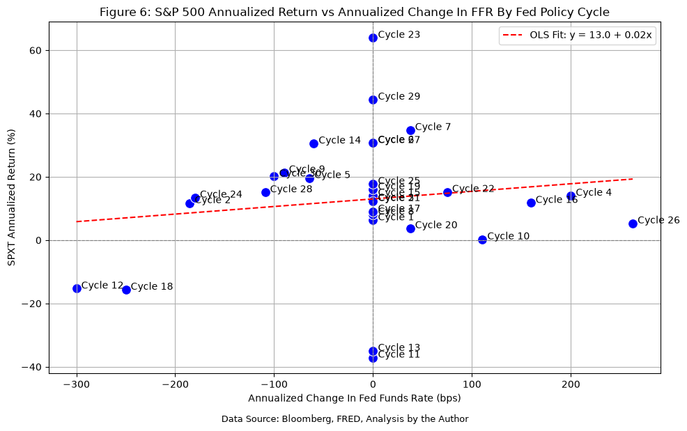
    


Here we can see the data points for cycles 11, 12, 13, 14 and 18 as mentioned above. Interestingly, cycles 28/29/30 (which is the current rate cutting cycle) appears to be an outlier. Of course, the book is not yet finished for cycles 28/29/30, and we could certainly see a bear market in stocks over the next several years.

### Bonds

Next, we'll run a similar process for medium term bonds using SPBDU10T_S&P US Treasury Bond 7-10 Year Total Return Index.

First, we pull data with the following:


```python
bb_clean_data(
    base_directory=DATA_DIR,
    fund_ticker_name="SPBDU10T_S&P US Treasury Bond 7-10 Year Total Return Index",
    source="Bloomberg",
    asset_class="Indices",
    excel_export=True,
    pickle_export=True,
    output_confirmation=False,
)

treas_10y = load_data(
    base_directory=DATA_DIR,
    ticker="SPBDU10T_S&P US Treasury Bond 7-10 Year Total Return Index_Clean",
    source="Bloomberg",
    asset_class="Indices",
    timeframe="Daily",
    file_format="pickle",
)

# The Bloomberg pickle stores the index as objects; convert to a nanosecond
# DatetimeIndex so it matches the FRED data in the merges further down
treas_10y.index = pd.to_datetime(treas_10y.index).astype("datetime64[ns]")

# Filter TREAS_10Y to date range
treas_10y = treas_10y[(treas_10y.index >= pd.to_datetime(START_DATE)) & (treas_10y.index <= pd.to_datetime(END_DATE))]

# Drop everything except the "close" column
treas_10y = treas_10y[["Close"]]

# Resample to monthly frequency
treas_10y_monthly = treas_10y.resample("ME").last()
treas_10y_monthly["Monthly_Return"] = treas_10y_monthly["Close"].pct_change()
treas_10y_monthly = treas_10y_monthly.dropna()

display(Markdown(f"Table {next(table_number)}: S&P US Treasury Bond 7-10 Year Total Return Index Monthly Close And Returns"))
display(treas_10y_monthly)
```


Table 12: S&P US Treasury Bond 7-10 Year Total Return Index Monthly Close And Returns


<div>
<style scoped>
    .dataframe tbody tr th:only-of-type {
        vertical-align: middle;
    }

    .dataframe tbody tr th {
        vertical-align: top;
    }

    .dataframe thead th {
        text-align: right;
    }
</style>
<table border="1" class="dataframe">
  <thead>
    <tr style="text-align: right;">
      <th></th>
      <th>Close</th>
      <th>Monthly_Return</th>
    </tr>
    <tr>
      <th>Date</th>
      <th></th>
      <th></th>
    </tr>
  </thead>
  <tbody>
    <tr>
      <th>1990-01-31</th>
      <td>98.01</td>
      <td>-0.02</td>
    </tr>
    <tr>
      <th>1990-02-28</th>
      <td>97.99</td>
      <td>-0.00</td>
    </tr>
    <tr>
      <th>1990-03-31</th>
      <td>97.99</td>
      <td>-0.00</td>
    </tr>
    <tr>
      <th>1990-04-30</th>
      <td>96.61</td>
      <td>-0.01</td>
    </tr>
    <tr>
      <th>1990-05-31</th>
      <td>99.65</td>
      <td>0.03</td>
    </tr>
    <tr>
      <th>...</th>
      <td>...</td>
      <td>...</td>
    </tr>
    <tr>
      <th>2025-12-31</th>
      <td>652.29</td>
      <td>-0.01</td>
    </tr>
    <tr>
      <th>2026-01-31</th>
      <td>650.17</td>
      <td>-0.00</td>
    </tr>
    <tr>
      <th>2026-02-28</th>
      <td>666.43</td>
      <td>0.03</td>
    </tr>
    <tr>
      <th>2026-03-31</th>
      <td>651.02</td>
      <td>-0.02</td>
    </tr>
    <tr>
      <th>2026-04-30</th>
      <td>650.20</td>
      <td>-0.00</td>
    </tr>
  </tbody>
</table>
<p>436 rows × 2 columns</p>
</div>


Next, we can plot the price history before calculating the cycle performance:


```python
plot_time_series(
    df=treas_10y,
    plot_start_date=None,
    plot_end_date=None,
    plot_columns=["Close"],
    title=f"Figure {next(figure_number)}: S&P US Treasury Bond 7-10 Year Total Return Index Daily Close Price",
    x_label="Date",
    x_format="Year",
    x_tick_spacing=2,
    x_tick_start=None,
    x_tick_rotation=30,
    y_label="Price ($)",
    y_format="Decimal",
    y_format_decimal_places=0,
    y_tick_spacing=50,
    y_tick_rotation=0,
    grid=True,
    legend=False,
    export_plot=False,
    plot_file_name=None,
    caption="Data Source: Bloomberg, Analysis by the Author",
)
```


    
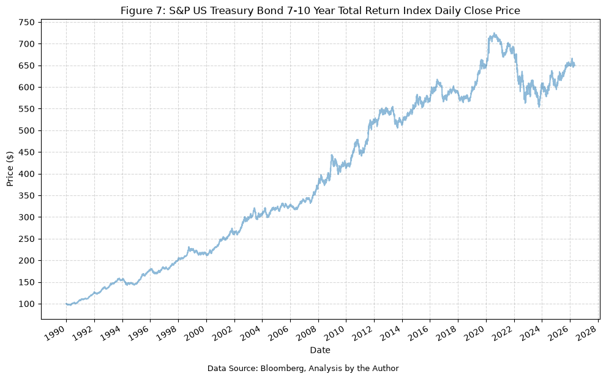
    


Next, we will calculate the performance for the Treasury index based on the pre-defined Fed cycles:


```python
treas_10y_cycles = calc_fed_cycle_asset_performance(
    start_date=cycle_ranges["adjusted_start_date"],
    end_date=cycle_ranges["end_date"],
    label=cycle_ranges["cycle_label"],
    fed_funds_change=cycle_ranges["fed_funds_change"],
    monthly_returns=treas_10y_monthly,
)

display(Markdown(f"Table {next(table_number)}: S&P US Treasury Bond 7-10 Year Total Return Index Performance By Fed Policy Cycle"))
display(treas_10y_cycles)
```


Table 13: S&P US Treasury Bond 7-10 Year Total Return Index Performance By Fed Policy Cycle


<div>
<style scoped>
    .dataframe tbody tr th:only-of-type {
        vertical-align: middle;
    }

    .dataframe tbody tr th {
        vertical-align: top;
    }

    .dataframe thead th {
        text-align: right;
    }
</style>
<table border="1" class="dataframe">
  <thead>
    <tr style="text-align: right;">
      <th></th>
      <th>Cycle</th>
      <th>Start</th>
      <th>End</th>
      <th>Months</th>
      <th>CumulativeReturn</th>
      <th>CumulativeReturnPct</th>
      <th>AverageMonthlyReturn</th>
      <th>AverageMonthlyReturnPct</th>
      <th>AnnualizedReturn</th>
      <th>AnnualizedReturnPct</th>
      <th>Volatility</th>
      <th>FedFundsChange</th>
      <th>FedFundsChange_bps</th>
      <th>FFR_AnnualizedChange</th>
      <th>FFR_AnnualizedChange_bps</th>
      <th>Label</th>
    </tr>
  </thead>
  <tbody>
    <tr>
      <th>0</th>
      <td>Cycle 1</td>
      <td>1990-01-31</td>
      <td>1990-06-30</td>
      <td>6</td>
      <td>0.01</td>
      <td>1.36</td>
      <td>0.00</td>
      <td>0.24</td>
      <td>0.03</td>
      <td>2.74</td>
      <td>0.07</td>
      <td>0.00</td>
      <td>0.00</td>
      <td>0.00</td>
      <td>0.00</td>
      <td>Cycle 1, 1990-01-31 to 1990-06-30</td>
    </tr>
    <tr>
      <th>1</th>
      <td>Cycle 2</td>
      <td>1990-07-30</td>
      <td>1993-03-31</td>
      <td>33</td>
      <td>0.43</td>
      <td>43.22</td>
      <td>0.01</td>
      <td>1.11</td>
      <td>0.14</td>
      <td>13.95</td>
      <td>0.05</td>
      <td>-0.05</td>
      <td>-525.00</td>
      <td>-0.02</td>
      <td>-190.91</td>
      <td>Cycle 2, 1990-07-30 to 1993-03-31</td>
    </tr>
    <tr>
      <th>2</th>
      <td>Cycle 3</td>
      <td>1993-04-30</td>
      <td>1994-01-31</td>
      <td>10</td>
      <td>0.08</td>
      <td>8.30</td>
      <td>0.01</td>
      <td>0.81</td>
      <td>0.10</td>
      <td>10.04</td>
      <td>0.05</td>
      <td>0.00</td>
      <td>0.00</td>
      <td>0.00</td>
      <td>0.00</td>
      <td>Cycle 3, 1993-04-30 to 1994-01-31</td>
    </tr>
    <tr>
      <th>3</th>
      <td>Cycle 4</td>
      <td>1994-02-28</td>
      <td>1995-06-30</td>
      <td>17</td>
      <td>0.06</td>
      <td>6.17</td>
      <td>0.00</td>
      <td>0.37</td>
      <td>0.04</td>
      <td>4.32</td>
      <td>0.07</td>
      <td>0.03</td>
      <td>300.00</td>
      <td>0.02</td>
      <td>211.76</td>
      <td>Cycle 4, 1994-02-28 to 1995-06-30</td>
    </tr>
    <tr>
      <th>4</th>
      <td>Cycle 5</td>
      <td>1995-07-30</td>
      <td>1996-07-31</td>
      <td>13</td>
      <td>0.04</td>
      <td>3.73</td>
      <td>0.00</td>
      <td>0.29</td>
      <td>0.03</td>
      <td>3.44</td>
      <td>0.05</td>
      <td>-0.01</td>
      <td>-75.00</td>
      <td>-0.01</td>
      <td>-69.23</td>
      <td>Cycle 5, 1995-07-30 to 1996-07-31</td>
    </tr>
    <tr>
      <th>5</th>
      <td>Cycle 6</td>
      <td>1996-08-31</td>
      <td>1997-02-28</td>
      <td>7</td>
      <td>0.05</td>
      <td>5.08</td>
      <td>0.01</td>
      <td>0.72</td>
      <td>0.09</td>
      <td>8.86</td>
      <td>0.06</td>
      <td>0.00</td>
      <td>0.00</td>
      <td>0.00</td>
      <td>0.00</td>
      <td>Cycle 6, 1996-08-31 to 1997-02-28</td>
    </tr>
    <tr>
      <th>6</th>
      <td>Cycle 7</td>
      <td>1997-03-28</td>
      <td>1997-09-30</td>
      <td>7</td>
      <td>0.06</td>
      <td>6.39</td>
      <td>0.01</td>
      <td>0.90</td>
      <td>0.11</td>
      <td>11.20</td>
      <td>0.07</td>
      <td>0.00</td>
      <td>25.00</td>
      <td>0.00</td>
      <td>42.86</td>
      <td>Cycle 7, 1997-03-28 to 1997-09-30</td>
    </tr>
    <tr>
      <th>7</th>
      <td>Cycle 8</td>
      <td>1997-10-30</td>
      <td>1998-08-31</td>
      <td>11</td>
      <td>0.12</td>
      <td>12.26</td>
      <td>0.01</td>
      <td>1.06</td>
      <td>0.13</td>
      <td>13.45</td>
      <td>0.04</td>
      <td>0.00</td>
      <td>0.00</td>
      <td>0.00</td>
      <td>0.00</td>
      <td>Cycle 8, 1997-10-30 to 1998-08-31</td>
    </tr>
    <tr>
      <th>8</th>
      <td>Cycle 9</td>
      <td>1998-09-30</td>
      <td>1999-05-31</td>
      <td>9</td>
      <td>-0.00</td>
      <td>-0.44</td>
      <td>-0.00</td>
      <td>-0.03</td>
      <td>-0.01</td>
      <td>-0.59</td>
      <td>0.08</td>
      <td>-0.01</td>
      <td>-75.00</td>
      <td>-0.01</td>
      <td>-100.00</td>
      <td>Cycle 9, 1998-09-30 to 1999-05-31</td>
    </tr>
    <tr>
      <th>9</th>
      <td>Cycle 10</td>
      <td>1999-06-30</td>
      <td>2000-11-30</td>
      <td>18</td>
      <td>0.11</td>
      <td>10.80</td>
      <td>0.01</td>
      <td>0.58</td>
      <td>0.07</td>
      <td>7.08</td>
      <td>0.04</td>
      <td>0.02</td>
      <td>175.00</td>
      <td>0.01</td>
      <td>116.67</td>
      <td>Cycle 10, 1999-06-30 to 2000-11-30</td>
    </tr>
    <tr>
      <th>10</th>
      <td>Cycle 11</td>
      <td>2000-12-30</td>
      <td>2000-12-31</td>
      <td>1</td>
      <td>0.02</td>
      <td>2.34</td>
      <td>0.02</td>
      <td>2.34</td>
      <td>0.32</td>
      <td>31.93</td>
      <td>NaN</td>
      <td>0.00</td>
      <td>0.00</td>
      <td>0.00</td>
      <td>0.00</td>
      <td>Cycle 11, 2000-12-30 to 2000-12-31</td>
    </tr>
    <tr>
      <th>11</th>
      <td>Cycle 12</td>
      <td>2001-01-31</td>
      <td>2002-06-30</td>
      <td>18</td>
      <td>0.12</td>
      <td>11.72</td>
      <td>0.01</td>
      <td>0.63</td>
      <td>0.08</td>
      <td>7.67</td>
      <td>0.06</td>
      <td>-0.05</td>
      <td>-475.00</td>
      <td>-0.03</td>
      <td>-316.67</td>
      <td>Cycle 12, 2001-01-31 to 2002-06-30</td>
    </tr>
    <tr>
      <th>12</th>
      <td>Cycle 13</td>
      <td>2002-07-30</td>
      <td>2002-10-31</td>
      <td>4</td>
      <td>0.08</td>
      <td>8.03</td>
      <td>0.02</td>
      <td>1.97</td>
      <td>0.26</td>
      <td>26.06</td>
      <td>0.08</td>
      <td>0.00</td>
      <td>0.00</td>
      <td>0.00</td>
      <td>0.00</td>
      <td>Cycle 13, 2002-07-30 to 2002-10-31</td>
    </tr>
    <tr>
      <th>13</th>
      <td>Cycle 14</td>
      <td>2002-11-30</td>
      <td>2003-12-31</td>
      <td>14</td>
      <td>0.03</td>
      <td>3.47</td>
      <td>0.00</td>
      <td>0.27</td>
      <td>0.03</td>
      <td>2.96</td>
      <td>0.09</td>
      <td>-0.01</td>
      <td>-75.00</td>
      <td>-0.01</td>
      <td>-64.29</td>
      <td>Cycle 14, 2002-11-30 to 2003-12-31</td>
    </tr>
    <tr>
      <th>14</th>
      <td>Cycle 15</td>
      <td>2004-01-31</td>
      <td>2004-05-31</td>
      <td>5</td>
      <td>-0.01</td>
      <td>-1.01</td>
      <td>-0.00</td>
      <td>-0.18</td>
      <td>-0.02</td>
      <td>-2.40</td>
      <td>0.08</td>
      <td>0.00</td>
      <td>0.00</td>
      <td>0.00</td>
      <td>0.00</td>
      <td>Cycle 15, 2004-01-31 to 2004-05-31</td>
    </tr>
    <tr>
      <th>15</th>
      <td>Cycle 16</td>
      <td>2004-06-30</td>
      <td>2006-12-31</td>
      <td>31</td>
      <td>0.11</td>
      <td>10.94</td>
      <td>0.00</td>
      <td>0.34</td>
      <td>0.04</td>
      <td>4.10</td>
      <td>0.04</td>
      <td>0.04</td>
      <td>425.00</td>
      <td>0.02</td>
      <td>164.52</td>
      <td>Cycle 16, 2004-06-30 to 2006-12-31</td>
    </tr>
    <tr>
      <th>16</th>
      <td>Cycle 17</td>
      <td>2007-01-31</td>
      <td>2007-08-31</td>
      <td>8</td>
      <td>0.05</td>
      <td>4.68</td>
      <td>0.01</td>
      <td>0.58</td>
      <td>0.07</td>
      <td>7.11</td>
      <td>0.05</td>
      <td>0.00</td>
      <td>0.00</td>
      <td>0.00</td>
      <td>0.00</td>
      <td>Cycle 17, 2007-01-31 to 2007-08-31</td>
    </tr>
    <tr>
      <th>17</th>
      <td>Cycle 18</td>
      <td>2007-09-30</td>
      <td>2009-07-31</td>
      <td>23</td>
      <td>0.17</td>
      <td>17.30</td>
      <td>0.01</td>
      <td>0.73</td>
      <td>0.09</td>
      <td>8.68</td>
      <td>0.10</td>
      <td>-0.05</td>
      <td>-500.00</td>
      <td>-0.03</td>
      <td>-260.87</td>
      <td>Cycle 18, 2007-09-30 to 2009-07-31</td>
    </tr>
    <tr>
      <th>18</th>
      <td>Cycle 19</td>
      <td>2009-08-31</td>
      <td>2015-11-30</td>
      <td>76</td>
      <td>0.38</td>
      <td>38.12</td>
      <td>0.00</td>
      <td>0.44</td>
      <td>0.05</td>
      <td>5.23</td>
      <td>0.06</td>
      <td>0.00</td>
      <td>0.00</td>
      <td>0.00</td>
      <td>0.00</td>
      <td>Cycle 19, 2009-08-31 to 2015-11-30</td>
    </tr>
    <tr>
      <th>19</th>
      <td>Cycle 20</td>
      <td>2015-12-30</td>
      <td>2016-06-30</td>
      <td>7</td>
      <td>0.07</td>
      <td>7.23</td>
      <td>0.01</td>
      <td>1.01</td>
      <td>0.13</td>
      <td>12.72</td>
      <td>0.05</td>
      <td>0.00</td>
      <td>25.00</td>
      <td>0.00</td>
      <td>42.86</td>
      <td>Cycle 20, 2015-12-30 to 2016-06-30</td>
    </tr>
    <tr>
      <th>20</th>
      <td>Cycle 21</td>
      <td>2016-07-30</td>
      <td>2016-11-30</td>
      <td>5</td>
      <td>-0.06</td>
      <td>-6.06</td>
      <td>-0.01</td>
      <td>-1.23</td>
      <td>-0.14</td>
      <td>-13.92</td>
      <td>0.06</td>
      <td>0.00</td>
      <td>0.00</td>
      <td>0.00</td>
      <td>0.00</td>
      <td>Cycle 21, 2016-07-30 to 2016-11-30</td>
    </tr>
    <tr>
      <th>21</th>
      <td>Cycle 22</td>
      <td>2016-12-30</td>
      <td>2019-06-30</td>
      <td>31</td>
      <td>0.11</td>
      <td>10.58</td>
      <td>0.00</td>
      <td>0.33</td>
      <td>0.04</td>
      <td>3.97</td>
      <td>0.04</td>
      <td>0.02</td>
      <td>200.00</td>
      <td>0.01</td>
      <td>77.42</td>
      <td>Cycle 22, 2016-12-30 to 2019-06-30</td>
    </tr>
    <tr>
      <th>22</th>
      <td>Cycle 23</td>
      <td>2019-07-30</td>
      <td>2019-07-31</td>
      <td>1</td>
      <td>0.00</td>
      <td>0.04</td>
      <td>0.00</td>
      <td>0.04</td>
      <td>0.00</td>
      <td>0.43</td>
      <td>NaN</td>
      <td>0.00</td>
      <td>0.00</td>
      <td>0.00</td>
      <td>0.00</td>
      <td>Cycle 23, 2019-07-30 to 2019-07-31</td>
    </tr>
    <tr>
      <th>23</th>
      <td>Cycle 24</td>
      <td>2019-08-31</td>
      <td>2020-09-30</td>
      <td>14</td>
      <td>0.13</td>
      <td>13.04</td>
      <td>0.01</td>
      <td>0.89</td>
      <td>0.11</td>
      <td>11.08</td>
      <td>0.06</td>
      <td>-0.02</td>
      <td>-225.00</td>
      <td>-0.02</td>
      <td>-192.86</td>
      <td>Cycle 24, 2019-08-31 to 2020-09-30</td>
    </tr>
    <tr>
      <th>24</th>
      <td>Cycle 25</td>
      <td>2020-10-30</td>
      <td>2022-02-28</td>
      <td>17</td>
      <td>-0.07</td>
      <td>-6.83</td>
      <td>-0.00</td>
      <td>-0.41</td>
      <td>-0.05</td>
      <td>-4.87</td>
      <td>0.05</td>
      <td>0.00</td>
      <td>0.00</td>
      <td>0.00</td>
      <td>0.00</td>
      <td>Cycle 25, 2020-10-30 to 2022-02-28</td>
    </tr>
    <tr>
      <th>25</th>
      <td>Cycle 26</td>
      <td>2022-03-28</td>
      <td>2024-01-31</td>
      <td>23</td>
      <td>-0.10</td>
      <td>-9.58</td>
      <td>-0.00</td>
      <td>-0.40</td>
      <td>-0.05</td>
      <td>-5.12</td>
      <td>0.10</td>
      <td>0.05</td>
      <td>525.00</td>
      <td>0.03</td>
      <td>273.91</td>
      <td>Cycle 26, 2022-03-28 to 2024-01-31</td>
    </tr>
    <tr>
      <th>26</th>
      <td>Cycle 27</td>
      <td>2024-02-29</td>
      <td>2024-08-31</td>
      <td>7</td>
      <td>0.03</td>
      <td>2.88</td>
      <td>0.00</td>
      <td>0.43</td>
      <td>0.05</td>
      <td>4.98</td>
      <td>0.07</td>
      <td>0.00</td>
      <td>0.00</td>
      <td>0.00</td>
      <td>0.00</td>
      <td>Cycle 27, 2024-02-29 to 2024-08-31</td>
    </tr>
    <tr>
      <th>27</th>
      <td>Cycle 28</td>
      <td>2024-09-30</td>
      <td>2025-06-30</td>
      <td>10</td>
      <td>0.02</td>
      <td>1.86</td>
      <td>0.00</td>
      <td>0.20</td>
      <td>0.02</td>
      <td>2.24</td>
      <td>0.06</td>
      <td>-0.01</td>
      <td>-100.00</td>
      <td>-0.01</td>
      <td>-120.00</td>
      <td>Cycle 28, 2024-09-30 to 2025-06-30</td>
    </tr>
    <tr>
      <th>28</th>
      <td>Cycle 29</td>
      <td>2025-07-30</td>
      <td>2025-08-31</td>
      <td>2</td>
      <td>0.01</td>
      <td>1.08</td>
      <td>0.01</td>
      <td>0.54</td>
      <td>0.07</td>
      <td>6.64</td>
      <td>0.06</td>
      <td>0.00</td>
      <td>0.00</td>
      <td>0.00</td>
      <td>0.00</td>
      <td>Cycle 29, 2025-07-30 to 2025-08-31</td>
    </tr>
    <tr>
      <th>29</th>
      <td>Cycle 30</td>
      <td>2025-09-30</td>
      <td>2026-04-30</td>
      <td>8</td>
      <td>0.01</td>
      <td>1.39</td>
      <td>0.00</td>
      <td>0.18</td>
      <td>0.02</td>
      <td>2.10</td>
      <td>0.05</td>
      <td>-0.01</td>
      <td>-75.00</td>
      <td>-0.01</td>
      <td>-112.50</td>
      <td>Cycle 30, 2025-09-30 to 2026-04-30</td>
    </tr>
  </tbody>
</table>
</div>


As with the S&P 500 above, this gives us the per-cycle dates, month count, cumulative and annualized returns, volatility, and the cumulative and annualized change in the FFR.

From the above DataFrame, we can then plot the cumulative and annualized returns for each cycle in a bar chart. First, the cumulative returns along with the cumulative change in FFR:


```python
plot_bar_returns_ffr_change(
    cycle_df=treas_10y_cycles,
    asset_label="TREAS_10Y",
    annualized_or_cumulative="Cumulative",
    title=f"Figure {next(figure_number)}: 7-10 Year Treasuries Cumulative Return And Cumulative Change In FFR By Fed Policy Cycle",
    caption="Data Sources: Bloomberg & FRED, Analysis by the Author",
)
```


    
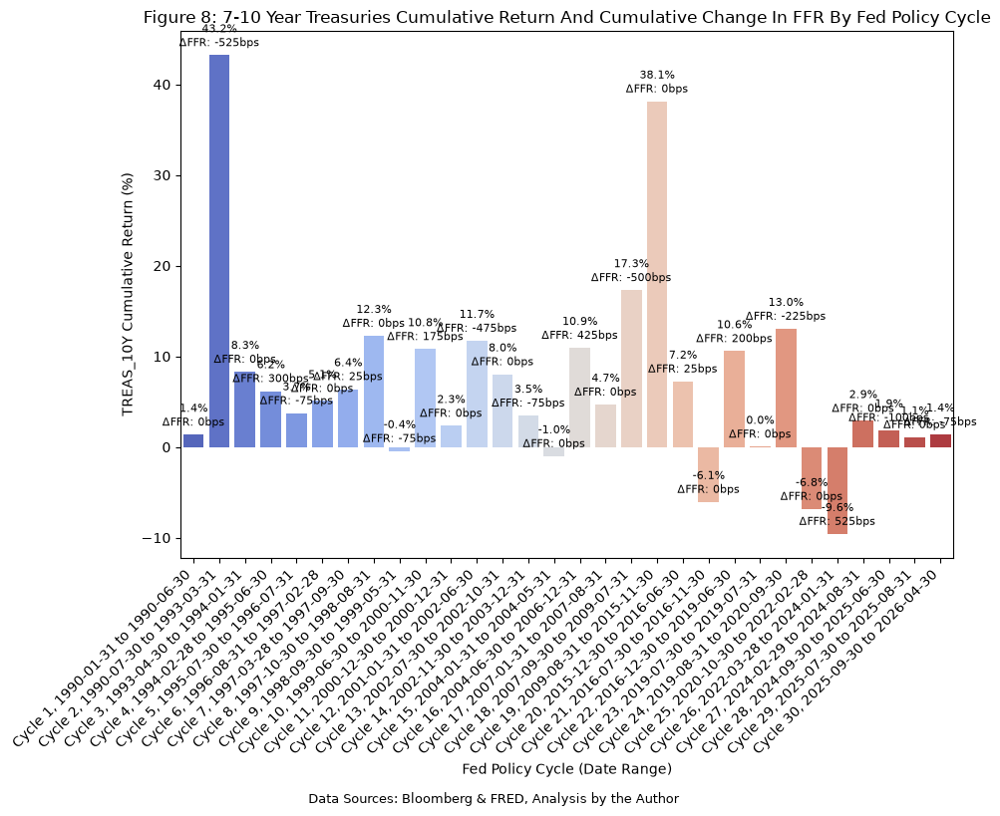
    


And then the annualized returns along with the annualized change in FFR:


```python
plot_bar_returns_ffr_change(
    cycle_df=treas_10y_cycles,
    asset_label="TREAS_10Y",
    annualized_or_cumulative="Annualized",
    title=f"Figure {next(figure_number)}: 7-10 Year Treasuries Annualized Return And Annualized Change In FFR By Fed Policy Cycle",
    caption="Data Sources: Bloomberg & FRED, Analysis by the Author",
)
```


    
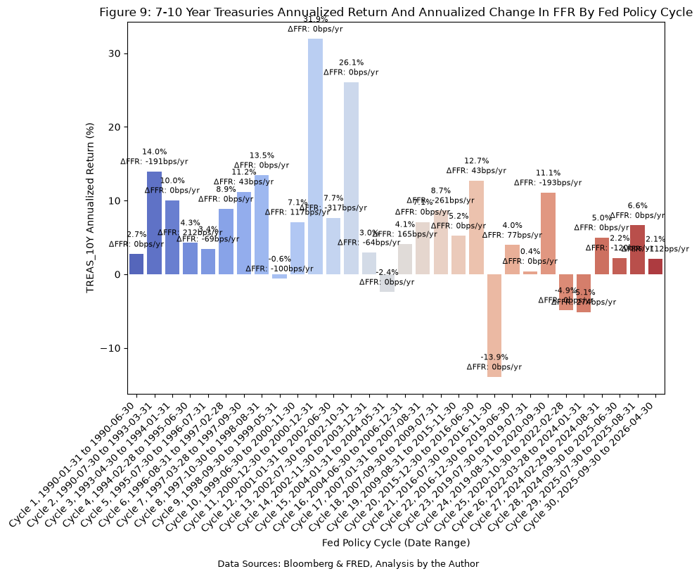
    


For this dataset, we have cycles 11/12/13 exhibiting strong returns, which is consistent with the economic intuition that bonds should perform well during periods of economic weakness and rate cuts. We also see this outcome with cycle 18. It becomes a little more interesting during cycles 25 and 26, where the correlations of stocks and bond returns turned positive (historically they have been negative), so we see negative bond returns there. Finally, cycles 28/29/30 also exhibit positive bond returns, which is consistent with our thesis that bonds should perform well during periods of economic weakness and rate cuts.

Finally, we can run an OLS regression to check fit:


```python
model = run_regression(
    df=treas_10y_cycles,
    x_plot_column="FFR_AnnualizedChange_bps",
    y_plot_column="AnnualizedReturnPct",
    regression_model="OLS-statsmodels",
    regression_constant=True,
)

print(model.summary())

# Pull the fitted coefficients by name
intercept = model.params["const"]
slope = model.params["FFR_AnnualizedChange_bps"]
print(f"Intercept: {intercept}, Slope: {slope}")

# Calc X and Y values for the regression line across the observed FFR range
X_vals = np.linspace(
    treas_10y_cycles["FFR_AnnualizedChange_bps"].min(),
    treas_10y_cycles["FFR_AnnualizedChange_bps"].max(),
    100,
)
Y_vals = intercept + slope * X_vals
```

                                 OLS Regression Results                            
    ===============================================================================
    Dep. Variable:     AnnualizedReturnPct   R-squared:                       0.025
    Model:                             OLS   Adj. R-squared:                 -0.010
    Method:                  Least Squares   F-statistic:                    0.7142
    Date:                 Wed, 11 Nov 2026   Prob (F-statistic):              0.405
    Time:                         14:17:00   Log-Likelihood:                -106.48
    No. Observations:                   30   AIC:                             217.0
    Df Residuals:                       28   BIC:                             219.8
    Df Model:                            1                                         
    Covariance Type:             nonrobust                                         
    ============================================================================================
                                   coef    std err          t      P>|t|      [0.025      0.975]
    --------------------------------------------------------------------------------------------
    const                        6.0203      1.605      3.750      0.001       2.732       9.309
    FFR_AnnualizedChange_bps    -0.0110      0.013     -0.845      0.405      -0.038       0.016
    ==============================================================================
    Omnibus:                       10.116   Durbin-Watson:                   2.132
    Prob(Omnibus):                  0.006   Jarque-Bera (JB):               10.690
    Skew:                           0.857   Prob(JB):                      0.00477
    Kurtosis:                       5.369   Cond. No.                         125.
    ==============================================================================
    
    Notes:
    [1] Standard Errors assume that the covariance matrix of the errors is correctly specified.
    Intercept: 6.0202835637649565, Slope: -0.010977336485290014


And then plot the regression line along with the values:


```python
plot_scatter_regression_ffr_vs_returns(
    cycle_df=treas_10y_cycles,
    asset_label="TREAS_10Y",
    x_vals=X_vals,
    y_vals=Y_vals,
    intercept=intercept,
    slope=slope,
    title=f"Figure {next(figure_number)}: 7-10 Year Treasuries Annualized Return vs Annualized Change In FFR By Fed Policy Cycle",
    caption="Data Source: Bloomberg, FRED, Analysis by the Author",
)
```


    
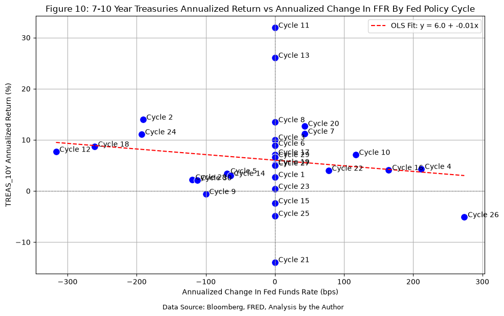
    


The slope here is negative, which is the sign we would expect: cycles where the FFR fell are associated with stronger Treasury returns. It is worth being honest about the strength of that relationship, though. With only 30 cycle observations the R-squared is about 0.05 and the slope is not statistically significant at any conventional threshold, so the regression is directionally consistent with the economic intuition rather than evidence for it. The bar charts above, where the sign of the return lines up with the sign of the rate change in most cycles, are the more convincing exhibit.

### High Yield Bonds

Next, we'll run a similar process for high yield bonds using LF98TRUU_Bloomberg US Corporate High Yield Total Return Index Value Unhedged USD.

First, we pull data with the following:


```python
bb_clean_data(
    base_directory=DATA_DIR,
    fund_ticker_name="LF98TRUU_Bloomberg US Corporate High Yield Total Return Index Value Unhedged USD",
    source="Bloomberg",
    asset_class="Indices",
    excel_export=True,
    pickle_export=True,
    output_confirmation=False,
)

hy_bonds = load_data(
    base_directory=DATA_DIR,
    ticker="LF98TRUU_Bloomberg US Corporate High Yield Total Return Index Value Unhedged USD_Clean",
    source="Bloomberg",
    asset_class="Indices",
    timeframe="Daily",
    file_format="pickle",
)

# The Bloomberg pickle stores the index as objects; convert to a nanosecond
# DatetimeIndex so it matches the FRED data in the merges further down
hy_bonds.index = pd.to_datetime(hy_bonds.index).astype("datetime64[ns]")

# Filter HY_BONDS to date range
hy_bonds = hy_bonds[(hy_bonds.index >= pd.to_datetime(START_DATE)) & (hy_bonds.index <= pd.to_datetime(END_DATE))]

# Drop everything except the "close" column
hy_bonds = hy_bonds[["Close"]]

# Resample to monthly frequency
hy_bonds_monthly = hy_bonds.resample("ME").last()
hy_bonds_monthly["Monthly_Return"] = hy_bonds_monthly["Close"].pct_change()
hy_bonds_monthly = hy_bonds_monthly.dropna()

display(Markdown(f"Table {next(table_number)}: Bloomberg US Corporate High Yield Total Return Index Monthly Close And Returns"))
display(hy_bonds_monthly)
```


Table 14: Bloomberg US Corporate High Yield Total Return Index Monthly Close And Returns


<div>
<style scoped>
    .dataframe tbody tr th:only-of-type {
        vertical-align: middle;
    }

    .dataframe tbody tr th {
        vertical-align: top;
    }

    .dataframe thead th {
        text-align: right;
    }
</style>
<table border="1" class="dataframe">
  <thead>
    <tr style="text-align: right;">
      <th></th>
      <th>Close</th>
      <th>Monthly_Return</th>
    </tr>
    <tr>
      <th>Date</th>
      <th></th>
      <th></th>
    </tr>
  </thead>
  <tbody>
    <tr>
      <th>1990-01-31</th>
      <td>194.21</td>
      <td>-0.02</td>
    </tr>
    <tr>
      <th>1990-02-28</th>
      <td>190.20</td>
      <td>-0.02</td>
    </tr>
    <tr>
      <th>1990-03-31</th>
      <td>195.19</td>
      <td>0.03</td>
    </tr>
    <tr>
      <th>1990-04-30</th>
      <td>194.86</td>
      <td>-0.00</td>
    </tr>
    <tr>
      <th>1990-05-31</th>
      <td>198.62</td>
      <td>0.02</td>
    </tr>
    <tr>
      <th>...</th>
      <td>...</td>
      <td>...</td>
    </tr>
    <tr>
      <th>2025-12-31</th>
      <td>2914.49</td>
      <td>0.01</td>
    </tr>
    <tr>
      <th>2026-01-31</th>
      <td>2929.32</td>
      <td>0.01</td>
    </tr>
    <tr>
      <th>2026-02-28</th>
      <td>2934.74</td>
      <td>0.00</td>
    </tr>
    <tr>
      <th>2026-03-31</th>
      <td>2900.04</td>
      <td>-0.01</td>
    </tr>
    <tr>
      <th>2026-04-30</th>
      <td>2949.11</td>
      <td>0.02</td>
    </tr>
  </tbody>
</table>
<p>436 rows × 2 columns</p>
</div>


Next, we can plot the price history before calculating the cycle performance:


```python
plot_time_series(
    df=hy_bonds,
    plot_start_date=None,
    plot_end_date=None,
    plot_columns=["Close"],
    title=f"Figure {next(figure_number)}: Bloomberg US Corporate High Yield Total Return Index Value Unhedged USD Daily Close Price",
    x_label="Date",
    x_format="Year",
    x_tick_spacing=2,
    x_tick_start=None,
    x_tick_rotation=30,
    y_label="Price ($)",
    y_format="Decimal",
    y_format_decimal_places=0,
    y_tick_spacing=200,
    y_tick_rotation=0,
    grid=True,
    legend=False,
    export_plot=False,
    plot_file_name=None,
    caption="Data Source: Bloomberg, Analysis by the Author",
)
```


    
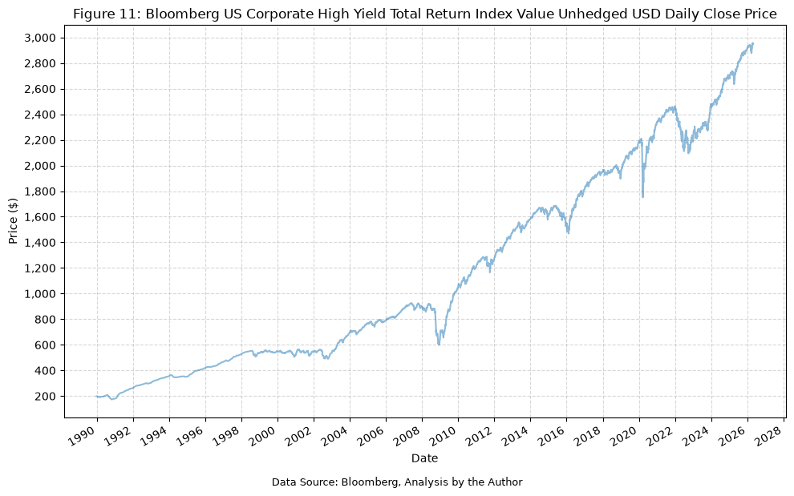
    


Next, we will calculate the performance of high yield bonds based on the pre-defined Fed cycles:


```python
hy_bonds_cycles = calc_fed_cycle_asset_performance(
    start_date=cycle_ranges["adjusted_start_date"],
    end_date=cycle_ranges["end_date"],
    label=cycle_ranges["cycle_label"],
    fed_funds_change=cycle_ranges["fed_funds_change"],
    monthly_returns=hy_bonds_monthly,
)

display(Markdown(f"Table {next(table_number)}: Bloomberg US Corporate High Yield Total Return Index Performance By Fed Policy Cycle"))
display(hy_bonds_cycles)
```


Table 15: Bloomberg US Corporate High Yield Total Return Index Performance By Fed Policy Cycle


<div>
<style scoped>
    .dataframe tbody tr th:only-of-type {
        vertical-align: middle;
    }

    .dataframe tbody tr th {
        vertical-align: top;
    }

    .dataframe thead th {
        text-align: right;
    }
</style>
<table border="1" class="dataframe">
  <thead>
    <tr style="text-align: right;">
      <th></th>
      <th>Cycle</th>
      <th>Start</th>
      <th>End</th>
      <th>Months</th>
      <th>CumulativeReturn</th>
      <th>CumulativeReturnPct</th>
      <th>AverageMonthlyReturn</th>
      <th>AverageMonthlyReturnPct</th>
      <th>AnnualizedReturn</th>
      <th>AnnualizedReturnPct</th>
      <th>Volatility</th>
      <th>FedFundsChange</th>
      <th>FedFundsChange_bps</th>
      <th>FFR_AnnualizedChange</th>
      <th>FFR_AnnualizedChange_bps</th>
      <th>Label</th>
    </tr>
  </thead>
  <tbody>
    <tr>
      <th>0</th>
      <td>Cycle 1</td>
      <td>1990-01-31</td>
      <td>1990-06-30</td>
      <td>6</td>
      <td>0.02</td>
      <td>2.49</td>
      <td>0.00</td>
      <td>0.43</td>
      <td>0.05</td>
      <td>5.05</td>
      <td>0.08</td>
      <td>0.00</td>
      <td>0.00</td>
      <td>0.00</td>
      <td>0.00</td>
      <td>Cycle 1, 1990-01-31 to 1990-06-30</td>
    </tr>
    <tr>
      <th>1</th>
      <td>Cycle 2</td>
      <td>1990-07-30</td>
      <td>1993-03-31</td>
      <td>33</td>
      <td>0.58</td>
      <td>58.32</td>
      <td>0.01</td>
      <td>1.45</td>
      <td>0.18</td>
      <td>18.18</td>
      <td>0.11</td>
      <td>-0.05</td>
      <td>-525.00</td>
      <td>-0.02</td>
      <td>-190.91</td>
      <td>Cycle 2, 1990-07-30 to 1993-03-31</td>
    </tr>
    <tr>
      <th>2</th>
      <td>Cycle 3</td>
      <td>1993-04-30</td>
      <td>1994-01-31</td>
      <td>10</td>
      <td>0.13</td>
      <td>12.81</td>
      <td>0.01</td>
      <td>1.21</td>
      <td>0.16</td>
      <td>15.56</td>
      <td>0.02</td>
      <td>0.00</td>
      <td>0.00</td>
      <td>0.00</td>
      <td>0.00</td>
      <td>Cycle 3, 1993-04-30 to 1994-01-31</td>
    </tr>
    <tr>
      <th>3</th>
      <td>Cycle 4</td>
      <td>1994-02-28</td>
      <td>1995-06-30</td>
      <td>17</td>
      <td>0.09</td>
      <td>8.89</td>
      <td>0.01</td>
      <td>0.52</td>
      <td>0.06</td>
      <td>6.20</td>
      <td>0.06</td>
      <td>0.03</td>
      <td>300.00</td>
      <td>0.02</td>
      <td>211.76</td>
      <td>Cycle 4, 1994-02-28 to 1995-06-30</td>
    </tr>
    <tr>
      <th>4</th>
      <td>Cycle 5</td>
      <td>1995-07-30</td>
      <td>1996-07-31</td>
      <td>13</td>
      <td>0.10</td>
      <td>10.19</td>
      <td>0.01</td>
      <td>0.75</td>
      <td>0.09</td>
      <td>9.37</td>
      <td>0.02</td>
      <td>-0.01</td>
      <td>-75.00</td>
      <td>-0.01</td>
      <td>-69.23</td>
      <td>Cycle 5, 1995-07-30 to 1996-07-31</td>
    </tr>
    <tr>
      <th>5</th>
      <td>Cycle 6</td>
      <td>1996-08-31</td>
      <td>1997-02-28</td>
      <td>7</td>
      <td>0.10</td>
      <td>9.97</td>
      <td>0.01</td>
      <td>1.37</td>
      <td>0.18</td>
      <td>17.69</td>
      <td>0.02</td>
      <td>0.00</td>
      <td>0.00</td>
      <td>0.00</td>
      <td>0.00</td>
      <td>Cycle 6, 1996-08-31 to 1997-02-28</td>
    </tr>
    <tr>
      <th>6</th>
      <td>Cycle 7</td>
      <td>1997-03-28</td>
      <td>1997-09-30</td>
      <td>7</td>
      <td>0.08</td>
      <td>7.77</td>
      <td>0.01</td>
      <td>1.08</td>
      <td>0.14</td>
      <td>13.70</td>
      <td>0.05</td>
      <td>0.00</td>
      <td>25.00</td>
      <td>0.00</td>
      <td>42.86</td>
      <td>Cycle 7, 1997-03-28 to 1997-09-30</td>
    </tr>
    <tr>
      <th>7</th>
      <td>Cycle 8</td>
      <td>1997-10-30</td>
      <td>1998-08-31</td>
      <td>11</td>
      <td>0.01</td>
      <td>1.21</td>
      <td>0.00</td>
      <td>0.13</td>
      <td>0.01</td>
      <td>1.32</td>
      <td>0.07</td>
      <td>0.00</td>
      <td>0.00</td>
      <td>0.00</td>
      <td>0.00</td>
      <td>Cycle 8, 1997-10-30 to 1998-08-31</td>
    </tr>
    <tr>
      <th>8</th>
      <td>Cycle 9</td>
      <td>1998-09-30</td>
      <td>1999-05-31</td>
      <td>9</td>
      <td>0.05</td>
      <td>5.07</td>
      <td>0.01</td>
      <td>0.57</td>
      <td>0.07</td>
      <td>6.82</td>
      <td>0.06</td>
      <td>-0.01</td>
      <td>-75.00</td>
      <td>-0.01</td>
      <td>-100.00</td>
      <td>Cycle 9, 1998-09-30 to 1999-05-31</td>
    </tr>
    <tr>
      <th>9</th>
      <td>Cycle 10</td>
      <td>1999-06-30</td>
      <td>2000-11-30</td>
      <td>18</td>
      <td>-0.08</td>
      <td>-7.67</td>
      <td>-0.00</td>
      <td>-0.43</td>
      <td>-0.05</td>
      <td>-5.18</td>
      <td>0.05</td>
      <td>0.02</td>
      <td>175.00</td>
      <td>0.01</td>
      <td>116.67</td>
      <td>Cycle 10, 1999-06-30 to 2000-11-30</td>
    </tr>
    <tr>
      <th>10</th>
      <td>Cycle 11</td>
      <td>2000-12-30</td>
      <td>2000-12-31</td>
      <td>1</td>
      <td>0.02</td>
      <td>1.93</td>
      <td>0.02</td>
      <td>1.93</td>
      <td>0.26</td>
      <td>25.81</td>
      <td>NaN</td>
      <td>0.00</td>
      <td>0.00</td>
      <td>0.00</td>
      <td>0.00</td>
      <td>Cycle 11, 2000-12-30 to 2000-12-31</td>
    </tr>
    <tr>
      <th>11</th>
      <td>Cycle 12</td>
      <td>2001-01-31</td>
      <td>2002-06-30</td>
      <td>18</td>
      <td>0.00</td>
      <td>0.18</td>
      <td>0.00</td>
      <td>0.07</td>
      <td>0.00</td>
      <td>0.12</td>
      <td>0.12</td>
      <td>-0.05</td>
      <td>-475.00</td>
      <td>-0.03</td>
      <td>-316.67</td>
      <td>Cycle 12, 2001-01-31 to 2002-06-30</td>
    </tr>
    <tr>
      <th>12</th>
      <td>Cycle 13</td>
      <td>2002-07-30</td>
      <td>2002-10-31</td>
      <td>4</td>
      <td>-0.04</td>
      <td>-3.78</td>
      <td>-0.01</td>
      <td>-0.93</td>
      <td>-0.11</td>
      <td>-10.92</td>
      <td>0.10</td>
      <td>0.00</td>
      <td>0.00</td>
      <td>0.00</td>
      <td>0.00</td>
      <td>Cycle 13, 2002-07-30 to 2002-10-31</td>
    </tr>
    <tr>
      <th>13</th>
      <td>Cycle 14</td>
      <td>2002-11-30</td>
      <td>2003-12-31</td>
      <td>14</td>
      <td>0.39</td>
      <td>38.87</td>
      <td>0.02</td>
      <td>2.39</td>
      <td>0.33</td>
      <td>32.51</td>
      <td>0.07</td>
      <td>-0.01</td>
      <td>-75.00</td>
      <td>-0.01</td>
      <td>-64.29</td>
      <td>Cycle 14, 2002-11-30 to 2003-12-31</td>
    </tr>
    <tr>
      <th>14</th>
      <td>Cycle 15</td>
      <td>2004-01-31</td>
      <td>2004-05-31</td>
      <td>5</td>
      <td>-0.00</td>
      <td>-0.08</td>
      <td>-0.00</td>
      <td>-0.01</td>
      <td>-0.00</td>
      <td>-0.18</td>
      <td>0.05</td>
      <td>0.00</td>
      <td>0.00</td>
      <td>0.00</td>
      <td>0.00</td>
      <td>Cycle 15, 2004-01-31 to 2004-05-31</td>
    </tr>
    <tr>
      <th>15</th>
      <td>Cycle 16</td>
      <td>2004-06-30</td>
      <td>2006-12-31</td>
      <td>31</td>
      <td>0.28</td>
      <td>27.79</td>
      <td>0.01</td>
      <td>0.80</td>
      <td>0.10</td>
      <td>9.96</td>
      <td>0.04</td>
      <td>0.04</td>
      <td>425.00</td>
      <td>0.02</td>
      <td>164.52</td>
      <td>Cycle 16, 2004-06-30 to 2006-12-31</td>
    </tr>
    <tr>
      <th>16</th>
      <td>Cycle 17</td>
      <td>2007-01-31</td>
      <td>2007-08-31</td>
      <td>8</td>
      <td>0.01</td>
      <td>0.58</td>
      <td>0.00</td>
      <td>0.09</td>
      <td>0.01</td>
      <td>0.87</td>
      <td>0.06</td>
      <td>0.00</td>
      <td>0.00</td>
      <td>0.00</td>
      <td>0.00</td>
      <td>Cycle 17, 2007-01-31 to 2007-08-31</td>
    </tr>
    <tr>
      <th>17</th>
      <td>Cycle 18</td>
      <td>2007-09-30</td>
      <td>2009-07-31</td>
      <td>23</td>
      <td>0.03</td>
      <td>3.50</td>
      <td>0.00</td>
      <td>0.33</td>
      <td>0.02</td>
      <td>1.81</td>
      <td>0.21</td>
      <td>-0.05</td>
      <td>-500.00</td>
      <td>-0.03</td>
      <td>-260.87</td>
      <td>Cycle 18, 2007-09-30 to 2009-07-31</td>
    </tr>
    <tr>
      <th>18</th>
      <td>Cycle 19</td>
      <td>2009-08-31</td>
      <td>2015-11-30</td>
      <td>76</td>
      <td>0.73</td>
      <td>72.64</td>
      <td>0.01</td>
      <td>0.74</td>
      <td>0.09</td>
      <td>9.00</td>
      <td>0.07</td>
      <td>0.00</td>
      <td>0.00</td>
      <td>0.00</td>
      <td>0.00</td>
      <td>Cycle 19, 2009-08-31 to 2015-11-30</td>
    </tr>
    <tr>
      <th>19</th>
      <td>Cycle 20</td>
      <td>2015-12-30</td>
      <td>2016-06-30</td>
      <td>7</td>
      <td>0.06</td>
      <td>6.31</td>
      <td>0.01</td>
      <td>0.91</td>
      <td>0.11</td>
      <td>11.06</td>
      <td>0.09</td>
      <td>0.00</td>
      <td>25.00</td>
      <td>0.00</td>
      <td>42.86</td>
      <td>Cycle 20, 2015-12-30 to 2016-06-30</td>
    </tr>
    <tr>
      <th>20</th>
      <td>Cycle 21</td>
      <td>2016-07-30</td>
      <td>2016-11-30</td>
      <td>5</td>
      <td>0.05</td>
      <td>5.46</td>
      <td>0.01</td>
      <td>1.07</td>
      <td>0.14</td>
      <td>13.60</td>
      <td>0.04</td>
      <td>0.00</td>
      <td>0.00</td>
      <td>0.00</td>
      <td>0.00</td>
      <td>Cycle 21, 2016-07-30 to 2016-11-30</td>
    </tr>
    <tr>
      <th>21</th>
      <td>Cycle 22</td>
      <td>2016-12-30</td>
      <td>2019-06-30</td>
      <td>31</td>
      <td>0.18</td>
      <td>17.86</td>
      <td>0.01</td>
      <td>0.54</td>
      <td>0.07</td>
      <td>6.57</td>
      <td>0.04</td>
      <td>0.02</td>
      <td>200.00</td>
      <td>0.01</td>
      <td>77.42</td>
      <td>Cycle 22, 2016-12-30 to 2019-06-30</td>
    </tr>
    <tr>
      <th>22</th>
      <td>Cycle 23</td>
      <td>2019-07-30</td>
      <td>2019-07-31</td>
      <td>1</td>
      <td>0.01</td>
      <td>0.56</td>
      <td>0.01</td>
      <td>0.56</td>
      <td>0.07</td>
      <td>6.98</td>
      <td>NaN</td>
      <td>0.00</td>
      <td>0.00</td>
      <td>0.00</td>
      <td>0.00</td>
      <td>Cycle 23, 2019-07-30 to 2019-07-31</td>
    </tr>
    <tr>
      <th>23</th>
      <td>Cycle 24</td>
      <td>2019-08-31</td>
      <td>2020-09-30</td>
      <td>14</td>
      <td>0.04</td>
      <td>4.05</td>
      <td>0.00</td>
      <td>0.36</td>
      <td>0.03</td>
      <td>3.46</td>
      <td>0.14</td>
      <td>-0.02</td>
      <td>-225.00</td>
      <td>-0.02</td>
      <td>-192.86</td>
      <td>Cycle 24, 2019-08-31 to 2020-09-30</td>
    </tr>
    <tr>
      <th>24</th>
      <td>Cycle 25</td>
      <td>2020-10-30</td>
      <td>2022-02-28</td>
      <td>17</td>
      <td>0.08</td>
      <td>7.88</td>
      <td>0.00</td>
      <td>0.46</td>
      <td>0.06</td>
      <td>5.50</td>
      <td>0.05</td>
      <td>0.00</td>
      <td>0.00</td>
      <td>0.00</td>
      <td>0.00</td>
      <td>Cycle 25, 2020-10-30 to 2022-02-28</td>
    </tr>
    <tr>
      <th>25</th>
      <td>Cycle 26</td>
      <td>2022-03-28</td>
      <td>2024-01-31</td>
      <td>23</td>
      <td>0.05</td>
      <td>4.65</td>
      <td>0.00</td>
      <td>0.24</td>
      <td>0.02</td>
      <td>2.40</td>
      <td>0.10</td>
      <td>0.05</td>
      <td>525.00</td>
      <td>0.03</td>
      <td>273.91</td>
      <td>Cycle 26, 2022-03-28 to 2024-01-31</td>
    </tr>
    <tr>
      <th>26</th>
      <td>Cycle 27</td>
      <td>2024-02-29</td>
      <td>2024-08-31</td>
      <td>7</td>
      <td>0.06</td>
      <td>6.29</td>
      <td>0.01</td>
      <td>0.88</td>
      <td>0.11</td>
      <td>11.02</td>
      <td>0.03</td>
      <td>0.00</td>
      <td>0.00</td>
      <td>0.00</td>
      <td>0.00</td>
      <td>Cycle 27, 2024-02-29 to 2024-08-31</td>
    </tr>
    <tr>
      <th>27</th>
      <td>Cycle 28</td>
      <td>2024-09-30</td>
      <td>2025-06-30</td>
      <td>10</td>
      <td>0.06</td>
      <td>6.45</td>
      <td>0.01</td>
      <td>0.63</td>
      <td>0.08</td>
      <td>7.78</td>
      <td>0.04</td>
      <td>-0.01</td>
      <td>-100.00</td>
      <td>-0.01</td>
      <td>-120.00</td>
      <td>Cycle 28, 2024-09-30 to 2025-06-30</td>
    </tr>
    <tr>
      <th>28</th>
      <td>Cycle 29</td>
      <td>2025-07-30</td>
      <td>2025-08-31</td>
      <td>2</td>
      <td>0.02</td>
      <td>1.71</td>
      <td>0.01</td>
      <td>0.85</td>
      <td>0.11</td>
      <td>10.68</td>
      <td>0.02</td>
      <td>0.00</td>
      <td>0.00</td>
      <td>0.00</td>
      <td>0.00</td>
      <td>Cycle 29, 2025-07-30 to 2025-08-31</td>
    </tr>
    <tr>
      <th>29</th>
      <td>Cycle 30</td>
      <td>2025-09-30</td>
      <td>2026-04-30</td>
      <td>8</td>
      <td>0.03</td>
      <td>3.35</td>
      <td>0.00</td>
      <td>0.42</td>
      <td>0.05</td>
      <td>5.06</td>
      <td>0.03</td>
      <td>-0.01</td>
      <td>-75.00</td>
      <td>-0.01</td>
      <td>-112.50</td>
      <td>Cycle 30, 2025-09-30 to 2026-04-30</td>
    </tr>
  </tbody>
</table>
</div>


As with the previous data sets, this gives us the per-cycle dates, month count, cumulative and annualized returns, volatility, and the cumulative and annualized change in the FFR.

From the above DataFrame, we can then plot the cumulative and annualized returns for each cycle in a bar chart. First, the cumulative returns along with the cumulative change in FFR:


```python
plot_bar_returns_ffr_change(
    cycle_df=hy_bonds_cycles,
    asset_label="HY_BONDS",
    annualized_or_cumulative="Cumulative",
    title=f"Figure {next(figure_number)}: High Yield Bonds Cumulative Return And Cumulative Change In FFR By Fed Policy Cycle",
    caption="Data Sources: Bloomberg & FRED, Analysis by the Author",
)
```


    
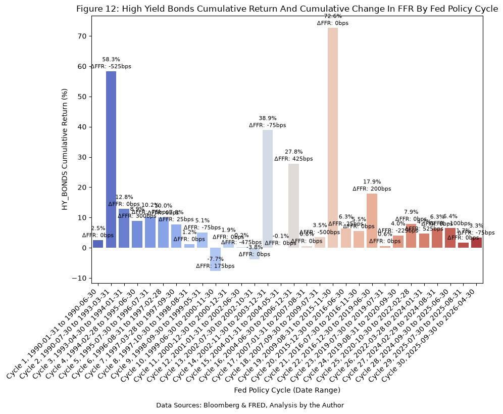
    


And then the annualized returns along with the annualized change in FFR:


```python
plot_bar_returns_ffr_change(
    cycle_df=hy_bonds_cycles,
    asset_label="HY_BONDS",
    annualized_or_cumulative="Annualized",
    title=f"Figure {next(figure_number)}: High Yield Bonds Annualized Return And Annualized Change In FFR By Fed Policy Cycle",
    caption="Data Sources: Bloomberg & FRED, Analysis by the Author",
)
```


    
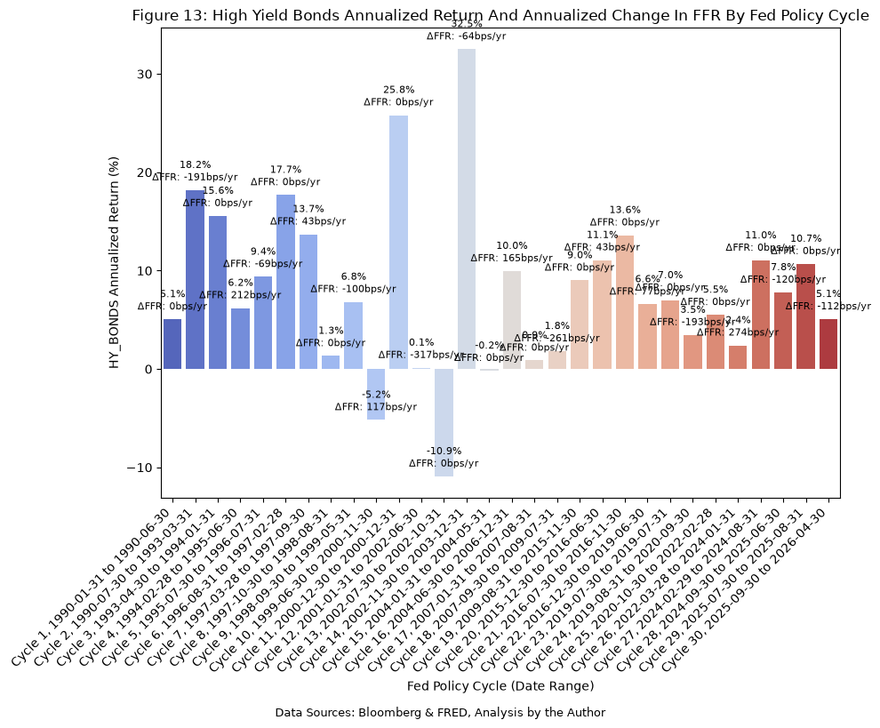
    


High yield behaves like a hybrid of the two asset classes above, which is what we would expect given that it carries both duration and credit risk. The largest drawdowns line up with credit events rather than with the FFR itself. Cycle 13 (mid-to-late 2002, the WorldCom/Enron aftermath) is the worst cycle in the sample at roughly -24% annualized despite no change in the FFR at all, and cycle 11 (late 2000) is similar, but also shorter in length. The strongest cycles, 14 (late 2002 through 2003) and 2 (1990-1993), are both recoveries which do coincide with easing.

Finally, we can run an OLS regression to check fit:


```python
model = run_regression(
    df=hy_bonds_cycles,
    x_plot_column="FFR_AnnualizedChange_bps",
    y_plot_column="AnnualizedReturnPct",
    regression_model="OLS-statsmodels",
    regression_constant=True,
)

print(model.summary())

# Pull the fitted coefficients by name
intercept = model.params["const"]
slope = model.params["FFR_AnnualizedChange_bps"]
print(f"Intercept: {intercept}, Slope: {slope}")

# Calc X and Y values for the regression line across the observed FFR range
X_vals = np.linspace(
    hy_bonds_cycles["FFR_AnnualizedChange_bps"].min(),
    hy_bonds_cycles["FFR_AnnualizedChange_bps"].max(),
    100,
)
Y_vals = intercept + slope * X_vals
```

                                 OLS Regression Results                            
    ===============================================================================
    Dep. Variable:     AnnualizedReturnPct   R-squared:                       0.001
    Model:                             OLS   Adj. R-squared:                 -0.035
    Method:                  Least Squares   F-statistic:                   0.02847
    Date:                 Wed, 11 Nov 2026   Prob (F-statistic):              0.867
    Time:                         14:17:03   Log-Likelihood:                -106.61
    No. Observations:                   30   AIC:                             217.2
    Df Residuals:                       28   BIC:                             220.0
    Df Model:                            1                                         
    Covariance Type:             nonrobust                                         
    ============================================================================================
                                   coef    std err          t      P>|t|      [0.025      0.975]
    --------------------------------------------------------------------------------------------
    const                        8.0241      1.612      4.977      0.000       4.722      11.327
    FFR_AnnualizedChange_bps    -0.0022      0.013     -0.169      0.867      -0.029       0.025
    ==============================================================================
    Omnibus:                        5.453   Durbin-Watson:                   2.706
    Prob(Omnibus):                  0.065   Jarque-Bera (JB):                3.861
    Skew:                           0.623   Prob(JB):                        0.145
    Kurtosis:                       4.239   Cond. No.                         125.
    ==============================================================================
    
    Notes:
    [1] Standard Errors assume that the covariance matrix of the errors is correctly specified.
    Intercept: 8.024141389636096, Slope: -0.0022011101986482897


And then plot the regression line along with the values:


```python
plot_scatter_regression_ffr_vs_returns(
    cycle_df=hy_bonds_cycles,
    asset_label="HY_BONDS",
    x_vals=X_vals,
    y_vals=Y_vals,
    intercept=intercept,
    slope=slope,
    title=f"Figure {next(figure_number)}: High Yield Bonds Annualized Return vs Annualized Change In FFR By Fed Policy Cycle",
    caption="Data Source: Bloomberg, FRED, Analysis by the Author",
)
```


    
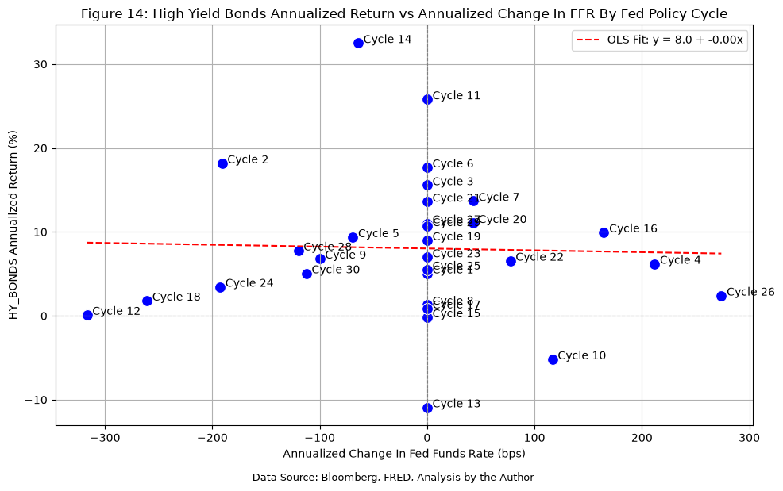
    


This is the weakest relationship of the four assets. The slope is slightly negative but the R-squared is effectively zero, so the annualized change in the FFR explains essentially none of the variation in high yield returns across cycles. Credit spreads, not the policy rate, are what drive this asset class.

### Gold

Finally, we'll run a similar process for gold using XAU_Gold USD Spot.


```python
bb_clean_data(
    base_directory=DATA_DIR,
    fund_ticker_name="XAU_Gold USD Spot",
    source="Bloomberg",
    asset_class="Commodities",
    excel_export=True,
    pickle_export=True,
    output_confirmation=False,
)

gold = load_data(
    base_directory=DATA_DIR,
    ticker="XAU_Gold USD Spot_Clean",
    source="Bloomberg",
    asset_class="Commodities",
    timeframe="Daily",
    file_format="pickle",
)

# The Bloomberg pickle stores the index as objects; convert to a nanosecond
# DatetimeIndex so it matches the FRED data in the merges further down
gold.index = pd.to_datetime(gold.index).astype("datetime64[ns]")

# Filter GOLD to date range
gold = gold[(gold.index >= pd.to_datetime(START_DATE)) & (gold.index <= pd.to_datetime(END_DATE))]

# Drop everything except the "close" column
gold = gold[["Close"]]

# Resample to monthly frequency
gold_monthly = gold.resample("ME").last()
gold_monthly["Monthly_Return"] = gold_monthly["Close"].pct_change()
gold_monthly = gold_monthly.dropna()

display(Markdown(f"Table {next(table_number)}: Gold Spot Price Monthly Close And Returns"))
display(gold_monthly)
```


Table 16: Gold Spot Price Monthly Close And Returns


<div>
<style scoped>
    .dataframe tbody tr th:only-of-type {
        vertical-align: middle;
    }

    .dataframe tbody tr th {
        vertical-align: top;
    }

    .dataframe thead th {
        text-align: right;
    }
</style>
<table border="1" class="dataframe">
  <thead>
    <tr style="text-align: right;">
      <th></th>
      <th>Close</th>
      <th>Monthly_Return</th>
    </tr>
    <tr>
      <th>Date</th>
      <th></th>
      <th></th>
    </tr>
  </thead>
  <tbody>
    <tr>
      <th>1990-01-31</th>
      <td>415.05</td>
      <td>0.03</td>
    </tr>
    <tr>
      <th>1990-02-28</th>
      <td>407.70</td>
      <td>-0.02</td>
    </tr>
    <tr>
      <th>1990-03-31</th>
      <td>368.50</td>
      <td>-0.10</td>
    </tr>
    <tr>
      <th>1990-04-30</th>
      <td>367.75</td>
      <td>-0.00</td>
    </tr>
    <tr>
      <th>1990-05-31</th>
      <td>363.05</td>
      <td>-0.01</td>
    </tr>
    <tr>
      <th>...</th>
      <td>...</td>
      <td>...</td>
    </tr>
    <tr>
      <th>2025-12-31</th>
      <td>4319.37</td>
      <td>0.02</td>
    </tr>
    <tr>
      <th>2026-01-31</th>
      <td>4894.23</td>
      <td>0.13</td>
    </tr>
    <tr>
      <th>2026-02-28</th>
      <td>5278.93</td>
      <td>0.08</td>
    </tr>
    <tr>
      <th>2026-03-31</th>
      <td>4668.06</td>
      <td>-0.12</td>
    </tr>
    <tr>
      <th>2026-04-30</th>
      <td>4617.85</td>
      <td>-0.01</td>
    </tr>
  </tbody>
</table>
<p>436 rows × 2 columns</p>
</div>


Next, we can plot the price history before calculating the cycle performance:


```python
plot_time_series(
    df=gold,
    plot_start_date=None,
    plot_end_date=None,
    plot_columns=["Close"],
    title=f"Figure {next(figure_number)}: XAU Gold USD Spot Daily Close Price",
    x_label="Date",
    x_format="Year",
    x_tick_spacing=2,
    x_tick_start=None,
    x_tick_rotation=30,
    y_label="Price ($)",
    y_format="Decimal",
    y_format_decimal_places=0,
    y_tick_spacing=400,
    y_tick_rotation=0,
    grid=True,
    legend=False,
    export_plot=False,
    plot_file_name=None,
    caption="Data Source: Bloomberg, Analysis by the Author",
)
```


    
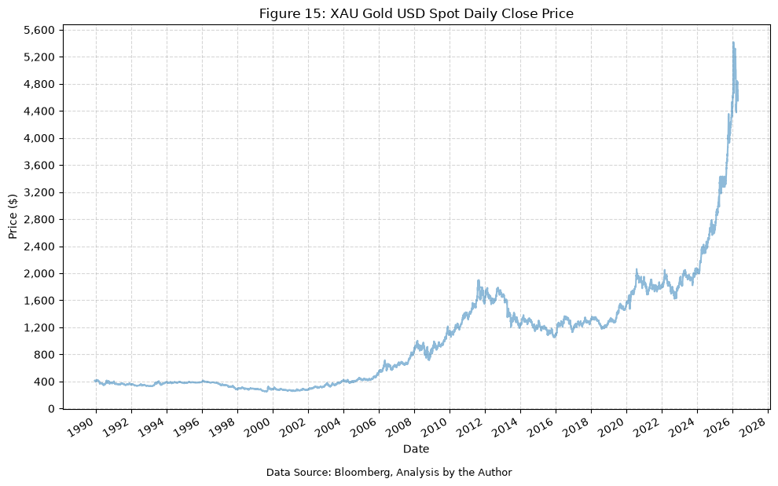
    


Finally, we will calculate the performance of gold based on the pre-defined Fed cycles:


```python
gold_cycles = calc_fed_cycle_asset_performance(
    start_date=cycle_ranges["adjusted_start_date"],
    end_date=cycle_ranges["end_date"],
    label=cycle_ranges["cycle_label"],
    fed_funds_change=cycle_ranges["fed_funds_change"],
    monthly_returns=gold_monthly,
)

display(Markdown(f"Table {next(table_number)}: Gold Spot Price Performance By Fed Policy Cycle"))
display(gold_cycles)
```


Table 17: Gold Spot Price Performance By Fed Policy Cycle


<div>
<style scoped>
    .dataframe tbody tr th:only-of-type {
        vertical-align: middle;
    }

    .dataframe tbody tr th {
        vertical-align: top;
    }

    .dataframe thead th {
        text-align: right;
    }
</style>
<table border="1" class="dataframe">
  <thead>
    <tr style="text-align: right;">
      <th></th>
      <th>Cycle</th>
      <th>Start</th>
      <th>End</th>
      <th>Months</th>
      <th>CumulativeReturn</th>
      <th>CumulativeReturnPct</th>
      <th>AverageMonthlyReturn</th>
      <th>AverageMonthlyReturnPct</th>
      <th>AnnualizedReturn</th>
      <th>AnnualizedReturnPct</th>
      <th>Volatility</th>
      <th>FedFundsChange</th>
      <th>FedFundsChange_bps</th>
      <th>FFR_AnnualizedChange</th>
      <th>FFR_AnnualizedChange_bps</th>
      <th>Label</th>
    </tr>
  </thead>
  <tbody>
    <tr>
      <th>0</th>
      <td>Cycle 1</td>
      <td>1990-01-31</td>
      <td>1990-06-30</td>
      <td>6</td>
      <td>-0.12</td>
      <td>-12.22</td>
      <td>-0.02</td>
      <td>-2.07</td>
      <td>-0.23</td>
      <td>-22.95</td>
      <td>0.15</td>
      <td>0.00</td>
      <td>0.00</td>
      <td>0.00</td>
      <td>0.00</td>
      <td>Cycle 1, 1990-01-31 to 1990-06-30</td>
    </tr>
    <tr>
      <th>1</th>
      <td>Cycle 2</td>
      <td>1990-07-30</td>
      <td>1993-03-31</td>
      <td>33</td>
      <td>-0.04</td>
      <td>-3.75</td>
      <td>-0.00</td>
      <td>-0.07</td>
      <td>-0.01</td>
      <td>-1.38</td>
      <td>0.10</td>
      <td>-0.05</td>
      <td>-525.00</td>
      <td>-0.02</td>
      <td>-190.91</td>
      <td>Cycle 2, 1990-07-30 to 1993-03-31</td>
    </tr>
    <tr>
      <th>2</th>
      <td>Cycle 3</td>
      <td>1993-04-30</td>
      <td>1994-01-31</td>
      <td>10</td>
      <td>0.13</td>
      <td>12.65</td>
      <td>0.01</td>
      <td>1.32</td>
      <td>0.15</td>
      <td>15.37</td>
      <td>0.18</td>
      <td>0.00</td>
      <td>0.00</td>
      <td>0.00</td>
      <td>0.00</td>
      <td>Cycle 3, 1993-04-30 to 1994-01-31</td>
    </tr>
    <tr>
      <th>3</th>
      <td>Cycle 4</td>
      <td>1994-02-28</td>
      <td>1995-06-30</td>
      <td>17</td>
      <td>0.01</td>
      <td>0.71</td>
      <td>0.00</td>
      <td>0.06</td>
      <td>0.00</td>
      <td>0.50</td>
      <td>0.07</td>
      <td>0.03</td>
      <td>300.00</td>
      <td>0.02</td>
      <td>211.76</td>
      <td>Cycle 4, 1994-02-28 to 1995-06-30</td>
    </tr>
    <tr>
      <th>4</th>
      <td>Cycle 5</td>
      <td>1995-07-30</td>
      <td>1996-07-31</td>
      <td>13</td>
      <td>0.01</td>
      <td>0.64</td>
      <td>0.00</td>
      <td>0.06</td>
      <td>0.01</td>
      <td>0.59</td>
      <td>0.06</td>
      <td>-0.01</td>
      <td>-75.00</td>
      <td>-0.01</td>
      <td>-69.23</td>
      <td>Cycle 5, 1995-07-30 to 1996-07-31</td>
    </tr>
    <tr>
      <th>5</th>
      <td>Cycle 6</td>
      <td>1996-08-31</td>
      <td>1997-02-28</td>
      <td>7</td>
      <td>-0.06</td>
      <td>-6.10</td>
      <td>-0.01</td>
      <td>-0.84</td>
      <td>-0.10</td>
      <td>-10.22</td>
      <td>0.12</td>
      <td>0.00</td>
      <td>0.00</td>
      <td>0.00</td>
      <td>0.00</td>
      <td>Cycle 6, 1996-08-31 to 1997-02-28</td>
    </tr>
    <tr>
      <th>6</th>
      <td>Cycle 7</td>
      <td>1997-03-28</td>
      <td>1997-09-30</td>
      <td>7</td>
      <td>-0.08</td>
      <td>-7.98</td>
      <td>-0.01</td>
      <td>-1.15</td>
      <td>-0.13</td>
      <td>-13.29</td>
      <td>0.09</td>
      <td>0.00</td>
      <td>25.00</td>
      <td>0.00</td>
      <td>42.86</td>
      <td>Cycle 7, 1997-03-28 to 1997-09-30</td>
    </tr>
    <tr>
      <th>7</th>
      <td>Cycle 8</td>
      <td>1997-10-30</td>
      <td>1998-08-31</td>
      <td>11</td>
      <td>-0.18</td>
      <td>-17.61</td>
      <td>-0.02</td>
      <td>-1.69</td>
      <td>-0.19</td>
      <td>-19.05</td>
      <td>0.12</td>
      <td>0.00</td>
      <td>0.00</td>
      <td>0.00</td>
      <td>0.00</td>
      <td>Cycle 8, 1997-10-30 to 1998-08-31</td>
    </tr>
    <tr>
      <th>8</th>
      <td>Cycle 9</td>
      <td>1998-09-30</td>
      <td>1999-05-31</td>
      <td>9</td>
      <td>-0.02</td>
      <td>-1.89</td>
      <td>-0.00</td>
      <td>-0.15</td>
      <td>-0.03</td>
      <td>-2.51</td>
      <td>0.13</td>
      <td>-0.01</td>
      <td>-75.00</td>
      <td>-0.01</td>
      <td>-100.00</td>
      <td>Cycle 9, 1998-09-30 to 1999-05-31</td>
    </tr>
    <tr>
      <th>9</th>
      <td>Cycle 10</td>
      <td>1999-06-30</td>
      <td>2000-11-30</td>
      <td>18</td>
      <td>0.00</td>
      <td>0.04</td>
      <td>0.00</td>
      <td>0.11</td>
      <td>0.00</td>
      <td>0.02</td>
      <td>0.17</td>
      <td>0.02</td>
      <td>175.00</td>
      <td>0.01</td>
      <td>116.67</td>
      <td>Cycle 10, 1999-06-30 to 2000-11-30</td>
    </tr>
    <tr>
      <th>10</th>
      <td>Cycle 11</td>
      <td>2000-12-30</td>
      <td>2000-12-31</td>
      <td>1</td>
      <td>0.01</td>
      <td>0.67</td>
      <td>0.01</td>
      <td>0.67</td>
      <td>0.08</td>
      <td>8.29</td>
      <td>NaN</td>
      <td>0.00</td>
      <td>0.00</td>
      <td>0.00</td>
      <td>0.00</td>
      <td>Cycle 11, 2000-12-30 to 2000-12-31</td>
    </tr>
    <tr>
      <th>11</th>
      <td>Cycle 12</td>
      <td>2001-01-31</td>
      <td>2002-06-30</td>
      <td>18</td>
      <td>0.16</td>
      <td>15.50</td>
      <td>0.01</td>
      <td>0.85</td>
      <td>0.10</td>
      <td>10.08</td>
      <td>0.11</td>
      <td>-0.05</td>
      <td>-475.00</td>
      <td>-0.03</td>
      <td>-316.67</td>
      <td>Cycle 12, 2001-01-31 to 2002-06-30</td>
    </tr>
    <tr>
      <th>12</th>
      <td>Cycle 13</td>
      <td>2002-07-30</td>
      <td>2002-10-31</td>
      <td>4</td>
      <td>0.01</td>
      <td>1.05</td>
      <td>0.00</td>
      <td>0.31</td>
      <td>0.03</td>
      <td>3.18</td>
      <td>0.12</td>
      <td>0.00</td>
      <td>0.00</td>
      <td>0.00</td>
      <td>0.00</td>
      <td>Cycle 13, 2002-07-30 to 2002-10-31</td>
    </tr>
    <tr>
      <th>13</th>
      <td>Cycle 14</td>
      <td>2002-11-30</td>
      <td>2003-12-31</td>
      <td>14</td>
      <td>0.31</td>
      <td>30.75</td>
      <td>0.02</td>
      <td>2.03</td>
      <td>0.26</td>
      <td>25.83</td>
      <td>0.16</td>
      <td>-0.01</td>
      <td>-75.00</td>
      <td>-0.01</td>
      <td>-64.29</td>
      <td>Cycle 14, 2002-11-30 to 2003-12-31</td>
    </tr>
    <tr>
      <th>14</th>
      <td>Cycle 15</td>
      <td>2004-01-31</td>
      <td>2004-05-31</td>
      <td>5</td>
      <td>-0.05</td>
      <td>-4.79</td>
      <td>-0.01</td>
      <td>-0.82</td>
      <td>-0.11</td>
      <td>-11.11</td>
      <td>0.22</td>
      <td>0.00</td>
      <td>0.00</td>
      <td>0.00</td>
      <td>0.00</td>
      <td>Cycle 15, 2004-01-31 to 2004-05-31</td>
    </tr>
    <tr>
      <th>15</th>
      <td>Cycle 16</td>
      <td>2004-06-30</td>
      <td>2006-12-31</td>
      <td>31</td>
      <td>0.61</td>
      <td>60.97</td>
      <td>0.02</td>
      <td>1.63</td>
      <td>0.20</td>
      <td>20.23</td>
      <td>0.15</td>
      <td>0.04</td>
      <td>425.00</td>
      <td>0.02</td>
      <td>164.52</td>
      <td>Cycle 16, 2004-06-30 to 2006-12-31</td>
    </tr>
    <tr>
      <th>16</th>
      <td>Cycle 17</td>
      <td>2007-01-31</td>
      <td>2007-08-31</td>
      <td>8</td>
      <td>0.06</td>
      <td>5.75</td>
      <td>0.01</td>
      <td>0.72</td>
      <td>0.09</td>
      <td>8.75</td>
      <td>0.07</td>
      <td>0.00</td>
      <td>0.00</td>
      <td>0.00</td>
      <td>0.00</td>
      <td>Cycle 17, 2007-01-31 to 2007-08-31</td>
    </tr>
    <tr>
      <th>17</th>
      <td>Cycle 18</td>
      <td>2007-09-30</td>
      <td>2009-07-31</td>
      <td>23</td>
      <td>0.42</td>
      <td>41.69</td>
      <td>0.02</td>
      <td>1.78</td>
      <td>0.20</td>
      <td>19.94</td>
      <td>0.25</td>
      <td>-0.05</td>
      <td>-500.00</td>
      <td>-0.03</td>
      <td>-260.87</td>
      <td>Cycle 18, 2007-09-30 to 2009-07-31</td>
    </tr>
    <tr>
      <th>18</th>
      <td>Cycle 19</td>
      <td>2009-08-31</td>
      <td>2015-11-30</td>
      <td>76</td>
      <td>0.12</td>
      <td>11.61</td>
      <td>0.00</td>
      <td>0.28</td>
      <td>0.02</td>
      <td>1.75</td>
      <td>0.18</td>
      <td>0.00</td>
      <td>0.00</td>
      <td>0.00</td>
      <td>0.00</td>
      <td>Cycle 19, 2009-08-31 to 2015-11-30</td>
    </tr>
    <tr>
      <th>19</th>
      <td>Cycle 20</td>
      <td>2015-12-30</td>
      <td>2016-06-30</td>
      <td>7</td>
      <td>0.24</td>
      <td>24.15</td>
      <td>0.03</td>
      <td>3.28</td>
      <td>0.45</td>
      <td>44.89</td>
      <td>0.20</td>
      <td>0.00</td>
      <td>25.00</td>
      <td>0.00</td>
      <td>42.86</td>
      <td>Cycle 20, 2015-12-30 to 2016-06-30</td>
    </tr>
    <tr>
      <th>20</th>
      <td>Cycle 21</td>
      <td>2016-07-30</td>
      <td>2016-11-30</td>
      <td>5</td>
      <td>-0.11</td>
      <td>-11.25</td>
      <td>-0.02</td>
      <td>-2.29</td>
      <td>-0.25</td>
      <td>-24.90</td>
      <td>0.14</td>
      <td>0.00</td>
      <td>0.00</td>
      <td>0.00</td>
      <td>0.00</td>
      <td>Cycle 21, 2016-07-30 to 2016-11-30</td>
    </tr>
    <tr>
      <th>21</th>
      <td>Cycle 22</td>
      <td>2016-12-30</td>
      <td>2019-06-30</td>
      <td>31</td>
      <td>0.20</td>
      <td>20.15</td>
      <td>0.01</td>
      <td>0.63</td>
      <td>0.07</td>
      <td>7.36</td>
      <td>0.09</td>
      <td>0.02</td>
      <td>200.00</td>
      <td>0.01</td>
      <td>77.42</td>
      <td>Cycle 22, 2016-12-30 to 2019-06-30</td>
    </tr>
    <tr>
      <th>22</th>
      <td>Cycle 23</td>
      <td>2019-07-30</td>
      <td>2019-07-31</td>
      <td>1</td>
      <td>0.00</td>
      <td>0.30</td>
      <td>0.00</td>
      <td>0.30</td>
      <td>0.04</td>
      <td>3.66</td>
      <td>NaN</td>
      <td>0.00</td>
      <td>0.00</td>
      <td>0.00</td>
      <td>0.00</td>
      <td>Cycle 23, 2019-07-30 to 2019-07-31</td>
    </tr>
    <tr>
      <th>23</th>
      <td>Cycle 24</td>
      <td>2019-08-31</td>
      <td>2020-09-30</td>
      <td>14</td>
      <td>0.33</td>
      <td>33.39</td>
      <td>0.02</td>
      <td>2.17</td>
      <td>0.28</td>
      <td>28.01</td>
      <td>0.15</td>
      <td>-0.02</td>
      <td>-225.00</td>
      <td>-0.02</td>
      <td>-192.86</td>
      <td>Cycle 24, 2019-08-31 to 2020-09-30</td>
    </tr>
    <tr>
      <th>24</th>
      <td>Cycle 25</td>
      <td>2020-10-30</td>
      <td>2022-02-28</td>
      <td>17</td>
      <td>0.01</td>
      <td>1.23</td>
      <td>0.00</td>
      <td>0.17</td>
      <td>0.01</td>
      <td>0.87</td>
      <td>0.15</td>
      <td>0.00</td>
      <td>0.00</td>
      <td>0.00</td>
      <td>0.00</td>
      <td>Cycle 25, 2020-10-30 to 2022-02-28</td>
    </tr>
    <tr>
      <th>25</th>
      <td>Cycle 26</td>
      <td>2022-03-28</td>
      <td>2024-01-31</td>
      <td>23</td>
      <td>0.07</td>
      <td>6.84</td>
      <td>0.00</td>
      <td>0.36</td>
      <td>0.04</td>
      <td>3.51</td>
      <td>0.14</td>
      <td>0.05</td>
      <td>525.00</td>
      <td>0.03</td>
      <td>273.91</td>
      <td>Cycle 26, 2022-03-28 to 2024-01-31</td>
    </tr>
    <tr>
      <th>26</th>
      <td>Cycle 27</td>
      <td>2024-02-29</td>
      <td>2024-08-31</td>
      <td>7</td>
      <td>0.23</td>
      <td>22.74</td>
      <td>0.03</td>
      <td>3.01</td>
      <td>0.42</td>
      <td>42.09</td>
      <td>0.11</td>
      <td>0.00</td>
      <td>0.00</td>
      <td>0.00</td>
      <td>0.00</td>
      <td>Cycle 27, 2024-02-29 to 2024-08-31</td>
    </tr>
    <tr>
      <th>27</th>
      <td>Cycle 28</td>
      <td>2024-09-30</td>
      <td>2025-06-30</td>
      <td>10</td>
      <td>0.32</td>
      <td>31.95</td>
      <td>0.03</td>
      <td>2.88</td>
      <td>0.39</td>
      <td>39.47</td>
      <td>0.14</td>
      <td>-0.01</td>
      <td>-100.00</td>
      <td>-0.01</td>
      <td>-120.00</td>
      <td>Cycle 28, 2024-09-30 to 2025-06-30</td>
    </tr>
    <tr>
      <th>28</th>
      <td>Cycle 29</td>
      <td>2025-07-30</td>
      <td>2025-08-31</td>
      <td>2</td>
      <td>0.04</td>
      <td>4.38</td>
      <td>0.02</td>
      <td>2.20</td>
      <td>0.29</td>
      <td>29.36</td>
      <td>0.13</td>
      <td>0.00</td>
      <td>0.00</td>
      <td>0.00</td>
      <td>0.00</td>
      <td>Cycle 29, 2025-07-30 to 2025-08-31</td>
    </tr>
    <tr>
      <th>29</th>
      <td>Cycle 30</td>
      <td>2025-09-30</td>
      <td>2026-04-30</td>
      <td>8</td>
      <td>0.34</td>
      <td>33.93</td>
      <td>0.04</td>
      <td>4.00</td>
      <td>0.55</td>
      <td>55.00</td>
      <td>0.27</td>
      <td>-0.01</td>
      <td>-75.00</td>
      <td>-0.01</td>
      <td>-112.50</td>
      <td>Cycle 30, 2025-09-30 to 2026-04-30</td>
    </tr>
  </tbody>
</table>
</div>


As with the previous asset classes, this gives us the per-cycle dates, month count, cumulative and annualized returns, volatility, and the cumulative and annualized change in the FFR.

From the above DataFrame, we can then plot the cumulative and annualized returns for each cycle in a bar chart. First, the cumulative returns along with the cumulative change in FFR:


```python
plot_bar_returns_ffr_change(
    cycle_df=gold_cycles,
    asset_label="GOLD",
    annualized_or_cumulative="Cumulative",
    title=f"Figure {next(figure_number)}: Gold Cumulative Return And Cumulative Change In FFR By Fed Policy Cycle",
    caption="Data Sources: Bloomberg & FRED, Analysis by the Author",
)
```


    
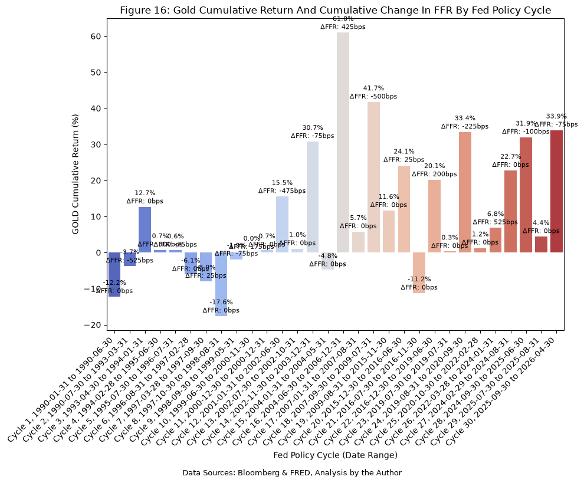
    


And then the annualized returns along with the annualized change in FFR:


```python
plot_bar_returns_ffr_change(
    cycle_df=gold_cycles,
    asset_label="GOLD",
    annualized_or_cumulative="Annualized",
    title=f"Figure {next(figure_number)}: Gold Annualized Return And Annualized Change In FFR By Fed Policy Cycle",
    caption="Data Sources: Bloomberg & FRED, Analysis by the Author",
)
```


    
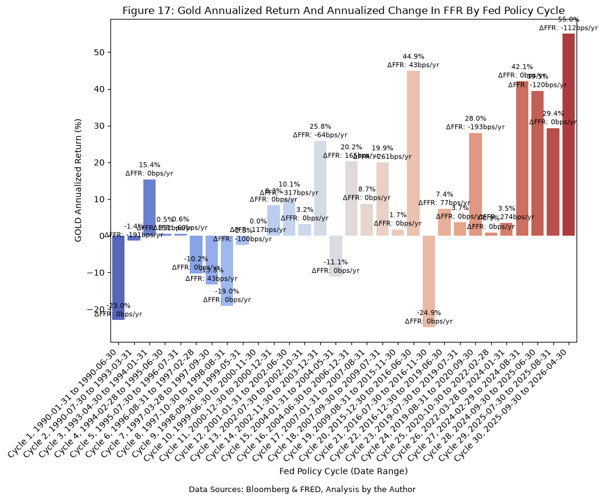
    


We see strong returns for gold across several different Fed cycles, so it is difficult to draw any kind of initial conclusion based on the bar charts. We see rate cuts in cycle 2, without a corresponding strong performance in gold, but cycles 14, 18, and 24 all have strong gold performance coinciding with easing.

Finally, we can run an OLS regression to check fit:


```python
model = run_regression(
    df=gold_cycles,
    x_plot_column="FFR_AnnualizedChange_bps",
    y_plot_column="AnnualizedReturnPct",
    regression_model="OLS-statsmodels",
    regression_constant=True,
)

print(model.summary())

# Pull the fitted coefficients by name
intercept = model.params["const"]
slope = model.params["FFR_AnnualizedChange_bps"]
print(f"Intercept: {intercept}, Slope: {slope}")

# Calc X and Y values for the regression line across the observed FFR range
X_vals = np.linspace(
    gold_cycles["FFR_AnnualizedChange_bps"].min(),
    gold_cycles["FFR_AnnualizedChange_bps"].max(),
    100,
)
Y_vals = intercept + slope * X_vals
```

                                 OLS Regression Results                            
    ===============================================================================
    Dep. Variable:     AnnualizedReturnPct   R-squared:                       0.044
    Model:                             OLS   Adj. R-squared:                  0.010
    Method:                  Least Squares   F-statistic:                     1.291
    Date:                 Wed, 11 Nov 2026   Prob (F-statistic):              0.266
    Time:                         14:17:05   Log-Likelihood:                -131.36
    No. Observations:                   30   AIC:                             266.7
    Df Residuals:                       28   BIC:                             269.5
    Df Model:                            1                                         
    Covariance Type:             nonrobust                                         
    ============================================================================================
                                   coef    std err          t      P>|t|      [0.025      0.975]
    --------------------------------------------------------------------------------------------
    const                        8.2173      3.679      2.234      0.034       0.681      15.753
    FFR_AnnualizedChange_bps    -0.0338      0.030     -1.136      0.266      -0.095       0.027
    ==============================================================================
    Omnibus:                        1.325   Durbin-Watson:                   1.381
    Prob(Omnibus):                  0.516   Jarque-Bera (JB):                1.168
    Skew:                           0.451   Prob(JB):                        0.558
    Kurtosis:                       2.652   Cond. No.                         125.
    ==============================================================================
    
    Notes:
    [1] Standard Errors assume that the covariance matrix of the errors is correctly specified.
    Intercept: 8.21727895986418, Slope: -0.03382356576285242


And then plot the regression line along with the values:


```python
plot_scatter_regression_ffr_vs_returns(
    cycle_df=gold_cycles,
    asset_label="GOLD",
    x_vals=X_vals,
    y_vals=Y_vals,
    intercept=intercept,
    slope=slope,
    title=f"Figure {next(figure_number)}: Gold Annualized Return vs Annualized Change In FFR By Fed Policy Cycle",
    caption="Data Source: Bloomberg, FRED, Analysis by the Author",
)
```


    
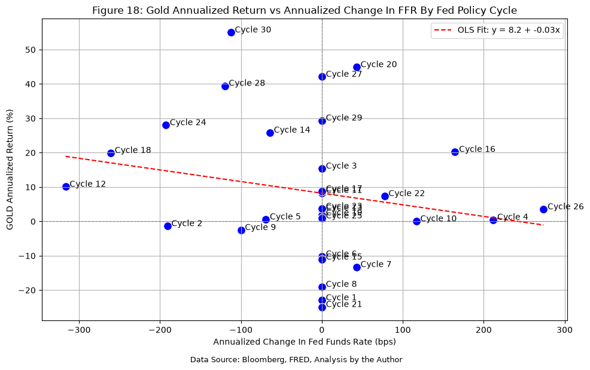
    


It's difficult to draw any strong conclusions with the above plot. Gold has traditionally been considered a hedge for inflation, and while one of the Fed's mandates is to manage inflation, there may not be a conclusion to draw in relationship to the historical returns that gold has exhibited.

## Asset Allocation

With the above analysis complete, let's look at how a portfolio would have allocated based on the data, and at the hypothetical historical results.

We will restrict the strategy to stocks and Treasuries. High yield showed essentially no relationship to the FFR (its R-squared was near zero, and its worst cycles were credit events that happened during flat-rate periods), and gold's relationship was weak enough that any rule built on it would be curve-fitting rather than economics.

We also have to be careful with our criteria for when to hold stocks versus bonds, as hindsight bias is certainly possible. So, without overanalyzing the results:

> **Let's assume that we hold stocks as the default position during tightening cycles, hold bonds during easing cycles when the Fed starts cutting rates, and resume holding stocks when the Fed stops cutting rates.**

Let's consider the `Extended Neutral` bucket. Assigning those months to stocks is not a neutral decision, because it covers 37% of the sample, and because it covers 2009-2015 and 2020-2021 it gives the strategy the two strongest equity runs in the record. As we will see below, that single bucket is the largest contributor to the strategy's total return.

We also have to be careful about *when* we are allowed to act on the signal. This is a similar discussion to matching the timing of economic data releases with the cycle labels, but we found that we could act on the 1st of the month following an FOMC decision, so we could use that following month's return.


```python
fedfunds_grouped_cycles['cycle_invested'] = fedfunds_grouped_cycles['cycle_filled']

display(Markdown(f"Table {next(table_number)}: Monthly Cycle Labels With Implementation"))
display(fedfunds_grouped_cycles.head(50))
```


Table 18: Monthly Cycle Labels With Implementation


<div>
<style scoped>
    .dataframe tbody tr th:only-of-type {
        vertical-align: middle;
    }

    .dataframe tbody tr th {
        vertical-align: top;
    }

    .dataframe thead th {
        text-align: right;
    }
</style>
<table border="1" class="dataframe">
  <thead>
    <tr style="text-align: right;">
      <th></th>
      <th>start_date</th>
      <th>fed_funds_start</th>
      <th>end_date</th>
      <th>fed_funds_end</th>
      <th>fed_funds_change</th>
      <th>cycle</th>
      <th>cycle_filled</th>
      <th>group</th>
      <th>cycle_invested</th>
    </tr>
  </thead>
  <tbody>
    <tr>
      <th>0</th>
      <td>1989-12-31</td>
      <td>0.08</td>
      <td>1990-01-31</td>
      <td>0.08</td>
      <td>0.00</td>
      <td>Neutral</td>
      <td>Extended Neutral</td>
      <td>1</td>
      <td>Extended Neutral</td>
    </tr>
    <tr>
      <th>1</th>
      <td>1990-01-31</td>
      <td>0.08</td>
      <td>1990-02-28</td>
      <td>0.08</td>
      <td>0.00</td>
      <td>Neutral</td>
      <td>Extended Neutral</td>
      <td>1</td>
      <td>Extended Neutral</td>
    </tr>
    <tr>
      <th>2</th>
      <td>1990-02-28</td>
      <td>0.08</td>
      <td>1990-03-31</td>
      <td>0.08</td>
      <td>0.00</td>
      <td>Neutral</td>
      <td>Extended Neutral</td>
      <td>1</td>
      <td>Extended Neutral</td>
    </tr>
    <tr>
      <th>3</th>
      <td>1990-03-31</td>
      <td>0.08</td>
      <td>1990-04-30</td>
      <td>0.08</td>
      <td>0.00</td>
      <td>Neutral</td>
      <td>Extended Neutral</td>
      <td>1</td>
      <td>Extended Neutral</td>
    </tr>
    <tr>
      <th>4</th>
      <td>1990-04-30</td>
      <td>0.08</td>
      <td>1990-05-31</td>
      <td>0.08</td>
      <td>0.00</td>
      <td>Neutral</td>
      <td>Extended Neutral</td>
      <td>1</td>
      <td>Extended Neutral</td>
    </tr>
    <tr>
      <th>5</th>
      <td>1990-05-31</td>
      <td>0.08</td>
      <td>1990-06-30</td>
      <td>0.08</td>
      <td>0.00</td>
      <td>Neutral</td>
      <td>Extended Neutral</td>
      <td>1</td>
      <td>Extended Neutral</td>
    </tr>
    <tr>
      <th>6</th>
      <td>1990-06-30</td>
      <td>0.08</td>
      <td>1990-07-31</td>
      <td>0.08</td>
      <td>-0.00</td>
      <td>Easing</td>
      <td>Easing</td>
      <td>2</td>
      <td>Easing</td>
    </tr>
    <tr>
      <th>7</th>
      <td>1990-07-31</td>
      <td>0.08</td>
      <td>1990-08-31</td>
      <td>0.08</td>
      <td>0.00</td>
      <td>Neutral</td>
      <td>Easing</td>
      <td>2</td>
      <td>Easing</td>
    </tr>
    <tr>
      <th>8</th>
      <td>1990-08-31</td>
      <td>0.08</td>
      <td>1990-09-30</td>
      <td>0.08</td>
      <td>0.00</td>
      <td>Neutral</td>
      <td>Easing</td>
      <td>2</td>
      <td>Easing</td>
    </tr>
    <tr>
      <th>9</th>
      <td>1990-09-30</td>
      <td>0.08</td>
      <td>1990-10-31</td>
      <td>0.08</td>
      <td>-0.00</td>
      <td>Easing</td>
      <td>Easing</td>
      <td>2</td>
      <td>Easing</td>
    </tr>
    <tr>
      <th>10</th>
      <td>1990-10-31</td>
      <td>0.08</td>
      <td>1990-11-30</td>
      <td>0.07</td>
      <td>-0.00</td>
      <td>Easing</td>
      <td>Easing</td>
      <td>2</td>
      <td>Easing</td>
    </tr>
    <tr>
      <th>11</th>
      <td>1990-11-30</td>
      <td>0.07</td>
      <td>1990-12-31</td>
      <td>0.07</td>
      <td>-0.00</td>
      <td>Easing</td>
      <td>Easing</td>
      <td>2</td>
      <td>Easing</td>
    </tr>
    <tr>
      <th>12</th>
      <td>1990-12-31</td>
      <td>0.07</td>
      <td>1991-01-31</td>
      <td>0.07</td>
      <td>-0.00</td>
      <td>Easing</td>
      <td>Easing</td>
      <td>2</td>
      <td>Easing</td>
    </tr>
    <tr>
      <th>13</th>
      <td>1991-01-31</td>
      <td>0.07</td>
      <td>1991-02-28</td>
      <td>0.06</td>
      <td>-0.01</td>
      <td>Easing</td>
      <td>Easing</td>
      <td>2</td>
      <td>Easing</td>
    </tr>
    <tr>
      <th>14</th>
      <td>1991-02-28</td>
      <td>0.06</td>
      <td>1991-03-31</td>
      <td>0.06</td>
      <td>-0.00</td>
      <td>Easing</td>
      <td>Easing</td>
      <td>2</td>
      <td>Easing</td>
    </tr>
    <tr>
      <th>15</th>
      <td>1991-03-31</td>
      <td>0.06</td>
      <td>1991-04-30</td>
      <td>0.06</td>
      <td>-0.00</td>
      <td>Easing</td>
      <td>Easing</td>
      <td>2</td>
      <td>Easing</td>
    </tr>
    <tr>
      <th>16</th>
      <td>1991-04-30</td>
      <td>0.06</td>
      <td>1991-05-31</td>
      <td>0.06</td>
      <td>0.00</td>
      <td>Neutral</td>
      <td>Easing</td>
      <td>2</td>
      <td>Easing</td>
    </tr>
    <tr>
      <th>17</th>
      <td>1991-05-31</td>
      <td>0.06</td>
      <td>1991-06-30</td>
      <td>0.06</td>
      <td>0.00</td>
      <td>Neutral</td>
      <td>Easing</td>
      <td>2</td>
      <td>Easing</td>
    </tr>
    <tr>
      <th>18</th>
      <td>1991-06-30</td>
      <td>0.06</td>
      <td>1991-07-31</td>
      <td>0.06</td>
      <td>0.00</td>
      <td>Neutral</td>
      <td>Easing</td>
      <td>2</td>
      <td>Easing</td>
    </tr>
    <tr>
      <th>19</th>
      <td>1991-07-31</td>
      <td>0.06</td>
      <td>1991-08-31</td>
      <td>0.06</td>
      <td>-0.00</td>
      <td>Easing</td>
      <td>Easing</td>
      <td>2</td>
      <td>Easing</td>
    </tr>
    <tr>
      <th>20</th>
      <td>1991-08-31</td>
      <td>0.06</td>
      <td>1991-09-30</td>
      <td>0.05</td>
      <td>-0.00</td>
      <td>Easing</td>
      <td>Easing</td>
      <td>2</td>
      <td>Easing</td>
    </tr>
    <tr>
      <th>21</th>
      <td>1991-09-30</td>
      <td>0.05</td>
      <td>1991-10-31</td>
      <td>0.05</td>
      <td>-0.00</td>
      <td>Easing</td>
      <td>Easing</td>
      <td>2</td>
      <td>Easing</td>
    </tr>
    <tr>
      <th>22</th>
      <td>1991-10-31</td>
      <td>0.05</td>
      <td>1991-11-30</td>
      <td>0.05</td>
      <td>-0.00</td>
      <td>Easing</td>
      <td>Easing</td>
      <td>2</td>
      <td>Easing</td>
    </tr>
    <tr>
      <th>23</th>
      <td>1991-11-30</td>
      <td>0.05</td>
      <td>1991-12-31</td>
      <td>0.04</td>
      <td>-0.01</td>
      <td>Easing</td>
      <td>Easing</td>
      <td>2</td>
      <td>Easing</td>
    </tr>
    <tr>
      <th>24</th>
      <td>1991-12-31</td>
      <td>0.04</td>
      <td>1992-01-31</td>
      <td>0.04</td>
      <td>0.00</td>
      <td>Neutral</td>
      <td>Easing</td>
      <td>2</td>
      <td>Easing</td>
    </tr>
    <tr>
      <th>25</th>
      <td>1992-01-31</td>
      <td>0.04</td>
      <td>1992-02-29</td>
      <td>0.04</td>
      <td>0.00</td>
      <td>Neutral</td>
      <td>Easing</td>
      <td>2</td>
      <td>Easing</td>
    </tr>
    <tr>
      <th>26</th>
      <td>1992-02-29</td>
      <td>0.04</td>
      <td>1992-03-31</td>
      <td>0.04</td>
      <td>0.00</td>
      <td>Neutral</td>
      <td>Easing</td>
      <td>2</td>
      <td>Easing</td>
    </tr>
    <tr>
      <th>27</th>
      <td>1992-03-31</td>
      <td>0.04</td>
      <td>1992-04-30</td>
      <td>0.04</td>
      <td>-0.00</td>
      <td>Easing</td>
      <td>Easing</td>
      <td>2</td>
      <td>Easing</td>
    </tr>
    <tr>
      <th>28</th>
      <td>1992-04-30</td>
      <td>0.04</td>
      <td>1992-05-31</td>
      <td>0.04</td>
      <td>0.00</td>
      <td>Neutral</td>
      <td>Easing</td>
      <td>2</td>
      <td>Easing</td>
    </tr>
    <tr>
      <th>29</th>
      <td>1992-05-31</td>
      <td>0.04</td>
      <td>1992-06-30</td>
      <td>0.04</td>
      <td>0.00</td>
      <td>Neutral</td>
      <td>Easing</td>
      <td>2</td>
      <td>Easing</td>
    </tr>
    <tr>
      <th>30</th>
      <td>1992-06-30</td>
      <td>0.04</td>
      <td>1992-07-31</td>
      <td>0.03</td>
      <td>-0.00</td>
      <td>Easing</td>
      <td>Easing</td>
      <td>2</td>
      <td>Easing</td>
    </tr>
    <tr>
      <th>31</th>
      <td>1992-07-31</td>
      <td>0.03</td>
      <td>1992-08-31</td>
      <td>0.03</td>
      <td>0.00</td>
      <td>Neutral</td>
      <td>Easing</td>
      <td>2</td>
      <td>Easing</td>
    </tr>
    <tr>
      <th>32</th>
      <td>1992-08-31</td>
      <td>0.03</td>
      <td>1992-09-30</td>
      <td>0.03</td>
      <td>-0.00</td>
      <td>Easing</td>
      <td>Easing</td>
      <td>2</td>
      <td>Easing</td>
    </tr>
    <tr>
      <th>33</th>
      <td>1992-09-30</td>
      <td>0.03</td>
      <td>1992-10-31</td>
      <td>0.03</td>
      <td>0.00</td>
      <td>Neutral</td>
      <td>Easing</td>
      <td>2</td>
      <td>Easing</td>
    </tr>
    <tr>
      <th>34</th>
      <td>1992-10-31</td>
      <td>0.03</td>
      <td>1992-11-30</td>
      <td>0.03</td>
      <td>0.00</td>
      <td>Neutral</td>
      <td>Easing</td>
      <td>2</td>
      <td>Easing</td>
    </tr>
    <tr>
      <th>35</th>
      <td>1992-11-30</td>
      <td>0.03</td>
      <td>1992-12-31</td>
      <td>0.03</td>
      <td>0.00</td>
      <td>Neutral</td>
      <td>Easing</td>
      <td>2</td>
      <td>Easing</td>
    </tr>
    <tr>
      <th>36</th>
      <td>1992-12-31</td>
      <td>0.03</td>
      <td>1993-01-31</td>
      <td>0.03</td>
      <td>0.00</td>
      <td>Neutral</td>
      <td>Easing</td>
      <td>2</td>
      <td>Easing</td>
    </tr>
    <tr>
      <th>37</th>
      <td>1993-01-31</td>
      <td>0.03</td>
      <td>1993-02-28</td>
      <td>0.03</td>
      <td>0.00</td>
      <td>Neutral</td>
      <td>Easing</td>
      <td>2</td>
      <td>Easing</td>
    </tr>
    <tr>
      <th>38</th>
      <td>1993-02-28</td>
      <td>0.03</td>
      <td>1993-03-31</td>
      <td>0.03</td>
      <td>0.00</td>
      <td>Neutral</td>
      <td>Easing</td>
      <td>2</td>
      <td>Easing</td>
    </tr>
    <tr>
      <th>39</th>
      <td>1993-03-31</td>
      <td>0.03</td>
      <td>1993-04-30</td>
      <td>0.03</td>
      <td>0.00</td>
      <td>Neutral</td>
      <td>Extended Neutral</td>
      <td>3</td>
      <td>Extended Neutral</td>
    </tr>
    <tr>
      <th>40</th>
      <td>1993-04-30</td>
      <td>0.03</td>
      <td>1993-05-31</td>
      <td>0.03</td>
      <td>0.00</td>
      <td>Neutral</td>
      <td>Extended Neutral</td>
      <td>3</td>
      <td>Extended Neutral</td>
    </tr>
    <tr>
      <th>41</th>
      <td>1993-05-31</td>
      <td>0.03</td>
      <td>1993-06-30</td>
      <td>0.03</td>
      <td>0.00</td>
      <td>Neutral</td>
      <td>Extended Neutral</td>
      <td>3</td>
      <td>Extended Neutral</td>
    </tr>
    <tr>
      <th>42</th>
      <td>1993-06-30</td>
      <td>0.03</td>
      <td>1993-07-31</td>
      <td>0.03</td>
      <td>0.00</td>
      <td>Neutral</td>
      <td>Extended Neutral</td>
      <td>3</td>
      <td>Extended Neutral</td>
    </tr>
    <tr>
      <th>43</th>
      <td>1993-07-31</td>
      <td>0.03</td>
      <td>1993-08-31</td>
      <td>0.03</td>
      <td>0.00</td>
      <td>Neutral</td>
      <td>Extended Neutral</td>
      <td>3</td>
      <td>Extended Neutral</td>
    </tr>
    <tr>
      <th>44</th>
      <td>1993-08-31</td>
      <td>0.03</td>
      <td>1993-09-30</td>
      <td>0.03</td>
      <td>0.00</td>
      <td>Neutral</td>
      <td>Extended Neutral</td>
      <td>3</td>
      <td>Extended Neutral</td>
    </tr>
    <tr>
      <th>45</th>
      <td>1993-09-30</td>
      <td>0.03</td>
      <td>1993-10-31</td>
      <td>0.03</td>
      <td>0.00</td>
      <td>Neutral</td>
      <td>Extended Neutral</td>
      <td>3</td>
      <td>Extended Neutral</td>
    </tr>
    <tr>
      <th>46</th>
      <td>1993-10-31</td>
      <td>0.03</td>
      <td>1993-11-30</td>
      <td>0.03</td>
      <td>0.00</td>
      <td>Neutral</td>
      <td>Extended Neutral</td>
      <td>3</td>
      <td>Extended Neutral</td>
    </tr>
    <tr>
      <th>47</th>
      <td>1993-11-30</td>
      <td>0.03</td>
      <td>1993-12-31</td>
      <td>0.03</td>
      <td>0.00</td>
      <td>Neutral</td>
      <td>Extended Neutral</td>
      <td>3</td>
      <td>Extended Neutral</td>
    </tr>
    <tr>
      <th>48</th>
      <td>1993-12-31</td>
      <td>0.03</td>
      <td>1994-01-31</td>
      <td>0.03</td>
      <td>0.00</td>
      <td>Neutral</td>
      <td>Extended Neutral</td>
      <td>3</td>
      <td>Extended Neutral</td>
    </tr>
    <tr>
      <th>49</th>
      <td>1994-01-31</td>
      <td>0.03</td>
      <td>1994-02-28</td>
      <td>0.03</td>
      <td>0.00</td>
      <td>Tightening</td>
      <td>Tightening</td>
      <td>4</td>
      <td>Tightening</td>
    </tr>
  </tbody>
</table>
</div>


Now, we can merge the monthly returns for each asset class with the group, based on cycle invested.


```python
# Reset index to merge on date
stocks_merged = pd.merge_asof(
    spxt_monthly.reset_index(),
    fedfunds_grouped_cycles[['start_date', 'end_date', 'cycle_invested', 'group']].dropna(),
    left_on='Date',
    right_on='end_date',
    direction='backward'
)

# Drop rows where the date falls outside the cycle's end_date
stocks_merged = stocks_merged[stocks_merged['Date'] <= stocks_merged['end_date']]
stocks_merged = stocks_merged[["Date", "Monthly_Return", "cycle_invested", "group"]]

display(Markdown(f"Table {next(table_number)}: SPXT Monthly Returns Merged With Cycle Labels"))
display(stocks_merged.head(15))
```


Table 19: SPXT Monthly Returns Merged With Cycle Labels


<div>
<style scoped>
    .dataframe tbody tr th:only-of-type {
        vertical-align: middle;
    }

    .dataframe tbody tr th {
        vertical-align: top;
    }

    .dataframe thead th {
        text-align: right;
    }
</style>
<table border="1" class="dataframe">
  <thead>
    <tr style="text-align: right;">
      <th></th>
      <th>Date</th>
      <th>Monthly_Return</th>
      <th>cycle_invested</th>
      <th>group</th>
    </tr>
  </thead>
  <tbody>
    <tr>
      <th>0</th>
      <td>1990-01-31</td>
      <td>-0.07</td>
      <td>Extended Neutral</td>
      <td>1</td>
    </tr>
    <tr>
      <th>1</th>
      <td>1990-02-28</td>
      <td>0.01</td>
      <td>Extended Neutral</td>
      <td>1</td>
    </tr>
    <tr>
      <th>2</th>
      <td>1990-03-31</td>
      <td>0.03</td>
      <td>Extended Neutral</td>
      <td>1</td>
    </tr>
    <tr>
      <th>3</th>
      <td>1990-04-30</td>
      <td>-0.02</td>
      <td>Extended Neutral</td>
      <td>1</td>
    </tr>
    <tr>
      <th>4</th>
      <td>1990-05-31</td>
      <td>0.10</td>
      <td>Extended Neutral</td>
      <td>1</td>
    </tr>
    <tr>
      <th>5</th>
      <td>1990-06-30</td>
      <td>-0.01</td>
      <td>Extended Neutral</td>
      <td>1</td>
    </tr>
    <tr>
      <th>6</th>
      <td>1990-07-31</td>
      <td>-0.00</td>
      <td>Easing</td>
      <td>2</td>
    </tr>
    <tr>
      <th>7</th>
      <td>1990-08-31</td>
      <td>-0.09</td>
      <td>Easing</td>
      <td>2</td>
    </tr>
    <tr>
      <th>8</th>
      <td>1990-09-30</td>
      <td>-0.05</td>
      <td>Easing</td>
      <td>2</td>
    </tr>
    <tr>
      <th>9</th>
      <td>1990-10-31</td>
      <td>-0.00</td>
      <td>Easing</td>
      <td>2</td>
    </tr>
    <tr>
      <th>10</th>
      <td>1990-11-30</td>
      <td>0.06</td>
      <td>Easing</td>
      <td>2</td>
    </tr>
    <tr>
      <th>11</th>
      <td>1990-12-31</td>
      <td>0.03</td>
      <td>Easing</td>
      <td>2</td>
    </tr>
    <tr>
      <th>12</th>
      <td>1991-01-31</td>
      <td>0.04</td>
      <td>Easing</td>
      <td>2</td>
    </tr>
    <tr>
      <th>13</th>
      <td>1991-02-28</td>
      <td>0.07</td>
      <td>Easing</td>
      <td>2</td>
    </tr>
    <tr>
      <th>14</th>
      <td>1991-03-31</td>
      <td>0.02</td>
      <td>Easing</td>
      <td>2</td>
    </tr>
  </tbody>
</table>
</div>


```python
# Reset index to merge on date
bonds_merged = pd.merge_asof(
    treas_10y_monthly.reset_index(),
    fedfunds_grouped_cycles[['start_date', 'end_date', 'cycle_invested', 'group']].dropna(),
    left_on='Date',
    right_on='end_date',
    direction='backward'
)

# Drop rows where the date falls outside the cycle's end_date
bonds_merged = bonds_merged[bonds_merged['Date'] <= bonds_merged['end_date']]
bonds_merged = bonds_merged[["Date", "Monthly_Return", "cycle_invested", "group"]]

display(Markdown(f"Table {next(table_number)}: 10Y Treasury Monthly Returns Merged With Cycle Labels"))
display(bonds_merged.head(15))
```


Table 20: 10Y Treasury Monthly Returns Merged With Cycle Labels


<div>
<style scoped>
    .dataframe tbody tr th:only-of-type {
        vertical-align: middle;
    }

    .dataframe tbody tr th {
        vertical-align: top;
    }

    .dataframe thead th {
        text-align: right;
    }
</style>
<table border="1" class="dataframe">
  <thead>
    <tr style="text-align: right;">
      <th></th>
      <th>Date</th>
      <th>Monthly_Return</th>
      <th>cycle_invested</th>
      <th>group</th>
    </tr>
  </thead>
  <tbody>
    <tr>
      <th>0</th>
      <td>1990-01-31</td>
      <td>-0.02</td>
      <td>Extended Neutral</td>
      <td>1</td>
    </tr>
    <tr>
      <th>1</th>
      <td>1990-02-28</td>
      <td>-0.00</td>
      <td>Extended Neutral</td>
      <td>1</td>
    </tr>
    <tr>
      <th>2</th>
      <td>1990-03-31</td>
      <td>-0.00</td>
      <td>Extended Neutral</td>
      <td>1</td>
    </tr>
    <tr>
      <th>3</th>
      <td>1990-04-30</td>
      <td>-0.01</td>
      <td>Extended Neutral</td>
      <td>1</td>
    </tr>
    <tr>
      <th>4</th>
      <td>1990-05-31</td>
      <td>0.03</td>
      <td>Extended Neutral</td>
      <td>1</td>
    </tr>
    <tr>
      <th>5</th>
      <td>1990-06-30</td>
      <td>0.02</td>
      <td>Extended Neutral</td>
      <td>1</td>
    </tr>
    <tr>
      <th>6</th>
      <td>1990-07-31</td>
      <td>0.01</td>
      <td>Easing</td>
      <td>2</td>
    </tr>
    <tr>
      <th>7</th>
      <td>1990-08-31</td>
      <td>-0.02</td>
      <td>Easing</td>
      <td>2</td>
    </tr>
    <tr>
      <th>8</th>
      <td>1990-09-30</td>
      <td>0.01</td>
      <td>Easing</td>
      <td>2</td>
    </tr>
    <tr>
      <th>9</th>
      <td>1990-10-31</td>
      <td>0.02</td>
      <td>Easing</td>
      <td>2</td>
    </tr>
    <tr>
      <th>10</th>
      <td>1990-11-30</td>
      <td>0.03</td>
      <td>Easing</td>
      <td>2</td>
    </tr>
    <tr>
      <th>11</th>
      <td>1990-12-31</td>
      <td>0.02</td>
      <td>Easing</td>
      <td>2</td>
    </tr>
    <tr>
      <th>12</th>
      <td>1991-01-31</td>
      <td>0.01</td>
      <td>Easing</td>
      <td>2</td>
    </tr>
    <tr>
      <th>13</th>
      <td>1991-02-28</td>
      <td>0.01</td>
      <td>Easing</td>
      <td>2</td>
    </tr>
    <tr>
      <th>14</th>
      <td>1991-03-31</td>
      <td>0.00</td>
      <td>Easing</td>
      <td>2</td>
    </tr>
  </tbody>
</table>
</div>


And then compress the monthly returns for each cycle together to calculate the cumulative return.


```python
# Select the appropriate return based on cycle
stocks_merged['strategy_return'] = stocks_merged.apply(
    lambda row: row['Monthly_Return'] if row['cycle_invested'] in ['Tightening', 'Extended Neutral'] else None,
    axis=1
)

bonds_merged['strategy_return'] = bonds_merged.apply(
    lambda row: row['Monthly_Return'] if row['cycle_invested'] == 'Easing' else None,
    axis=1
)

# Combine
strategy = pd.concat([stocks_merged, bonds_merged]).dropna(subset=['strategy_return'])
strategy = strategy.sort_values('Date')

display(Markdown(f"Table {next(table_number)}: Strategy Monthly Returns, First 20 Months"))
display(strategy.head(20))
```


Table 21: Strategy Monthly Returns, First 20 Months


<div>
<style scoped>
    .dataframe tbody tr th:only-of-type {
        vertical-align: middle;
    }

    .dataframe tbody tr th {
        vertical-align: top;
    }

    .dataframe thead th {
        text-align: right;
    }
</style>
<table border="1" class="dataframe">
  <thead>
    <tr style="text-align: right;">
      <th></th>
      <th>Date</th>
      <th>Monthly_Return</th>
      <th>cycle_invested</th>
      <th>group</th>
      <th>strategy_return</th>
    </tr>
  </thead>
  <tbody>
    <tr>
      <th>0</th>
      <td>1990-01-31</td>
      <td>-0.07</td>
      <td>Extended Neutral</td>
      <td>1</td>
      <td>-0.07</td>
    </tr>
    <tr>
      <th>1</th>
      <td>1990-02-28</td>
      <td>0.01</td>
      <td>Extended Neutral</td>
      <td>1</td>
      <td>0.01</td>
    </tr>
    <tr>
      <th>2</th>
      <td>1990-03-31</td>
      <td>0.03</td>
      <td>Extended Neutral</td>
      <td>1</td>
      <td>0.03</td>
    </tr>
    <tr>
      <th>3</th>
      <td>1990-04-30</td>
      <td>-0.02</td>
      <td>Extended Neutral</td>
      <td>1</td>
      <td>-0.02</td>
    </tr>
    <tr>
      <th>4</th>
      <td>1990-05-31</td>
      <td>0.10</td>
      <td>Extended Neutral</td>
      <td>1</td>
      <td>0.10</td>
    </tr>
    <tr>
      <th>5</th>
      <td>1990-06-30</td>
      <td>-0.01</td>
      <td>Extended Neutral</td>
      <td>1</td>
      <td>-0.01</td>
    </tr>
    <tr>
      <th>6</th>
      <td>1990-07-31</td>
      <td>0.01</td>
      <td>Easing</td>
      <td>2</td>
      <td>0.01</td>
    </tr>
    <tr>
      <th>7</th>
      <td>1990-08-31</td>
      <td>-0.02</td>
      <td>Easing</td>
      <td>2</td>
      <td>-0.02</td>
    </tr>
    <tr>
      <th>8</th>
      <td>1990-09-30</td>
      <td>0.01</td>
      <td>Easing</td>
      <td>2</td>
      <td>0.01</td>
    </tr>
    <tr>
      <th>9</th>
      <td>1990-10-31</td>
      <td>0.02</td>
      <td>Easing</td>
      <td>2</td>
      <td>0.02</td>
    </tr>
    <tr>
      <th>10</th>
      <td>1990-11-30</td>
      <td>0.03</td>
      <td>Easing</td>
      <td>2</td>
      <td>0.03</td>
    </tr>
    <tr>
      <th>11</th>
      <td>1990-12-31</td>
      <td>0.02</td>
      <td>Easing</td>
      <td>2</td>
      <td>0.02</td>
    </tr>
    <tr>
      <th>12</th>
      <td>1991-01-31</td>
      <td>0.01</td>
      <td>Easing</td>
      <td>2</td>
      <td>0.01</td>
    </tr>
    <tr>
      <th>13</th>
      <td>1991-02-28</td>
      <td>0.01</td>
      <td>Easing</td>
      <td>2</td>
      <td>0.01</td>
    </tr>
    <tr>
      <th>14</th>
      <td>1991-03-31</td>
      <td>0.00</td>
      <td>Easing</td>
      <td>2</td>
      <td>0.00</td>
    </tr>
    <tr>
      <th>15</th>
      <td>1991-04-30</td>
      <td>0.01</td>
      <td>Easing</td>
      <td>2</td>
      <td>0.01</td>
    </tr>
    <tr>
      <th>16</th>
      <td>1991-05-31</td>
      <td>0.00</td>
      <td>Easing</td>
      <td>2</td>
      <td>0.00</td>
    </tr>
    <tr>
      <th>17</th>
      <td>1991-06-30</td>
      <td>-0.01</td>
      <td>Easing</td>
      <td>2</td>
      <td>-0.01</td>
    </tr>
    <tr>
      <th>18</th>
      <td>1991-07-31</td>
      <td>0.01</td>
      <td>Easing</td>
      <td>2</td>
      <td>0.01</td>
    </tr>
    <tr>
      <th>19</th>
      <td>1991-08-31</td>
      <td>0.03</td>
      <td>Easing</td>
      <td>2</td>
      <td>0.03</td>
    </tr>
  </tbody>
</table>
</div>


```python
# Calculate cumulative returns and drawdown for spxt
spxt_monthly['Cumulative_Return'] = (1 + spxt_monthly['Monthly_Return']).cumprod() - 1
spxt_monthly['Cumulative_Return_Plus_One'] = 1 + spxt_monthly['Cumulative_Return']
spxt_monthly['Rolling_Max'] = spxt_monthly['Cumulative_Return_Plus_One'].cummax()
spxt_monthly['Drawdown'] = spxt_monthly['Cumulative_Return_Plus_One'] / spxt_monthly['Rolling_Max'] - 1
spxt_monthly.drop(columns=['Cumulative_Return_Plus_One', 'Rolling_Max'], inplace=True)

# Calculate cumulative returns and drawdown for treas_10y
treas_10y_monthly['Cumulative_Return'] = (1 + treas_10y_monthly['Monthly_Return']).cumprod() - 1
treas_10y_monthly['Cumulative_Return_Plus_One'] = 1 + treas_10y_monthly['Cumulative_Return']
treas_10y_monthly['Rolling_Max'] = treas_10y_monthly['Cumulative_Return_Plus_One'].cummax()
treas_10y_monthly['Drawdown'] = treas_10y_monthly['Cumulative_Return_Plus_One'] / treas_10y_monthly['Rolling_Max'] - 1
treas_10y_monthly.drop(columns=['Cumulative_Return_Plus_One', 'Rolling_Max'], inplace=True)

# Convert to DataFrame
portfolio_monthly = strategy[['Date', 'strategy_return']].copy().set_index('Date')
portfolio_monthly = portfolio_monthly.rename(columns={'strategy_return': 'Portfolio_Monthly_Return'})

# Calculate cumulative returns and drawdown for the portfolio
portfolio_monthly['Portfolio_Cumulative_Return'] = (1 + portfolio_monthly['Portfolio_Monthly_Return']).cumprod() - 1
portfolio_monthly['Portfolio_Cumulative_Return_Plus_One'] = 1 + portfolio_monthly['Portfolio_Cumulative_Return']
portfolio_monthly['Portfolio_Rolling_Max'] = portfolio_monthly['Portfolio_Cumulative_Return_Plus_One'].cummax()
portfolio_monthly['Portfolio_Drawdown'] = portfolio_monthly['Portfolio_Cumulative_Return_Plus_One'] / portfolio_monthly['Portfolio_Rolling_Max'] - 1
portfolio_monthly.drop(columns=['Portfolio_Cumulative_Return_Plus_One', 'Portfolio_Rolling_Max'], inplace=True)

# Merge "spxt_monthly" and "treas_10y_monthly" into "portfolio_monthly" to compare cumulative returns
portfolio_monthly = portfolio_monthly.join(
    spxt_monthly['Monthly_Return'].rename('SPXT_Monthly_Return'),
    how='left'
).join(
    spxt_monthly['Cumulative_Return'].rename('SPXT_Cumulative_Return'),
    how='left'
).join(
    spxt_monthly['Drawdown'].rename('SPXT_Drawdown'),
    how='left'
).join(
    treas_10y_monthly['Monthly_Return'].rename('10Y_Monthly_Return'),
    how='left'
).join(
    treas_10y_monthly['Cumulative_Return'].rename('10Y_Cumulative_Return'),
    how='left'
).join(
    treas_10y_monthly['Drawdown'].rename('10Y_Drawdown'),
    how='left'
)

display(Markdown(f"Table {next(table_number)}: Portfolio, SPXT, And 10Y Monthly Returns, Cumulative Returns, And Drawdowns"))
display(portfolio_monthly)
```


Table 22: Portfolio, SPXT, And 10Y Monthly Returns, Cumulative Returns, And Drawdowns


<div>
<style scoped>
    .dataframe tbody tr th:only-of-type {
        vertical-align: middle;
    }

    .dataframe tbody tr th {
        vertical-align: top;
    }

    .dataframe thead th {
        text-align: right;
    }
</style>
<table border="1" class="dataframe">
  <thead>
    <tr style="text-align: right;">
      <th></th>
      <th>Portfolio_Monthly_Return</th>
      <th>Portfolio_Cumulative_Return</th>
      <th>Portfolio_Drawdown</th>
      <th>SPXT_Monthly_Return</th>
      <th>SPXT_Cumulative_Return</th>
      <th>SPXT_Drawdown</th>
      <th>10Y_Monthly_Return</th>
      <th>10Y_Cumulative_Return</th>
      <th>10Y_Drawdown</th>
    </tr>
    <tr>
      <th>Date</th>
      <th></th>
      <th></th>
      <th></th>
      <th></th>
      <th></th>
      <th></th>
      <th></th>
      <th></th>
      <th></th>
    </tr>
  </thead>
  <tbody>
    <tr>
      <th>1990-01-31</th>
      <td>-0.07</td>
      <td>-0.07</td>
      <td>0.00</td>
      <td>-0.07</td>
      <td>-0.07</td>
      <td>0.00</td>
      <td>-0.02</td>
      <td>-0.02</td>
      <td>0.00</td>
    </tr>
    <tr>
      <th>1990-02-28</th>
      <td>0.01</td>
      <td>-0.06</td>
      <td>0.00</td>
      <td>0.01</td>
      <td>-0.06</td>
      <td>0.00</td>
      <td>-0.00</td>
      <td>-0.02</td>
      <td>-0.00</td>
    </tr>
    <tr>
      <th>1990-03-31</th>
      <td>0.03</td>
      <td>-0.03</td>
      <td>0.00</td>
      <td>0.03</td>
      <td>-0.03</td>
      <td>0.00</td>
      <td>-0.00</td>
      <td>-0.02</td>
      <td>-0.00</td>
    </tr>
    <tr>
      <th>1990-04-30</th>
      <td>-0.02</td>
      <td>-0.05</td>
      <td>-0.02</td>
      <td>-0.02</td>
      <td>-0.05</td>
      <td>-0.02</td>
      <td>-0.01</td>
      <td>-0.03</td>
      <td>-0.01</td>
    </tr>
    <tr>
      <th>1990-05-31</th>
      <td>0.10</td>
      <td>0.04</td>
      <td>0.00</td>
      <td>0.10</td>
      <td>0.04</td>
      <td>0.00</td>
      <td>0.03</td>
      <td>-0.00</td>
      <td>0.00</td>
    </tr>
    <tr>
      <th>...</th>
      <td>...</td>
      <td>...</td>
      <td>...</td>
      <td>...</td>
      <td>...</td>
      <td>...</td>
      <td>...</td>
      <td>...</td>
      <td>...</td>
    </tr>
    <tr>
      <th>2025-12-31</th>
      <td>-0.01</td>
      <td>43.03</td>
      <td>-0.01</td>
      <td>0.00</td>
      <td>39.12</td>
      <td>0.00</td>
      <td>-0.01</td>
      <td>5.52</td>
      <td>-0.10</td>
    </tr>
    <tr>
      <th>2026-01-31</th>
      <td>-0.00</td>
      <td>42.89</td>
      <td>-0.01</td>
      <td>0.01</td>
      <td>39.70</td>
      <td>0.00</td>
      <td>-0.00</td>
      <td>5.50</td>
      <td>-0.10</td>
    </tr>
    <tr>
      <th>2026-02-28</th>
      <td>0.03</td>
      <td>43.98</td>
      <td>0.00</td>
      <td>-0.01</td>
      <td>39.39</td>
      <td>-0.01</td>
      <td>0.03</td>
      <td>5.66</td>
      <td>-0.08</td>
    </tr>
    <tr>
      <th>2026-03-31</th>
      <td>-0.02</td>
      <td>42.94</td>
      <td>-0.02</td>
      <td>-0.05</td>
      <td>37.38</td>
      <td>-0.06</td>
      <td>-0.02</td>
      <td>5.51</td>
      <td>-0.10</td>
    </tr>
    <tr>
      <th>2026-04-30</th>
      <td>-0.00</td>
      <td>42.89</td>
      <td>-0.02</td>
      <td>0.10</td>
      <td>41.40</td>
      <td>0.00</td>
      <td>-0.00</td>
      <td>5.50</td>
      <td>-0.10</td>
    </tr>
  </tbody>
</table>
<p>436 rows × 9 columns</p>
</div>


Next, we'll look at performance for the assets and portfolio.

## Performance Statistics

We can then plot the monthly returns:


```python
plot_time_series(
    df=portfolio_monthly,
    plot_start_date=START_DATE,
    plot_end_date=END_DATE,
    plot_columns=["Portfolio_Monthly_Return", "SPXT_Monthly_Return", "10Y_Monthly_Return"],
    title=f"Figure {next(figure_number)}: Portfolio, SPXT, and 10Y Monthly Returns",
    x_label="Date",
    x_format="Year",
    x_tick_spacing=2,
    x_tick_start=None,
    x_tick_rotation=30,
    y_label="Return",
    y_format="Decimal",
    y_format_decimal_places=2,
    y_tick_spacing=0.02,
    y_tick_rotation=0,
    grid=True,
    legend=True,
    export_plot=False,
    plot_file_name=None,
    caption="Data Source: Bloomberg, Analysis by the Author",
)
```


    
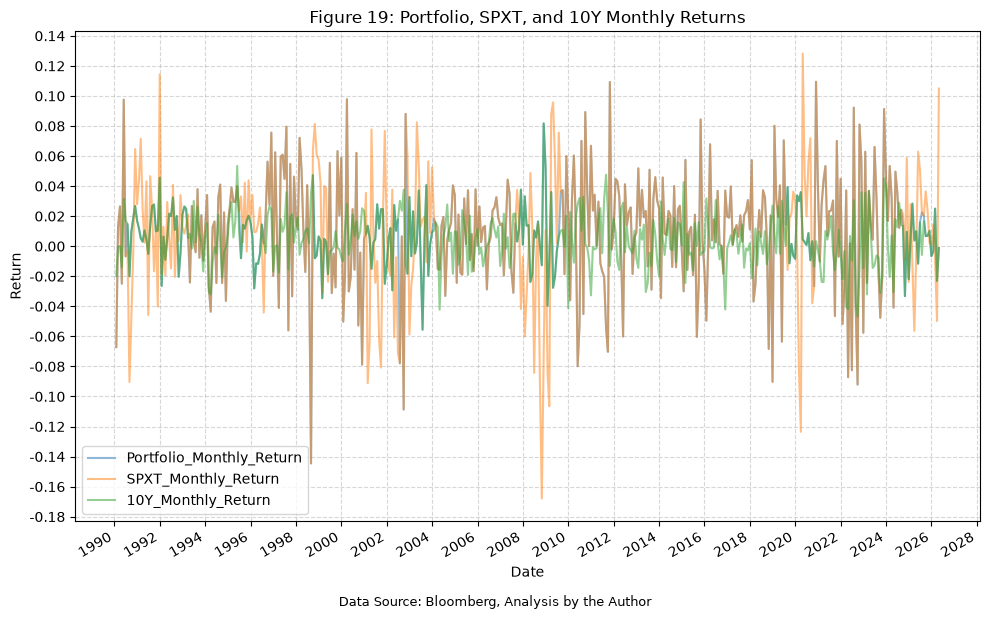
    


And cumulative returns:


```python
plot_time_series(
    df=portfolio_monthly,
    plot_start_date=START_DATE,
    plot_end_date=END_DATE,
    plot_columns=["Portfolio_Cumulative_Return", "SPXT_Cumulative_Return", "10Y_Cumulative_Return"],
    title=f"Figure {next(figure_number)}: Portfolio, SPXT, and 10Y Cumulative Returns",
    x_label="Date",
    x_format="Year",
    x_tick_spacing=2,
    x_tick_start=None,
    x_tick_rotation=30,
    y_label="Cumulative Return",
    y_format="Decimal",
    y_format_decimal_places=0,
    y_tick_spacing=3,
    y_tick_rotation=0,
    grid=True,
    legend=True,
    export_plot=False,
    plot_file_name=None,
    caption="Data Source: Bloomberg, Analysis by the Author",
)
```


    
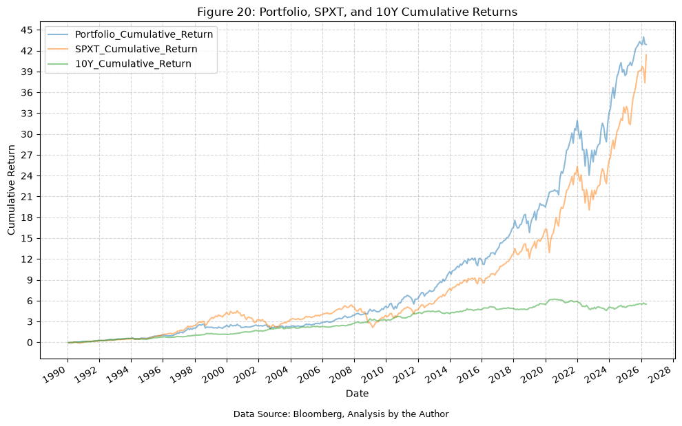
    


And drawdowns:


```python
plot_time_series(
    df=portfolio_monthly,
    plot_start_date=START_DATE,
    plot_end_date=END_DATE,
    plot_columns=["Portfolio_Drawdown", "SPXT_Drawdown", "10Y_Drawdown"],
    title=f"Figure {next(figure_number)}: Portfolio, SPXT, and 10Y Drawdowns",
    x_label="Date",
    x_format="Year",
    x_tick_spacing=2,
    x_tick_start=None,
    x_tick_rotation=30,
    y_label="Drawdown (%)",
    y_format="Decimal",
    y_format_decimal_places=2,
    y_tick_spacing=0.05,
    y_tick_rotation=0,
    grid=True,
    legend=True,
    export_plot=False,
    plot_file_name=None,
    caption="Data Source: Bloomberg, Analysis by the Author",
)
```


    
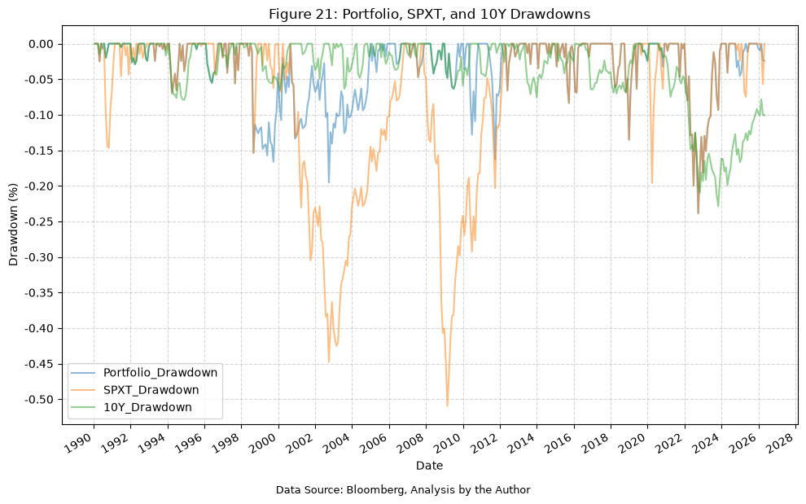
    


Finally, we can run the summary statistics on the strategy portfolio, SPXT, and the 7-10 year Treasury index with the following code:


```python
port_sum_stats = summary_stats(
    fund_list=["Portfolio"],
    df=portfolio_monthly[["Portfolio_Monthly_Return"]],
    period="Monthly",
    use_calendar_days=False,
    excel_export=False,
    pickle_export=False,
    output_confirmation=False,
)

spxt_sum_stats = summary_stats(
    fund_list=["SPXT"],
    df=portfolio_monthly[["SPXT_Monthly_Return"]],
    period="Monthly",
    use_calendar_days=False,
    excel_export=False,
    pickle_export=False,
    output_confirmation=False,
)

t10y_sum_stats = summary_stats(
    fund_list=["10Y"],
    df=portfolio_monthly[["10Y_Monthly_Return"]],
    period="Monthly",
    use_calendar_days=False,
    excel_export=False,
    pickle_export=False,
    output_confirmation=False,
)

sum_stats = pd.concat([port_sum_stats, spxt_sum_stats, t10y_sum_stats])
display(Markdown(f"Table {next(table_number)}: Summary Statistics, Portfolio, SPXT, And 10Y"))
display(sum_stats)
```


Table 23: Summary Statistics, Portfolio, SPXT, And 10Y


<div>
<style scoped>
    .dataframe tbody tr th:only-of-type {
        vertical-align: middle;
    }

    .dataframe tbody tr th {
        vertical-align: top;
    }

    .dataframe thead th {
        text-align: right;
    }
</style>
<table border="1" class="dataframe">
  <thead>
    <tr style="text-align: right;">
      <th></th>
      <th>Number of Observations</th>
      <th>Data Start Date</th>
      <th>Data End Date</th>
      <th>Annual Mean Return (Arithmetic)</th>
      <th>Annualized Volatility</th>
      <th>Annualized Sharpe Ratio</th>
      <th>CAGR (Geometric)</th>
      <th>Monthly Max Return</th>
      <th>Monthly Max Return (Date)</th>
      <th>Monthly Min Return</th>
      <th>Monthly Min Return (Date)</th>
      <th>Max Drawdown</th>
      <th>Peak</th>
      <th>Trough</th>
      <th>Recovery Date</th>
      <th>Calendar Days to Recovery</th>
      <th>MAR Ratio</th>
    </tr>
  </thead>
  <tbody>
    <tr>
      <th>Portfolio_Monthly_Return</th>
      <td>436</td>
      <td>1990-01-31</td>
      <td>2026-04-30</td>
      <td>0.11</td>
      <td>0.12</td>
      <td>0.94</td>
      <td>0.11</td>
      <td>0.11</td>
      <td>2020-11-30</td>
      <td>-0.14</td>
      <td>1998-08-31</td>
      <td>-0.24</td>
      <td>2021-12-31</td>
      <td>2022-09-30</td>
      <td>2023-12-31</td>
      <td>457.00</td>
      <td>0.46</td>
    </tr>
    <tr>
      <th>SPXT_Monthly_Return</th>
      <td>436</td>
      <td>1990-01-31</td>
      <td>2026-04-30</td>
      <td>0.11</td>
      <td>0.15</td>
      <td>0.77</td>
      <td>0.11</td>
      <td>0.13</td>
      <td>2020-04-30</td>
      <td>-0.17</td>
      <td>2008-10-31</td>
      <td>-0.51</td>
      <td>2007-10-31</td>
      <td>2009-02-28</td>
      <td>2012-03-31</td>
      <td>1127.00</td>
      <td>0.21</td>
    </tr>
    <tr>
      <th>10Y_Monthly_Return</th>
      <td>436</td>
      <td>1990-01-31</td>
      <td>2026-04-30</td>
      <td>0.05</td>
      <td>0.06</td>
      <td>0.85</td>
      <td>0.05</td>
      <td>0.08</td>
      <td>2008-11-30</td>
      <td>-0.06</td>
      <td>2003-07-31</td>
      <td>-0.23</td>
      <td>2020-07-31</td>
      <td>2023-10-31</td>
      <td>NaT</td>
      <td>NaN</td>
      <td>0.23</td>
    </tr>
  </tbody>
</table>
</div>


Based on the above, the strategy portfolio earns a higher annualized return than either stocks or bonds on their own, and it cuts the worst equity drawdown roughly in half by being in Treasuries through the 2008 and 2020 declines.

## Conclusion

This was an interesting exercise to evaluate the performance of different asset classes during Fed tightening and easing cycles. The bar charts line up with the economic intuition reasonably well. Stocks tend to do better through tightening cycles (economic strength) and Treasuries through easing cycles (economic weakness).

The regressions tell a different story, however. Across all four assets, the annualized change in the FFR explains almost none of the cross-cycle variation in returns. R-squared values run from roughly 0.004 for high yield to 0.06 for gold, and not one of the four slopes is statistically significant with 30 cycle observations. The scatter plots look suggestive, but while they are not evidence that the FFR drives returns, it does appear that that policy direction is *associated* with which asset does better.


```python
for cycle in ["Extended Neutral", "Tightening", "Easing"]:
    cum_return = (1 + strategy[strategy["cycle_invested"] == cycle]["Monthly_Return"]).cumprod() - 1
    print(f"Cumulative return for {cycle}: {cum_return.iloc[-1]:.2%} ")
```

    Cumulative return for Extended Neutral: 485.30% 
    Cumulative return for Tightening: 220.27% 
    Cumulative return for Easing: 134.13% 


On paper the backtest looks successful, but the caveats matter significantly. The largest caveat (as mentioned above) is the 37% of the sample that falls into the `Extended Neutral` bucket, and the choice to hold equities through those months. This contributes more to the strategy's total return than either the tightening or easing bucket. The strategy is effectively a long-equity position, with a Treasury hedge during cutting cycles. The signal carries a one-month implementation lag so it uses only completed rate changes, but it still assumes we correctly classify cycles as they happen in real time.

The strategy has done well post-GFC, but the period from 2008 to the present has been marked by historically low interest rates and a strong bull market in stocks, which may not be representative of future market conditions given current valuations (present time August 2026). Additionally, the current rate cutting cycle (cycles 28/29/30) is still ongoing, and it remains to be seen how the strategy will perform during this cycle and the ones that follow.

## Future Investigation

A couple of ideas sound intriguing for future investigation:

* Does a commodity index (such as GSCI) exhibit differing behavior than gold?
* How does leverage affect the returns that are observed for the strategy portfolio, stocks, and bonds?
* Do other Fed tightening/easing cycles exhibit the same behavior for returns?
* How sensitive is the strategy to the 6 month forward fill limit and to the choice to hold equities during `Extended Neutral` months? Sweeping both would show how much of the result is the policy signal and how much is the default long-equity stance.

## References

1. https://fred.stlouisfed.org/series/DFEDTARU
2. https://fred.stlouisfed.org/series/DFEDTARL
3. https://fred.stlouisfed.org/series/DFEDTAR

## Code


