## Post Updates

Update 9/10/2026: Cash now earns the 3 month Treasury bill rate rather than being held at a constant $1. The strategy can also now take a target weight per asset rather than splitting the portfolio evenly, and there is a new section at the end working through a 30/30/30/10 variant. The rebalance bands are expressed as a multiple of each asset's target weight instead of as fixed percentages of the portfolio, so that they are still relevant when the weights are not equal.

## Introduction

Harry Browne was an influencial politician, financial advisor, and author who lived from 1933 to 2006 and published 12 books. Wikipedia has [an in-depth biography](https://en.wikipedia.org/wiki/Harry_Browne) on him.

Within the world of finance and investing, one of his best known works is *Fail-Safe Investing: Lifelong Financial Security in 30 Minutes*. In it, he introduces the idea of the "Permanent Portfolio", an investment strategy that uses only four assets and is very simple to implement.

In this post, we will investigate Browne's suggested portfolio, including performance across various market cycles and economic regimes. Since first publishing it I have corrected how the cash sleeve is modeled, so that it earns the Treasury bill rate rather than nothing, and added a section at the end that relaxes Browne's equal allocation to see what happens when the four assets are weighted 30/30/30/10 instead.

## Browne's Portfolio Requirements

In *Fail-Safe Investing*, under rule #11, Browne lays out the requirements for a "bulletproof portfolio" that will "assure that your wealth will survive any event - including events that would be devastating to any one investment. In other words, this portfolio should protect you *no matter what the future brings.*"

His requirements for the portfolio consist of the followng:

1. Safety: Protection again any economic future, including "inflation, recession, or even depression"
2. Stability: Performance should be consistent so that you will not need to make any changes and will not experience significant drawdowns
3. Simplicity: Easy to implement and take very little time to maintain

He then describes the four "broad movements" of the economy:

1. Prosperity: The economy is growing, business is doing well, interest rates are usually low
2. Inflation: The cost of goods and services is rising
3. Tight money or recession: The money supply is shrinking, economic activity is slowing
4. Deflation: Prices are declining and the value of money is increasing

## The Permanent Portfolio

Browne then matches an asset class to each of the economic conditions above:

1. Prosperity -> Stocks (due to prosperity) and long term bonds (when interest rates fall)
2. Inflation -> Gold
3. Deflation -> Long term bonds (when interest rates fall)
4. Tight money -> Cash

He completes the Permanent Portfolio by stipulating the following:

* Start with a base allocation of 25% to each of the asset classes (stocks, bonds, gold, cash)
* Rebalance back to the base allocation annually, or when "any of the four investments has become worth less than 15%, or more than 35%, of the portfolio's overall value"</br>**Note:** Browne does not specify when the portfolio should be rebalanced; therefore, we will make an assumption of a January 1st rebalance.

## Python Imports


```python
# Standard Library
import os
import sys
import warnings

from pathlib import Path

# Data Handling
import pandas as pd

# Data Visualization
import matplotlib.dates as mdates
import matplotlib.pyplot as plt
import matplotlib.ticker as mtick
from matplotlib.ticker import MultipleLocator

# Display
from IPython.display import display

# Suppress warnings
warnings.filterwarnings("ignore")
```


```python
# Add the source subdirectory to the system path to allow import config from settings.py
current_directory = Path(os.getcwd())
website_base_directory = current_directory.parent.parent.parent
src_directory = website_base_directory / "src"
sys.path.append(str(src_directory)) if str(src_directory) not in sys.path else None

# Import settings.py
from settings import config

# Add configured directories from config to path
SOURCE_DIR = config("SOURCE_DIR")
sys.path.append(str(Path(SOURCE_DIR))) if str(Path(SOURCE_DIR)) not in sys.path else None

# Add other configured directories
BASE_DIR = config("BASE_DIR")
CONTENT_DIR = config("CONTENT_DIR")
POSTS_DIR = config("POSTS_DIR")
PAGES_DIR = config("PAGES_DIR")
PUBLIC_DIR = config("PUBLIC_DIR")
SOURCE_DIR = config("SOURCE_DIR")
DATA_DIR = config("DATA_DIR")
DATA_MANUAL_DIR = config("DATA_MANUAL_DIR")
```

## Python Functions

Here are the functions needed for this project:

* [bb_clean_data](/posts/reusable-extensible-python-functions-financial-data-analysis/#bb_clean_data): Takes an Excel export from Bloomberg, removes the miscellaneous headings/rows, and returns a DataFrame.
* [df_info](/posts/reusable-extensible-python-functions-financial-data-analysis/#df_info): Display summary information about a pandas DataFrame, along with the first five and last five rows.
* [load_data](/posts/reusable-extensible-python-functions-financial-data-analysis/#load_data): Load data from a CSV, Excel, or Pickle file into a pandas DataFrame.
* [pandas_set_decimal_places](/posts/reusable-extensible-python-functions-financial-data-analysis/#pandas_set_decimal_places): Set the number of decimal places displayed for floating-point numbers in pandas.
* [plot_bar](/posts/reusable-extensible-python-functions-financial-data-analysis/#plot_bar): Create a bar plot from a DataFrame for specified columns and date range.
* [plot_time_series](/posts/reusable-extensible-python-functions-financial-data-analysis/#plot_time_series): Plot the time series data from a DataFrame for a specified date range and columns.
* [strategy_harry_brown_perm_port](/posts/reusable-extensible-python-functions-financial-data-analysis/#strategy_harry_brown_perm_port): Execute the strategy for the Harry Brown permanent portfolio.
* [summary_stats](/posts/reusable-extensible-python-functions-financial-data-analysis/#summary_stats): Generate summary statistics for a series of returns.


```python
from bb_clean_data import bb_clean_data
from df_info import df_info
from load_data import load_data
from pandas_set_decimal_places import pandas_set_decimal_places
from plot_bar import plot_bar
from plot_time_series import plot_time_series
from strategy_harry_brown_perm_port import strategy_harry_brown_perm_port
from summary_stats import summary_stats
```


```python
# Set decimal places
pandas_set_decimal_places(3)
```

## Data

For this exercise, we will use the following asset classes:

1. Stocks: S&P 500 (SPXT_S&P 500 Total Return Index)
2. Bonds: 10 Year US Treasuries (SPBDU10T_S&P US Treasury Bond 7-10 Year Total Return Index)
3. Gold: Gold Spot Price (XAU_Gold USD Spot)
4. Cash: 3 month US Treasury bills (DGS3MO)

The first three are sourced from Bloomberg. Cash comes from FRED, and is discussed in its own section below.

We could use ETFs, but the available price history for the ETFs is much shorter than the indices above. If we wanted to use ETFs, the following would work:

1. Stocks: IVV - iShares Core S&P 500 ETF
2. Bonds: IEF - iShares 7-10 Year Treasury Bond ETF
3. Gold: IAU - iShares Gold Trust
4. Cash: BIL - SPDR Bloomberg 1-3 Month T-Bill ETF

### Load Data


```python
START_DATE = '1990-01-01'
END_DATE = '2025-12-31'
```

As previously mentioned, the data for this exercise comes primarily from Bloomberg. We'll start with loading the data first for bonds:


```python
# Bonds dataframe
bb_clean_data(
    base_directory=DATA_DIR,
    fund_ticker_name="SPBDU10T_S&P US Treasury Bond 7-10 Year Total Return Index",
    source="Bloomberg",
    asset_class="Indices",
    excel_export=True,
    pickle_export=True,
    output_confirmation=True,
)

bonds_data = load_data(
    base_directory=DATA_DIR,
    ticker="SPBDU10T_S&P US Treasury Bond 7-10 Year Total Return Index_Clean",
    source="Bloomberg",
    asset_class="Indices",
    timeframe="Daily",
    file_format="excel",
)

bonds_data['Date'] = pd.to_datetime(bonds_data['Date'])
bonds_data.set_index('Date', inplace = True)
bonds_data = bonds_data[(bonds_data.index >= START_DATE) & (bonds_data.index <= END_DATE)]
bonds_data.rename(columns={'Close':'Bonds_Close'}, inplace=True)
bonds_data['Bonds_Daily_Return'] = bonds_data['Bonds_Close'].pct_change()
bonds_data['Bonds_Total_Return'] = (1 + bonds_data['Bonds_Daily_Return']).cumprod()
df_info(bonds_data)

plot_time_series(
    df=bonds_data[["Bonds_Close"]],
    plot_start_date=START_DATE,
    plot_end_date=END_DATE,
    plot_columns="All",
    title="Bonds Adjusted Close Price",
    x_label="Year",
    x_format="Year",
    x_tick_spacing=2,
    x_tick_start=None,
    x_tick_rotation=30,
    y_label="Price",
    y_format="Decimal",
    y_format_decimal_places="Auto",
    y_tick_spacing="Auto",
    y_tick_rotation=0,
    grid=True,
    legend=True,
    legend_location="upper left",
    export_plot=False,
)
```

    The first and last date of data for SPBDU10T_S&P US Treasury Bond 7-10 Year Total Return Index is: 


<div>
<style scoped>
    .dataframe tbody tr th:only-of-type {
        vertical-align: middle;
    }

    .dataframe tbody tr th {
        vertical-align: top;
    }

    .dataframe thead th {
        text-align: right;
    }
</style>
<table border="1" class="dataframe">
  <thead>
    <tr style="text-align: right;">
      <th></th>
      <th>Close</th>
    </tr>
    <tr>
      <th>Date</th>
      <th></th>
    </tr>
  </thead>
  <tbody>
    <tr>
      <th>1989-12-29 00:00:00</th>
      <td>100</td>
    </tr>
  </tbody>
</table>
</div>


<div>
<style scoped>
    .dataframe tbody tr th:only-of-type {
        vertical-align: middle;
    }

    .dataframe tbody tr th {
        vertical-align: top;
    }

    .dataframe thead th {
        text-align: right;
    }
</style>
<table border="1" class="dataframe">
  <thead>
    <tr style="text-align: right;">
      <th></th>
      <th>Close</th>
    </tr>
    <tr>
      <th>Date</th>
      <th></th>
    </tr>
  </thead>
  <tbody>
    <tr>
      <th>2026-05-08 00:00:00</th>
      <td>652.052</td>
    </tr>
  </tbody>
</table>
</div>


    Bloomberg data cleaning complete for SPBDU10T_S&P US Treasury Bond 7-10 Year Total Return Index
    --------------------
    The columns, shape, and data types are:
    <class 'pandas.DataFrame'>
    DatetimeIndex: 9026 entries, 1990-01-02 to 2025-12-31
    Data columns (total 3 columns):
     #   Column              Non-Null Count  Dtype  
    ---  ------              --------------  -----  
     0   Bonds_Close         9026 non-null   float64
     1   Bonds_Daily_Return  9025 non-null   float64
     2   Bonds_Total_Return  9025 non-null   float64
    dtypes: float64(3)
    memory usage: 282.1 KB
    None
    The first 5 rows are:


<div>
<style scoped>
    .dataframe tbody tr th:only-of-type {
        vertical-align: middle;
    }

    .dataframe tbody tr th {
        vertical-align: top;
    }

    .dataframe thead th {
        text-align: right;
    }
</style>
<table border="1" class="dataframe">
  <thead>
    <tr style="text-align: right;">
      <th></th>
      <th>Bonds_Close</th>
      <th>Bonds_Daily_Return</th>
      <th>Bonds_Total_Return</th>
    </tr>
    <tr>
      <th>Date</th>
      <th></th>
      <th></th>
      <th></th>
    </tr>
  </thead>
  <tbody>
    <tr>
      <th>1990-01-02</th>
      <td>99.972</td>
      <td>NaN</td>
      <td>NaN</td>
    </tr>
    <tr>
      <th>1990-01-03</th>
      <td>99.733</td>
      <td>-0.002</td>
      <td>0.998</td>
    </tr>
    <tr>
      <th>1990-01-04</th>
      <td>99.813</td>
      <td>0.001</td>
      <td>0.998</td>
    </tr>
    <tr>
      <th>1990-01-05</th>
      <td>99.769</td>
      <td>-0.000</td>
      <td>0.998</td>
    </tr>
    <tr>
      <th>1990-01-08</th>
      <td>99.681</td>
      <td>-0.001</td>
      <td>0.997</td>
    </tr>
  </tbody>
</table>
</div>


    The last 5 rows are:


<div>
<style scoped>
    .dataframe tbody tr th:only-of-type {
        vertical-align: middle;
    }

    .dataframe tbody tr th {
        vertical-align: top;
    }

    .dataframe thead th {
        text-align: right;
    }
</style>
<table border="1" class="dataframe">
  <thead>
    <tr style="text-align: right;">
      <th></th>
      <th>Bonds_Close</th>
      <th>Bonds_Daily_Return</th>
      <th>Bonds_Total_Return</th>
    </tr>
    <tr>
      <th>Date</th>
      <th></th>
      <th></th>
      <th></th>
    </tr>
  </thead>
  <tbody>
    <tr>
      <th>2025-12-24</th>
      <td>652.943</td>
      <td>0.002</td>
      <td>6.531</td>
    </tr>
    <tr>
      <th>2025-12-26</th>
      <td>653.437</td>
      <td>0.001</td>
      <td>6.536</td>
    </tr>
    <tr>
      <th>2025-12-29</th>
      <td>654.663</td>
      <td>0.002</td>
      <td>6.548</td>
    </tr>
    <tr>
      <th>2025-12-30</th>
      <td>653.965</td>
      <td>-0.001</td>
      <td>6.541</td>
    </tr>
    <tr>
      <th>2025-12-31</th>
      <td>652.288</td>
      <td>-0.003</td>
      <td>6.525</td>
    </tr>
  </tbody>
</table>
</div>


    
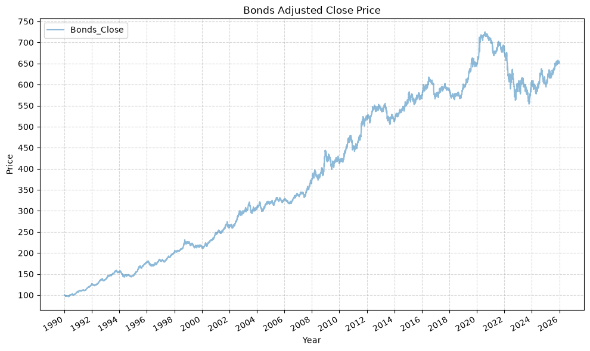
    


Then for stocks:


```python
# Stocks dataframe
bb_clean_data(
    base_directory=DATA_DIR,
    fund_ticker_name="SPXT_S&P 500 Total Return Index",
    source="Bloomberg",
    asset_class="Indices",
    excel_export=True,
    pickle_export=True,
    output_confirmation=True,
)

stocks_data = load_data(
    base_directory=DATA_DIR,
    ticker="SPXT_S&P 500 Total Return Index_Clean",
    source="Bloomberg",
    asset_class="Indices",
    timeframe="Daily",
    file_format="excel",
)

stocks_data['Date'] = pd.to_datetime(stocks_data['Date'])
stocks_data.set_index('Date', inplace = True)
stocks_data = stocks_data[(stocks_data.index >= START_DATE) & (stocks_data.index <= END_DATE)]
stocks_data.rename(columns={'Close':'Stocks_Close'}, inplace=True)
stocks_data['Stocks_Daily_Return'] = stocks_data['Stocks_Close'].pct_change()
stocks_data['Stocks_Total_Return'] = (1 + stocks_data['Stocks_Daily_Return']).cumprod()
df_info(stocks_data)

plot_time_series(
    df=stocks_data[["Stocks_Close"]],
    plot_start_date=START_DATE,
    plot_end_date=END_DATE,
    plot_columns="All",
    title="Stocks Adjusted Close Price",
    x_label="Year",
    x_format="Year",
    x_tick_spacing=2,
    x_tick_start=None,
    x_tick_rotation=30,
    y_label="Price",
    y_format="Decimal",
    y_format_decimal_places="Auto",
    y_tick_spacing="Auto",
    y_tick_rotation=0,
    grid=True,
    legend=True,
    legend_location="upper left",
    export_plot=False,
)
```

    The first and last date of data for SPXT_S&P 500 Total Return Index is: 


<div>
<style scoped>
    .dataframe tbody tr th:only-of-type {
        vertical-align: middle;
    }

    .dataframe tbody tr th {
        vertical-align: top;
    }

    .dataframe thead th {
        text-align: right;
    }
</style>
<table border="1" class="dataframe">
  <thead>
    <tr style="text-align: right;">
      <th></th>
      <th>Close</th>
    </tr>
    <tr>
      <th>Date</th>
      <th></th>
    </tr>
  </thead>
  <tbody>
    <tr>
      <th>1989-09-11 00:00:00</th>
      <td>369.550</td>
    </tr>
  </tbody>
</table>
</div>


<div>
<style scoped>
    .dataframe tbody tr th:only-of-type {
        vertical-align: middle;
    }

    .dataframe tbody tr th {
        vertical-align: top;
    }

    .dataframe thead th {
        text-align: right;
    }
</style>
<table border="1" class="dataframe">
  <thead>
    <tr style="text-align: right;">
      <th></th>
      <th>Close</th>
    </tr>
    <tr>
      <th>Date</th>
      <th></th>
    </tr>
  </thead>
  <tbody>
    <tr>
      <th>2026-05-08 00:00:00</th>
      <td>16516.800</td>
    </tr>
  </tbody>
</table>
</div>


    Bloomberg data cleaning complete for SPXT_S&P 500 Total Return Index
    --------------------
    The columns, shape, and data types are:
    <class 'pandas.DataFrame'>
    DatetimeIndex: 9071 entries, 1990-01-02 to 2025-12-31
    Data columns (total 3 columns):
     #   Column               Non-Null Count  Dtype  
    ---  ------               --------------  -----  
     0   Stocks_Close         9071 non-null   float64
     1   Stocks_Daily_Return  9070 non-null   float64
     2   Stocks_Total_Return  9070 non-null   float64
    dtypes: float64(3)
    memory usage: 283.5 KB
    None
    The first 5 rows are:


<div>
<style scoped>
    .dataframe tbody tr th:only-of-type {
        vertical-align: middle;
    }

    .dataframe tbody tr th {
        vertical-align: top;
    }

    .dataframe thead th {
        text-align: right;
    }
</style>
<table border="1" class="dataframe">
  <thead>
    <tr style="text-align: right;">
      <th></th>
      <th>Stocks_Close</th>
      <th>Stocks_Daily_Return</th>
      <th>Stocks_Total_Return</th>
    </tr>
    <tr>
      <th>Date</th>
      <th></th>
      <th></th>
      <th></th>
    </tr>
  </thead>
  <tbody>
    <tr>
      <th>1990-01-02</th>
      <td>386.160</td>
      <td>NaN</td>
      <td>NaN</td>
    </tr>
    <tr>
      <th>1990-01-03</th>
      <td>385.170</td>
      <td>-0.003</td>
      <td>0.997</td>
    </tr>
    <tr>
      <th>1990-01-04</th>
      <td>382.020</td>
      <td>-0.008</td>
      <td>0.989</td>
    </tr>
    <tr>
      <th>1990-01-05</th>
      <td>378.300</td>
      <td>-0.010</td>
      <td>0.980</td>
    </tr>
    <tr>
      <th>1990-01-08</th>
      <td>380.040</td>
      <td>0.005</td>
      <td>0.984</td>
    </tr>
  </tbody>
</table>
</div>


    The last 5 rows are:


<div>
<style scoped>
    .dataframe tbody tr th:only-of-type {
        vertical-align: middle;
    }

    .dataframe tbody tr th {
        vertical-align: top;
    }

    .dataframe thead th {
        text-align: right;
    }
</style>
<table border="1" class="dataframe">
  <thead>
    <tr style="text-align: right;">
      <th></th>
      <th>Stocks_Close</th>
      <th>Stocks_Daily_Return</th>
      <th>Stocks_Total_Return</th>
    </tr>
    <tr>
      <th>Date</th>
      <th></th>
      <th></th>
      <th></th>
    </tr>
  </thead>
  <tbody>
    <tr>
      <th>2025-12-24</th>
      <td>15409.700</td>
      <td>0.003</td>
      <td>39.905</td>
    </tr>
    <tr>
      <th>2025-12-26</th>
      <td>15406.480</td>
      <td>-0.000</td>
      <td>39.897</td>
    </tr>
    <tr>
      <th>2025-12-29</th>
      <td>15353.160</td>
      <td>-0.003</td>
      <td>39.759</td>
    </tr>
    <tr>
      <th>2025-12-30</th>
      <td>15332.070</td>
      <td>-0.001</td>
      <td>39.704</td>
    </tr>
    <tr>
      <th>2025-12-31</th>
      <td>15220.450</td>
      <td>-0.007</td>
      <td>39.415</td>
    </tr>
  </tbody>
</table>
</div>


    
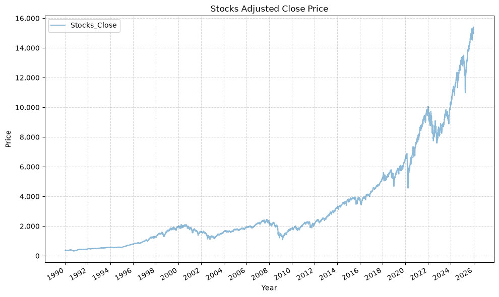
    


And finally, gold:


```python
# Gold dataframe
bb_clean_data(
    base_directory=DATA_DIR,
    fund_ticker_name="XAU_Gold USD Spot",
    source="Bloomberg",
    asset_class="Commodities",
    excel_export=True,
    pickle_export=True,
    output_confirmation=True,
)

gold_data = load_data(
    base_directory=DATA_DIR,
    ticker="XAU_Gold USD Spot_Clean",
    source="Bloomberg",
    asset_class="Commodities",
    timeframe="Daily",
    file_format="excel",
)

gold_data['Date'] = pd.to_datetime(gold_data['Date'])
gold_data.set_index('Date', inplace = True)
gold_data = gold_data[(gold_data.index >= START_DATE) & (gold_data.index <= END_DATE)]
gold_data.rename(columns={'Close':'Gold_Close'}, inplace=True)
gold_data['Gold_Daily_Return'] = gold_data['Gold_Close'].pct_change()
gold_data['Gold_Total_Return'] = (1 + gold_data['Gold_Daily_Return']).cumprod()
df_info(gold_data)

plot_time_series(
    df=gold_data[["Gold_Close"]],
    plot_start_date=START_DATE,
    plot_end_date=END_DATE,
    plot_columns="All",
    title="Gold Adjusted Close Price",
    x_label="Year",
    x_format="Year",
    x_tick_spacing=2,
    x_tick_start=None,
    x_tick_rotation=30,
    y_label="Price",
    y_format="Decimal",
    y_format_decimal_places="Auto",
    y_tick_spacing="Auto",
    y_tick_rotation=0,
    grid=True,
    legend=True,
    legend_location="upper left",
    export_plot=False,
)
```

    The first and last date of data for XAU_Gold USD Spot is: 


<div>
<style scoped>
    .dataframe tbody tr th:only-of-type {
        vertical-align: middle;
    }

    .dataframe tbody tr th {
        vertical-align: top;
    }

    .dataframe thead th {
        text-align: right;
    }
</style>
<table border="1" class="dataframe">
  <thead>
    <tr style="text-align: right;">
      <th></th>
      <th>Close</th>
    </tr>
    <tr>
      <th>Date</th>
      <th></th>
    </tr>
  </thead>
  <tbody>
    <tr>
      <th>1920-01-30 00:00:00</th>
      <td>20.680</td>
    </tr>
  </tbody>
</table>
</div>


<div>
<style scoped>
    .dataframe tbody tr th:only-of-type {
        vertical-align: middle;
    }

    .dataframe tbody tr th {
        vertical-align: top;
    }

    .dataframe thead th {
        text-align: right;
    }
</style>
<table border="1" class="dataframe">
  <thead>
    <tr style="text-align: right;">
      <th></th>
      <th>Close</th>
    </tr>
    <tr>
      <th>Date</th>
      <th></th>
    </tr>
  </thead>
  <tbody>
    <tr>
      <th>2026-05-11 00:00:00</th>
      <td>4726.400</td>
    </tr>
  </tbody>
</table>
</div>


    Bloomberg data cleaning complete for XAU_Gold USD Spot
    --------------------
    The columns, shape, and data types are:
    <class 'pandas.DataFrame'>
    DatetimeIndex: 9336 entries, 1990-01-02 to 2025-12-31
    Data columns (total 3 columns):
     #   Column             Non-Null Count  Dtype  
    ---  ------             --------------  -----  
     0   Gold_Close         9336 non-null   float64
     1   Gold_Daily_Return  9335 non-null   float64
     2   Gold_Total_Return  9335 non-null   float64
    dtypes: float64(3)
    memory usage: 291.8 KB
    None
    The first 5 rows are:


<div>
<style scoped>
    .dataframe tbody tr th:only-of-type {
        vertical-align: middle;
    }

    .dataframe tbody tr th {
        vertical-align: top;
    }

    .dataframe thead th {
        text-align: right;
    }
</style>
<table border="1" class="dataframe">
  <thead>
    <tr style="text-align: right;">
      <th></th>
      <th>Gold_Close</th>
      <th>Gold_Daily_Return</th>
      <th>Gold_Total_Return</th>
    </tr>
    <tr>
      <th>Date</th>
      <th></th>
      <th></th>
      <th></th>
    </tr>
  </thead>
  <tbody>
    <tr>
      <th>1990-01-02</th>
      <td>399.000</td>
      <td>NaN</td>
      <td>NaN</td>
    </tr>
    <tr>
      <th>1990-01-03</th>
      <td>395.000</td>
      <td>-0.010</td>
      <td>0.990</td>
    </tr>
    <tr>
      <th>1990-01-04</th>
      <td>396.500</td>
      <td>0.004</td>
      <td>0.994</td>
    </tr>
    <tr>
      <th>1990-01-05</th>
      <td>405.000</td>
      <td>0.021</td>
      <td>1.015</td>
    </tr>
    <tr>
      <th>1990-01-08</th>
      <td>404.600</td>
      <td>-0.001</td>
      <td>1.014</td>
    </tr>
  </tbody>
</table>
</div>


    The last 5 rows are:


<div>
<style scoped>
    .dataframe tbody tr th:only-of-type {
        vertical-align: middle;
    }

    .dataframe tbody tr th {
        vertical-align: top;
    }

    .dataframe thead th {
        text-align: right;
    }
</style>
<table border="1" class="dataframe">
  <thead>
    <tr style="text-align: right;">
      <th></th>
      <th>Gold_Close</th>
      <th>Gold_Daily_Return</th>
      <th>Gold_Total_Return</th>
    </tr>
    <tr>
      <th>Date</th>
      <th></th>
      <th></th>
      <th></th>
    </tr>
  </thead>
  <tbody>
    <tr>
      <th>2025-12-24</th>
      <td>4479.420</td>
      <td>-0.001</td>
      <td>11.227</td>
    </tr>
    <tr>
      <th>2025-12-26</th>
      <td>4533.210</td>
      <td>0.012</td>
      <td>11.361</td>
    </tr>
    <tr>
      <th>2025-12-29</th>
      <td>4332.350</td>
      <td>-0.044</td>
      <td>10.858</td>
    </tr>
    <tr>
      <th>2025-12-30</th>
      <td>4339.490</td>
      <td>0.002</td>
      <td>10.876</td>
    </tr>
    <tr>
      <th>2025-12-31</th>
      <td>4319.370</td>
      <td>-0.005</td>
      <td>10.825</td>
    </tr>
  </tbody>
</table>
</div>


    
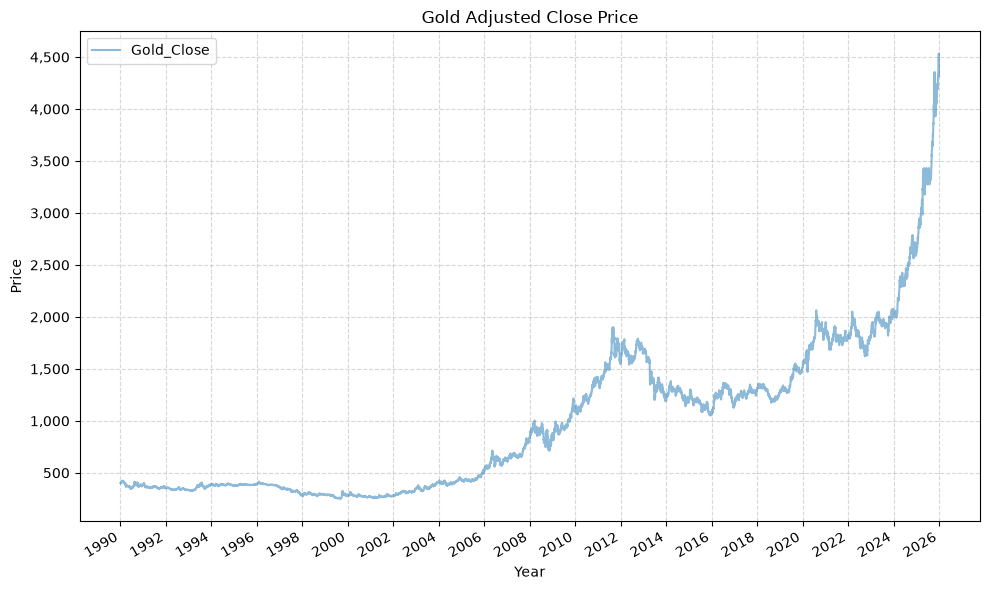
    


### Cash Rate

Browne's fourth asset is cash, and the obvious way to model it is to hold it at a constant $1, which is what we did initially. Realistically, that was a poor assumption, and it's unlikely that anyone implementing this strategy would truly leave the cash allocation in actual cash. In practice, they would hold Treasury bills, or a close proxy. We use the 3 month Treasury constant maturity yield from FRED to model the cash allocation.


```python
# Pull the 3 month Treasury bill rate directly from the FRED CSV endpoint
cash_rate = pd.read_csv(
    "https://fred.stlouisfed.org/graph/fredgraph.csv?id=DGS3MO",
    parse_dates=["observation_date"],
    index_col="observation_date",
)["DGS3MO"]

# Normalize to nanosecond resolution so the index lines up with the price data
cash_rate.index = cash_rate.index.astype("datetime64[ns]")

# Convert from percent to decimal
cash_rate = cash_rate / 100

print(f"Cash rate range: {cash_rate.index.min().date()} to {cash_rate.index.max().date()}")
```

    Cash rate range: 1981-09-01 to 2026-10-27


The yield over the period we care about looks like this:


```python
plot_time_series(
    df=cash_rate.to_frame("3 Month Treasury Bill"),
    plot_start_date=START_DATE,
    plot_end_date=END_DATE,
    plot_columns="All",
    title="3 Month Treasury Bill Yield",
    x_label="Year",
    x_format="Year",
    x_tick_spacing=2,
    x_tick_start=None,
    x_tick_rotation=30,
    y_label="Yield",
    y_format="Percentage",
    y_format_decimal_places=1,
    y_tick_spacing="Auto",
    y_tick_rotation=0,
    grid=True,
    legend=True,
    legend_location="upper right",
    export_plot=False,
)
```


    
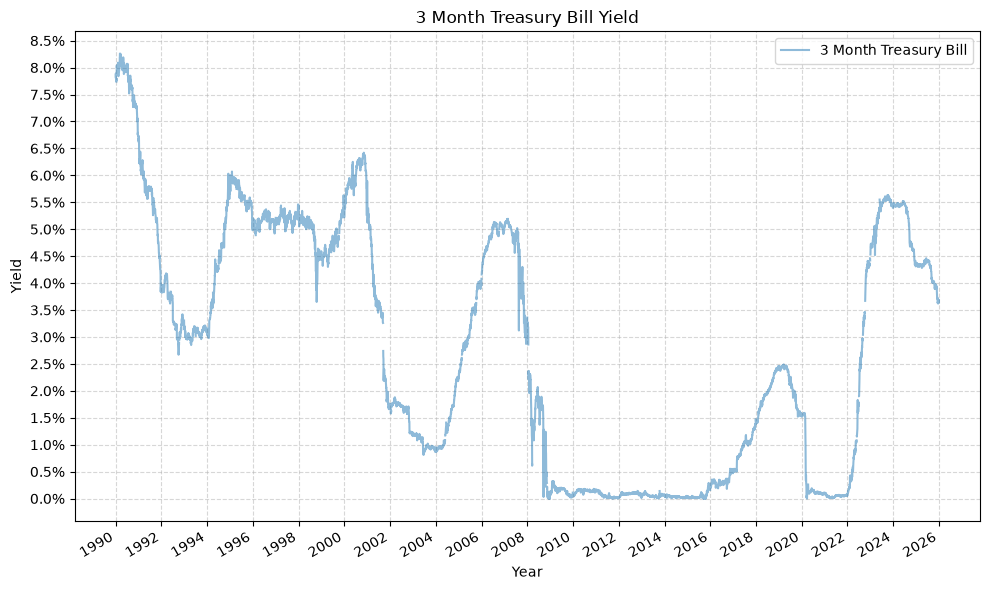
    


### Combine Data

We'll now combine the dataframes for the timeseries data from each of the asset classes, as follows:


```python
# Merge the stock data and bond data into a single DataFrame using their indices (dates)
perm_port = pd.merge(stocks_data['Stocks_Close'], bonds_data['Bonds_Close'], left_index=True, right_index=True)

# Add gold data to the portfolio DataFrame by merging it with the existing data on indices (dates)
perm_port = pd.merge(perm_port, gold_data['Gold_Close'], left_index=True, right_index=True)

# Build a total return index for cash, so that it can be treated like any other asset.
# The rate is published daily but only accrues over the calendar days that actually
# elapse between rows, and we accrue on the previous day's published rate so that no
# day earns a return from a rate that was not yet known.
daily_rate = cash_rate.reindex(perm_port.index).ffill()
days_elapsed = perm_port.index.to_series().diff().dt.days.fillna(0)
perm_port['Cash_Close'] = (1 + daily_rate.shift(1).fillna(0) * days_elapsed / 365).cumprod()

# Remove any rows with missing values (NaN) to ensure clean data for further analysis
perm_port.dropna(inplace=True)

# Display the finalized portfolio DataFrame
display(perm_port)
```


<div>
<style scoped>
    .dataframe tbody tr th:only-of-type {
        vertical-align: middle;
    }

    .dataframe tbody tr th {
        vertical-align: top;
    }

    .dataframe thead th {
        text-align: right;
    }
</style>
<table border="1" class="dataframe">
  <thead>
    <tr style="text-align: right;">
      <th></th>
      <th>Stocks_Close</th>
      <th>Bonds_Close</th>
      <th>Gold_Close</th>
      <th>Cash_Close</th>
    </tr>
    <tr>
      <th>Date</th>
      <th></th>
      <th></th>
      <th></th>
      <th></th>
    </tr>
  </thead>
  <tbody>
    <tr>
      <th>1990-01-02</th>
      <td>386.160</td>
      <td>99.972</td>
      <td>399.000</td>
      <td>1.000</td>
    </tr>
    <tr>
      <th>1990-01-03</th>
      <td>385.170</td>
      <td>99.733</td>
      <td>395.000</td>
      <td>1.000</td>
    </tr>
    <tr>
      <th>1990-01-04</th>
      <td>382.020</td>
      <td>99.813</td>
      <td>396.500</td>
      <td>1.000</td>
    </tr>
    <tr>
      <th>1990-01-05</th>
      <td>378.300</td>
      <td>99.769</td>
      <td>405.000</td>
      <td>1.001</td>
    </tr>
    <tr>
      <th>1990-01-08</th>
      <td>380.040</td>
      <td>99.681</td>
      <td>404.600</td>
      <td>1.001</td>
    </tr>
    <tr>
      <th>...</th>
      <td>...</td>
      <td>...</td>
      <td>...</td>
      <td>...</td>
    </tr>
    <tr>
      <th>2025-12-24</th>
      <td>15409.700</td>
      <td>652.943</td>
      <td>4479.420</td>
      <td>2.727</td>
    </tr>
    <tr>
      <th>2025-12-26</th>
      <td>15406.480</td>
      <td>653.437</td>
      <td>4533.210</td>
      <td>2.727</td>
    </tr>
    <tr>
      <th>2025-12-29</th>
      <td>15353.160</td>
      <td>654.663</td>
      <td>4332.350</td>
      <td>2.728</td>
    </tr>
    <tr>
      <th>2025-12-30</th>
      <td>15332.070</td>
      <td>653.965</td>
      <td>4339.490</td>
      <td>2.728</td>
    </tr>
    <tr>
      <th>2025-12-31</th>
      <td>15220.450</td>
      <td>652.288</td>
      <td>4319.370</td>
      <td>2.728</td>
    </tr>
  </tbody>
</table>
<p>8977 rows × 4 columns</p>
</div>


### Check For Missing Values

We can check for any missing (NaN) values in each column:


```python
# Check for any missing values in each column
perm_port.isnull().any()
```


    Stocks_Close    False
    Bonds_Close     False
    Gold_Close      False
    Cash_Close      False
    dtype: bool


### Permanent Portfolio DataFrame Info

And here is the summary information for the combined dataframe:


```python
df_info(perm_port)
```

    The columns, shape, and data types are:
    <class 'pandas.DataFrame'>
    DatetimeIndex: 8977 entries, 1990-01-02 to 2025-12-31
    Data columns (total 4 columns):
     #   Column        Non-Null Count  Dtype  
    ---  ------        --------------  -----  
     0   Stocks_Close  8977 non-null   float64
     1   Bonds_Close   8977 non-null   float64
     2   Gold_Close    8977 non-null   float64
     3   Cash_Close    8977 non-null   float64
    dtypes: float64(4)
    memory usage: 350.7 KB
    None
    The first 5 rows are:


<div>
<style scoped>
    .dataframe tbody tr th:only-of-type {
        vertical-align: middle;
    }

    .dataframe tbody tr th {
        vertical-align: top;
    }

    .dataframe thead th {
        text-align: right;
    }
</style>
<table border="1" class="dataframe">
  <thead>
    <tr style="text-align: right;">
      <th></th>
      <th>Stocks_Close</th>
      <th>Bonds_Close</th>
      <th>Gold_Close</th>
      <th>Cash_Close</th>
    </tr>
    <tr>
      <th>Date</th>
      <th></th>
      <th></th>
      <th></th>
      <th></th>
    </tr>
  </thead>
  <tbody>
    <tr>
      <th>1990-01-02</th>
      <td>386.160</td>
      <td>99.972</td>
      <td>399.000</td>
      <td>1.000</td>
    </tr>
    <tr>
      <th>1990-01-03</th>
      <td>385.170</td>
      <td>99.733</td>
      <td>395.000</td>
      <td>1.000</td>
    </tr>
    <tr>
      <th>1990-01-04</th>
      <td>382.020</td>
      <td>99.813</td>
      <td>396.500</td>
      <td>1.000</td>
    </tr>
    <tr>
      <th>1990-01-05</th>
      <td>378.300</td>
      <td>99.769</td>
      <td>405.000</td>
      <td>1.001</td>
    </tr>
    <tr>
      <th>1990-01-08</th>
      <td>380.040</td>
      <td>99.681</td>
      <td>404.600</td>
      <td>1.001</td>
    </tr>
  </tbody>
</table>
</div>


    The last 5 rows are:


<div>
<style scoped>
    .dataframe tbody tr th:only-of-type {
        vertical-align: middle;
    }

    .dataframe tbody tr th {
        vertical-align: top;
    }

    .dataframe thead th {
        text-align: right;
    }
</style>
<table border="1" class="dataframe">
  <thead>
    <tr style="text-align: right;">
      <th></th>
      <th>Stocks_Close</th>
      <th>Bonds_Close</th>
      <th>Gold_Close</th>
      <th>Cash_Close</th>
    </tr>
    <tr>
      <th>Date</th>
      <th></th>
      <th></th>
      <th></th>
      <th></th>
    </tr>
  </thead>
  <tbody>
    <tr>
      <th>2025-12-24</th>
      <td>15409.700</td>
      <td>652.943</td>
      <td>4479.420</td>
      <td>2.727</td>
    </tr>
    <tr>
      <th>2025-12-26</th>
      <td>15406.480</td>
      <td>653.437</td>
      <td>4533.210</td>
      <td>2.727</td>
    </tr>
    <tr>
      <th>2025-12-29</th>
      <td>15353.160</td>
      <td>654.663</td>
      <td>4332.350</td>
      <td>2.728</td>
    </tr>
    <tr>
      <th>2025-12-30</th>
      <td>15332.070</td>
      <td>653.965</td>
      <td>4339.490</td>
      <td>2.728</td>
    </tr>
    <tr>
      <th>2025-12-31</th>
      <td>15220.450</td>
      <td>652.288</td>
      <td>4319.370</td>
      <td>2.728</td>
    </tr>
  </tbody>
</table>
</div>


We can see that we have daily close price data for all 4 asset classes from the beginning of 1990 to the end of 2025.

## Execute Strategy

Using an annual rebalance date of January 1, we'll now execute the strategy.

The `rebal_per_high` and `rebal_per_low` arguments set the rebalance bands as a multiple of each asset's target weight, rather than as fixed percentages of the portfolio. Browne's rule of rebalancing when an asset passes 35% or falls below 15% is, for an evenly weighted four asset portfolio, the same as saying 140% and 60% of a 25% target, so those are the values passed below. Expressing the bands this way means they continue to make sense once the weights are no longer equal, which is what the last section of this post needs.


```python
# List of funds to be used
fund_list = ['Stocks', 'Bonds', 'Gold', 'Cash']

# Starting cash contribution
starting_cash = 10000

# Monthly cash contribution
cash_contrib = 0

strat = strategy_harry_brown_perm_port(
    fund_list=fund_list,
    starting_cash=starting_cash,
    cash_contrib=cash_contrib,
    close_prices_df=perm_port,
    rebal_month=1,
    rebal_day=1,
    rebal_per_high=1.40,
    rebal_per_low=0.60,
    excel_export=True,
    pickle_export=True,
    output_confirmation=True,
)

strat = strat.set_index('Date')
```

    Strategy complete for Stocks_Bonds_Gold_Cash


This returns a dataframe with the entire strategy:


```python
df_info(strat)
```

    The columns, shape, and data types are:
    <class 'pandas.DataFrame'>
    DatetimeIndex: 8977 entries, 1990-01-02 to 2025-12-31
    Data columns (total 34 columns):
     #   Column                Non-Null Count  Dtype  
    ---  ------                --------------  -----  
     0   Stocks_Close          8977 non-null   float64
     1   Bonds_Close           8977 non-null   float64
     2   Gold_Close            8977 non-null   float64
     3   Cash_Close            8977 non-null   float64
     4   Stocks_BA_Shares      8977 non-null   float64
     5   Stocks_BA_$_Invested  8977 non-null   float64
     6   Stocks_BA_Port_%      8977 non-null   float64
     7   Bonds_BA_Shares       8977 non-null   float64
     8   Bonds_BA_$_Invested   8977 non-null   float64
     9   Bonds_BA_Port_%       8977 non-null   float64
     10  Gold_BA_Shares        8977 non-null   float64
     11  Gold_BA_$_Invested    8977 non-null   float64
     12  Gold_BA_Port_%        8977 non-null   float64
     13  Cash_BA_Shares        8977 non-null   float64
     14  Cash_BA_$_Invested    8977 non-null   float64
     15  Cash_BA_Port_%        8977 non-null   float64
     16  Total_BA_$_Invested   8977 non-null   float64
     17  Contribution          8977 non-null   int64  
     18  Rebalance             8977 non-null   str    
     19  Stocks_AA_Shares      8977 non-null   float64
     20  Stocks_AA_$_Invested  8977 non-null   float64
     21  Stocks_AA_Port_%      8977 non-null   float64
     22  Bonds_AA_Shares       8977 non-null   float64
     23  Bonds_AA_$_Invested   8977 non-null   float64
     24  Bonds_AA_Port_%       8977 non-null   float64
     25  Gold_AA_Shares        8977 non-null   float64
     26  Gold_AA_$_Invested    8977 non-null   float64
     27  Gold_AA_Port_%        8977 non-null   float64
     28  Cash_AA_Shares        8977 non-null   float64
     29  Cash_AA_$_Invested    8977 non-null   float64
     30  Cash_AA_Port_%        8977 non-null   float64
     31  Total_AA_$_Invested   8977 non-null   float64
     32  Return                8976 non-null   float64
     33  Cumulative_Return     8976 non-null   float64
    dtypes: float64(32), int64(1), str(1)
    memory usage: 2.4 MB
    None
    The first 5 rows are:


<div>
<style scoped>
    .dataframe tbody tr th:only-of-type {
        vertical-align: middle;
    }

    .dataframe tbody tr th {
        vertical-align: top;
    }

    .dataframe thead th {
        text-align: right;
    }
</style>
<table border="1" class="dataframe">
  <thead>
    <tr style="text-align: right;">
      <th></th>
      <th>Stocks_Close</th>
      <th>Bonds_Close</th>
      <th>Gold_Close</th>
      <th>Cash_Close</th>
      <th>Stocks_BA_Shares</th>
      <th>Stocks_BA_$_Invested</th>
      <th>Stocks_BA_Port_%</th>
      <th>Bonds_BA_Shares</th>
      <th>Bonds_BA_$_Invested</th>
      <th>Bonds_BA_Port_%</th>
      <th>...</th>
      <th>Bonds_AA_Port_%</th>
      <th>Gold_AA_Shares</th>
      <th>Gold_AA_$_Invested</th>
      <th>Gold_AA_Port_%</th>
      <th>Cash_AA_Shares</th>
      <th>Cash_AA_$_Invested</th>
      <th>Cash_AA_Port_%</th>
      <th>Total_AA_$_Invested</th>
      <th>Return</th>
      <th>Cumulative_Return</th>
    </tr>
    <tr>
      <th>Date</th>
      <th></th>
      <th></th>
      <th></th>
      <th></th>
      <th></th>
      <th></th>
      <th></th>
      <th></th>
      <th></th>
      <th></th>
      <th></th>
      <th></th>
      <th></th>
      <th></th>
      <th></th>
      <th></th>
      <th></th>
      <th></th>
      <th></th>
      <th></th>
      <th></th>
    </tr>
  </thead>
  <tbody>
    <tr>
      <th>1990-01-02</th>
      <td>386.160</td>
      <td>99.972</td>
      <td>399.000</td>
      <td>1.000</td>
      <td>6.474</td>
      <td>2500.000</td>
      <td>0.250</td>
      <td>25.007</td>
      <td>2500.000</td>
      <td>0.250</td>
      <td>...</td>
      <td>0.250</td>
      <td>6.266</td>
      <td>2500.000</td>
      <td>0.250</td>
      <td>2500.000</td>
      <td>2500.000</td>
      <td>0.250</td>
      <td>10000.000</td>
      <td>NaN</td>
      <td>NaN</td>
    </tr>
    <tr>
      <th>1990-01-03</th>
      <td>385.170</td>
      <td>99.733</td>
      <td>395.000</td>
      <td>1.000</td>
      <td>6.474</td>
      <td>2493.591</td>
      <td>0.250</td>
      <td>25.007</td>
      <td>2494.023</td>
      <td>0.250</td>
      <td>...</td>
      <td>0.250</td>
      <td>6.266</td>
      <td>2474.937</td>
      <td>0.248</td>
      <td>2500.000</td>
      <td>2500.536</td>
      <td>0.251</td>
      <td>9963.088</td>
      <td>-0.004</td>
      <td>0.996</td>
    </tr>
    <tr>
      <th>1990-01-04</th>
      <td>382.020</td>
      <td>99.813</td>
      <td>396.500</td>
      <td>1.000</td>
      <td>6.474</td>
      <td>2473.198</td>
      <td>0.248</td>
      <td>25.007</td>
      <td>2496.024</td>
      <td>0.251</td>
      <td>...</td>
      <td>0.251</td>
      <td>6.266</td>
      <td>2484.336</td>
      <td>0.250</td>
      <td>2500.000</td>
      <td>2501.077</td>
      <td>0.251</td>
      <td>9954.634</td>
      <td>-0.001</td>
      <td>0.995</td>
    </tr>
    <tr>
      <th>1990-01-05</th>
      <td>378.300</td>
      <td>99.769</td>
      <td>405.000</td>
      <td>1.001</td>
      <td>6.474</td>
      <td>2449.114</td>
      <td>0.245</td>
      <td>25.007</td>
      <td>2494.924</td>
      <td>0.250</td>
      <td>...</td>
      <td>0.250</td>
      <td>6.266</td>
      <td>2537.594</td>
      <td>0.254</td>
      <td>2500.000</td>
      <td>2501.614</td>
      <td>0.251</td>
      <td>9983.246</td>
      <td>0.003</td>
      <td>0.998</td>
    </tr>
    <tr>
      <th>1990-01-08</th>
      <td>380.040</td>
      <td>99.681</td>
      <td>404.600</td>
      <td>1.001</td>
      <td>6.474</td>
      <td>2460.379</td>
      <td>0.246</td>
      <td>25.007</td>
      <td>2492.723</td>
      <td>0.249</td>
      <td>...</td>
      <td>0.249</td>
      <td>6.266</td>
      <td>2535.088</td>
      <td>0.254</td>
      <td>2500.000</td>
      <td>2503.216</td>
      <td>0.251</td>
      <td>9991.406</td>
      <td>0.001</td>
      <td>0.999</td>
    </tr>
  </tbody>
</table>
<p>5 rows × 34 columns</p>
</div>


    The last 5 rows are:


<div>
<style scoped>
    .dataframe tbody tr th:only-of-type {
        vertical-align: middle;
    }

    .dataframe tbody tr th {
        vertical-align: top;
    }

    .dataframe thead th {
        text-align: right;
    }
</style>
<table border="1" class="dataframe">
  <thead>
    <tr style="text-align: right;">
      <th></th>
      <th>Stocks_Close</th>
      <th>Bonds_Close</th>
      <th>Gold_Close</th>
      <th>Cash_Close</th>
      <th>Stocks_BA_Shares</th>
      <th>Stocks_BA_$_Invested</th>
      <th>Stocks_BA_Port_%</th>
      <th>Bonds_BA_Shares</th>
      <th>Bonds_BA_$_Invested</th>
      <th>Bonds_BA_Port_%</th>
      <th>...</th>
      <th>Bonds_AA_Port_%</th>
      <th>Gold_AA_Shares</th>
      <th>Gold_AA_$_Invested</th>
      <th>Gold_AA_Port_%</th>
      <th>Cash_AA_Shares</th>
      <th>Cash_AA_$_Invested</th>
      <th>Cash_AA_Port_%</th>
      <th>Total_AA_$_Invested</th>
      <th>Return</th>
      <th>Cumulative_Return</th>
    </tr>
    <tr>
      <th>Date</th>
      <th></th>
      <th></th>
      <th></th>
      <th></th>
      <th></th>
      <th></th>
      <th></th>
      <th></th>
      <th></th>
      <th></th>
      <th></th>
      <th></th>
      <th></th>
      <th></th>
      <th></th>
      <th></th>
      <th></th>
      <th></th>
      <th></th>
      <th></th>
      <th></th>
    </tr>
  </thead>
  <tbody>
    <tr>
      <th>2025-12-24</th>
      <td>15409.700</td>
      <td>652.943</td>
      <td>4479.420</td>
      <td>2.727</td>
      <td>1.801</td>
      <td>27757.176</td>
      <td>0.239</td>
      <td>38.502</td>
      <td>25139.529</td>
      <td>0.216</td>
      <td>...</td>
      <td>0.216</td>
      <td>8.731</td>
      <td>39111.169</td>
      <td>0.337</td>
      <td>8868.928</td>
      <td>24181.218</td>
      <td>0.208</td>
      <td>116189.091</td>
      <td>0.001</td>
      <td>11.619</td>
    </tr>
    <tr>
      <th>2025-12-26</th>
      <td>15406.480</td>
      <td>653.437</td>
      <td>4533.210</td>
      <td>2.727</td>
      <td>1.801</td>
      <td>27751.375</td>
      <td>0.238</td>
      <td>38.502</td>
      <td>25158.549</td>
      <td>0.216</td>
      <td>...</td>
      <td>0.216</td>
      <td>8.731</td>
      <td>39580.825</td>
      <td>0.339</td>
      <td>8868.928</td>
      <td>24186.107</td>
      <td>0.207</td>
      <td>116676.857</td>
      <td>0.004</td>
      <td>11.668</td>
    </tr>
    <tr>
      <th>2025-12-29</th>
      <td>15353.160</td>
      <td>654.663</td>
      <td>4332.350</td>
      <td>2.728</td>
      <td>1.801</td>
      <td>27655.331</td>
      <td>0.241</td>
      <td>38.502</td>
      <td>25205.752</td>
      <td>0.219</td>
      <td>...</td>
      <td>0.219</td>
      <td>8.731</td>
      <td>37827.056</td>
      <td>0.329</td>
      <td>8868.928</td>
      <td>24193.343</td>
      <td>0.211</td>
      <td>114881.483</td>
      <td>-0.015</td>
      <td>11.488</td>
    </tr>
    <tr>
      <th>2025-12-30</th>
      <td>15332.070</td>
      <td>653.965</td>
      <td>4339.490</td>
      <td>2.728</td>
      <td>1.801</td>
      <td>27617.342</td>
      <td>0.240</td>
      <td>38.502</td>
      <td>25178.878</td>
      <td>0.219</td>
      <td>...</td>
      <td>0.219</td>
      <td>8.731</td>
      <td>37889.398</td>
      <td>0.330</td>
      <td>8868.928</td>
      <td>24195.782</td>
      <td>0.211</td>
      <td>114881.400</td>
      <td>-0.000</td>
      <td>11.488</td>
    </tr>
    <tr>
      <th>2025-12-31</th>
      <td>15220.450</td>
      <td>652.288</td>
      <td>4319.370</td>
      <td>2.728</td>
      <td>1.801</td>
      <td>27416.283</td>
      <td>0.240</td>
      <td>38.502</td>
      <td>25114.310</td>
      <td>0.219</td>
      <td>...</td>
      <td>0.219</td>
      <td>8.731</td>
      <td>37713.724</td>
      <td>0.330</td>
      <td>8868.928</td>
      <td>24198.202</td>
      <td>0.211</td>
      <td>114442.519</td>
      <td>-0.004</td>
      <td>11.444</td>
    </tr>
  </tbody>
</table>
<p>5 rows × 34 columns</p>
</div>


From the above, we can see that there are all columns for before/after re-balancing, including the shares, asset values, percentages, etc. for the four different asset classes.

## Summary Statistics

Let's look at the summary statistics for the entire timeframe, as well as several different ranges:


```python
sum_stats = summary_stats(
    fund_list=fund_list,
    df=strat[['Return']],
    period="Daily",
    use_calendar_days=False,
    excel_export=True,
    pickle_export=True,
    output_confirmation=True,
)

strat_pre_1999 = strat[strat.index < '2000-01-01']
sum_stats_pre_1999 = summary_stats(
    fund_list=fund_list,
    df=strat_pre_1999[['Return']],
    period="Daily",
    use_calendar_days=False,
    excel_export=False,
    pickle_export=False,
    output_confirmation=True,
)

strat_post_1999 = strat[strat.index >= '2000-01-01']
sum_stats_post_1999 = summary_stats(
    fund_list=fund_list,
    df=strat_post_1999[['Return']],
    period="Daily",
    use_calendar_days=False,
    excel_export=False,
    pickle_export=False,
    output_confirmation=True,
)

strat_post_2009 = strat[strat.index >= '2010-01-01']
sum_stats_post_2009 = summary_stats(
    fund_list=fund_list,
    df=strat_post_2009[['Return']],
    period="Daily",
    use_calendar_days=False,
    excel_export=False,
    pickle_export=False,
    output_confirmation=True,
)
```

    Summary stats complete for Stocks_Bonds_Gold_Cash
    Summary stats complete for Stocks_Bonds_Gold_Cash
    Summary stats complete for Stocks_Bonds_Gold_Cash
    Summary stats complete for Stocks_Bonds_Gold_Cash


And then concat them to make comparing them easier:


```python
all_sum_stats = pd.concat([sum_stats])
all_sum_stats = all_sum_stats.rename(index={'Return': f'{START_DATE[:4]} - {END_DATE[:4]}'})
all_sum_stats = pd.concat([all_sum_stats, sum_stats_pre_1999])
all_sum_stats = all_sum_stats.rename(index={'Return': 'Pre 1999'})
all_sum_stats = pd.concat([all_sum_stats, sum_stats_post_1999])
all_sum_stats = all_sum_stats.rename(index={'Return': 'Post 1999'})
all_sum_stats = pd.concat([all_sum_stats, sum_stats_post_2009])
all_sum_stats = all_sum_stats.rename(index={'Return': 'Post 2009'})
display(all_sum_stats)
```


<div>
<style scoped>
    .dataframe tbody tr th:only-of-type {
        vertical-align: middle;
    }

    .dataframe tbody tr th {
        vertical-align: top;
    }

    .dataframe thead th {
        text-align: right;
    }
</style>
<table border="1" class="dataframe">
  <thead>
    <tr style="text-align: right;">
      <th></th>
      <th>Number of Observations</th>
      <th>Data Start Date</th>
      <th>Data End Date</th>
      <th>Annual Mean Return (Arithmetic)</th>
      <th>Annualized Volatility</th>
      <th>Annualized Sharpe Ratio</th>
      <th>CAGR (Geometric)</th>
      <th>Daily Max Return</th>
      <th>Daily Max Return (Date)</th>
      <th>Daily Min Return</th>
      <th>Daily Min Return (Date)</th>
      <th>Max Drawdown</th>
      <th>Peak</th>
      <th>Trough</th>
      <th>Recovery Date</th>
      <th>Calendar Days to Recovery</th>
      <th>MAR Ratio</th>
    </tr>
  </thead>
  <tbody>
    <tr>
      <th>1990 - 2025</th>
      <td>8976</td>
      <td>1990-01-02</td>
      <td>2025-12-31</td>
      <td>0.070</td>
      <td>0.060</td>
      <td>1.162</td>
      <td>0.071</td>
      <td>0.029</td>
      <td>2020-03-24</td>
      <td>-0.030</td>
      <td>2020-03-12</td>
      <td>-0.151</td>
      <td>2008-03-18</td>
      <td>2008-11-12</td>
      <td>2009-09-16</td>
      <td>308</td>
      <td>0.468</td>
    </tr>
    <tr>
      <th>Pre 1999</th>
      <td>2473</td>
      <td>1990-01-02</td>
      <td>1999-12-30</td>
      <td>0.073</td>
      <td>0.050</td>
      <td>1.461</td>
      <td>0.074</td>
      <td>0.022</td>
      <td>1999-09-28</td>
      <td>-0.018</td>
      <td>1993-08-05</td>
      <td>-0.060</td>
      <td>1998-07-20</td>
      <td>1998-08-31</td>
      <td>1998-11-05</td>
      <td>66</td>
      <td>1.228</td>
    </tr>
    <tr>
      <th>Post 1999</th>
      <td>6503</td>
      <td>2000-01-03</td>
      <td>2025-12-31</td>
      <td>0.069</td>
      <td>0.064</td>
      <td>1.082</td>
      <td>0.070</td>
      <td>0.029</td>
      <td>2020-03-24</td>
      <td>-0.030</td>
      <td>2020-03-12</td>
      <td>-0.151</td>
      <td>2008-03-18</td>
      <td>2008-11-12</td>
      <td>2009-09-16</td>
      <td>308</td>
      <td>0.460</td>
    </tr>
    <tr>
      <th>Post 2009</th>
      <td>3996</td>
      <td>2010-01-04</td>
      <td>2025-12-31</td>
      <td>0.073</td>
      <td>0.062</td>
      <td>1.187</td>
      <td>0.074</td>
      <td>0.029</td>
      <td>2020-03-24</td>
      <td>-0.030</td>
      <td>2020-03-12</td>
      <td>-0.124</td>
      <td>2021-12-27</td>
      <td>2022-10-20</td>
      <td>2023-07-18</td>
      <td>271</td>
      <td>0.595</td>
    </tr>
  </tbody>
</table>
</div>


Since the book was published in 1999, it is worth looking specifically at the periods before and after that date.

The pre 1999 decade is the has the lowest volatility, but the returns are on par with the entire sample. Given the cash yield during the 1990s, we can guess that the cash allocation buoyed the overall returns during that period, whereas the post 2009 period suffered from a near-zero cash yield and those returns were likely buoyed by the stock allocation.

## Annual Returns

Here's the annual returns:


```python
# Create dataframe for the annual returns
strat_annual_returns = strat['Cumulative_Return'].resample('YE').last().pct_change().dropna()
strat_annual_returns_df = strat_annual_returns.to_frame()
strat_annual_returns_df['Year'] = strat_annual_returns_df.index.year  # Add a 'Year' column with just the year
strat_annual_returns_df.reset_index(drop=True, inplace=True)  # Reset the index to remove the datetime index

# Now the DataFrame will have 'Year' and 'Cumulative_Return' columns
strat_annual_returns_df = strat_annual_returns_df[['Year', 'Cumulative_Return']]  # Keep only 'Year' and 'Cumulative_Return' columns
strat_annual_returns_df.rename(columns = {'Cumulative_Return':'Return'}, inplace=True)
strat_annual_returns_df.set_index('Year', inplace=True)
display(strat_annual_returns_df)
```


<div>
<style scoped>
    .dataframe tbody tr th:only-of-type {
        vertical-align: middle;
    }

    .dataframe tbody tr th {
        vertical-align: top;
    }

    .dataframe thead th {
        text-align: right;
    }
</style>
<table border="1" class="dataframe">
  <thead>
    <tr style="text-align: right;">
      <th></th>
      <th>Return</th>
    </tr>
    <tr>
      <th>Year</th>
      <th></th>
    </tr>
  </thead>
  <tbody>
    <tr>
      <th>1991</th>
      <td>0.116</td>
    </tr>
    <tr>
      <th>1992</th>
      <td>0.039</td>
    </tr>
    <tr>
      <th>1993</th>
      <td>0.106</td>
    </tr>
    <tr>
      <th>1994</th>
      <td>-0.006</td>
    </tr>
    <tr>
      <th>1995</th>
      <td>0.168</td>
    </tr>
    <tr>
      <th>1996</th>
      <td>0.062</td>
    </tr>
    <tr>
      <th>1997</th>
      <td>0.069</td>
    </tr>
    <tr>
      <th>1998</th>
      <td>0.115</td>
    </tr>
    <tr>
      <th>1999</th>
      <td>0.051</td>
    </tr>
    <tr>
      <th>2000</th>
      <td>0.015</td>
    </tr>
    <tr>
      <th>2001</th>
      <td>0.004</td>
    </tr>
    <tr>
      <th>2002</th>
      <td>0.047</td>
    </tr>
    <tr>
      <th>2003</th>
      <td>0.124</td>
    </tr>
    <tr>
      <th>2004</th>
      <td>0.055</td>
    </tr>
    <tr>
      <th>2005</th>
      <td>0.072</td>
    </tr>
    <tr>
      <th>2006</th>
      <td>0.117</td>
    </tr>
    <tr>
      <th>2007</th>
      <td>0.129</td>
    </tr>
    <tr>
      <th>2008</th>
      <td>-0.030</td>
    </tr>
    <tr>
      <th>2009</th>
      <td>0.108</td>
    </tr>
    <tr>
      <th>2010</th>
      <td>0.137</td>
    </tr>
    <tr>
      <th>2011</th>
      <td>0.070</td>
    </tr>
    <tr>
      <th>2012</th>
      <td>0.068</td>
    </tr>
    <tr>
      <th>2013</th>
      <td>-0.006</td>
    </tr>
    <tr>
      <th>2014</th>
      <td>0.052</td>
    </tr>
    <tr>
      <th>2015</th>
      <td>-0.018</td>
    </tr>
    <tr>
      <th>2016</th>
      <td>0.053</td>
    </tr>
    <tr>
      <th>2017</th>
      <td>0.097</td>
    </tr>
    <tr>
      <th>2018</th>
      <td>-0.007</td>
    </tr>
    <tr>
      <th>2019</th>
      <td>0.151</td>
    </tr>
    <tr>
      <th>2020</th>
      <td>0.135</td>
    </tr>
    <tr>
      <th>2021</th>
      <td>0.057</td>
    </tr>
    <tr>
      <th>2022</th>
      <td>-0.077</td>
    </tr>
    <tr>
      <th>2023</th>
      <td>0.122</td>
    </tr>
    <tr>
      <th>2024</th>
      <td>0.142</td>
    </tr>
    <tr>
      <th>2025</th>
      <td>0.237</td>
    </tr>
  </tbody>
</table>
</div>


```python
# Export the annual returns DataFrame to Excel and pickle files
plan_name = '_'.join(fund_list)
strat_annual_returns_df.to_excel(f"{plan_name}_Annual_Returns.xlsx", sheet_name="data")
strat_annual_returns_df.to_pickle(f"{plan_name}_Annual_Returns.pkl")
```

Since the strategy, summary statistics, and annual returns are all exported as excel files, they can be found at the following locations:

* [Stocks_Bonds_Gold_Cash_Strategy.xlsx](Stocks_Bonds_Gold_Cash_Strategy.xlsx)</br>
* [Stocks_Bonds_Gold_Cash_Summary_Stats.xlsx](Stocks_Bonds_Gold_Cash_Summary_Stats.xlsx)</br>
* [Stocks_Bonds_Gold_Cash_Annual_Returns.xlsx](Stocks_Bonds_Gold_Cash_Annual_Returns.xlsx)</br>

Next we will look at some plots to help visualize the data.

## Plots

### Plot Cumulative Return


```python
def plot_cumulative_return(strat_df):
    # Generate plot
    plt.figure(figsize=(10, 5), facecolor = '#F5F5F5')

    # Plotting data
    plt.plot(strat_df.index, strat_df['Cumulative_Return'], label = 'Strategy Cumulative Return', linestyle='-', color='green', linewidth=1)

    # Set X axis
    # x_tick_spacing = 5  # Specify the interval for x-axis ticks
    # plt.gca().xaxis.set_major_locator(MultipleLocator(x_tick_spacing))
    plt.gca().xaxis.set_major_locator(mdates.YearLocator())
    plt.gca().xaxis.set_major_formatter(mdates.DateFormatter('%Y'))
    plt.xlabel('Year', fontsize = 9)
    plt.xticks(rotation = 45, fontsize = 7)
    # plt.xlim(, )

    # Set Y axis
    y_tick_spacing = 0.5  # Specify the interval for y-axis ticks
    plt.gca().yaxis.set_major_locator(MultipleLocator(y_tick_spacing))
    plt.ylabel('Cumulative Return', fontsize = 9)
    plt.yticks(fontsize = 7)
    # plt.ylim(0, 7.5)

    # Set title, etc.
    plt.title('Cumulative Return', fontsize = 12)

    # Set the grid & legend
    plt.tight_layout()
    plt.grid(True)
    plt.legend(fontsize=8)

    # Save the figure
    plt.savefig('06_Cumulative_Return.png', dpi=300, bbox_inches='tight')

    # Display the plot
    return plt.show()
```


```python
plot_time_series(
    df=strat,
    plot_start_date=START_DATE,
    plot_end_date=END_DATE,
    plot_columns=["Cumulative_Return"],
    title="Harry Browne Permanent Portfolio Cumulative Return",
    x_label="Year",
    x_format="Year",
    x_tick_spacing=2,
    x_tick_start=None,
    x_tick_rotation=30,
    y_label="Cumulative Return",
    y_format="Decimal",
    y_format_decimal_places="Auto",
    y_tick_spacing="Auto",
    y_tick_rotation=0,
    grid=True,
    legend=True,
    legend_location="upper left",
    export_plot=False,
)
```


    
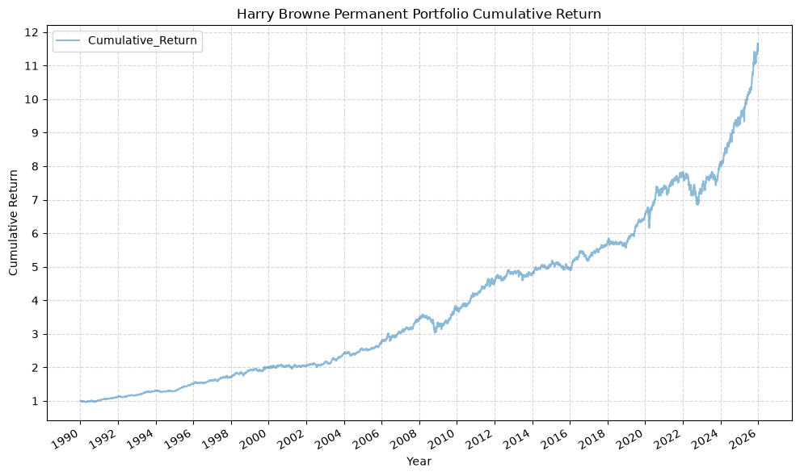
    


```python
plot_cumulative_return(strat)
```


    
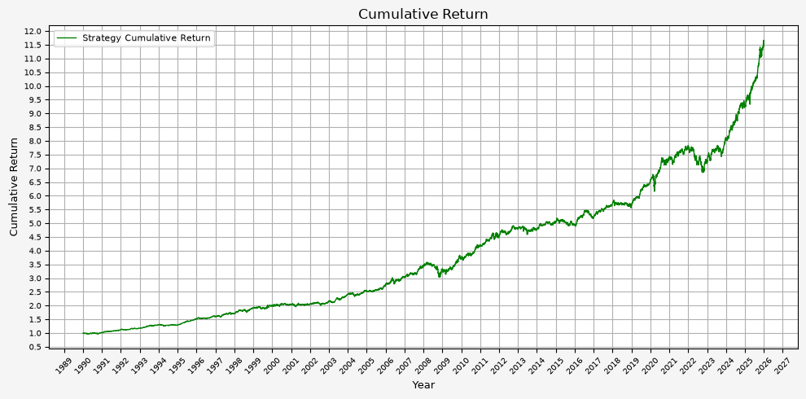
    


### Plot Portfolio & Component Values


```python
def plot_values(strat_df):
    # Generate plot
    plt.figure(figsize=(10, 5), facecolor = '#F5F5F5')

    # Plotting data
    plt.plot(strat_df.index, strat_df['Total_AA_$_Invested'], label='Total Portfolio Value', linestyle='-', color='black', linewidth=1)
    plt.plot(strat_df.index, strat_df['Stocks_AA_$_Invested'], label='Stocks Position Value', linestyle='-', color='orange', linewidth=1)
    plt.plot(strat_df.index, strat_df['Bonds_AA_$_Invested'], label='Bond Position Value', linestyle='-', color='yellow', linewidth=1)
    plt.plot(strat_df.index, strat_df['Gold_AA_$_Invested'], label='Gold Position Value', linestyle='-', color='blue', linewidth=1)
    plt.plot(strat_df.index, strat_df['Cash_AA_$_Invested'], label='Cash Position Value', linestyle='-', color='brown', linewidth=1)

    # Set X axis
    # x_tick_spacing = 5  # Specify the interval for x-axis ticks
    # plt.gca().xaxis.set_major_locator(MultipleLocator(x_tick_spacing))
    plt.gca().xaxis.set_major_locator(mdates.YearLocator())
    plt.gca().xaxis.set_major_formatter(mdates.DateFormatter('%Y'))
    plt.xlabel('Year', fontsize = 9)
    plt.xticks(rotation = 45, fontsize = 7)
    # plt.xlim(, )

    # Set Y axis
    y_tick_spacing = 5000  # Specify the interval for y-axis ticks
    plt.gca().yaxis.set_major_locator(MultipleLocator(y_tick_spacing))
    plt.gca().yaxis.set_major_formatter(mtick.FuncFormatter(lambda x, pos: '{:,.0f}'.format(x))) # Adding commas to y-axis labels
    plt.ylabel('Total Value ($)', fontsize = 9)
    plt.yticks(fontsize = 7)
    # plt.ylim(0, 75000)

    # Set title, etc.
    plt.title('Total Values For Stocks, Bonds, Gold, and Cash Positions and Portfolio', fontsize = 12)

    # Set the grid & legend
    plt.tight_layout()
    plt.grid(True)
    plt.legend(fontsize=8)

    # Save the figure
    plt.savefig('07_Portfolio_Values.png', dpi=300, bbox_inches='tight')

    # Display the plot
    return plt.show()
```


```python
plot_values(strat)
```


    
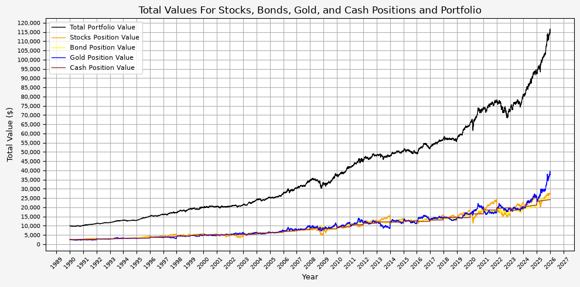
    


```python
plot_time_series(
    df=strat,
    plot_start_date=START_DATE,
    plot_end_date=END_DATE,
    plot_columns=["Total_AA_$_Invested", "Stocks_AA_$_Invested", "Bonds_AA_$_Invested", "Gold_AA_$_Invested", "Cash_AA_$_Invested"],
    title="Portfolio & Allocation Values",
    x_label="Year",
    x_format="Year",
    x_tick_spacing=2,
    x_tick_start=None,
    x_tick_rotation=30,
    y_label="Value ($)",
    y_format="Decimal",
    y_format_decimal_places="Auto",
    y_tick_spacing="Auto",
    y_tick_rotation=0,
    grid=True,
    legend=True,
    legend_location="upper left",
    export_plot=False,
)
```


    
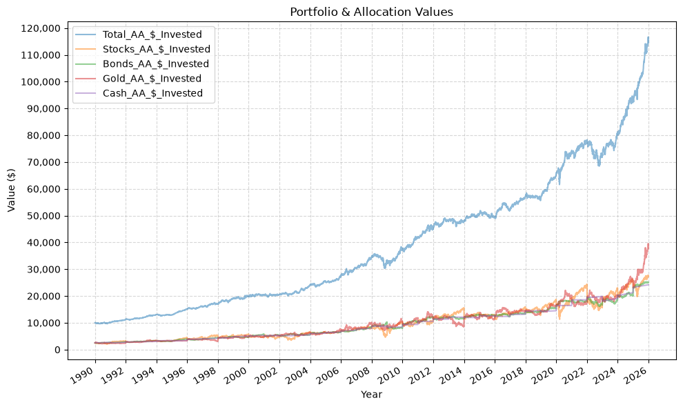
    


Here we can see the annual rebalancing taking effect with the values of the different asset classes. This can also be seen more clearly below.

### Plot Portfolio Drawdown


```python
def plot_drawdown(strat_df):
    rolling_max = strat_df['Total_AA_$_Invested'].cummax()
    drawdown = (strat_df['Total_AA_$_Invested'] - rolling_max) / rolling_max * 100

    # Generate plot
    plt.figure(figsize=(10, 5), facecolor = '#F5F5F5')

    # Plotting data
    plt.plot(strat_df.index, drawdown, label='Drawdown', linestyle='-', color='red', linewidth=1)

    # Set X axis
    # x_tick_spacing = 5  # Specify the interval for x-axis ticks
    # plt.gca().xaxis.set_major_locator(MultipleLocator(x_tick_spacing))
    plt.gca().xaxis.set_major_locator(mdates.YearLocator())
    plt.gca().xaxis.set_major_formatter(mdates.DateFormatter('%Y'))
    plt.xlabel('Year', fontsize = 9)
    plt.xticks(rotation = 45, fontsize = 7)
    # plt.xlim(, )

    # Set Y axis
    y_tick_spacing = 1  # Specify the interval for y-axis ticks
    plt.gca().yaxis.set_major_locator(MultipleLocator(y_tick_spacing))
    # plt.gca().yaxis.set_major_formatter(mtick.FuncFormatter(lambda x, pos: '{:,.0f}'.format(x))) # Adding commas to y-axis labels
    plt.gca().yaxis.set_major_formatter(mtick.FuncFormatter(lambda x, pos: '{:.0f}'.format(x))) # Adding 0 decimal places to y-axis labels
    plt.ylabel('Drawdown (%)', fontsize = 9)
    plt.yticks(fontsize = 7)
    # plt.ylim(-20, 0)

    # Set title, etc.
    plt.title('Portfolio Drawdown', fontsize = 12)

    # Set the grid & legend
    plt.tight_layout()
    plt.grid(True)
    plt.legend(fontsize=8)

    # Save the figure
    plt.savefig('08_Portfolio_Drawdown.png', dpi=300, bbox_inches='tight')

    # Display the plot
    return plt.show()
```


```python
plot_drawdown(strat)
```


    
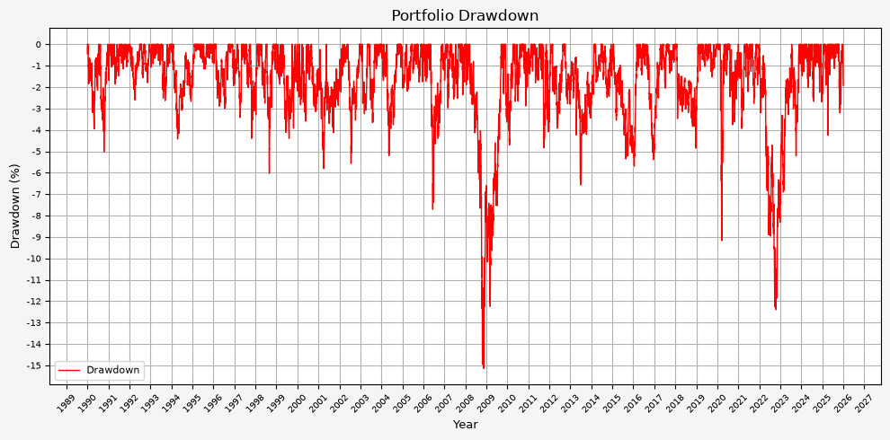
    


```python
rolling_max = strat['Total_AA_$_Invested'].cummax()
drawdown = (strat['Total_AA_$_Invested'] - rolling_max) / rolling_max

# Merge drawdown with the original dataframe
strat = strat.copy()
strat['Drawdown'] = drawdown

plot_time_series(
    df=strat,
    plot_start_date=START_DATE,
    plot_end_date=END_DATE,
    plot_columns=["Drawdown"],
    title="Portfolio Drawdown",
    x_label="Year",
    x_format="Year",
    x_tick_spacing=2,
    x_tick_start=None,
    x_tick_rotation=30,
    y_label="Drawdown (%)",
    y_format="Percentage",
    y_format_decimal_places=0,
    y_tick_spacing="Auto",
    y_tick_rotation=0,
    grid=True,
    legend=True,
    legend_location="lower left",
    export_plot=False,
)
```


    
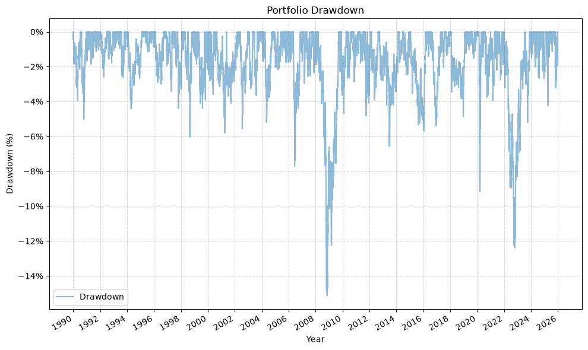
    


From this plot, we can see that the maximum drawdown came during the GFC; the drawdown during COVID was (interestingly) less than 10%.

### Plot Asset Weights


```python
def plot_asset_weights(strat_df):
    # Generate plot
    plt.figure(figsize=(10, 5), facecolor = '#F5F5F5')

    # Plotting data
    plt.plot(strat_df.index, strat_df['Stocks_AA_Port_%'] * 100, label='Stocks Portfolio Weight', linestyle='-', color='orange', linewidth=1)
    plt.plot(strat_df.index, strat_df['Bonds_AA_Port_%'] * 100, label='Bonds Portfolio Weight', linestyle='-', color='yellow', linewidth=1)
    plt.plot(strat_df.index, strat_df['Gold_AA_Port_%'] * 100, label='Gold Portfolio Weight', linestyle='-', color='blue', linewidth=1)
    plt.plot(strat_df.index, strat_df['Cash_AA_Port_%'] * 100, label='Cash Portfolio Weight', linestyle='-', color='brown', linewidth=1)

    # Set X axis
    # x_tick_spacing = 5  # Specify the interval for x-axis ticks
    # plt.gca().xaxis.set_major_locator(MultipleLocator(x_tick_spacing))
    plt.gca().xaxis.set_major_locator(mdates.YearLocator())
    plt.gca().xaxis.set_major_formatter(mdates.DateFormatter('%Y'))
    plt.xlabel('Year', fontsize = 9)
    plt.xticks(rotation = 45, fontsize = 7)
    # plt.xlim(, )

    # Set Y axis
    y_tick_spacing = 1  # Specify the interval for y-axis ticks
    plt.gca().yaxis.set_major_locator(MultipleLocator(y_tick_spacing))
    # plt.gca().yaxis.set_major_formatter(mtick.FuncFormatter(lambda x, pos: '{:,.0f}'.format(x))) # Adding commas to y-axis labels
    plt.ylabel('Asset Weight (%)', fontsize = 9)
    plt.yticks(fontsize = 7)
    # plt.ylim(14, 36)

    # Set title, etc.
    plt.title('Portfolio Asset Weights For Stocks, Bonds, Gold, and Cash Positions', fontsize = 12)

    # Set the grid & legend
    plt.tight_layout()
    plt.grid(True)
    plt.legend(fontsize=8)

    # Save the figure
    plt.savefig('09_Portfolio_Weights.png', dpi=300, bbox_inches='tight')

    # Display the plot
    return plt.show()
```


```python
plot_asset_weights(strat)
```


    
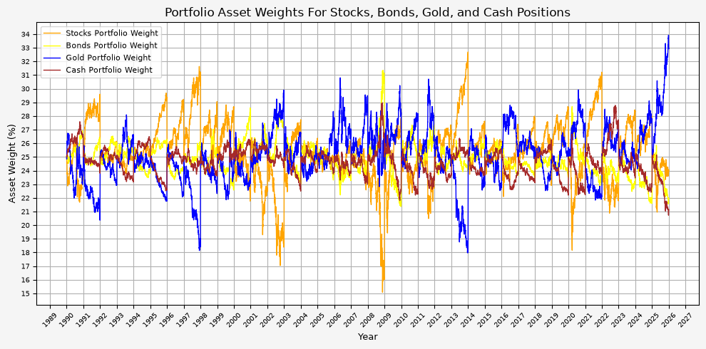
    


```python
plot_time_series(
    df=strat,
    plot_start_date=START_DATE,
    plot_end_date=END_DATE,
    plot_columns=["Stocks_AA_Port_%", "Bonds_AA_Port_%", "Gold_AA_Port_%", "Cash_AA_Port_%"],
    title="Portfolio Allocation Percentages",
    x_label="Year",
    x_format="Year",
    x_tick_spacing=2,
    x_tick_start=None,
    x_tick_rotation=30,
    y_label="Allocation (%)",
    y_format="Percentage",
    y_format_decimal_places=0,
    y_tick_spacing="Auto",
    y_tick_rotation=0,
    grid=True,
    legend=True,
    legend_location="upper left",
    export_plot=False,
)
```


    
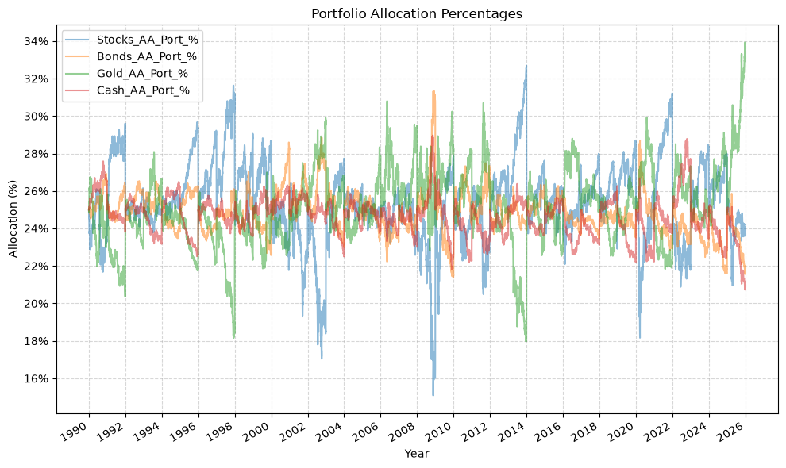
    


The annual rebalancing appears to work effectively by selling assets that have increased in value and buying assets that have decreased in value over the previous year. Also note that there is only one instance when the weight of an asset fell to 15%. This occured for stocks during the GFC.

### Plot Annual Returns


```python
def plot_annual_returns(return_df):
    # Generate plot
    plt.figure(figsize=(10, 5), facecolor = '#F5F5F5')

    # Plotting data
    plt.bar(return_df.index, return_df['Return'] * 100, label='Annual Returns', width=0.5)  # width adjusted for better spacing

    # Set X axis
    x_tick_spacing = 1  # Specify the interval for x-axis ticks
    plt.gca().xaxis.set_major_locator(MultipleLocator(x_tick_spacing))
    # plt.gca().xaxis.set_major_locator(mdates.YearLocator())
    # plt.gca().xaxis.set_major_formatter(mdates.DateFormatter('%Y'))
    plt.xlabel('Year', fontsize = 9)
    plt.xticks(rotation = 45, fontsize = 7)
    # plt.xlim(, )

    # Set Y axis
    y_tick_spacing = 1  # Specify the interval for y-axis ticks
    plt.gca().yaxis.set_major_locator(MultipleLocator(y_tick_spacing))
    # plt.gca().yaxis.set_major_formatter(mtick.FuncFormatter(lambda x, pos: '{:,.0f}'.format(x))) # Adding commas to y-axis labels
    plt.ylabel('Annual Return (%)', fontsize = 9)
    plt.yticks(fontsize = 7)
    # plt.ylim(-20, 20)

    # Set title, etc.
    plt.title('Portfolio Annual Returns', fontsize = 12)

    # Set the grid & legend
    plt.tight_layout()
    plt.grid(True)
    plt.legend(fontsize=8)

    # Save the figure
    plt.savefig('10_Portfolio_Annual_Returns.png', dpi=300, bbox_inches='tight')

    # Display the plot
    return plt.show()
```


```python
plot_annual_returns(strat_annual_returns_df)
```


    
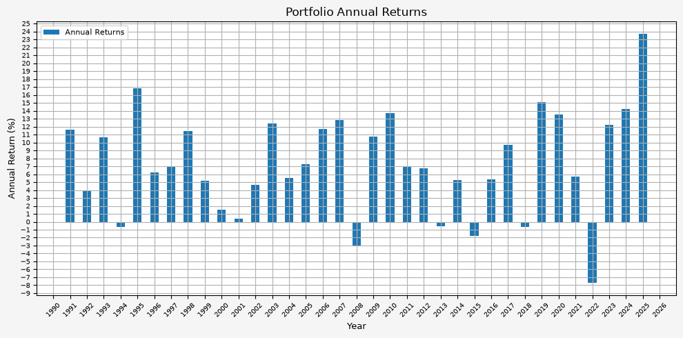
    


```python
plot_bar(
    df=strat_annual_returns_df.set_index(pd.to_datetime(strat_annual_returns_df.index, format="%Y")),
    plot_start_date=None,
    plot_end_date=None,
    plot_columns=["Return"],
    title="Annual Portfolio Returns",
    x_label="Year",
    x_format="Year",
    x_tick_spacing=2,
    x_tick_start=None,
    x_tick_rotation=30,
    y_label="Annual Return (%)",
    y_format="Percentage",
    y_format_decimal_places=0,
    y_tick_spacing=.05,
    y_tick_rotation=0,
    grid=True,
    legend=True,
)
```


    
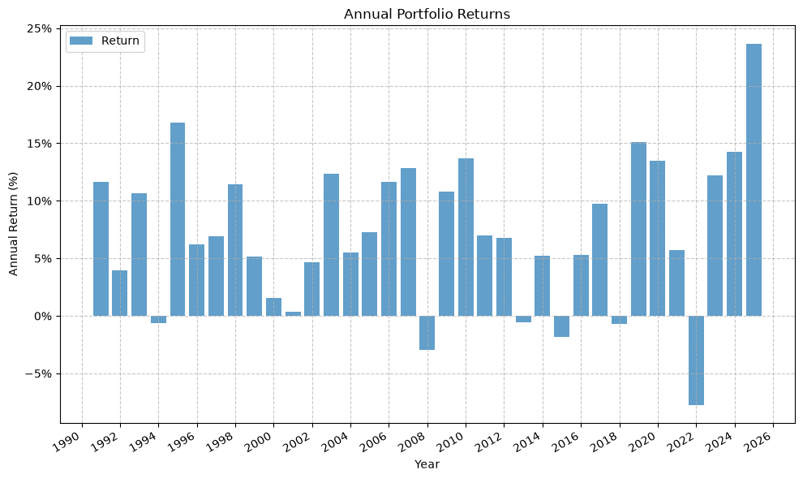
    


It's interesting to see that there really aren't any significant up or down years. Instead, it's a steady climb without much volatility.

## Varying The Asset Weights

Everything above uses Browne's equal split across the four assets, 25% for each. Here, we investigate varying the allocation to see if there are better alternatives that equal weight.

The `strategy_harry_brown_perm_port` function takes an optional `target_weights` argument for this. It maps each fund to its target weight, the weights have to sum to 1, and leaving it out gives the even split used above:


```python
# Target weights for the tilted portfolio
tilt_weights = {
    'Stocks': 0.30,
    'Bonds': 0.30,
    'Gold': 0.30,
    'Cash': 0.10,
}

strat_tilt = strategy_harry_brown_perm_port(
    fund_list=fund_list,
    starting_cash=starting_cash,
    cash_contrib=cash_contrib,
    close_prices_df=perm_port,
    rebal_month=1,
    rebal_day=1,
    rebal_per_high=1.40,
    rebal_per_low=0.60,
    excel_export=False,
    pickle_export=False,
    output_confirmation=True,
    target_weights=tilt_weights,
)

strat_tilt = strat_tilt.set_index('Date')
```

    Strategy complete for Stocks_Bonds_Gold_Cash


Because the bands are a multiple of each asset's target rather than a fixed share of the portfolio, cash is now rebalanced when it leaves the 6% to 14% range, while the other three are held to 18% to 42%. Had the bands stayed at a flat 15% and 35%, a 10% cash target would have sat below the lower bound permanently and forced a rebalance every single day.

Let's compare the summary statistics for the two allocations:


```python
weight_comparison = pd.concat([
    summary_stats(
        fund_list=fund_list,
        df=strat[['Return']],
        period="Daily",
        use_calendar_days=False,
        excel_export=False,
        pickle_export=False,
        output_confirmation=False,
    ).rename(index={'Return': '25/25/25/25'}),
    summary_stats(
        fund_list=fund_list,
        df=strat_tilt[['Return']],
        period="Daily",
        use_calendar_days=False,
        excel_export=False,
        pickle_export=False,
        output_confirmation=False,
    ).rename(index={'Return': '30/30/30/10'}),
])

display(weight_comparison)
```


<div>
<style scoped>
    .dataframe tbody tr th:only-of-type {
        vertical-align: middle;
    }

    .dataframe tbody tr th {
        vertical-align: top;
    }

    .dataframe thead th {
        text-align: right;
    }
</style>
<table border="1" class="dataframe">
  <thead>
    <tr style="text-align: right;">
      <th></th>
      <th>Number of Observations</th>
      <th>Data Start Date</th>
      <th>Data End Date</th>
      <th>Annual Mean Return (Arithmetic)</th>
      <th>Annualized Volatility</th>
      <th>Annualized Sharpe Ratio</th>
      <th>CAGR (Geometric)</th>
      <th>Daily Max Return</th>
      <th>Daily Max Return (Date)</th>
      <th>Daily Min Return</th>
      <th>Daily Min Return (Date)</th>
      <th>Max Drawdown</th>
      <th>Peak</th>
      <th>Trough</th>
      <th>Recovery Date</th>
      <th>Calendar Days to Recovery</th>
      <th>MAR Ratio</th>
    </tr>
  </thead>
  <tbody>
    <tr>
      <th>25/25/25/25</th>
      <td>8976</td>
      <td>1990-01-02</td>
      <td>2025-12-31</td>
      <td>0.070</td>
      <td>0.060</td>
      <td>1.162</td>
      <td>0.071</td>
      <td>0.029</td>
      <td>2020-03-24</td>
      <td>-0.030</td>
      <td>2020-03-12</td>
      <td>-0.151</td>
      <td>2008-03-18</td>
      <td>2008-11-12</td>
      <td>2009-09-16</td>
      <td>308</td>
      <td>0.468</td>
    </tr>
    <tr>
      <th>30/30/30/10</th>
      <td>8976</td>
      <td>1990-01-02</td>
      <td>2025-12-31</td>
      <td>0.079</td>
      <td>0.073</td>
      <td>1.083</td>
      <td>0.079</td>
      <td>0.035</td>
      <td>2020-03-24</td>
      <td>-0.036</td>
      <td>2020-03-12</td>
      <td>-0.183</td>
      <td>2008-03-18</td>
      <td>2008-11-12</td>
      <td>2009-10-06</td>
      <td>328</td>
      <td>0.432</td>
    </tr>
  </tbody>
</table>
</div>


The tilted portfolio provides a higher return, but with slightly higher risk metrics. It would be up to the individual investor to decide if the extra return is worth the additional risk, but personally, I would be in favor of the tilted portfolio.

This is worth discussing, because it is the opposite of what the first version of this post concluded. When cash was modeled as earning nothing, the two allocations looked equivalent on a risk adjusted basis, and cutting cash appeared to be a free way to scale the portfolio up. Once cash earns the Treasury bill rate, the 15% being moved out of it is no longer dead weight, and giving it up costs more than the extra risk earns back. The tilt buys a higher absolute return, but it pays for that return at a worse rate than the portfolio it started from.

The general lesson is that an incomplete backtest can provide a skewed perspective on performance.

Plotting the two cumulative return streams against one another shows the same thing:


```python
def plot_weight_comparison(base_df, tilt_df):
    # Generate plot
    plt.figure(figsize=(10, 5), facecolor = '#F5F5F5')

    # Plotting data
    plt.plot(base_df.index, base_df['Cumulative_Return'], label = '25/25/25/25', linestyle='-', color='green', linewidth=1)
    plt.plot(tilt_df.index, tilt_df['Cumulative_Return'], label = '30/30/30/10', linestyle='-', color='purple', linewidth=1)

    # Set X axis
    plt.gca().xaxis.set_major_locator(mdates.YearLocator())
    plt.gca().xaxis.set_major_formatter(mdates.DateFormatter('%Y'))
    plt.xlabel('Year', fontsize = 9)
    plt.xticks(rotation = 45, fontsize = 7)

    # Set Y axis
    y_tick_spacing = 0.5  # Specify the interval for y-axis ticks
    plt.gca().yaxis.set_major_locator(MultipleLocator(y_tick_spacing))
    plt.ylabel('Cumulative Return', fontsize = 9)
    plt.yticks(fontsize = 7)

    # Set title, etc.
    plt.title('Cumulative Return By Asset Weighting', fontsize = 12)

    # Set the grid & legend
    plt.tight_layout()
    plt.grid(True)
    plt.legend(fontsize=8)

    # Save the figure
    plt.savefig('11_Weight_Comparison.png', dpi=300, bbox_inches='tight')

    # Display the plot
    return plt.show()
```


```python
plot_weight_comparison(strat, strat_tilt)
```


    
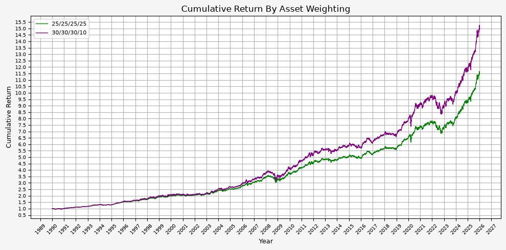
    


```python
base = strat[["Cumulative_Return"]].rename(columns={"Cumulative_Return": "Base_Cumulative_Return"})
tilt = strat_tilt[["Cumulative_Return"]].rename(columns={"Cumulative_Return": "Tilt_Cumulative_Return"})

combined = base.merge(tilt, left_index=True, right_index=True, how="outer")

plot_time_series(
    df=combined,
    plot_start_date=START_DATE,
    plot_end_date=END_DATE,
    plot_columns=["Base_Cumulative_Return", "Tilt_Cumulative_Return"],
    title="Harry Browne Permanent Portfolio Cumulative Return",
    x_label="Year",
    x_format="Year",
    x_tick_spacing=2,
    x_tick_start=None,
    x_tick_rotation=30,
    y_label="Cumulative Return",
    y_format="Decimal",
    y_format_decimal_places="Auto",
    y_tick_spacing="Auto",
    y_tick_rotation=0,
    grid=True,
    legend=True,
    legend_location="upper left",
    export_plot=False,
)
```


    
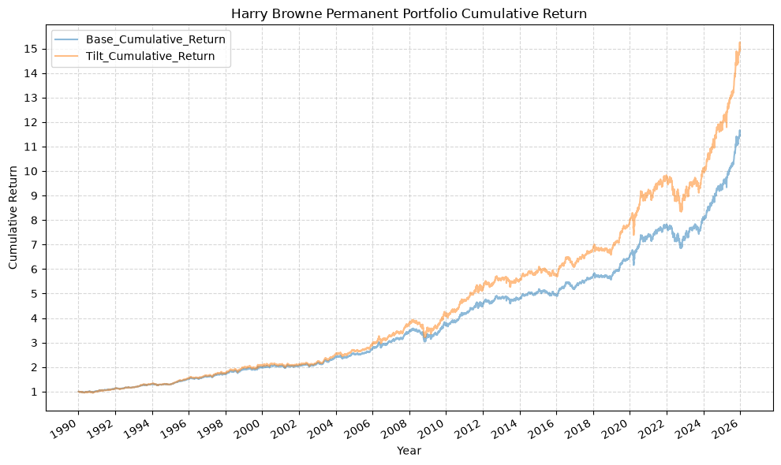
    


The two lines track each other closely throughout, with the tilted version pulling ahead gradually and giving back more in each of the drawdowns. There is no period where one is doing something structurally different from the other, which is what you might expect given that the underlying assets and the rebalancing rule are identical and only the allocation has changed.

## Conclusion

Overall, this is an interesting case study and Browne's idea behind the Permanent Portfolio is certainly compelling. While the portfolio returns are not necessarily the highest, its stability and risk-adjusted performance make it an attractive option for long-term investors.

## Future Investigation

There is more investigation to be done with respect to the following:

1. Investigate the extent to which the rebalancing date effects the portfolio performance.
2. Vary the weights of the asset classes further. The 30/30/30/10 case above comes out behind the even split on both Sharpe and MAR, which raises the question of whether any allocation of these four assets beats 25% each on a risk adjusted basis.
3. Use ETFs instead of Bloomberg index data, and verify the results are similar. ETF data is much more available than the Bloomberg index.

## References

1. "Fail-Safe Investing: Lifelong Financial Security in 30 Minutes", by Harry Browne
2. [Harry Browne](https://en.wikipedia.org/wiki/Harry_Browne) on Wikipedia
3. [3-Month Treasury Constant Maturity Rate (DGS3MO)](https://fred.stlouisfed.org/series/DGS3MO), Federal Reserve Bank of St. Louis
4. [Reusable & Extensible Python Functions For Financial Data Analysis](/posts/reusable-extensible-python-functions-financial-data-analysis/)

## Code


